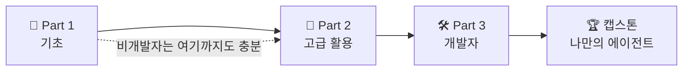

---
{"dg-publish":true,"permalink":"/ai-technique/claude/0-claude-ai/","dg-note-properties":{}}
---

<aside>  
🧭

**이 강좌는 누구를 위한 것인가요?**

Claude를 처음 만나는 **초급 사용자**, Projects·Skills·MCP로 업무를 자동화하려는 **파워 유저**, 그리고 Claude API와 에이전트를 직접 만들려는 **초보 개발자**까지 — 한 권으로 끝까지 안내하는 단계별 교재입니다.

</aside>

<aside>  
🌱

**Part 1 · 기초**

Claude와 첫 대화, 프롬프트의 원리, 파일·이미지·Artifacts 활용

</aside>

<aside>  
🚀

**Part 2 · 고급 활용**

Projects, 메모리, Skills, MCP·커넥터, 리서치와 에이전트형 작업

</aside>

<aside>  
🛠️

**Part 3 · 개발자**

Claude API, Tool Use, 캐싱·배치, MCP 서버 개발, Claude Code·Agent SDK

</aside>

---

## 📑 목차

---

## 1. 강좌 소개

> "좋은 도구는 손의 연장이고, 좋은 AI는 생각의 연장이다."

Claude는 Anthropic이 만든 대규모 언어 모델(LLM) 기반 AI 어시스턴트입니다. 이 강좌는 Claude를 **"질문에 답하는 챗봇"**에서 출발해 **"내 업무를 대신 수행하는 동료"**, 나아가 **"내가 만든 서비스의 두뇌"**로 활용하기까지의 전 과정을 다룹니다.

### 1.1 학습 목표

이 강좌를 마치면 여러분은 다음을 할 수 있습니다.

- [ ] Claude의 작동 원리(토큰, 컨텍스트 윈도우, 모델 패밀리)를 설명할 수 있다
- [ ] 역할·맥락·형식·예시를 갖춘 **구조화된 프롬프트**를 작성할 수 있다
- [ ] Projects와 Skills로 반복 업무를 **재사용 가능한 자산**으로 만들 수 있다
- [ ] MCP 커넥터로 Claude를 Notion·Google Drive·GitHub 같은 도구와 연결할 수 있다
- [ ] Python/TypeScript로 Claude API를 호출하고 **스트리밍·Tool Use**를 구현할 수 있다
- [ ] 나만의 MCP 서버와 에이전트를 만들어 배포할 수 있다

### 1.2 학습 로드맵

|단계|대상|핵심 주제|예상 학습 시간|
|---|---|---|---|
|🌱 Part 1|누구나|Claude 이해, 프롬프트 기초, 파일·Artifacts|약 4시간|
|🚀 Part 2|업무에 깊이 활용하려는 사용자|Projects, 메모리, Skills, MCP, Research|약 6시간|
|🛠️ Part 3|초보 개발자 이상|API, Tool Use, 캐싱, MCP 서버, Claude Code, Agent SDK|약 12시간|
|📚 부록|모두|용어집, 치트시트, 참고 자료|수시 참고|

### 1.3 이 교재의 표기법

<aside>  
💡

**TIP** — 바로 써먹을 수 있는 실전 요령

</aside>

<aside>  
⚠️

**주의** — 흔히 하는 실수와 보안상 유의점

</aside>

<aside>  
🧪

**실습** — 직접 따라 해보는 과제

</aside>

<aside>  
🔍

**심화** — 더 깊이 알고 싶은 분을 위한 내용

</aside>

- `코드 서체` 는 명령어, 파일명, 파라미터를 의미합니다.
- **주황색 굵은 글씨**는 개발자 전용 내용, **보라색**은 고급 사용자 내용입니다.
- ~~취소선~~은 더 이상 권장되지 않는 예전 방식을 뜻합니다.

---

## 2. 커리큘럼

<aside>  
📌

각 장은 아래 하위 페이지로 구성되어 있습니다. 순서대로 학습하는 것을 권장하지만, 개발자라면 Part 1의 3장(프롬프트)만 읽고 Part 3로 바로 넘어가도 좋습니다.

</aside>

### 🌱 Part 1 · 기초 — 누구나

[1장. Claude란 무엇인가](https://app.notion.com/p/1-Claude-4127dbaee6b6811ebb16df04dbeb3fc6?pvs=21)

[2장. 시작하기 — 첫 대화와 인터페이스](https://app.notion.com/p/2-4127dbaee6b681048258f184d822d71d?pvs=21)

[3장. 프롬프트 엔지니어링 기초](https://app.notion.com/p/3-4127dbaee6b681e0908ae5bad864e5a3?pvs=21)

[4장. 파일·이미지·Artifacts 활용](https://app.notion.com/p/4-Artifacts-4127dbaee6b681b2bd21d71e26fdf91a?pvs=21)

### 🚀 Part 2 · 고급 활용 — 파워 유저

[5장. Projects와 메모리 — 나만의 작업 공간](https://app.notion.com/p/5-Projects-4127dbaee6b68193992dc0bcffe707c8?pvs=21)

[6장. Skills — Claude에게 전문 기술 가르치기](https://app.notion.com/p/6-Skills-Claude-4127dbaee6b681f98d4ae5c0ffe49bd6?pvs=21)

[7장. MCP와 커넥터 — Claude를 세상과 연결하기](https://app.notion.com/p/7-MCP-Claude-4127dbaee6b6816ca363ffb845360213?pvs=21)

[8장. Research·웹 검색·에이전트형 작업](https://app.notion.com/p/8-Research-4127dbaee6b681a2a313e9a5c6ac9008?pvs=21)

### 🛠️ Part 3 · 개발자 — 샘플 코드 포함

[9장. 개발 환경 준비와 첫 API 호출](https://app.notion.com/p/9-API-4127dbaee6b68106b55fe4d9887287a3?pvs=21)

[10장. Messages API 심화](https://app.notion.com/p/10-Messages-API-4127dbaee6b681daa9e3d9794ede2bc7?pvs=21)

[11장. Tool Use와 에이전트 루프](https://app.notion.com/p/11-Tool-Use-4127dbaee6b681e68d2df25eae95e77d?pvs=21)

[12장. 비용과 성능 최적화 — 캐싱·배치·토큰 관리](https://app.notion.com/p/12-4127dbaee6b6810f8f6be0a49040ad1e?pvs=21)

[13장. 나만의 MCP 서버 만들기](https://app.notion.com/p/13-MCP-4127dbaee6b681fda5a3c0024b1788bf?pvs=21)

[14장. Claude Code와 Agent SDK](https://app.notion.com/p/14-Claude-Code-Agent-SDK-4127dbaee6b681f29be8d4a2f9080ff6?pvs=21)

[15장. 프로덕션 가이드 — 평가·안전·운영](https://app.notion.com/p/15-4127dbaee6b68164b233df257c86aa05?pvs=21)

### 📚 부록

[부록. 용어집·치트시트·참고 자료](https://app.notion.com/p/4127dbaee6b681358ba1facfc6be6936?pvs=21)

---

## 3. 학습 진도 관리

아래 데이터베이스에서 각 장의 **상태**를 바꾸고 **실습 완료**를 체크하며 진도를 관리하세요. 보드 보기로 바꾸면 칸반처럼 볼 수 있습니다.

[📊 학습 진도 트래커](https://app.notion.com/p/84e03709a325468f8c6228af43e79b59?pvs=21)

---

### ℹ️ 버전 정보와 업데이트 정책

- 기준일: 2026년 11월 8일
- 작성자: @goose
- AI 분야는 변화가 매우 빠릅니다. 모델 이름·가격·기능은 반드시 [Anthropic 공식 문서](https://docs.claude.com)에서 최신 정보를 확인하세요.
- 본문의 샘플 코드는 Python SDK `anthropic`, TypeScript SDK `@anthropic-ai/sdk` 최신 버전을 기준으로 합니다.