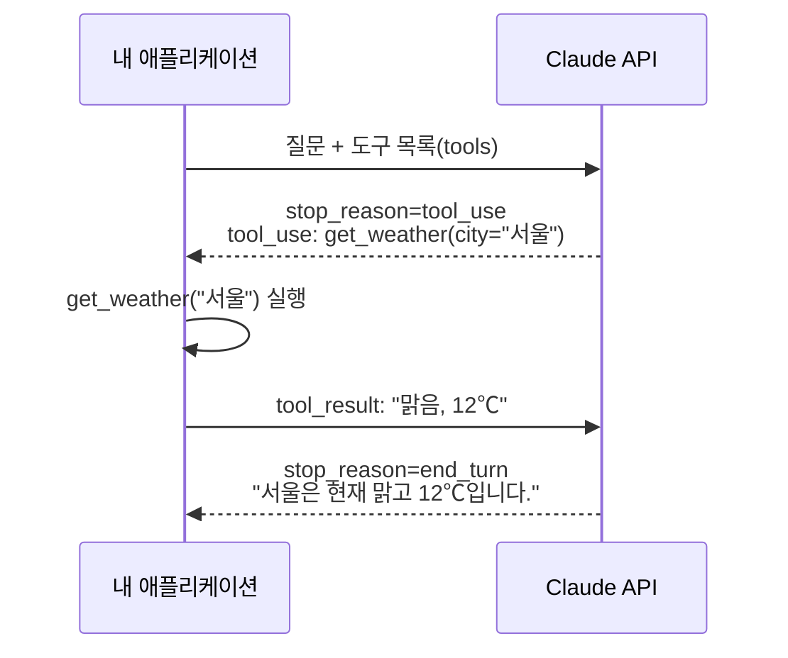

---
{"dg-publish":true,"permalink":"/ai-technique/claude/11-tool-use/","dg-note-properties":{}}
---


<aside>  
🛠️

**Part 3 · 개발자** — Claude가 여러분의 함수(날씨 조회, DB 검색, 주문 생성 등)를 호출하게 만드는 **Tool Use(Function Calling)**와, 이를 반복해 스스로 문제를 푸는 **에이전트 루프**를 구현합니다.

</aside>

## 11.1 Tool Use의 원리

Claude는 직접 함수를 실행하지 않습니다. "이 도구를 이 인자로 호출해 달라"고 **요청**하면, 여러분의 코드가 실행하고 결과를 돌려줍니다.



## 11.2 도구 정의하기

도구는 **이름 + 설명 + 입력 스키마(JSON Schema)**로 정의합니다. 설명은 Claude가 "언제, 어떻게" 쓸지 판단하는 유일한 단서이므로 신입사원에게 설명하듯 자세히 쓰세요.

```python
tools = [
    {
        "name": "get_weather",
        "description": (
            "지정한 도시의 현재 날씨를 조회한다. 사용자가 날씨, 기온, 우산 필요 여부 등을 물을 때 사용한다. "
            "미래 예보는 제공하지 않는다."
        ),
        "input_schema": {
            "type": "object",
            "properties": {
                "city": {"type": "string", "description": "도시 이름 (예: 서울, 부산, Tokyo)"},
                "unit": {"type": "string", "enum": ["celsius", "fahrenheit"]},
            },
            "required": ["city"],
            "additionalProperties": False,
        },
        "strict": True,   # 입력이 스키마를 정확히 따르도록 보장
    },
]
```

## 11.3 에이전트 루프 직접 구현하기

아래는 실무에서 그대로 확장할 수 있는 **완전한 에이전트 루프**입니다. Claude가 더 이상 도구를 호출하지 않을 때까지 반복합니다.

```python
import json
import anthropic

client = anthropic.Anthropic()

# 1) 실제 도구 구현 (예제용 가짜 데이터)
def get_weather(city: str, unit: str = "celsius") -> dict:
    fake = {"서울": 12, "부산": 16, "Tokyo": 14}
    return {"city": city, "temp": fake.get(city, 20), "unit": unit, "sky": "맑음"}

def search_orders(customer_id: str) -> list[dict]:
    return [{"order_id": "A-1001", "status": "배송 중", "eta": "2026-11-10"}]

TOOL_IMPL = {"get_weather": get_weather, "search_orders": search_orders}

tools = [
    {
        "name": "get_weather",
        "description": "도시의 현재 날씨를 조회한다.",
        "input_schema": {
            "type": "object",
            "properties": {"city": {"type": "string"}, "unit": {"type": "string", "enum": ["celsius", "fahrenheit"]}},
            "required": ["city"],
        },
    },
    {
        "name": "search_orders",
        "description": "고객 ID로 최근 주문과 배송 상태를 조회한다.",
        "input_schema": {
            "type": "object",
            "properties": {"customer_id": {"type": "string"}},
            "required": ["customer_id"],
        },
    },
]

def run_agent(user_input: str, max_turns: int = 10) -> str:
    messages = [{"role": "user", "content": user_input}]

    for _ in range(max_turns):                       # 무한 루프 방지
        response = client.messages.create(
            model="claude-opus-5-5",
            max_tokens=16000,
            system="너는 쇼핑몰 고객지원 에이전트야. 필요하면 도구를 사용해 정확한 정보로 답해.",
            tools=tools,
            messages=messages,
        )

        # assistant 응답(도구 호출 포함)을 그대로 대화에 추가
        messages.append({"role": "assistant", "content": response.content})

        if response.stop_reason != "tool_use":
            return next((b.text for b in response.content if b.type == "text"), "")

        # 2) 요청된 모든 도구를 실행하고 결과를 하나의 user 메시지로 묶어 반환
        tool_results = []
        for block in response.content:
            if block.type != "tool_use":
                continue
            try:
                result = TOOL_IMPL[block.name](**block.input)
                tool_results.append({
                    "type": "tool_result",
                    "tool_use_id": block.id,
                    "content": json.dumps(result, ensure_ascii=False),
                })
            except Exception as e:                      # 실패도 반드시 알려줌
                tool_results.append({
                    "type": "tool_result",
                    "tool_use_id": block.id,
                    "content": f"오류: {e}",
                    "is_error": True,
                })
        messages.append({"role": "user", "content": tool_results})

    return "최대 턴 수를 초과했습니다."

print(run_agent("고객번호 C-77인데 주문 언제 와요? 그리고 그날 부산 날씨는 어때요?"))
```

<aside>  
🔑

**에이전트 루프의 4가지 핵심 규칙**

1. assistant 응답은 텍스트만이 아니라 **`response.content` 전체**를 대화에 넣는다.
2. `tool_result` 의 `tool_use_id` 는 반드시 대응하는 `tool_use.id` 와 같아야 한다.
3. 병렬 호출된 여러 도구의 결과는 **하나의 user 메시지**에 모아서 보낸다.
4. 실패한 도구는 빼지 말고 `is_error: true` 로 알려 Claude가 대응하게 한다.  
    </aside>

## 11.4 Tool Runner — 루프를 SDK에 맡기기

직접 루프를 짜는 대신 SDK의 **Tool Runner(베타)**를 쓰면 함수만 정의하면 됩니다. 타입 힌트와 docstring에서 스키마가 자동 생성됩니다.

Python

```python
import anthropic
from anthropic import beta_tool

client = anthropic.Anthropic()

@beta_tool
def get_weather(city: str, unit: str = "celsius") -> str:
    """도시의 현재 날씨를 조회한다.

    Args:
        city: 도시 이름 (예: 서울)
        unit: celsius 또는 fahrenheit
    """
    return f"{city}: 맑음, 12도"

runner = client.beta.messages.tool_runner(
    model="claude-opus-5-5",
    max_tokens=16000,
    tools=[get_weather],
    messages=[{"role": "user", "content": "서울이랑 부산 날씨 비교해줘"}],
)

final = runner.until_done()      # 도구 호출이 끝날 때까지 자동 반복
print(next(b.text for b in final.content if b.type == "text"))
```

TypeScript

```tsx
import Anthropic from "@anthropic-ai/sdk";
import { betaZodTool } from "@anthropic-ai/sdk/helpers/beta/zod";
import { z } from "zod";

const client = new Anthropic();

const getWeather = betaZodTool({
  name: "get_weather",
  description: "도시의 현재 날씨를 조회한다.",
  inputSchema: z.object({ city: z.string().describe("도시 이름") }),
  run: async ({ city }) => `${city}: 맑음, 12도`,
});

const final = await client.beta.messages.toolRunner({
  model: "claude-opus-5-5",
  max_tokens: 16000,
  tools: [getWeather],
  messages: [{ role: "user", content: "서울이랑 부산 날씨 비교해줘" }],
});

for (const block of final.content) {
  if (block.type === "text") console.log(block.text);
}
```

## 11.5 서버 도구 — Anthropic이 실행해주는 도구

일부 도구는 Anthropic 인프라에서 실행되므로 구현이 필요 없습니다. `tools` 에 선언만 하면 됩니다.

|도구|용도|
|---|---|
|웹 검색 (`web_search`)|최신 정보를 검색하고 인용과 함께 답변|
|웹 페치 (`web_fetch`)|대화에 등장한 URL의 내용을 가져옴|
|코드 실행 (`code_execution`)|샌드박스에서 코드 실행, 데이터 분석, 파일 생성|
|도구 검색 (`tool_search`)|수백 개의 도구 중 필요한 것만 동적으로 로드|

```python
response = client.messages.create(
    model="claude-opus-5-5",
    max_tokens=16000,
    tools=[{"type": "web_search_20260209", "name": "web_search", "max_uses": 5}],
    messages=[{"role": "user", "content": "이번 주 발표된 AI 관련 주요 뉴스 3개를 출처와 함께 알려줘"}],
)
```

## 11.6 좋은 도구 설계 원칙

<aside>  
✅

**DO**

- 설명에 언제 쓰고 언제 쓰지 말지 적기
- 여러 API를 묶은 **의미 단위** 도구 (예: `schedule_meeting`)
- 에러 메시지를 사람이 읽을 수 있게 반환
- 결과는 필요한 필드만 간결하게  
    </aside>

<aside>  
❌

**DON'T**

- `do_stuff` 같은 모호한 이름
- 수백 KB의 원시 JSON을 그대로 반환
- 기능이 겹치는 도구 여러 개
- 삭제·결제 도구를 승인 절차 없이 제공  
    </aside>

---

## 🧪 실습 11 — 미니 프로젝트: 사내 도우미 에이전트

- [ ] `search_docs(query)`, `create_ticket(title, body)` 두 도구를 가진 에이전트 만들기
- [ ] `create_ticket` 실행 전에 터미널에서 `y/n` 승인을 받도록 구현하기 (Human-in-the-loop)
- [ ] 도구가 일부러 예외를 던지게 하고 Claude가 어떻게 대응하는지 관찰하기