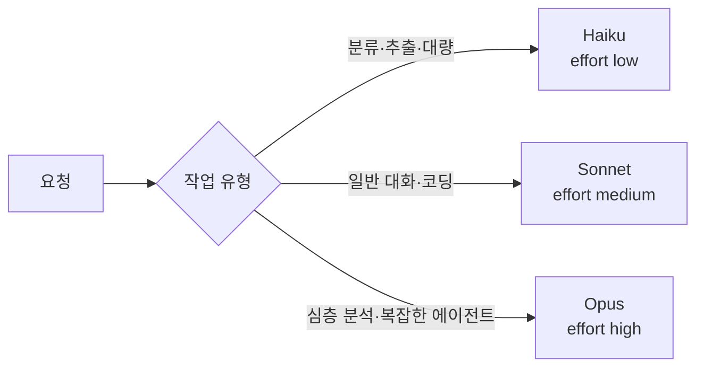

---
{"dg-publish":true,"permalink":"/ai-technique/claude/12/","dg-note-properties":{}}
---


<aside>  
🛠️

**Part 3 · 개발자** — 같은 품질을 더 싸고 빠르게. 프롬프트 캐싱, 배치 처리, 토큰 카운팅, 모델·effort 선택으로 비용을 크게 줄이는 방법을 배웁니다.

</aside>

## 12.1 최적화 우선순위

|순서|방법|효과|품질 영향|
|---|---|---|---|
|1|**프롬프트 캐싱**|반복되는 입력 비용 최대 약 90% 절감, 지연 시간 단축|없음|
|2|**배치 API**|비실시간 작업 50% 할인|없음 (대신 비동기)|
|3|**출력·입력 다이어트**|불필요한 컨텍스트와 장황한 출력 제거|대체로 없음|
|4|**effort 조절**|사고 토큰 절감|작업에 따라 있음 — 측정 필수|
|5|**모델 변경**|단가 자체를 낮춤|있음 — 평가셋으로 검증|

<aside>  
💡

**요청 단가가 아니라 "작업 완료당 비용"으로 판단하세요.** 싼 모델이 재시도나 추가 턴을 더 많이 요구하면 결국 더 비쌀 수 있습니다.

</aside>

## 12.2 프롬프트 캐싱

긴 시스템 프롬프트, 문서, 도구 정의처럼 **매 요청마다 반복되는 앞부분(prefix)**을 캐시에 저장해 재사용합니다.

$$  
\text{캐시 읽기 비용} \approx 0.1 \times \text{일반 입력 단가}, \quad \text{캐시 쓰기 비용} \approx 1.25 \times \text{일반 입력 단가}  
$$

```python
LONG_MANUAL = open("product_manual.md", encoding="utf-8").read()   # 수만 토큰 분량

response = client.messages.create(
    model="claude-opus-5-5",
    max_tokens=2048,
    system=[
        {"type": "text", "text": "너는 제품 매뉴얼 기반 상담사야."},
        {
            "type": "text",
            "text": LONG_MANUAL,
            "cache_control": {"type": "ephemeral"},   # 여기까지를 캐시 (기본 5분 TTL)
        },
    ],
    messages=[{"role": "user", "content": "필터 교체 주기가 어떻게 돼요?"}],
)

u = response.usage
print("캐시 쓰기:", u.cache_creation_input_tokens)
print("캐시 읽기:", u.cache_read_input_tokens)    # 두 번째 요청부터 값이 커져야 정상
print("일반 입력:", u.input_tokens)
```

<aside>  
⚠️

**캐시가 조용히 깨지는 원인**

캐싱은 **접두사 일치(prefix match)**입니다. 앞부분이 1바이트만 달라도 그 뒤는 모두 무효가 됩니다.

- 시스템 프롬프트에 현재 시각(`datetime.now()`)이나 요청 ID를 넣음
- 도구 목록 순서가 요청마다 바뀜
- 정렬되지 않은 JSON(`json.dumps` 의 키 순서)

→ 변하지 않는 내용을 앞에, 변하는 내용을 뒤에 배치하세요. 렌더링 순서는 `tools → system → messages` 입니다.

</aside>

## 12.3 배치 API — 50% 할인

수천 건의 리뷰 분류, 문서 요약, 데이터 라벨링처럼 **즉시 응답이 필요 없는 작업**은 배치로 보내세요. 대부분 1시간 이내에 완료되며, 최대 24시간까지 걸릴 수 있습니다.

```python
import time
import anthropic

client = anthropic.Anthropic()
reviews = ["배송이 빨라요", "색이 사진과 달라요", "그냥 그래요"]  # 실제로는 수천 건

batch = client.messages.batches.create(
    requests=[
        {
            "custom_id": f"review-{i}",          # 결과를 매칭할 고유 ID
            "params": {
                "model": "claude-opus-5-5",
                "max_tokens": 256,
                "output_config": {"effort": "low"},
                "messages": [{"role": "user", "content": f"긍정/부정/중립 중 하나로만 답해: {text}"}],
            },
        }
        for i, text in enumerate(reviews)
    ]
)

# 완료될 때까지 대기
while client.messages.batches.retrieve(batch.id).processing_status != "ended":
    time.sleep(60)

# 결과는 순서가 보장되지 않으므로 custom_id로 매칭
for result in client.messages.batches.results(batch.id):
    if result.result.type == "succeeded":
        text = next(b.text for b in result.result.message.content if b.type == "text")
        print(result.custom_id, "→", text)
    else:
        print(result.custom_id, "실패:", result.result.type)
```

## 12.4 토큰 수 미리 세기

요청을 보내기 전에 입력 토큰 수를 정확히 계산해 비용을 예측하거나 컨텍스트 한도를 점검할 수 있습니다. 다른 회사의 토크나이저(tiktoken 등)는 정확하지 않으니 쓰지 마세요.

```python
count = client.messages.count_tokens(
    model="claude-opus-5-5",
    system="너는 번역가야.",
    messages=[{"role": "user", "content": open("novel.txt", encoding="utf-8").read()}],
)
print("입력 토큰:", count.input_tokens)
```

## 12.5 모델 라우팅 전략



<aside>  
🔍

**심화** — 여러 모델을 섪기 전에 "_가장 좋은 모델을 낮은 effort로_" 먼저 측정해보세요. 최신 모델의 낮은 effort가 구세대 모델의 높은 effort보다 좋은 경우가 많고, 모델을 하나로 유지하면 캐시도 공유됩니다(캐시는 모델별로 분리됩니다).

</aside>

---

## 🧪 실습 12

- [ ] 10장 챗봇의 시스템 프롬프트에 캐싱을 적용하고 `cache_read_input_tokens` 확인하기
- [ ] CSV의 문장 100개를 배치 API로 분류하고, 일반 호출 대비 비용 비교하기
- [ ] 같은 작업을 effort `low`/`medium`/`high` 로 실행해 품질·토큰 표 만들기