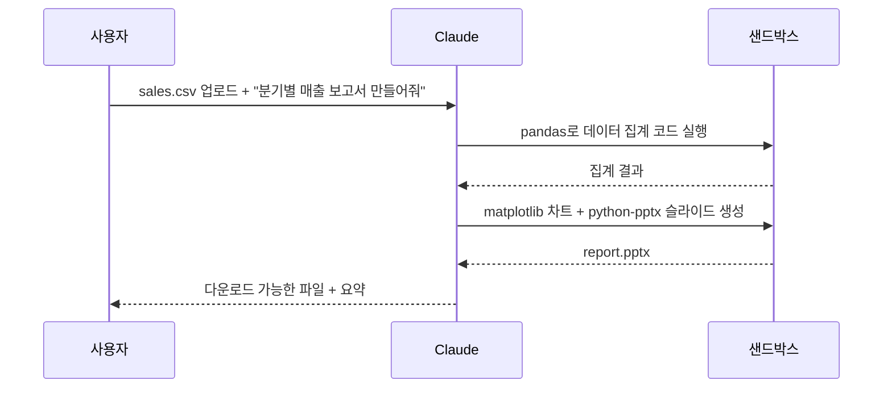

---
{"dg-publish":true,"permalink":"/ai-technique/claude/4-artifacts/","dg-note-properties":{}}
---

<aside>  
🌱

**Part 1 · 기초** — Claude에게 자료를 주고, 결과물을 독립된 문서·앱·파일로 받는 방법을 배웁니다.

</aside>

## 4.1 지원하는 파일 형식

### 📄 문서

- PDF (텍스트 + 표·차트 이미지까지 이해)
- Word(.docx), 텍스트, Markdown
- HTML, JSON, 코드 파일

### 📊 데이터

- CSV, Excel(.xlsx)
- 코드 실행 기능을 켜면 직접 분석·시각화

### 🖼️ 이미지

- PNG, JPEG, GIF, WebP
- 스크린샷, 손글씨, 다이어그램, 차트

## 4.2 이미지(Vision) 활용 아이디어

|상황|프롬프트 예시|
|---|---|
|화이트보드 사진|이 화이트보드 내용을 회의록 형식으로 정리해줘|
|에러 화면 스크린샷|이 에러의 원인과 해결 방법을 알려줘|
|UI 디자인 시안|이 화면을 HTML/CSS로 구현해줘|
|차트 이미지|이 차트에서 읽을 수 있는 인사이트 3가지는?|
|영수증 여러 장|항목별로 합계를 내서 표로 만들어줘|

## 4.3 Artifacts — 대화가 결과물이 되는 곳

Artifacts는 Claude가 만든 **독립적인 결과물**을 대화 옆 별도 패널에 보여주는 기능입니다. 버전이 관리되고, 공유할 수 있으며, 대화로 계속 수정할 수 있습니다.

|유형|예시|
|---|---|
|📝 문서|보고서, 기획서, 블로그 글 (Markdown)|
|💻 코드|Python 스크립트, SQL 쿼리|
|🌐 웹앱|HTML/React로 만든 계산기, 퀴즈, 대시보드, 미니 게임|
|📈 다이어그램|Mermaid 플로차트, SVG 일러스트|
|🤖 AI 앱|Artifact 안에서 Claude를 다시 호출하는 대화형 도구|

<aside>  
💡

**TIP** — "_이걸 팀원들이 쓸 수 있는 인터랙티브 체크리스트 웹앱으로 만들어줘_"처럼 결과물의 **사용자와 용도**를 말하면 훨씬 완성도 높은 Artifact가 나옵니다.

</aside>

## 4.4 파일 생성과 코드 실행

코드 실행(파일 생성) 기능이 켜져 있으면 Claude는 안전한 샌드박스에서 코드를 실행해 다음과 같은 파일을 직접 만들어 줍니다.

- Excel 스프레드시트(수식 포함), PowerPoint 발표 자료
- Word 문서, PDF 보고서
- 데이터 분석 결과 차트(PNG)

## 4.5 대용량 자료를 다룰 때의 요령

1. **자료를 먼저, 질문은 나중에** — 긴 문서는 프롬프트 앞부분에 두고 질문을 끝에 두면 답변 품질이 좋아집니다.
2. 여러 문서는 `<document index="1">` 처럼 번호를 붙여 구분하세요.
3. "관련 인용문을 먼저 뽑고, 그 인용문만을 근거로 답해줘"는 환각을 크게 줄입니다.
4. 반복해서 참조할 자료는 매번 올리지 말고 **Projects**(5장)에 넣으세요.

---

## 🧪 실습 4

- [ ] 자신의 업무 PDF 하나를 올리고 "핵심 5줄 요약 + 예상 질문 3개"를 요청하기
- [ ] "팀 점심 메뉴 룰렛 웹앱"을 Artifact로 만들고 기능을 2번 이상 추가 수정하기
- [ ] CSV를 업로드해 차트가 포함된 Excel 또는 PowerPoint 파일을 받아보기