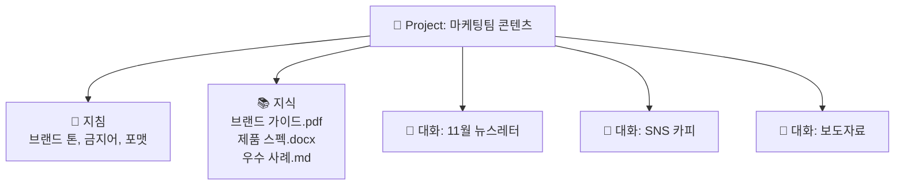

---
{"dg-publish":true,"permalink":"/ai-technique/claude/5-projects/","dg-note-properties":{}}
---


<aside>  
🚀

**Part 2 · 고급 활용** — 매번 같은 설명과 자료를 반복하지 않도록, Claude에게 **지속적인 맥락**을 주는 방법을 배웁니다.

</aside>

## 5.1 Projects란?

Project는 **지침(Instructions) + 지식(Knowledge) + 대화들**을 하나로 묶는 작업 공간입니다. 프로젝트 안에서 시작한 모든 대화는 같은 지침과 자료를 자동으로 참고합니다.



## 5.2 프로젝트 지침 작성법

프로젝트 지침은 사실상 **시스템 프롬프트**입니다. 3장의 6요소를 활용해 작성하세요.

```markdown
# 역할
너는 한화 마케팅팀의 시니어 콘텐츠 에디터야.

# 항상 지켜야 할 것
- 지식에 있는 "브랜드 가이드.pdf"의 톤을 따른다.
- 수치는 "제품 스펙.docx"에 있는 것만 사용하고, 없으면 [확인 필요]로 표시한다.
- 최종 결과물 끝에는 검토자가 확인해야 할 항목을 체크리스트로 단다.

# 출력 기본값
- 존댓말, 문장은 짧고 능동태로
- 제목 후보는 항상 3개 제시
```

## 5.3 지식(Knowledge) 관리 요령

<aside>  
✅

**넣으면 좋은 것**

- 스타일 가이드, 용어집
- 제품·조직 정보
- 잘 쓴 결과물 샘플
- 코드베이스 핵심 파일, API 문서  
    </aside>

<aside>  
🚫

**피해야 할 것**

- 서로 모순되는 구버전 문서
- 주제와 무관한 대량 자료
- 개인정보·기밀이 담긴 원본  
    </aside>

<aside>  
🔍

**심화: RAG 모드**

지식 용량이 컨텍스트 한도에 가까워지면 Projects는 자동으로 **검색 증강 생성(RAG)** 방식으로 전환해, 질문과 관련된 부분만 찾아 참고합니다. 덕분에 훨씬 많은 문서를 담을 수 있지만, 파일명과 문서 구조를 명확하게 해두면 검색 정확도가 올라갑니다.

</aside>

## 5.4 메모리(Memory)

메모리를 켜면 Claude가 과거 대화에서 얻은 여러분에 대한 정보(직무, 선호, 진행 중인 일)를 기억하고 다음 대화에 활용합니다.

|기능|설명|
|---|---|
|과거 대화 검색|"지난주에 얘기한 그 기획안 기억나?"처럼 이전 대화를 찾아 참고|
|자동 메모리|대화에서 중요한 사실을 요약해 저장|
|프로젝트별 분리|프로젝트마다 별도의 메모리 공간 유지|
|사용자 통제|기억된 내용 확인·수정·삭제, 시크릿(임시) 대화|

<aside>  
⚠️

**주의** — 메모리에 남기고 싶지 않은 대화는 **임시 대화(Incognito)**를 사용하세요. 기억된 내용은 Settings에서 언제든 확인하고 지울 수 있습니다.

</aside>

## 5.5 팀에서 Projects 공유하기

Team/Enterprise 플랜에서는 프로젝트를 동료와 공유해 **팀 공용 AI 비서**를 만들 수 있습니다. 예를 들어 "신입 온보딩 프로젝트"에 사내 규정·업무 매뉴얼을 넣어두면 신입사원이 언제든 질문할 수 있습니다.

---

## 🧪 실습 5

- [ ] 자신의 반복 업무 하나를 골라 Project를 만들고 지침을 작성하기
- [ ] 참고 문서 3개 이상을 지식에 추가하고, 문서 내용을 근거로 답하는지 검증하기
- [ ] 메모리 설정을 확인하고 기억된 내용을 검토하기