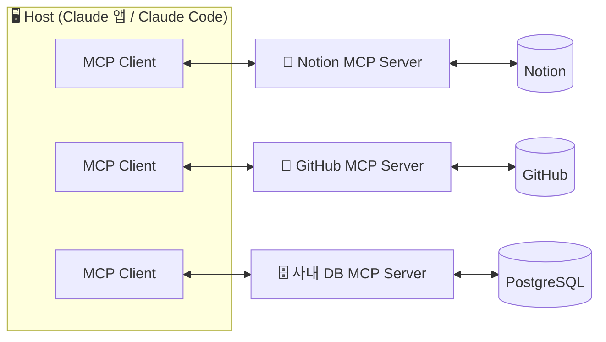

---
{"dg-publish":true,"permalink":"/ai-technique/claude/7-mcp-claude/","dg-note-properties":{}}
---


<aside>  
🚀

**Part 2 · 고급 활용** — MCP(Model Context Protocol)를 이해하고, 코드 없이 Claude를 Notion·Google Drive·Slack·GitHub 등과 연결하는 방법을 배웁니다. MCP 서버를 직접 만드는 방법은 13장에서 다룹니다.

</aside>

## 7.1 MCP란? — "AI를 위한 USB-C"

> **MCP(Model Context Protocol)**는 AI 애플리케이션이 외부 데이터와 도구에 접근하는 방식을 표준화한 **개방형 프로토콜**입니다. Anthropic이 2024년 11월 공개했고, 현재는 여러 AI 플랫폼과 개발 도구가 함께 사용하는 업계 표준이 되었습니다.

USB-C 이전에는 기기마다 충전기가 달랐습니다. MCP 이전에도 "AI 앱 × 도구" 조합마다 별도의 연동 코드가 필요했습니다. MCP는 이 $N \times M$ 문제를 $N + M$ 으로 줄여줍니다.

## 7.2 아키텍처



|구성요소|역할|
|---|---|
|**Host**|사용자가 쓰는 AI 앱 (Claude 데스크톱, [claude.ai](http://claude.ai), Claude Code, IDE)|
|**Client**|Host 내부에서 서버 하나와 1:1 연결을 유지하는 커넥터|
|**Server**|특정 서비스의 기능을 표준 형식으로 노출하는 프로그램|

### MCP 서버가 제공하는 3가지

<aside>  
🔧

**Tools (도구)**

Claude가 실행하는 함수. 예: 페이지 생성, 이슈 등록, SQL 실행

</aside>

<aside>  
📄

**Resources (리소스)**

Claude가 읽는 데이터. 예: 파일 내용, DB 스키마, 문서

</aside>

<aside>  
💬

**Prompts (프롬프트)**

서버가 제공하는 재사용 템플릿. 예: "코드 리뷰 요청"

</aside>

### 연결 방식(Transport)

|방식|실행 위치|사용 예|
|---|---|---|
|**stdio**|내 컴퓨터(로컬 프로세스)|파일 시스템, 로컬 DB, 개발 도구|
|**Streamable HTTP**|원격 서버(인터넷)|Notion, Slack, Linear 같은 SaaS 커넥터|

## 7.3 [claude.ai](http://claude.ai)에서 커넥터 연결하기

1. **Settings → Connectors**로 이동합니다.
2. 커넥터 디렉터리에서 원하는 서비스(예: Notion)를 고릅니다.
3. **Connect**를 누르고 해당 서비스에 로그인해 접근 권한(OAuth)을 승인합니다.
4. 대화 입력창의 도구 메뉴에서 커넥터가 켜져 있는지 확인합니다.
5. "Notion에서 지난주 회의록을 찾아 요약해줘"처럼 요청합니다.

<aside>  
💡

**TIP** — 디렉터리에 없는 서비스도 원격 MCP 서버 URL이 있다면 **Add custom connector**로 추가할 수 있습니다.

</aside>

## 7.4 데스크톱 앱에서 로컬 MCP 서버 연결하기

데스크톱 앱은 내 컴퓨터에서 실행되는 로컬 MCP 서버도 연결할 수 있습니다. 가장 쉬운 방법은 **Settings → Extensions**에서 클릭 한 번으로 설치하는 데스크톱 확장(.mcpb)이고, 직접 설정할 수도 있습니다.

### 🛠️ 수동 설정: claude_desktop_config.json

**Settings → Developer → Edit Config**를 누르면 설정 파일이 열립니다.

- macOS: `~/Library/Application Support/Claude/claude_desktop_config.json`
- Windows: `%APPDATA%\Claude\claude_desktop_config.json`

```json
{
  "mcpServers": {
    "filesystem": {
      "command": "npx",
      "args": [
        "-y",
        "@modelcontextprotocol/server-filesystem",
        "/Users/me/Documents",
        "/Users/me/Downloads"
      ]
    }
  }
}
```

저장 후 앱을 완전히 재시작하면, Claude가 지정한 폴더의 파일을 읽고 쓸 수 있게 됩니다. (Node.js 설치 필요)

## 7.5 활용 시나리오

|직무|연결|요청 예시|
|---|---|---|
|기획자|Notion + Slack|이번 주 Slack #product 채널의 피드백을 모아 Notion 제품 백로그에 정리해줘|
|영업|Gmail + Google Calendar|내일 미팅 참석자와 지난 메일 기록을 바탕으로 미팅 브리핑을 만들어줘|
|개발자|GitHub + Linear|열려 있는 버그 이슈 중 우선순위 높은 것과 관련 PR을 찾아줘|
|데이터 분석가|사내 DB (로컬 MCP)|지난 분기 코호트별 리텐션을 조회해 차트로 보여줘|

## 7.6 보안 체크리스트

<aside>  
🛡️

**MCP는 Claude에게 실제 권한을 줍니다.** 연결 전 아래를 확인하세요.

- [ ] 공식 또는 신뢰할 수 있는 개발자가 만든 서버인가?
- [ ] 필요한 최소 권한만 부여했는가? (읽기 전용이면 충분한가?)
- [ ] 쓰기·삭제·전송 같은 되돌리기 어려운 작업은 승인 후 실행되도록 설정했는가?
- [ ] **프롬프트 인젝션**: 외부 문서·웹페이지에 숨겨진 악의적 지시가 Claude를 조종할 수 있음을 알고 있는가?  
    </aside>

---

## 🧪 실습 7

- [ ] [claude.ai](http://claude.ai)에 Notion 또는 Google Drive 커넥터를 연결하기
- [ ] "내 Notion에서 ○○ 관련 문서를 찾아 비교표를 만들어줘" 요청하기
- [ ] (데스크톱) Filesystem MCP 서버를 연결하고 다운로드 폴더 정리를 맡겨보기