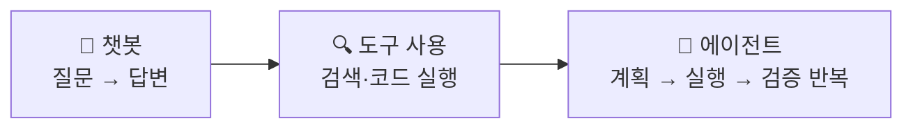

---
{"dg-publish":true,"permalink":"/ai-technique/claude/8-research/","dg-note-properties":{}}
---

<aside>  
🚀

**Part 2 · 고급 활용** — Claude가 스스로 조사하고, 여러 도구를 오가며 긴 작업을 완수하는 **에이전트형 활용법**을 배웁니다.

</aside>

## 8.1 챗봇에서 에이전트로

**에이전트(Agent)**란 목표를 받으면 스스로 계획을 세우고, 도구를 사용해 실행하고, 결과를 보며 다음 행동을 결정하는 AI입니다. 사람은 단계마다 지시하는 대신 **목표와 기준**을 주고 결과를 검토합니다.

## 8.2 웹 검색

웹 검색을 켜면 Claude가 최신 정보를 검색하고 **출처를 인용**해 답합니다. 학습 시점 이후의 뉴스, 가격, 제품 정보, 기술 문서 확인에 필수입니다.

## 8.3 Research — 심층 조사 모드

Research는 수십~수백 개의 소스를 여러 단계에 걸쳐 조사하고, 인용이 포함된 보고서를 만드는 기능입니다. 연결된 커넥터(Google Drive, Gmail 등)의 **내부 자료까지 함께** 조사할 수 있다는 것이 강점입니다.

### 일반 검색이 적합한 경우

- 단일 사실 확인
- 빠른 답변이 필요할 때
- "오늘 환율은?"

### Research가 적합한 경우

- 시장·경쟁사 분석
- 기술 선택을 위한 비교 조사
- "국내 2차전지 재활용 규제 동향 보고서"

<aside>  
💡

**TIP — Research 프롬프트 공식**

**주제** + **목적과 독자** + **범위(기간·지역)** + **반드시 답해야 할 질문** + **출력 형식**

예) "경영진 의사결정을 위해 최근 2년간 유럽 태양광 보조금 정책 변화를 조사해줘. 국가별 표와 우리 사업에 미치는 영향 3가지, 출처 목록을 포함해줘."

</aside>

## 8.4 브라우저·데스크톱 에이전트

Claude는 대화창을 넘어 실제 환경에서 작업할 수도 있습니다.

|기능|하는 일|
|---|---|
|**Claude in Chrome**|브라우저 확장 프로그램으로 웹페이지를 읽고, 클릭하고, 양식을 채움|
|**Computer Use**|화면을 보고 마우스·키보드를 조작해 데스크톱 앱을 사용|
|**Claude Code**|코드베이스에서 파일을 읽고 수정하고 명령어를 실행 (14장)|
|**예약 작업**|"매일 아침 9시에 뉴스 요약"처럼 정해진 시간에 자동 실행|

<aside>  
⚠️

**주의 — 에이전트에게 권한을 줄 때**

- 결제, 메일 발송, 파일 삭제처럼 **되돌릴 수 없는 작업**은 반드시 직접 확인 후 승인하세요.
- 웹페이지에 숨겨진 문구가 Claude에게 엉뚱한 지시를 내릴 수 있습니다(프롬프트 인젝션). 민감한 계정에서는 특히 주의하세요.  
    </aside>

## 8.5 에이전트에게 일을 잘 맡기는 법

1. **끝난 상태를 정의**하세요. "조사해줘" 대신 "어떤 질문에 답하는 어떤 문서가 나오면 완료"인지 알려주세요.
2. **검증 방법**을 알려주세요. "숫자는 원문과 대조해", "코드는 테스트를 통과해야 해".
3. **권한의 경계**를 정하세요. "초안까지만, 발송은 내가 할게".
4. 큰 작업은 **중간 보고**를 요청해 방향을 조기에 바로잡으세요.

---

## 🧪 실습 8

- [ ] 자신의 업무 분야에서 최근 이슈 하나를 Research로 조사하고, 출처 3개를 직접 검증하기
- [ ] 웹 검색 없이 / 있이 같은 최신 질문을 해 차이 비교하기
- [ ] 매주 반복되는 조사 업무를 예약 작업으로 만들 수 있는지 검토하기