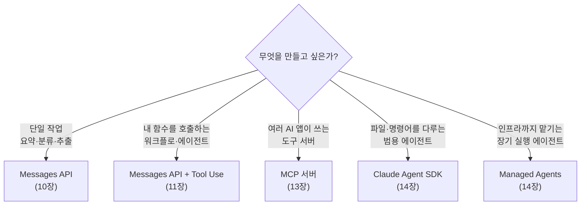

---
{"dg-publish":true,"permalink":"/ai-technique/claude/9-api/","dg-note-properties":{}}
---


<aside>  
🛠️

**Part 3 · 개발자** — API 키를 발급받고, Python과 TypeScript로 Claude를 처음 호출합니다. 터미널을 열고 명령어를 입력할 수 있다면 충분합니다.

</aside>

## 9.1 개발자를 위한 Claude 제품 지도



<aside>  
💡

**단순함에서 시작하세요.** 대부분의 문제는 잘 설계된 단일 API 호출이나 코드로 제어하는 워크플로로 해결됩니다. 에이전트는 단계를 미리 정의하기 어렵고, 오류를 검증·복구할 수 있을 때 선택하세요.

</aside>

## 9.2 API 키 발급

1. [Claude Console](https://platform.claude.com)에 가입합니다.
2. **Billing**에서 크레딧을 충전합니다.
3. **API Keys → Create Key**로 키를 만듭니다. `sk-ant-` 로 시작하는 문자열입니다.
4. 키는 한 번만 표시되므로 비밀번호 관리자에 안전하게 보관합니다.

<aside>  
🔐

**API 키 보안 원칙**

- 코드에 키를 **직접 적지 마세요.** 환경 변수나 시크릿 관리자를 쓰세요.
- `.env` 파일은 반드시 `.gitignore` 에 추가하세요.
- 프론트엔드(브라우저·앱) 코드에 키를 넣으면 누구나 탈취할 수 있습니다. 항상 **백엔드 서버를 거쳐** 호출하세요.
- 유출이 의심되면 즉시 Console에서 키를 폐기하세요.  
    </aside>

## 9.3 환경 설정

Python

Python 3.10 이상을 권장합니다.

```bash
# 프로젝트 폴더와 가상환경 만들기
mkdir claude-app && cd claude-app
python -m venv .venv
source .venv/bin/activate        # Windows: .venv\Scripts\activate

# SDK 설치
pip install anthropic python-dotenv

# API 키를 환경 변수로 저장
echo 'ANTHROPIC_API_KEY=sk-ant-...' > .env
echo '.env' >> .gitignore
```

TypeScript

Node.js 20 이상을 권장합니다.

```bash
mkdir claude-app && cd claude-app
npm init -y
npm install @anthropic-ai/sdk dotenv
npm install -D typescript tsx @types/node

echo 'ANTHROPIC_API_KEY=sk-ant-...' > .env
echo '.env' >> .gitignore
```

cURL

별도 설치 없이 터미널에서 바로 테스트할 수 있습니다.

```bash
export ANTHROPIC_API_KEY=sk-ant-...
```

## 9.4 Hello, Claude!

Python

```python
# hello.py
from dotenv import load_dotenv
import anthropic

load_dotenv()                      # .env의 ANTHROPIC_API_KEY 로드
client = anthropic.Anthropic()     # 환경 변수에서 자동으로 키를 읽음

response = client.messages.create(
    model="claude-opus-5-5",
    max_tokens=1024,
    messages=[
        {"role": "user", "content": "안녕! 너를 한 문장으로 소개해줘."}
    ],
)

# 응답은 여러 콘텐츠 블록의 리스트 — text 블록만 출력
for block in response.content:
    if block.type == "text":
        print(block.text)

print("사용 토큰:", response.usage.input_tokens, "/", response.usage.output_tokens)
```

```bash
python hello.py
```

TypeScript

```tsx
// hello.ts
import "dotenv/config";
import Anthropic from "@anthropic-ai/sdk";

const client = new Anthropic(); // ANTHROPIC_API_KEY 자동 사용

const response = await client.messages.create({
  model: "claude-opus-5-5",
  max_tokens: 1024,
  messages: [{ role: "user", content: "안녕! 너를 한 문장으로 소개해줘." }],
});

for (const block of response.content) {
  if (block.type === "text") console.log(block.text);
}
console.log("사용 토큰:", response.usage.input_tokens, "/", response.usage.output_tokens);
```

```bash
npx tsx hello.ts
```

cURL

```bash
curl <https://api.anthropic.com/v1/messages> \
  -H "x-api-key: $ANTHROPIC_API_KEY" \
  -H "anthropic-version: 2023-06-01" \
  -H "content-type: application/json" \
  -d '{
    "model": "claude-opus-5-5",
    "max_tokens": 1024,
    "messages": [{"role": "user", "content": "안녕! 너를 한 문장으로 소개해줘."}]
  }'
```

<aside>  
📌

`anthropic-version` 헤더 값은 API 버전에 따라 달라질 수 있습니다. SDK를 쓰면 자동으로 처리됩니다.

</aside>

## 9.5 응답 구조 읽기

```json
{
  "id": "msg_01XFDUDYJgAACzvnptvVoYEL",
  "type": "message",
  "role": "assistant",
  "model": "claude-opus-5-5",
  "content": [
    { "type": "thinking", "thinking": "", "signature": "..." },
    { "type": "text", "text": "안녕하세요! 저는 Anthropic이 만든 AI 어시스턴트 Claude입니다." }
  ],
  "stop_reason": "end_turn",
  "usage": { "input_tokens": 21, "output_tokens": 38 }
}
```

|필드|의미|
|---|---|
|`content`|콘텐츠 블록 배열. `text`, `thinking`, `tool_use` 등 여러 타입이 섞일 수 있으므로 **항상 type을 확인**하고 읽습니다.|
|`stop_reason`|`end_turn`(정상 종료), `max_tokens`(길이 한도로 잘림), `tool_use`(도구 호출 요청), `refusal`(안전상 거절), `pause_turn` 등|
|`usage`|입력·출력 토큰 수. 캐시 사용 시 `cache_read_input_tokens` 등도 포함|

<aside>  
⚠️

**흔한 실수** — `response.content[0].text` 처럼 첫 블록이 항상 텍스트라고 가정하면 안 됩니다. 최신 모델은 사고(thinking) 블록이 먼저 올 수 있습니다.

</aside>

## 9.6 Workbench로 프롬프트 실험하기

Console의 **Workbench**에서는 코드 없이 시스템 프롬프트·모델·파라미터를 바꿔가며 실험하고, **Get Code** 버튼으로 그대로 SDK 코드를 얻을 수 있습니다. 프롬프트 생성기·개선기도 제공됩니다.

---

## 🧪 실습 9

- [ ] API 키를 발급하고 `.env` 로 관리하기
- [ ] Python 또는 TypeScript로 hello 예제 실행하기
- [ ] `usage` 값으로 1장의 공식을 이용해 요청 비용 계산해보기