---
{"dg-publish":true,"permalink":"/ai-technique/skills/claude-skills-eli-5/","title":"Claude Skills 완전 정복 — ELI5편 (다섯 살도 이해하는 그림 강좌)","tags":["claude/skills","ai/agent","tutorial","eli5"],"dg-note-properties":{"title":"Claude Skills 완전 정복 — ELI5편 (다섯 살도 이해하는 그림 강좌)","aliases":["Claude Skills 쉬운 강좌","Skills ELI5","레시피 상자로 배우는 Claude Skills"],"tags":["claude/skills","ai/agent","tutorial","eli5"],"cssclasses":["wide-page"],"level":"입문 → 초급 → 중급 → 전문가","audience":"Skill을 처음 듣는 사람부터 팀에 배포하려는 사람까지","created":"2026-11-12","updated":"2026-11-12","status":"complete","related":["[[Claude-Skills-완전정복-강좌]]","[[Claude-Skills-완전정복-강좌-Desktop편]]"]}}
---


# Claude Skills 완전 정복 — ELI5편

> [!abstract] 이 책 한 권으로 얻는 것
> - Skill이 무엇인지 **레시피 상자 그림 하나**로 설명할 수 있게 됩니다.
> - **10분 안에** 첫 Skill을 만들어 Claude에게 가르칩니다.
> - 설명서만 있는 Skill → 템플릿과 스크립트가 든 Skill → 팀에 나눠 주는 Skill 순서로 **한 계단씩** 올라갑니다.
> - 마지막 졸업 작품까지 마치면, 동료가 "Skill 어떻게 만들어요?" 하고 물을 때 가르쳐 줄 수 있습니다.

> [!info] 기준 시점
> **2026년 11월** 공식 문서를 확인하고 썼습니다.[^howto][^use] 메뉴 이름과 버튼 글자는 앱이 업데이트되면 바뀔 수 있습니다. 화면과 다르면 [[AI technique/skills/Claude-Skills-완전정복-강좌-ELI5편#부록 E. 참고 자료\|#부록 E. 참고 자료]]의 공식 문서를 먼저 보세요.

> [!tip] 함께 보면 좋은 노트
> - 개발자용 심화 → [[Claude-Skills-완전정복-강좌\|Claude-Skills-완전정복-강좌]]
> - Claude Desktop 앱 중심 → [[Claude-Skills-완전정복-강좌-Desktop편\|Claude-Skills-완전정복-강좌-Desktop편]]
>
> 이 ELI5편은 두 노트의 **앞에** 읽는 책입니다. 그림과 비유로 뼈대를 세우고, 세부 옵션은 위 두 노트에서 찾으면 됩니다.

학습 메타데이터 (Dataview 인라인 필드):
과정:: Claude Skills 완전 정복 — ELI5편
총분량:: 4부 18장 + 부록 5개
선수지식:: 없음 (Claude와 대화해 본 경험이면 충분)
예상시간:: 입문 1시간 · 초급 2시간 · 중급 3시간 · 전문가 4시간

---

## 목차

> [!note]- 자동 목차 (Automatic Table of Contents 플러그인 사용 시)
> ```table-of-contents
> title:
> style: nestedList
> minLevel: 2
> maxLevel: 2
> includeLinks: true
> ```

- [[AI technique/skills/Claude-Skills-완전정복-강좌-ELI5편#여는 글. 이 책을 읽는 법\|#여는 글. 이 책을 읽는 법]]
- **🟢 1부. 그림으로 이해하기 (입문)**
  - [[AI technique/skills/Claude-Skills-완전정복-강좌-ELI5편#1장. Skill이 뭐예요\|#1장. Skill이 뭐예요]]
  - [[AI technique/skills/Claude-Skills-완전정복-강좌-ELI5편#2장. Claude는 Skill을 어떻게 꺼내 쓸까\|#2장. Claude는 Skill을 어떻게 꺼내 쓸까]]
  - [[AI technique/skills/Claude-Skills-완전정복-강좌-ELI5편#3장. 헷갈리는 친구들 구분하기\|#3장. 헷갈리는 친구들 구분하기]]
- **🟡 2부. 따라 만들기 (초급)**
  - [[AI technique/skills/Claude-Skills-완전정복-강좌-ELI5편#4장. 준비 운동 — Skill 켜고 써 보기\|#4장. 준비 운동 — Skill 켜고 써 보기]]
  - [[AI technique/skills/Claude-Skills-완전정복-강좌-ELI5편#5장. 첫 Skill 만들기 — 10분 완성\|#5장. 첫 Skill 만들기 — 10분 완성]]
  - [[AI technique/skills/Claude-Skills-완전정복-강좌-ELI5편#6장. SKILL.md 뜯어보기\|#6장. SKILL.md 뜯어보기]]
  - [[AI technique/skills/Claude-Skills-완전정복-강좌-ELI5편#7장. 라벨 잘 쓰는 법 — description 훈련\|#7장. 라벨 잘 쓰는 법 — description 훈련]]
- **🟠 3부. 실력 키우기 (중급)**
  - [[AI technique/skills/Claude-Skills-완전정복-강좌-ELI5편#8장. 상자에 물건 더 넣기\|#8장. 상자에 물건 더 넣기]]
  - [[AI technique/skills/Claude-Skills-완전정복-강좌-ELI5편#9장. 예제 1 — 회의록 정리 Skill\|#9장. 예제 1 — 회의록 정리 Skill]]
  - [[AI technique/skills/Claude-Skills-완전정복-강좌-ELI5편#10장. 예제 2 — 주간 장애 리포트 Skill\|#10장. 예제 2 — 주간 장애 리포트 Skill]]
  - [[AI technique/skills/Claude-Skills-완전정복-강좌-ELI5편#11장. 예제 3 — 커넥터와 함께 쓰는 Skill\|#11장. 예제 3 — 커넥터와 함께 쓰는 Skill]]
  - [[AI technique/skills/Claude-Skills-완전정복-강좌-ELI5편#12장. 고장 났을 때 고치는 법\|#12장. 고장 났을 때 고치는 법]]
- **🔴 4부. 전문가 되기 (고급)**
  - [[AI technique/skills/Claude-Skills-완전정복-강좌-ELI5편#13장. 좋은 Skill의 설계 원칙\|#13장. 좋은 Skill의 설계 원칙]]
  - [[AI technique/skills/Claude-Skills-완전정복-강좌-ELI5편#14장. Claude Code에서만 되는 고급 기능\|#14장. Claude Code에서만 되는 고급 기능]]
  - [[AI technique/skills/Claude-Skills-완전정복-강좌-ELI5편#15장. 테스트와 평가\|#15장. 테스트와 평가]]
  - [[AI technique/skills/Claude-Skills-완전정복-강좌-ELI5편#16장. 나누어 쓰기 — 공유와 플러그인\|#16장. 나누어 쓰기 — 공유와 플러그인]]
  - [[AI technique/skills/Claude-Skills-완전정복-강좌-ELI5편#17장. 안전하게 쓰기\|#17장. 안전하게 쓰기]]
  - [[AI technique/skills/Claude-Skills-완전정복-강좌-ELI5편#18장. 졸업 작품 — 고객 문의 답변 Skill\|#18장. 졸업 작품 — 고객 문의 답변 Skill]]
- **📎 부록**
  - [[AI technique/skills/Claude-Skills-완전정복-강좌-ELI5편#부록 A. 한 장 요약\|#부록 A. 한 장 요약]]
  - [[AI technique/skills/Claude-Skills-완전정복-강좌-ELI5편#부록 B. 용어 사전\|#부록 B. 용어 사전]]
  - [[AI technique/skills/Claude-Skills-완전정복-강좌-ELI5편#부록 C. 플래시카드\|#부록 C. 플래시카드]]
  - [[AI technique/skills/Claude-Skills-완전정복-강좌-ELI5편#부록 D. Obsidian 학습 관리\|#부록 D. Obsidian 학습 관리]]
  - [[AI technique/skills/Claude-Skills-완전정복-강좌-ELI5편#부록 E. 참고 자료\|#부록 E. 참고 자료]]

---

## 여는 글. 이 책을 읽는 법

### 모든 장은 같은 순서로 되어 있습니다

| 표시 | 뜻 | 읽는 법 |
|---|---|---|
| 🧒 **다섯 살 버전** | 그림과 짧은 문장 | 이것만 읽어도 그 장의 핵심은 가져갑니다 |
| 🧑‍💼 **어른 버전** | 정확한 용어와 규칙 | 실제로 만들 때 필요한 내용 |
| 🛠 **따라 하기** | 번호가 붙은 실습 | 순서대로 그대로 하면 됩니다 |
| 🎓 **전문가 한 걸음** | 한 단계 깊은 이야기 | 처음 읽을 때는 건너뛰어도 됩니다 |
| ❓ **스스로 확인** | 접혀 있는 퀴즈 | 먼저 답을 생각하고 펼치세요 |

> [!tip] 시간이 없다면
> - **30분**: 1부의 🧒만 읽고 [[AI technique/skills/Claude-Skills-완전정복-강좌-ELI5편#5장. 첫 Skill 만들기 — 10분 완성\|5장]]을 따라 합니다.
> - **반나절**: 1부 → 2부 → [[AI technique/skills/Claude-Skills-완전정복-강좌-ELI5편#9장. 예제 1 — 회의록 정리 Skill\|9장]].
> - **끝까지**: 순서대로. 4부는 실제로 Skill을 두세 개 만들어 본 뒤에 읽으면 훨씬 잘 읽힙니다.

### 이 책 전체에 나오는 비유 하나

이 책은 처음부터 끝까지 **주방**에서 이야기합니다. 새 용어가 나올 때마다 이 표로 돌아오세요.
{ #kitchen-map}


| 주방에서 | 진짜 이름 | 한 줄 설명 |
|---|---|---|
| 👨‍🍳 요리사 | **Claude** | 요리는 잘하지만 우리 가게 방식은 아직 모릅니다 |
| 📦 레시피 상자 | **Skill** (폴더) | 한 가지 일을 하는 방법을 담은 상자 |
| 🏷️ 상자 겉면 라벨 | **name, description** | 상자를 열지 않고도 무슨 상자인지 알게 해 줍니다 |
| 📄 레시피 카드 | **SKILL.md 본문** | 상자를 열면 맨 위에 있는 설명서 |
| 📚 두꺼운 참고 책 | **references/** | 필요한 쪽만 펴 보는 자세한 자료 |
| 🍪 쿠키 틀 | **assets/** | 모양이 정해져 있어 채우기만 하면 되는 것 |
| 🔌 주방 기계 | **scripts/** | 버튼을 누르면 언제나 같은 결과가 나오는 것 |
| ☎️ 전화기 | **커넥터 (MCP)** | 가게 밖(Jira, Slack, Drive…)과 이어 주는 선 |
| 🎁 선물 세트 | **플러그인** | 상자 여러 개와 전화기를 한 번에 포장한 것 |

### Obsidian 설정 (선택)

플러그인이 없어도 읽는 데는 문제가 없습니다. 설치하면 진도 관리와 복습 기능이 살아납니다.

| 종류 | 이름 | 이 노트에서 하는 일 |
|---|---|---|
| 기본 내장 | Callouts, Mermaid, Properties, 각주, 블록 참조, 접기 | 본문 전체 |
| 커뮤니티 | **Tasks** | 장마다 있는 체크리스트를 모아 봅니다 → [[AI technique/skills/Claude-Skills-완전정복-강좌-ELI5편#D.1 Tasks — 남은 실습 모아 보기\|#D.1 Tasks — 남은 실습 모아 보기]] |
| 커뮤니티 | **Dataview** | 학습 메타데이터와 관련 노트를 표로 봅니다 → [[AI technique/skills/Claude-Skills-완전정복-강좌-ELI5편#D.2 Dataview — 학습 현황판\|#D.2 Dataview — 학습 현황판]] |
| 커뮤니티 | **Spaced Repetition** | [[AI technique/skills/Claude-Skills-완전정복-강좌-ELI5편#부록 C. 플래시카드\|#부록 C. 플래시카드]]로 복습합니다 |
| 커뮤니티 | **Templater** | 새 Skill을 설계할 때 쓰는 노트 양식 → [[AI technique/skills/Claude-Skills-완전정복-강좌-ELI5편#D.3 Templater — Skill 설계 노트 양식\|#D.3 Templater — Skill 설계 노트 양식]] |
| 커뮤니티 | **Automatic Table of Contents** | 위쪽의 자동 목차 |

> [!tip]- 넓은 화면 CSS 스니펫
> frontmatter의 `cssclasses: wide-page`를 쓰려면 `.obsidian/snippets/wide-page.css`를 만들고 *설정 → 모양 → CSS 스니펫*에서 켜세요.
> ```css
> .wide-page { --file-line-width: 100%; }
> ```

---

# 🟢 1부. 그림으로 이해하기 (입문)

## 1장. Skill이 뭐예요

> [!abstract] 🧒 다섯 살 버전
> 요리를 아주 잘하는 요리사가 우리 가게에 새로 왔어요.
> 그런데 **우리 가게 김치찌개 만드는 법**은 몰라요.
>
> 그래서 **레시피를 적어 상자에 넣고**, 상자 겉에 **"김치찌개 주문이 오면 여세요"** 라고 써 붙였어요.
>
> 이제 김치찌개 주문이 오면 요리사는 그 상자를 열고, 적힌 대로 만들어요.
> 매번 다시 설명할 필요가 없어요.
>
> **그 상자가 Skill이에요.**

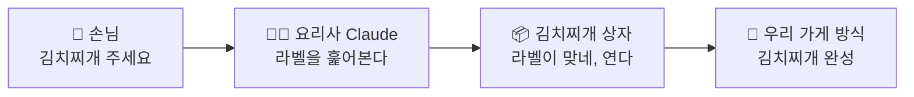

### 1.1 Skill이 없을 때와 있을 때

```text
😩 Skill이 없을 때                     😀 Skill이 있을 때
────────────────────────────          ────────────────────────────
월요일: "회의록은 이렇게 정리해줘…"      한 번만: 회의록 Skill을 만든다
화요일: "회의록은 이렇게 정리해줘…"      월요일: "이 회의 정리해줘"
수요일: "아, 담당자도 꼭 넣어줘…"       화요일: "이 회의 정리해줘"
목요일: "회의록은 이렇게 정리해줘…"      수요일: "이 회의 정리해줘"
```

> [!info] 🧑‍💼 어른 버전
> **Skill = `SKILL.md` 파일이 들어 있는 폴더**입니다.
> `SKILL.md`에는 Claude가 따를 지침이 적혀 있고, 필요하면 같은 폴더에 참고 문서·템플릿·스크립트를 함께 넣습니다. Claude는 요청이 Skill의 설명(`description`)과 맞을 때만 그 내용을 불러옵니다.[^howto]

가장 작은 Skill은 파일 하나짜리 폴더입니다.

```text
explaining-simply/      ← 📦 상자 (폴더)
└── SKILL.md            ← 📄 레시피 카드 (이 파일 하나면 Skill입니다)
```

### 1.2 어떤 일을 Skill로 만들면 좋을까

| 이런 일이면 Skill로 | 이런 일이면 Skill이 아닙니다 |
|---|---|
| 같은 설명을 **여러 번** 되풀이하고 있다 | 한 번만 하고 끝나는 일 → 그냥 대화로 요청 |
| 결과가 **매번 같은 모양**이어야 한다 (보고서 양식, 체크리스트) | **모든 대화**에 적용할 말투·선호 → 개인 설정이나 프로젝트 지침 |
| 여러 단계를 **정해진 순서**로 해야 한다 | Jira·Slack의 **실시간 데이터**가 필요하다 → 커넥터 |
| 참고 문서나 계산 프로그램이 있어야 제대로 나온다 | |

> [!tip] 한 문장 테스트
> "**Claude에게 같은 잔소리를 세 번째 하고 있다**"면 Skill로 만들 때입니다.

### 1.3 스스로 확인

> [!question]- Skill에 꼭 있어야 하는 파일은 몇 개일까요?
> **한 개**, `SKILL.md`입니다. 나머지 폴더(references, assets, scripts)는 모두 선택입니다.

> [!question]- "항상 존댓말로 답해줘"는 Skill로 만드는 것이 좋을까요?
> 아닙니다. 모든 대화에 적용되어야 하는 내용은 **개인 설정**에 넣습니다. Skill은 **특정한 일을 할 때만** 열리는 상자입니다.

- [ ] 1장 완료 — Skill을 레시피 상자에 빗대어 설명할 수 있다 #skills-eli5

---

## 2장. Claude는 Skill을 어떻게 꺼내 쓸까

> [!abstract] 🧒 다섯 살 버전
> 주방 선반에 상자가 **백 개** 있어요.
> 요리사가 백 개를 전부 열어서 읽고 있으면 요리는 언제 하죠?
>
> 그래서 요리사는 이렇게 해요.
>
> 1. 🏷️ 평소에는 **라벨만** 봐요.
> 2. 📄 주문에 맞는 상자만 **열어서 카드를** 읽어요.
> 3. 📚 카드에 "자세한 건 참고 책 12쪽" 이라고 쓰여 있으면 **그때 그 쪽만** 펴요.
>
> 꼭 필요한 것만, 꼭 필요할 때 꺼내요.

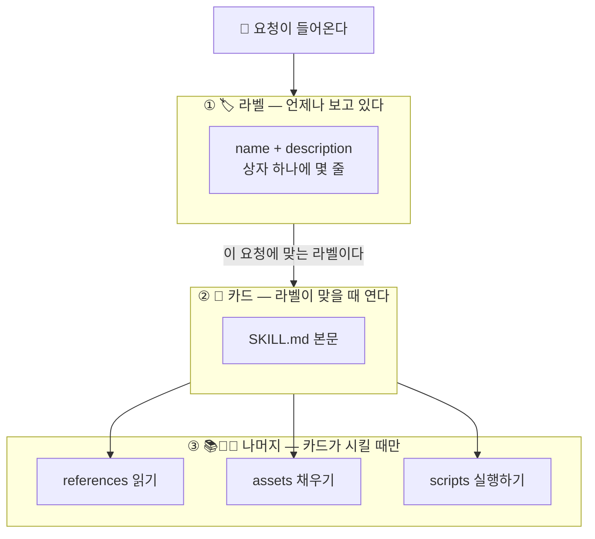

> [!info] 🧑‍💼 어른 버전
> 이 방식의 이름은 **Progressive Disclosure(단계적 공개)** 입니다. ==Skill 설계의 대부분이 이 그림 한 장에서 나옵니다.==
>
> | 단계 | 무엇이 | 언제 Claude에게 보이나 |
> |---|---|---|
> | ① | `name`, `description` | 켜져 있는 모든 Skill에 대해 **항상** |
> | ② | `SKILL.md` 본문 | 요청이 description과 **맞을 때** |
> | ③ | 폴더 안의 다른 파일 | 본문의 어느 단계가 **그 파일을 필요로 할 때** |

### 2.1 여기서 나오는 세 가지 결론

1. **Skill을 많이 켜 두어도 부담이 작습니다.** 평소에 자리를 차지하는 것은 라벨뿐입니다.
2. **Claude가 상자를 열지 말지는 라벨(description)만 보고 정합니다.** 본문을 아무리 잘 써도 라벨이 엉성하면 상자는 열리지 않습니다. → [[AI technique/skills/Claude-Skills-완전정복-강좌-ELI5편#7장. 라벨 잘 쓰는 법 — description 훈련\|7장]]
3. **긴 내용은 본문에서 빼서 다른 파일로 옮깁니다.** 본문은 열릴 때마다 통째로 읽히기 때문입니다. → [[AI technique/skills/Claude-Skills-완전정복-강좌-ELI5편#8장. 상자에 물건 더 넣기\|8장]]

> [!note]- 🎓 전문가 한 걸음 — 스크립트는 "읽지 않고 돌린다"
> 스크립트(`scripts/`)는 Claude가 소스 코드를 읽는 것이 아니라 **실행하고 결과만 받습니다.** 300줄짜리 프로그램이라도 대화에는 출력 몇 줄만 들어옵니다. 그래서 정확해야 하는 계산은 지침으로 설명하는 것보다 스크립트로 넣는 편이 싸고 정확합니다.

### 2.2 스스로 확인

> [!question]- Skill 50개를 켜 두면 Claude가 대화마다 50개의 SKILL.md를 전부 읽을까요?
> 아닙니다. 항상 보는 것은 50개의 **이름과 설명**뿐입니다. 본문은 요청과 맞는 Skill 것만 읽습니다.

> [!question]- 내 Skill이 열려야 할 때 안 열립니다. 가장 먼저 볼 곳은?
> `description`입니다. Claude가 고를 때 보는 것이 그것뿐이기 때문입니다.

- [ ] 2장 완료 — 라벨 → 카드 → 나머지의 세 단계를 그릴 수 있다 #skills-eli5

---

## 3장. 헷갈리는 친구들 구분하기

> [!abstract] 🧒 다섯 살 버전
> 주방에는 상자 말고도 여러 가지가 있어요.
>
> - 📌 **벽에 붙은 쪽지** — "손 씻기!" 처럼 **언제나** 지키는 것
> - 🗂️ **오늘 행사 폴더** — **이 행사** 준비할 때만 보는 자료
> - 📦 **레시피 상자** — **그 요리**를 할 때만 여는 방법
> - ☎️ **전화기** — 가게 **밖**에 물어보거나 주문 넣는 선
> - 🎁 **선물 세트** — 상자와 전화기를 **한꺼번에** 포장한 것

| 주방 | 진짜 이름 | 언제 Claude에게 보이나 | 무엇을 넣나 |
|---|---|---|---|
| 📌 벽 쪽지 | **개인 설정** (Preferences) | 모든 대화에 항상 | 말투, 언어, 늘 지킬 선호 |
| 🗂️ 행사 폴더 | **프로젝트** (Projects) | 그 프로젝트의 대화에 항상 | 한 주제의 배경 지식과 문서 |
| 📦 레시피 상자 | **Skill** | 요청이 맞을 때만 | 한 가지 일의 절차와 노하우 |
| ☎️ 전화기 | **커넥터** (MCP) | 도구로 연결됨 | 외부 서비스의 데이터와 동작 |
| 🎁 선물 세트 | **플러그인** | 설치하면 안에 든 것이 모두 | Skill + 커넥터 등을 묶은 것 |

> [!important] 가장 많이 헷갈리는 한 쌍 — Skill과 커넥터
> - ☎️ **커넥터는 "할 수 있게" 해 줍니다.** Jira 커넥터가 있으면 Claude가 이슈를 만들 **수 있습니다.**
> - 📦 **Skill은 "어떻게 할지" 알려 줍니다.** 버그 접수 Skill은 **어느 프로젝트에, 어떤 라벨로, 어떤 양식으로** 만드는지 알려 줍니다.
>
> Skill은 혼자서 외부 서비스에 닿을 수 없습니다.[^howto] 전화기가 없으면 레시피에 "납품업체에 전화하세요"라고 적혀 있어도 걸 수 없는 것과 같습니다.

### 3.1 스스로 확인

> [!question]- "우리 팀 Jira에 이슈를 만들 때 쓰는 라벨 규칙"은 어디에 넣을까요?
> **Skill**입니다. 이슈를 만드는 능력은 커넥터가, 우리 팀 규칙은 Skill이 맡습니다.

> [!question]- "신제품 기획서 초안과 시장 조사 자료 5개"는 어디에 넣을까요?
> **프로젝트**입니다. 한 주제에 대해 계속 참고할 배경 자료이기 때문입니다.

- [ ] 3장 완료 — Skill, 프로젝트, 커넥터, 플러그인을 구분할 수 있다 #skills-eli5

---

# 🟡 2부. 따라 만들기 (초급)

## 4장. 준비 운동 — Skill 켜고 써 보기

> [!abstract] 🧒 다섯 살 버전
> 상자를 만들기 전에, **이미 선반에 있는 상자**부터 써 봐요.
> 가게에는 처음부터 놓여 있는 상자가 있어요. 엑셀 상자, 워드 상자, 파워포인트 상자, PDF 상자예요.
> "엑셀 파일 만들어 줘" 하면 요리사가 알아서 엑셀 상자를 열어요.

### 4.1 어디서 Skill을 쓸 수 있나

| 곳 | 누가 주로 쓰나 | Skill을 넣는 방법 |
|---|---|---|
| **claude.ai / Claude 데스크톱·모바일 앱** | 누구나 | `Customize > Skills`에서 켜거나 ZIP으로 올립니다 |
| **Cowork** (데스크톱 앱의 작업 공간) | 파일 작업을 맡기는 사람 | 위와 같은 계정의 Skill을 그대로 씁니다 |
| **Claude Code** (터미널, 코딩 에이전트) | 개발자 | 폴더를 정해진 위치에 두면 끝. 올릴 필요 없습니다 |
| **Claude API** | 서비스를 만드는 개발자 | Skills API로 올리고 요청에 Skill을 지정합니다 |

> [!info] 요금제
> Skills는 **Free, Pro, Max, Team, Enterprise** 요금제에서 쓸 수 있고, **코드 실행 기능이 켜져 있어야** 합니다.[^use]

### 4.2 🛠 따라 하기 — 코드 실행 켜기

1. Claude 앱 또는 claude.ai에 로그인합니다.
2. 요금제에 따라 다음을 확인합니다.

| 요금제 | 확인할 곳 |
|---|---|
| Free / Pro / Max | `Settings > Capabilities`에서 **Code execution and file creation**을 켭니다 (새 설정 화면에서는 *Create and edit files*로 표시됩니다) |
| Team | 조직 단위로 기본으로 켜져 있습니다 |
| Enterprise | 조직 소유자(Owner)가 조직 설정에서 코드 실행과 Skills를 먼저 켜야 합니다 |

3. 왼쪽 사이드바에서 **Customize → Skills**로 들어갑니다. Skill 목록이 보이면 준비가 끝났습니다.

> [!warning] Skills 메뉴가 안 보이면
> 코드 실행이 꺼져 있는 경우가 대부분입니다. 회사 계정이면 조직 소유자에게 문의하세요.

### 4.3 🛠 따라 하기 — 기본 Skill로 첫 경험

1. 새 대화를 엽니다.
2. 아래 문장을 그대로 넣습니다.

```text
우리 팀 5명의 이번 주 할 일을 정리하는 엑셀 파일을 만들어줘.
열은 담당자, 할 일, 마감일, 상태로 하고 상태별로 색을 다르게 해줘.
```

3. Claude가 `.xlsx` 파일을 만들어 줍니다.

> [!success] 방금 일어난 일
> "엑셀 Skill을 써"라고 말하지 않았습니다. Claude가 **라벨을 보고 스스로** 엑셀 상자를 열었습니다. [[AI technique/skills/Claude-Skills-완전정복-강좌-ELI5편#2장. Claude는 Skill을 어떻게 꺼내 쓸까\|2장]]의 그림이 실제로 움직인 것입니다. Claude의 생각 과정(thinking)을 펼치면 Skill을 읽는 단계가 보입니다.

### 4.4 Skill을 내가 직접 고르고 싶을 때

- 문장으로 지정합니다: "**pdf skill을 사용해서** 이 계약서의 표를 뽑아줘"
- 입력창에 `/`를 치면 Skill 목록이 나오는 화면에서는 거기서 고릅니다.

### 4.5 남이 만든 Skill 추가하기

1. `Customize > Skills`에서 **+** 를 누르고 **Browse skills**를 고릅니다.
2. 마음에 드는 Skill을 추가합니다.
3. 목록에서 스위치로 켜고 끕니다.

> [!danger] 켜기 전에 열어 보세요
> Skill 안의 지침과 스크립트는 **내 대화 안에서 실행**됩니다. 믿을 수 있는 곳에서 받은 것만 쓰고, 켜기 전에 `SKILL.md`와 포함된 파일을 한 번 읽어 보세요. 자세한 내용은 [[AI technique/skills/Claude-Skills-완전정복-강좌-ELI5편#17장. 안전하게 쓰기\|17장]]에 있습니다.

- [ ] 4장 완료 — 코드 실행을 켜고 기본 Skill로 파일을 만들어 봤다 #skills-eli5

---

## 5장. 첫 Skill 만들기 — 10분 완성

> [!abstract] 🧒 다섯 살 버전
> 이제 내 상자를 만들어요. 필요한 건 세 가지뿐이에요.
>
> 1. 📦 **상자** 하나 (폴더)
> 2. 🏷️ **라벨** 한 장 (이름, 그리고 "언제 여는 상자인지")
> 3. 📄 **카드** 한 장 (하는 방법)
>
> 우리가 만들 상자는 **"쉽게 설명하기" 상자**예요.
> 누가 "쉽게 설명해 줘" 하면 요리사가 이 상자를 열고, 비유와 그림으로 설명해 줘요.

### 5.1 만드는 길 세 가지

| 길 | 난이도 | 이런 분께 |
|---|---|---|
| **A. 직접 써서 ZIP으로 올리기** | ⭐⭐ | 구조를 눈으로 익히고 싶은 분. **이 장의 기본 길입니다** |
| **B. Claude Code 폴더에 넣기** | ⭐⭐ | 터미널에서 Claude Code를 쓰는 분 |
| **C. Claude에게 만들어 달라고 하기** | ⭐ | 일단 결과부터 보고 싶은 분 |

> [!tip] 추천 순서
> 처음 한 번은 **A**로 손으로 만들어 보세요. 상자 구조가 머리에 들어온 뒤에는 **C**로 초안을 받고 직접 다듬는 것이 가장 빠릅니다.

### 5.2 🛠 길 A — 직접 써서 ZIP으로 올리기

**Step 1. 상자 만들기 (폴더)**

바탕화면이나 문서 폴더에 `explaining-simply`라는 폴더를 만듭니다.

> [!warning] 폴더 이름 규칙
> **영어 소문자, 숫자, 하이픈(`-`)만** 씁니다. 한글, 띄어쓰기, 대문자, 밑줄(`_`)은 안 됩니다.

**Step 2. 카드 만들기 (SKILL.md)**

폴더 안에 `SKILL.md`라는 파일을 만듭니다. 메모장, 텍스트 편집기, VS Code, Obsidian 어느 것이든 됩니다.

> [!warning] 파일 이름에서 자주 틀리는 것
> - 이름은 정확히 `SKILL.md`입니다. `SKILL.md.txt`가 되지 않았는지 확인하세요. (Windows는 *파일 확장명 표시*를 켜면 보입니다.)
> - macOS 텍스트 편집기는 *포맷 → 일반 텍스트로 만들기*를 누른 뒤 저장하세요.

**Step 3. 내용 붙여 넣기**

아래 내용을 그대로 복사해 `SKILL.md`에 붙이고 저장합니다.

````markdown
---
name: explaining-simply
description: 어려운 개념을 다섯 살도 이해할 수 있게 비유와 그림으로 설명한다. 사용자가 "쉽게 설명해줘", "ELI5", "다섯 살에게 설명하듯", "초보자용으로 풀어줘"라고 말하거나 무언가가 어떻게 동작하는지 아주 쉬운 설명을 원할 때 사용한다.
---

# 쉽게 설명하기

다음 순서로 답한다.

1. **한 문장 답**: 질문의 답을 가장 쉬운 말로 한 문장.
2. **비유 하나**: 주방, 학교, 택배처럼 누구나 아는 것에 빗댄다.
3. **그림**: 이모지와 화살표로 3~5칸짜리 흐름을 그린다.
4. **조금 더 정확하게**: 비유와 실제가 다른 점을 한 가지 알려 준다.
5. **확인 질문**: 이해했는지 볼 수 있는 쉬운 질문 하나로 끝낸다.

## 규칙

- 한 문장에는 한 가지 이야기만 담는다.
- 전문 용어는 처음 나올 때 괄호 안에 풀어 쓴다.
- 비유는 하나만 골라 끝까지 쓴다. 중간에 다른 비유로 바꾸지 않는다.

## 예시

입력: 캐시가 뭐야? 쉽게 설명해줘

출력:
**한 문장 답** 자주 쓰는 것을 가까이 꺼내 두는 자리예요.
**비유** 냉장고까지 가기 귀찮아서 물병을 책상 위에 올려 두는 것과 같아요.
**그림** 🧑 목마름 → 🥤 책상 위 물병(빠름) / 🚶 냉장고(느림)
**조금 더 정확하게** 책상은 좁아서 오래된 것은 치워야 해요. 캐시도 자리가 차면 오래된 것부터 지워요.
**확인 질문** 책상 위 물이 미지근해졌다면 어떻게 해야 할까요?
````

**Step 4. 상자 포장하기 (ZIP)**

==여기가 가장 많이 틀리는 단계입니다.== 파일이 아니라 **폴더 자체**를 압축합니다.

```text
✅ 맞는 포장                          ❌ 틀린 포장 (Skill로 인식되지 않음)
explaining-simply.zip                explaining-simply.zip
└── explaining-simply/               └── SKILL.md
    └── SKILL.md
```

| 운영체제 | 방법 |
|---|---|
| macOS (Finder) | `explaining-simply` **폴더**를 우클릭 → *압축* |
| Windows (탐색기) | `explaining-simply` **폴더**를 우클릭 → *압축(ZIP) 파일로* (또는 *보내기 → 압축(ZIP) 폴더*) |
| macOS / Linux 터미널 | 폴더의 **부모 위치**에서 아래 명령 |
| Windows PowerShell | 폴더의 **부모 위치**에서 아래 명령 |

```bash
# macOS / Linux
zip -r explaining-simply.zip explaining-simply/
unzip -l explaining-simply.zip     # 모든 줄이 explaining-simply/ 로 시작하면 정상
```

```powershell
# Windows PowerShell
Compress-Archive -Path explaining-simply -DestinationPath explaining-simply.zip
```

**Step 5. 선반에 올리기 (업로드)**

1. `Customize > Skills`로 갑니다.
2. **+** 버튼을 누르고 Skill 업로드 항목을 고릅니다. (버튼 글자는 버전에 따라 *Upload skill*, *Upload a skill* 등으로 조금씩 다릅니다.)
3. 방금 만든 `explaining-simply.zip`을 고릅니다.
4. 목록에 `explaining-simply`가 나타나면 **스위치를 켭니다.**

**Step 6. 써 보기**

**새 대화**를 열고 넣어 봅니다.

```text
블록체인이 뭐야? 쉽게 설명해줘
```

> [!success] 성공 확인 3가지
> - [ ] 답이 **한 문장 답 → 비유 → 그림 → 조금 더 정확하게 → 확인 질문** 순서로 나온다
> - [ ] Claude의 생각 과정을 펼치면 `explaining-simply`를 읽는 단계가 보인다
> - [ ] "쉽게"라는 말이 없는 평범한 질문("블록체인의 합의 알고리즘 종류를 표로 정리해줘")에는 이 형식이 나오지 **않는다**

세 번째가 중요합니다. 상자는 **맞는 주문에만** 열려야 합니다.

### 5.3 🛠 길 B — Claude Code 폴더에 넣기

Claude Code는 올릴 필요가 없습니다. 폴더를 정해진 자리에 두면 됩니다.

| 범위 | 위치 |
|---|---|
| 나 혼자, 모든 프로젝트에서 | `~/.claude/skills/explaining-simply/SKILL.md` |
| 이 프로젝트에서, 팀과 git으로 공유 | `<프로젝트>/.claude/skills/explaining-simply/SKILL.md` |

```bash
mkdir -p ~/.claude/skills/explaining-simply
# 그 폴더 안에 SKILL.md를 만들고 5.2의 Step 3 내용을 저장합니다 (아무 편집기나 사용)
```

터미널에서 `claude`를 실행한 뒤 다음 중 하나로 확인합니다.

```text
> /skills                      ← 인식된 Skill 목록
> /explaining-simply TCP 핸드셰이크     ← 이름으로 직접 부르기
> TCP 핸드셰이크를 쉽게 설명해줘        ← Claude가 스스로 고르는지 보기
```

> [!info] 계정 Skill이 Claude Code에도 따라옵니다
> claude.ai의 `Customize > Skills`에서 켠 Skill은 같은 계정으로 로그인한 Claude Code에도 불러와집니다. `/skills`에서 *claude.ai sync* 아래에 보입니다. 동기화는 계정 → Claude Code **한 방향**이며, Claude Code v2.1.273 이상이 필요합니다.[^use] 반대로 `~/.claude/skills`에 만든 Skill이 claude.ai로 올라가지는 않습니다.

### 5.4 🛠 길 C — Claude에게 만들어 달라고 하기

Anthropic이 제공하는 **skill-creator**는 "Skill을 만들어 주는 Skill"입니다.

1. `Customize > Skills`에서 `skill-creator`(Anthropic 제공)가 켜져 있는지 확인합니다.
2. 새 대화에서 요청합니다.

```text
skill-creator로 Skill을 하나 만들고 싶어.
목적: 어려운 개념을 다섯 살도 이해하게 비유와 그림으로 설명하기.
언제: 내가 "쉽게 설명해줘", "ELI5"라고 할 때.
형식: 한 문장 답 → 비유 → 이모지 그림 → 비유와 다른 점 → 확인 질문.
```

3. Claude가 묻는 말에 답합니다. (언제 써야 하는지, 좋은 결과의 예시가 무엇인지 등)
4. 만들어진 Skill을 저장하거나 내려받아 [[AI technique/skills/Claude-Skills-완전정복-강좌-ELI5편#5.2 🛠 길 A — 직접 써서 ZIP으로 올리기\|길 A의 Step 5]]처럼 올립니다.
5. **반드시 열어서 읽고** 고칩니다. 초안은 Claude가 쓰고, 품질은 내가 책임집니다.

> [!note]- 🎓 전문가 한 걸음 — 화면을 녹화해서 Skill 만들기
> Mac용 Claude의 **Cowork**에서는 내가 일하는 화면을 녹화해 Skill로 만들 수 있습니다. 입력창의 **+** → *Record a skill*, 또는 `Customize > Skills`의 추가 메뉴에서 시작합니다. 2026년 11월 기준 Pro·Max·Team 요금제의 Mac용 Cowork에서 제공되며, 일반 채팅·Windows·Free·Enterprise에서는 제공되지 않습니다.[^custom] 말로 설명하기 어려운 클릭 순서를 가르칠 때 좋습니다.

### 5.5 스스로 확인

> [!question]- ZIP을 열었더니 맨 위에 SKILL.md가 바로 보입니다. 맞는 구조일까요?
> 틀렸습니다. 맨 위에는 **Skill 폴더**가 있어야 하고 `SKILL.md`는 그 안에 있어야 합니다. 파일들을 선택해 압축하지 말고 **폴더를** 압축하세요.

> [!question]- 폴더 이름은 `explaining-simply`인데 name을 `easy-explainer`로 썼습니다. 어떻게 될까요?
> 올릴 때 문제가 됩니다. **폴더 이름과 `name`은 같아야** 합니다.

- [ ] 5장 완료 — `explaining-simply`를 만들어 올리고 세 가지 성공 확인을 통과했다 #skills-eli5

---

## 6장. SKILL.md 뜯어보기

> [!abstract] 🧒 다섯 살 버전
> 카드는 **두 칸**으로 나뉘어 있어요.
>
> - 위 칸은 🏷️ **라벨**이에요. 상자 겉에 붙어요. 줄 세 개(`---`) 사이에 써요.
> - 아래 칸은 📄 **하는 방법**이에요. 상자를 열어야 보여요.

````text
┌─────────────────────────────────────────────┐
│ ---                                         │
│ name: explaining-simply          🏷️ 라벨    │  ← 항상 보임 (①단계)
│ description: 어려운 개념을 …                 │
│ ---                                         │
├─────────────────────────────────────────────┤
│ # 쉽게 설명하기                              │
│                                 📄 하는 방법 │  ← 상자가 열릴 때 보임 (②단계)
│ 1. 한 문장 답 …                              │
│ 2. 비유 하나 …                               │
└─────────────────────────────────────────────┘
````

> [!info] 🧑‍💼 어른 버전
> 위 칸은 **YAML frontmatter**, 아래 칸은 **Markdown 본문**입니다. frontmatter는 파일의 **첫 줄**에서 `---`로 시작하고 `---`로 끝나야 합니다.

### 6.1 라벨 규칙 (frontmatter)

두 항목 모두 필수입니다.[^howto]

| 항목 | 규칙 |
|---|---|
| `name` | 영어 **소문자·숫자·하이픈**만, **64자** 이하, **폴더 이름과 같아야** 함 |
| `description` | **무엇을 하는지 + 언제 쓰는지**, **1,024자** 이하, 비워 둘 수 없음 |

```yaml
# ✅ 좋은 이름
name: explaining-simply
name: summarizing-meetings
name: weekly-incident-report

# ❌ 나쁜 이름
name: Easy_Explainer     # 대문자와 밑줄
name: 쉬운설명            # 한글
name: helper             # 무슨 상자인지 알 수 없음
name: claude-helper      # claude, anthropic은 이름에 쓸 수 없는 예약어
```

> [!tip] 이름 짓는 요령
> "~하기"에 해당하는 영어 동명사로 짓는 관례가 있습니다. `explaining-…`, `summarizing-…`, `reviewing-…`. 꼭 지켜야 하는 것은 아니고, 팀 안에서 한 가지 방식으로 통일하면 됩니다.

### 6.2 본문 규칙

본문은 평범한 글입니다. 제목, 목록, 굵은 글씨를 써도 되고 문단으로만 써도 됩니다. 넣으면 좋은 것은 네 가지입니다.

| 넣을 것 | 왜 |
|---|---|
| **순서가 있는 절차** | Claude가 단계를 빼먹지 않습니다 |
| **입력과 출력 예시** | 열 줄 설명보다 예시 한 쌍이 정확합니다 |
| **양식과 규칙** | 결과 모양이 매번 같아집니다 |
| **애매한 경우의 처리** | "정보가 없으면 지어내지 말고 '미정'으로 쓴다" 같은 것 |

> [!important] 본문은 500줄 이하로
> 본문은 상자가 열릴 때마다 통째로 읽힙니다. 길어지면 자세한 내용을 다른 파일로 옮기고 본문에서 가리키기만 하세요.[^howto] → [[AI technique/skills/Claude-Skills-완전정복-강좌-ELI5편#8장. 상자에 물건 더 넣기\|8장]]

### 6.3 잘 쓴 본문의 세 가지 습관

**① Claude가 이미 아는 것은 쓰지 않는다**

```markdown
<!-- ❌ 누구나 아는 이야기 -->
회의록이란 회의에서 논의된 내용을 기록한 문서로서 일반적으로…

<!-- ✅ 우리 팀에만 있는 이야기 -->
회의록은 결정 사항 → 할 일 → 미결 사항 순서로 쓴다. 할 일에는 담당자와 마감일을 붙인다.
```

**② 방법을 여러 개 늘어놓지 말고 하나를 정해 준다**

```markdown
<!-- ❌ -->
표로 써도 되고 목록으로 써도 되고 문단으로 써도 된다.

<!-- ✅ -->
할 일은 표로 쓴다. 할 일이 하나뿐일 때만 한 문장으로 쓴다.
```

**③ 시키는 이유를 한마디 붙인다**

```markdown
<!-- △ -->
담당자가 없으면 반드시 "미정"이라고 써라.

<!-- ✅ -->
담당자가 회의록에 나오지 않으면 "미정"으로 쓴다. 추측해서 이름을 넣으면
엉뚱한 사람에게 일이 배정되기 때문이다.
```

이유를 알면 Claude는 적혀 있지 않은 상황에서도 그 뜻에 맞게 판단합니다.

### 6.4 스스로 확인

> [!question]- frontmatter 위에 빈 줄이나 제목을 넣어도 될까요?
> 안 됩니다. `---`는 파일의 **첫 줄**이어야 합니다.

> [!question]- description과 본문 중 Claude가 "이 Skill을 쓸까?" 판단할 때 읽는 것은?
> **description뿐**입니다. 본문은 쓰기로 정한 다음에야 읽습니다.

- [ ] 6장 완료 — frontmatter와 본문의 역할을 구분하고 규칙을 말할 수 있다 #skills-eli5

---

## 7장. 라벨 잘 쓰는 법 — description 훈련

> [!abstract] 🧒 다섯 살 버전
> 상자에 **"요리"** 라고만 써 있으면, 요리사는 이 상자를 언제 열어야 할지 몰라요.
>
> **"김치찌개 만드는 법. 손님이 김치찌개나 찌개를 시키면 여세요."**
> 이렇게 써 있으면 바로 알아요.
>
> 좋은 라벨에는 두 가지가 들어 있어요. **무엇이 들었는지**, 그리고 **언제 여는지**.

### 7.1 좋은 라벨의 네 가지 조건

| # | 조건 | 예 |
|---|---|---|
| 1 | **무엇을 하는지** 쓴다 | "회의 내용을 결정 사항·할 일·미결 사항으로 정리한다." |
| 2 | **언제 쓰는지** 쓴다 | "회의록, 회의 메모, 녹취록을 주며 정리를 부탁할 때 사용한다." |
| 3 | **사람들이 실제로 쓰는 말**을 넣는다 | "회의록", "미팅 노트", "액션 아이템", "meeting notes" |
| 4 | **Skill을 설명하는 말투**로 쓴다 | ✅ "…를 정리한다" ❌ "제가 도와드릴게요", "당신은 …할 수 있습니다" |

### 7.2 고치기 전과 후

```yaml
# ❌ 무엇인지도, 언제인지도 알 수 없음
description: 문서 도우미

# ❌ 무엇은 있지만 언제가 없음
description: 회의록을 정리한다.

# ✅ 무엇 + 언제 + 실제로 쓰는 말 + 경계
description: >-
  회의 메모나 녹취록을 결정 사항, 할 일(담당자·마감일), 미결 사항으로
  정리한다. 사용자가 회의록, 미팅 노트, meeting notes를 주면서 정리나
  요약, 액션 아이템 추출을 부탁할 때 사용한다. 회의 일정을 잡거나
  안건을 만드는 요청에는 사용하지 않는다.
```

> [!tip] `>-` 는 무엇인가요
> YAML에서 긴 글을 여러 줄로 나눠 쓰게 해 주는 표시입니다. 줄을 바꿔 써도 한 문장으로 이어집니다.

### 7.3 너무 넓은 라벨과 너무 좁은 라벨

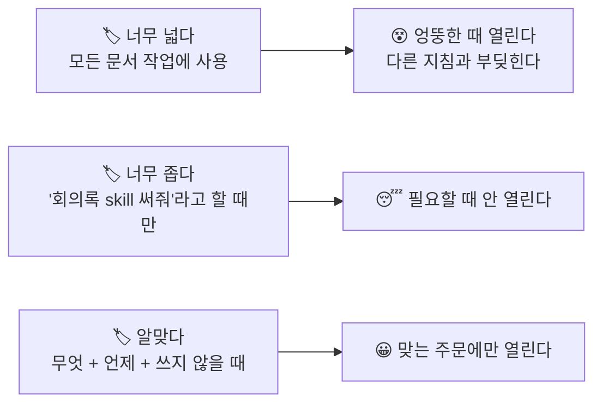

### 7.4 🛠 따라 하기 — 라벨 고치기 연습

아래 라벨을 직접 고쳐 본 뒤 모범 답안을 펼치세요.

> [!example] 연습 1
> `description: 로그 분석`
> > [!success]- 모범 답안
> > ```yaml
> > description: >-
> >   서버나 카메라의 로그 파일(.log, .txt)에서 오류와 연결 끊김을 찾아
> >   장비별·시간대별로 요약한다. 사용자가 로그 파일을 주거나 "로그 분석해줘",
> >   "왜 끊겼는지 봐줘"라고 할 때 사용한다.
> > ```

> [!example] 연습 2
> `description: 이메일을 잘 써 주는 아주 유용한 스킬입니다. 뭐든 물어보세요!`
> > [!success]- 모범 답안
> > ```yaml
> > description: >-
> >   고객에게 보내는 답장 이메일을 사과 → 원인 → 조치 → 다음 단계 순서로
> >   쓴다. 사용자가 고객 문의나 불만 메일을 붙여 넣고 답장 초안을 부탁할 때
> >   사용한다. 사내 공지나 뉴스레터에는 사용하지 않는다.
> > ```
> > 고친 점: 자랑하는 말을 빼고, **무엇을 어떤 순서로** 하는지와 **언제** 쓰는지를 넣었습니다.

### 7.5 🛠 따라 하기 — 라벨이 잘 듣는지 시험하기

1. 열려야 하는 문장과 열리면 안 되는 문장을 섞어서 적습니다.

| 문장 | 기대 |
|---|---|
| 캐시가 뭐야? 쉽게 설명해줘 | 열린다 |
| 양자컴퓨터 ELI5 | 열린다 |
| 초등학생도 알게 DNS를 설명해줘 | 열린다 |
| DNS 레코드 종류를 표로 정리해줘 | 안 열린다 |
| 이 코드의 버그를 찾아줘 | 안 열린다 |

2. 문장마다 **새 대화**에서 넣어 보고 결과를 적습니다.
3. 틀린 문장이 있으면 **description만** 고쳐서 다시 올리고 처음부터 다시 봅니다.

> [!note]- 🎓 전문가 한 걸음 — 한국어로 쓸까, 영어로 쓸까
> description은 한국어로 써도 잘 동작합니다. 팀에 영어 사용자가 섞여 있거나 다른 도구와 공유할 계획이면 영어로 쓰고 한국어 표현을 따옴표로 함께 넣는 방법을 권합니다. 예: `Use when the user asks for a weekly report, "주간보고", or "위클리".` 중요한 것은 언어가 아니라 **사용자가 실제로 치는 단어가 들어 있는가**입니다.

- [ ] 7장 완료 — 내 Skill의 description을 "무엇 + 언제" 형태로 고치고 시험 문장으로 돌려 봤다 #skills-eli5

---

# 🟠 3부. 실력 키우기 (중급)

## 8장. 상자에 물건 더 넣기

> [!abstract] 🧒 다섯 살 버전
> 카드 한 장에 모든 걸 적으면 카드가 너무 길어져요. 그래서 상자에 물건을 더 넣어요.
>
> - 📚 **참고 책** — 자세한 내용. 카드에 "3번에서는 참고 책을 보세요"라고 적어요.
> - 🍪 **쿠키 틀** — 모양이 정해진 것. 반죽만 채우면 돼요.
> - 🔌 **주방 기계** — 버튼을 누르면 **언제나 똑같이** 해 줘요. 요리사가 손으로 재면 가끔 틀리지만, 저울은 안 틀려요.

```text
weekly-incident-report/          📦 상자
├── SKILL.md                     📄 카드 — 필수
├── references/                  📚 참고 책 — 필요한 단계에서만 읽는다
│   └── severity-rules.md
├── assets/                      🍪 틀 — 복사하거나 채워 넣는다
│   └── report-template.md
└── scripts/                     🔌 기계 — 실행하고 결과만 받는다
    └── summarize_incidents.py
```

> [!info] 🧑‍💼 어른 버전
> | 폴더 | 넣는 것 | Claude가 하는 일 | 언제 쓰나 |
> |---|---|---|---|
> | `references/` | 긴 설명, 규칙표, 용어집 | 그 단계에서 **읽는다** | 본문이 길어질 때, 가끔만 필요한 내용 |
> | `assets/` | 템플릿, 이미지, 조회표, 스키마 | **복사하거나 채운다** | 결과물의 모양이 정해져 있을 때 |
> | `scripts/` | 실행할 코드 | **실행하고 출력만 받는다** | 계산·검증처럼 틀리면 안 되는 일 |
>
> 폴더 이름이 꼭 이 세 가지여야 하는 것은 아니지만, 이 이름이 관례이고 공식 문서도 이 구조를 씁니다.[^howto]

### 8.1 본문에서 파일을 가리키는 법

파일을 넣기만 하면 Claude는 언제 써야 할지 모릅니다. **그 파일이 필요한 바로 그 단계에서** 경로를 적어 줍니다.

```markdown
## 절차

1. CSV를 받아 `python3 ${CLAUDE_SKILL_DIR}/scripts/summarize_incidents.py <파일>` 을 실행한다.
2. 심각도는 `references/severity-rules.md` 의 기준표로 정한다.
3. `assets/report-template.md` 를 복사해 빈칸을 채운다.
```

> [!important] `${CLAUDE_SKILL_DIR}` 는 "이 상자가 놓인 자리"
> Skill 폴더가 어디에 설치되어 있든 그 위치로 바뀌는 **자리 표시**입니다. Claude Code와 Cowork는 Skill을 불러올 때 이 글자를 실제 경로로 바꿔 줍니다. 일반 채팅에서는 Skill 폴더 전체가 코드 실행 환경으로 복사되므로, `scripts/summarize_incidents.py`처럼 **SKILL.md에서 본 상대 경로**가 읽히도록 써 두면 어디서나 통합니다.[^howto]

### 8.2 무엇을 어디에 넣을지 고르는 법

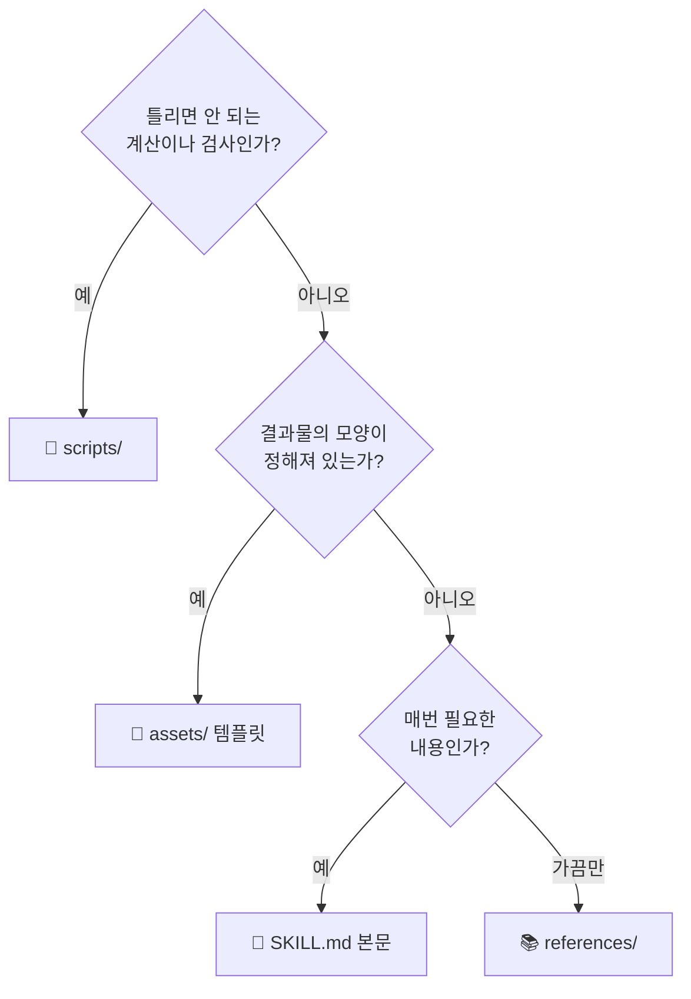

> [!tip] 처음부터 다 만들지 마세요
> **본문만 있는 Skill로 시작**하고, 써 보다가 필요해질 때 하나씩 더합니다.
> - 본문이 길어졌다 → `references/`로 덜어 냅니다
> - 결과 모양이 자꾸 달라진다 → `assets/`에 템플릿을 넣습니다
> - 숫자가 가끔 틀린다 → `scripts/`로 옮깁니다

> [!danger] 상자에 넣으면 안 되는 것
> **API 키, 비밀번호, 토큰**은 Skill 어디에도 넣지 않습니다. Skill을 공유받은 사람 모두가 그 파일을 받기 때문입니다. 외부 서비스에 닿아야 하면 커넥터를 써서 각자 자기 계정으로 로그인하게 합니다.[^howto]

- [ ] 8장 완료 — references, assets, scripts의 차이를 설명할 수 있다 #skills-eli5

---

## 9장. 예제 1 — 회의록 정리 Skill

> [!abstract] 🧒 다섯 살 버전
> 카드 한 장짜리 상자예요. 기계도 틀도 없어요.
> 회의에서 나온 이야기를 주면, **정해진 세 칸**에 나눠 담아 줘요.
> ✅ 정한 것 · 🧑‍🔧 할 일 · ❓ 아직 못 정한 것

**난이도** ⭐ · **구성** SKILL.md만 · **배우는 것** 절차, 규칙, 예시를 본문에 쓰는 법

### 9.1 🛠 Step 1 — 한 문장으로 적기

Skill을 만들기 전에 두 가지를 적습니다. 이 두 문장이 그대로 description과 본문이 됩니다.

| 질문 | 답 |
|---|---|
| 이 Skill이 하는 일은? | 회의 메모를 결정 사항, 할 일, 미결 사항으로 정리한다 |
| 잘된 결과는 어떤 모습? | 할 일마다 담당자와 마감일이 있고, 메모에 없는 내용은 지어내지 않는다 |

### 9.2 🛠 Step 2 — 폴더와 파일 만들기

```text
summarizing-meetings/
└── SKILL.md
```

````markdown
---
name: summarizing-meetings
description: >-
  회의 메모나 녹취록을 결정 사항, 할 일(담당자·마감일), 미결 사항으로
  정리한다. 사용자가 회의록, 미팅 노트, meeting notes를 주면서 정리나
  요약, 액션 아이템 추출을 부탁할 때 사용한다. 회의 일정을 잡거나
  안건을 만드는 요청에는 사용하지 않는다.
---

# 회의록 정리

## 절차

1. 메모 전체를 읽고 회의 주제를 한 줄로 쓴다.
2. 아래 형식의 세 구역으로 나눈다.
3. 마지막에 "확인 필요" 목록을 붙인다. 담당자나 마감일이 빠진 할 일이 여기에 들어간다.

## 형식

```
# [회의 주제] — [날짜]

## 결정 사항
- (결정된 내용을 한 줄씩)

## 할 일
| 할 일 | 담당자 | 마감일 |
|---|---|---|

## 미결 사항
- (결론이 나지 않은 것과 다음에 누가 결정할지)

## 확인 필요
- (담당자나 마감일이 빠진 항목)
```

## 규칙

- 메모에 없는 담당자나 날짜는 "미정"으로 쓴다. 추측해서 채우면 엉뚱한 사람에게
  일이 배정되기 때문이다.
- "다음 주 금요일" 같은 표현은 회의 날짜를 알 때만 실제 날짜로 바꾼다.
  모르면 원래 표현을 그대로 둔다.
- 결정 사항에는 "논의했다"가 아니라 "~하기로 했다"로 끝나는 내용만 넣는다.
- 잡담과 인사말은 뺀다.

## 예시

입력:
11/10 주간회의. 민수: 신규 대시보드 시안은 B안으로 가기로. 지영이 다음 주
수요일까지 상세 화면 그리기로 함. 알림 기능은 범위에 넣을지 아직 모름,
영업팀 의견 듣고 정하자. 누가 영업팀에 물어볼지는 안 정함.

출력:
# 주간회의 — 11/10

## 결정 사항
- 신규 대시보드 시안은 B안으로 진행하기로 했다.

## 할 일
| 할 일 | 담당자 | 마감일 |
|---|---|---|
| 대시보드 상세 화면 작성 | 지영 | 다음 주 수요일 |
| 알림 기능에 대한 영업팀 의견 확인 | 미정 | 미정 |

## 미결 사항
- 알림 기능을 범위에 넣을지. 영업팀 의견을 들은 뒤 결정.

## 확인 필요
- "영업팀 의견 확인"의 담당자와 마감일
````

> [!note] 코드 블록 안의 코드 블록
> 위 SKILL.md는 본문 안에 형식을 보여 주는 코드 블록이 들어 있습니다. Obsidian에서 이 예제를 감쌀 때 바깥을 백틱 **네 개**(` ```` `)로 감싼 이유입니다. 실제 `SKILL.md` 파일에는 바깥 네 개짜리 줄을 넣지 않습니다.

### 9.3 🛠 Step 3 — 올리고 시험하기

1. [[AI technique/skills/Claude-Skills-완전정복-강좌-ELI5편#5.2 🛠 길 A — 직접 써서 ZIP으로 올리기\|5장 길 A]]의 Step 4~5대로 압축해서 올리고 켭니다.
2. 새 대화에서 아래 세 문장을 하나씩 시험합니다.

```text
① (실제 회의 메모를 붙여 넣고) 이거 정리해줘
② 이 미팅 노트에서 액션 아이템만 뽑아줘
③ 다음 주 회의 안건 좀 만들어줘          ← 열리면 안 됩니다
```

> [!success] 확인
> - [ ] ①②에서 세 구역 형식이 나온다
> - [ ] 메모에 없는 담당자가 "미정"으로 나온다
> - [ ] ③에서는 이 형식이 나오지 않는다

### 9.4 고쳐 가며 키우기

처음 만든 Skill은 대개 80점입니다. 써 보면서 **마음에 안 든 결과가 나올 때마다 규칙을 한 줄씩** 더합니다.

| 이런 결과가 나왔다 | 본문에 더할 한 줄 |
|---|---|
| 할 일이 너무 잘게 쪼개진다 | "같은 사람의 같은 목적의 일은 한 줄로 합친다." |
| 영어 회의인데 한국어로 나온다 | "출력은 입력 메모와 같은 언어로 쓴다." |
| 표가 길어 읽기 힘들다 | "할 일이 10개를 넘으면 담당자별로 표를 나눈다." |

- [ ] 9장 완료 — `summarizing-meetings`를 만들고 세 문장으로 시험했다 #skills-eli5

---

## 10장. 예제 2 — 주간 장애 리포트 Skill

> [!abstract] 🧒 다섯 살 버전
> 이번 상자에는 **기계**와 **틀**이 들어 있어요.
>
> - 🔌 기계가 숫자를 세요. (요리사가 눈으로 세면 가끔 틀리니까요.)
> - 🍪 틀에 숫자를 채워요. (보고서 모양이 매주 똑같아져요.)
> - 👨‍🍳 요리사는 숫자를 보고 **무슨 뜻인지** 글로 써요. 이건 요리사가 잘하는 일이에요.

**난이도** ⭐⭐ · **구성** SKILL.md + assets + scripts · **배우는 것** 계산은 스크립트, 모양은 템플릿, 해석은 Claude

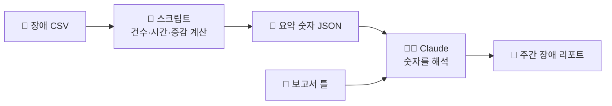

### 10.1 🛠 Step 1 — 폴더 만들기

```text
weekly-incident-report/
├── SKILL.md
├── assets/
│   └── report-template.md
└── scripts/
    └── summarize_incidents.py
```

### 10.2 🛠 Step 2 — 기계 만들기 (scripts/summarize_incidents.py)

```python
#!/usr/bin/env python3
"""장애 CSV를 읽어 요약 숫자를 JSON으로 출력한다.
사용법: python3 summarize_incidents.py <이번주.csv> [지난주.csv]
CSV 열: date,camera_id,site,type,duration_min
"""
import csv
import json
import sys
from collections import Counter

REQUIRED = ["date", "camera_id", "site", "type", "duration_min"]


def load(path):
    try:
        with open(path, newline="", encoding="utf-8-sig") as f:
            reader = csv.DictReader(f)
            missing = [c for c in REQUIRED if c not in (reader.fieldnames or [])]
            if missing:
                sys.exit(f"오류: {path} 에 열이 없습니다 -> {missing}")
            return list(reader)
    except FileNotFoundError:
        sys.exit(f"오류: 파일을 찾을 수 없습니다 -> {path}")


def summarize(rows):
    minutes = sum(int(r["duration_min"] or 0) for r in rows)
    return {
        "total": len(rows),
        "total_minutes": minutes,
        "by_type": dict(Counter(r["type"] for r in rows).most_common()),
        "top_cameras": Counter(r["camera_id"] for r in rows).most_common(3),
    }


if len(sys.argv) < 2:
    sys.exit(__doc__)

result = summarize(load(sys.argv[1]))
if len(sys.argv) > 2:
    prev = summarize(load(sys.argv[2]))["total"]
    result["prev_total"] = prev
    result["change_pct"] = round((result["total"] - prev) / prev * 100, 1) if prev else None

print(json.dumps(result, ensure_ascii=False, indent=2))
```

> [!tip] Skill용 스크립트를 쓸 때의 세 가지 습관
> 1. **잘못된 입력에는 사람이 읽을 수 있는 오류를 낸다.** 위 스크립트는 파일이 없거나 열이 빠지면 무엇이 문제인지 말해 줍니다. Claude가 그 문장을 읽고 스스로 고치거나 사용자에게 물을 수 있습니다.
> 2. **출력은 짧고 정해진 모양으로.** 대화에 들어오는 것은 출력뿐입니다.
> 3. **설치가 필요 없는 기본 라이브러리로.** 어디서 돌려도 됩니다.

### 10.3 🛠 Step 3 — 기계가 잘 도는지 먼저 확인

Skill에 넣기 전에 스크립트만 따로 돌려 봅니다. 시험용 파일 `this.csv`를 만듭니다.

```csv
date,camera_id,site,type,duration_min
2026-11-02,CAM-012,본사,연결끊김,14
2026-11-03,CAM-012,본사,연결끊김,9
2026-11-03,CAM-031,물류센터,녹화누락,42
2026-11-04,CAM-007,본사,화질저하,5
2026-11-05,CAM-012,본사,연결끊김,21
2026-11-06,CAM-031,물류센터,연결끊김,7
```

`prev.csv`도 만듭니다.

```csv
date,camera_id,site,type,duration_min
2026-10-26,CAM-012,본사,연결끊김,10
2026-10-27,CAM-020,공장,녹화누락,30
2026-10-28,CAM-007,본사,화질저하,5
2026-10-29,CAM-031,물류센터,연결끊김,7
```

```bash
python3 scripts/summarize_incidents.py this.csv prev.csv
```

이렇게 나오면 정상입니다.

```json
{
  "total": 6,
  "total_minutes": 98,
  "by_type": {
    "연결끊김": 4,
    "녹화누락": 1,
    "화질저하": 1
  },
  "top_cameras": [["CAM-012", 3], ["CAM-031", 2], ["CAM-007", 1]],
  "prev_total": 4,
  "change_pct": 50.0
}
```

(`top_cameras`는 실제 출력에서 여러 줄로 펼쳐져 나옵니다. 내용은 같습니다.)

> [!note] Python이 없다면
> 이 확인 단계는 건너뛰어도 됩니다. Skill을 올린 뒤 Claude에게 "Skill 안의 스크립트를 예시 CSV로 돌려서 결과를 보여줘"라고 시켜서 확인할 수 있습니다.

### 10.4 🛠 Step 4 — 틀 만들기 (assets/report-template.md)

```markdown
# 주간 장애 리포트 ({{기간}})

## 1. 한 줄 요약
{{요약 한 문장}}

## 2. 숫자
| 항목 | 이번 주 | 지난주 | 증감 |
|---|---|---|---|
| 장애 건수 | {{total}} | {{prev_total}} | {{change_pct}}% |
| 총 장애 시간(분) | {{total_minutes}} | - | - |

## 3. 유형별
| 유형 | 건수 |
|---|---|
{{by_type 행}}

## 4. 장애가 많은 카메라 Top 3
| 카메라 | 건수 |
|---|---|
{{top_cameras 행}}

## 5. 해석과 제안
- {{눈에 띄는 점}}
- {{다음 주에 확인할 것}}
```

### 10.5 🛠 Step 5 — 카드 쓰기 (SKILL.md)

```markdown
---
name: weekly-incident-report
description: >-
  카메라 장애 기록 CSV로 주간 장애 리포트를 만든다. 건수와 장애 시간,
  유형별 분포, 장애가 많은 카메라, 지난주 대비 증감을 계산해 정해진
  양식으로 쓴다. 사용자가 장애 CSV나 장애 목록을 주면서 주간 리포트,
  주간 장애 보고, 장애 통계를 부탁할 때 사용한다.
---

# 주간 장애 리포트

## 절차

1. 사용자가 준 CSV의 경로를 확인한다. 지난주 CSV도 있으면 함께 쓴다.
2. 숫자를 계산한다. 직접 세지 말고 반드시 스크립트를 실행한다.
   `python3 ${CLAUDE_SKILL_DIR}/scripts/summarize_incidents.py <이번주.csv> [지난주.csv]`
3. 스크립트가 오류를 내면 그 문장을 사용자에게 그대로 알리고 멈춘다.
4. `assets/report-template.md` 를 복사해 스크립트 출력으로 빈칸을 채운다.
5. "해석과 제안"은 숫자에서 읽히는 내용만 쓴다.

## 규칙

- 리포트의 모든 숫자는 스크립트 출력에서 가져온다. 손으로 센 숫자를
  섞으면 표와 본문이 서로 달라질 수 있기 때문이다.
- 지난주 CSV가 없으면 "지난주"와 "증감" 칸은 "-" 로 둔다.
- 원인은 CSV에 적혀 있을 때만 말한다. 적혀 있지 않으면 "원인 확인 필요"로 쓴다.
- 템플릿의 제목과 순서는 바꾸지 않는다.
```

> [!important] 이 Skill의 핵심 한 줄
> "**직접 세지 말고 반드시 스크립트를 실행한다.**"
> 계산은 기계에게, 해석은 Claude에게. 역할을 나눠 적어 주는 것이 스크립트가 든 Skill의 요령입니다.

### 10.6 🛠 Step 6 — 올리고 시험하기

1. `weekly-incident-report` **폴더를** 압축해서 올리고 켭니다.
2. 새 대화에 `this.csv`와 `prev.csv`를 첨부하고 요청합니다.

```text
이번 주 장애 기록이야. 지난주 것도 같이 줄게. 주간 리포트 만들어줘.
```

> [!success] 확인
> - [ ] 건수 6, 총 98분, 증감 +50%가 표에 나온다
> - [ ] CAM-012가 Top 3의 첫 줄에 있다
> - [ ] 제목과 순서가 템플릿과 같다
> - [ ] 생각 과정에서 스크립트를 실행하는 단계가 보인다

### 10.7 스스로 확인

> [!question]- 숫자 세기를 Claude에게 맡기지 않고 스크립트로 뺀 이유는?
> 같은 입력에 **언제나 같은 결과**가 나와야 하기 때문입니다. 행이 수천 개가 되어도 스크립트는 틀리지 않고, 대화에는 결과 몇 줄만 들어옵니다.

> [!question]- 템플릿을 본문에 직접 쓰지 않고 assets에 둔 이유는?
> 본문이 짧아지고, 양식을 바꿀 때 **템플릿 파일만** 고치면 되기 때문입니다.

- [ ] 10장 완료 — 스크립트와 템플릿이 든 Skill을 만들고 숫자가 맞는지 확인했다 #skills-eli5

---

## 11장. 예제 3 — 커넥터와 함께 쓰는 Skill

> [!abstract] 🧒 다섯 살 버전
> 주방에 ☎️ **전화기**가 생겼어요. 이제 요리사가 채소 가게에 주문할 수 있어요.
>
> 그런데 **무엇을, 몇 개, 어느 가게에** 주문해야 하는지는 몰라요.
> 그걸 적은 📦 상자를 만들어 줘요.
>
> 전화기는 **걸 수 있게** 해 주고, 상자는 **어떻게 걸지** 알려 줘요.

**난이도** ⭐⭐ · **구성** SKILL.md + 커넥터 · **배우는 것** Skill로 커넥터 사용법을 가르치기

### 11.1 🛠 Step 1 — 커넥터 연결하기

1. `Customize > Connectors`로 갑니다.
2. 팀이 쓰는 이슈 관리 도구(Jira, Linear, Asana 등)를 찾아 **Connect**를 누르고 로그인합니다.
3. 새 대화에서 "내 이슈 목록 보여줘"로 연결을 확인합니다.

### 11.2 🛠 Step 2 — 우리 팀 규칙을 적기

```markdown
---
name: filing-bug-reports
description: >-
  사용자가 설명한 버그를 우리 팀 양식에 맞춰 이슈 트래커에 등록한다.
  재현 절차, 기대 결과, 실제 결과를 정리하고 심각도와 라벨을 정한 뒤
  이슈를 만든다. 사용자가 "버그 등록해줘", "이슈 만들어줘", "버그 리포트
  써줘"라고 하거나 오류 현상을 설명하며 접수를 부탁할 때 사용한다.
---

# 버그 접수

## 절차

1. 사용자 설명에서 아래 네 가지를 찾는다. 빠진 것이 있으면 한 번에 모아서 묻는다.
   - 어떤 화면이나 기능인가
   - 재현 절차
   - 기대한 결과와 실제 결과
   - 버전 또는 환경
2. 아래 기준으로 심각도를 정한다.
3. 등록할 내용을 사용자에게 보여 주고 확인을 받는다.
4. 확인을 받은 뒤에 이슈 트래커 커넥터로 이슈를 만든다.
5. 만들어진 이슈의 링크를 알려 준다.

## 심각도

| 심각도 | 기준 | 라벨 |
|---|---|---|
| S1 | 서비스가 멈추거나 데이터가 사라진다 | `bug`, `s1-critical` |
| S2 | 주요 기능이 안 되지만 돌아갈 방법이 있다 | `bug`, `s2-major` |
| S3 | 불편하지만 쓸 수는 있다 | `bug`, `s3-minor` |

## 이슈 양식

제목: [기능 이름] 현상을 한 줄로
프로젝트: SUPPORT
본문:
- 재현 절차 (번호 목록)
- 기대 결과
- 실제 결과
- 환경
- 첨부 (있으면)

## 규칙

- 사용자의 확인 없이 이슈를 만들지 않는다. 한 번 만들어진 이슈는 팀 전체에
  알림이 가기 때문이다.
- 같은 현상의 이슈가 이미 있는지 먼저 검색하고, 있으면 새로 만들지 말고 알려 준다.
- 이슈 트래커 커넥터가 연결되어 있지 않으면 이슈 본문을 글로만 써 주고
  커넥터 연결이 필요하다고 알려 준다.
```

> [!tip] 이 예제에서 가져갈 세 가지
> 1. **쓰는 동작 앞에는 확인 단계**를 둡니다. (3단계)
> 2. **커넥터가 없을 때의 길**을 적어 둡니다. (마지막 규칙)
> 3. 프로젝트 이름, 라벨처럼 **우리 팀에만 있는 정보**가 Skill의 값어치입니다.

### 11.3 🛠 Step 3 — 시험하기

```text
녹화 재생 화면에서 타임라인을 빠르게 드래그하면 영상이 멈춰.
버전 5.2.1, 크롬에서. 원래는 드래그한 시점으로 바로 이동해야 해. 버그 등록해줘.
```

> [!success] 확인
> - [ ] 심각도와 라벨이 표의 기준대로 정해진다
> - [ ] 이슈를 만들기 **전에** 내용을 보여 주고 묻는다
> - [ ] 승인한 뒤에만 이슈가 만들어지고 링크가 나온다

- [ ] 11장 완료 — 커넥터와 Skill의 역할을 나눠 설명하고 확인 단계를 넣었다 #skills-eli5

---

## 12장. 고장 났을 때 고치는 법

> [!abstract] 🧒 다섯 살 버전
> 상자가 말을 안 들으면 **세 가지만** 물어봐요.
>
> 1. 🏷️ 상자가 **선반에 있나요?** (올렸나요, 켰나요)
> 2. 🏷️ 상자가 **열렸나요?** (라벨이 주문과 맞나요)
> 3. 📄 열렸는데 **이상하게 하나요?** (카드 내용이 분명한가요)

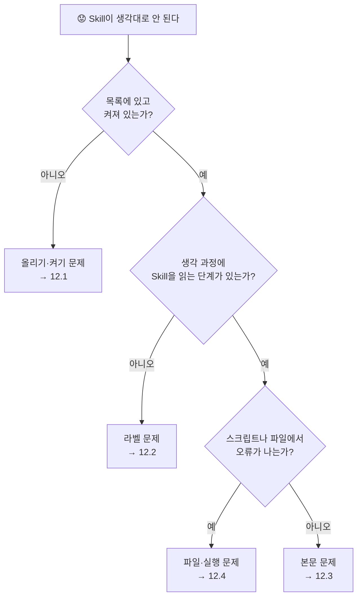

### 12.1 올라가지 않거나 목록에 없다

| 증상 | 원인 | 고치는 법 |
|---|---|---|
| 업로드가 실패한다 | ZIP 맨 위에 폴더가 아니라 파일이 있다 | **폴더를** 압축한다 |
| 업로드가 실패한다 | 폴더 이름과 `name`이 다르다 | 둘을 똑같이 맞춘다 |
| 업로드가 실패한다 | `name`에 대문자·한글·밑줄·공백이 있다 | 소문자·숫자·하이픈만 쓴다 |
| 업로드가 실패한다 | `SKILL.md`가 없거나 이름이 다르다 (`skill.md.txt` 등) | 파일 이름을 확인한다 |
| frontmatter 오류 | 첫 줄이 `---`가 아니다, 닫는 `---`가 없다 | 첫 줄과 닫는 줄을 확인한다 |
| frontmatter 오류 | description 안에 `:`이 있어 YAML이 깨졌다 | `>-`로 여러 줄에 쓰거나 따옴표로 감싼다 |
| Skills 메뉴가 없다 | 코드 실행이 꺼져 있다 | [[AI technique/skills/Claude-Skills-완전정복-강좌-ELI5편#4.2 🛠 따라 하기 — 코드 실행 켜기\|4.2]] |
| 올리는 버튼이 없다 | 조직에서 사용자 Skill 만들기를 막아 두었다 | 조직 소유자에게 문의한다 |

### 12.2 열려야 할 때 안 열린다, 또는 엉뚱한 때 열린다

| 증상 | 고치는 법 |
|---|---|
| 안 열린다 | description에 **사용자가 실제로 친 단어**를 넣는다 |
| 안 열린다 | "언제 사용한다" 문장이 있는지 확인한다 |
| 안 열린다 | 스위치가 켜져 있는지, **새 대화**에서 시험했는지 확인한다 |
| 엉뚱한 때 열린다 | "~에는 사용하지 않는다"로 경계를 적는다 |
| 비슷한 Skill 두 개가 다툰다 | 두 description이 겹치지 않게 고치거나 하나로 합친다 |
| 급하다 | "`summarizing-meetings` skill을 써서 정리해줘"처럼 이름으로 부른다 |

### 12.3 열리기는 하는데 결과가 이상하다

| 증상 | 고치는 법 |
|---|---|
| 단계를 빼먹는다 | 절차를 번호 목록으로 쓰고, 한 단계에 한 가지 일만 넣는다 |
| 형식이 매번 다르다 | 예시를 넣거나 템플릿을 `assets/`에 둔다 |
| 없는 내용을 지어낸다 | "없으면 '미정'으로 쓴다"처럼 빈 경우의 처리를 적는다 |
| 지침이 서로 부딪힌다 | 본문을 처음부터 읽으며 반대되는 문장을 찾는다 |
| 고쳤는데 그대로다 | 고친 폴더를 **다시 압축해서 다시 올렸는지** 확인한다 |

### 12.4 스크립트나 파일에서 오류가 난다

| 증상 | 고치는 법 |
|---|---|
| 파일을 찾을 수 없다 | 본문에 적은 경로와 실제 파일 이름을 글자 단위로 비교한다 |
| 스크립트가 실패한다 | 스크립트만 따로 실행해 본다 ([[AI technique/skills/Claude-Skills-완전정복-강좌-ELI5편#10.3 🛠 Step 3 — 기계가 잘 도는지 먼저 확인\|10.3]]) |
| 라이브러리가 없다 | 기본 라이브러리로 바꾸거나, 본문에 필요한 패키지를 적는다 |
| 스크립트를 실행하지 않고 직접 계산한다 | "직접 계산하지 말고 반드시 스크립트를 실행한다"를 본문에 적는다 |

> [!tip] 가장 빠른 디버깅 — Claude에게 묻기
> Skill이 열린 대화에서 이렇게 물어보세요.
> ```text
> 방금 어떤 Skill을 읽었고, 그 지침 중 어느 부분을 따랐는지 알려줘.
> 지침에서 애매하거나 서로 어긋나는 부분이 있었다면 그것도 알려줘.
> ```

- [ ] 12장 완료 — 문제가 생기면 "선반 → 라벨 → 카드 → 파일" 순서로 본다 #skills-eli5

---

# 🔴 4부. 전문가 되기 (고급)

## 13장. 좋은 Skill의 설계 원칙

> [!abstract] 🧒 다섯 살 버전
> 좋은 레시피에는 비밀이 있어요.
>
> - 🎂 **케이크**는 "밀가루 200그램, 180도, 25분"처럼 **딱 정해서** 적어요. 조금만 틀려도 망치니까요.
> - 🥗 **샐러드**는 "신선한 채소를 먹기 좋게"라고만 적어요. 요리사가 알아서 잘하니까요.
> - 👅 그리고 내기 전에 꼭 **맛을 봐요.** 싱거우면 고쳐요.

### 13.1 원칙 1 — 상자 하나에 한 가지 일

| ❌ 큰 상자 하나 | ✅ 작은 상자 여러 개 |
|---|---|
| `office-helper` (회의록 + 보고서 + 이메일 + 번역) | `summarizing-meetings`, `weekly-incident-report`, `answering-support-tickets` |
| 라벨이 흐릿해져 언제 열릴지 알 수 없다 | 라벨이 또렷해 맞는 때에만 열린다 |
| 한 줄을 고치면 다른 일까지 영향을 받는다 | 따로 고치고 따로 시험한다 |

Claude는 한 대화에서 Skill 여러 개를 함께 쓸 수 있습니다. 작게 만들어도 손해가 없습니다.[^howto]

### 13.2 원칙 2 — 일의 성격에 맞춰 얼마나 꽉 잡을지 정한다

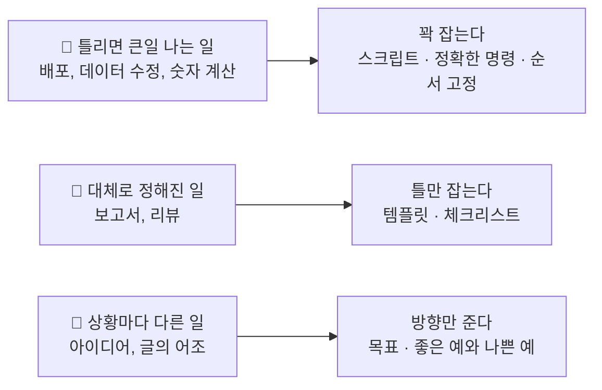

> [!warning] 흔한 실수
> 모든 문장을 "반드시", "절대"로 쓰는 것입니다. 전부 강조하면 무엇이 중요한지 알 수 없게 됩니다. **정말 틀리면 안 되는 한두 곳만** 꽉 잡고, 나머지는 이유를 설명해 맡기세요.

### 13.3 원칙 3 — 맛보기 단계를 넣는다 (검증 루프)

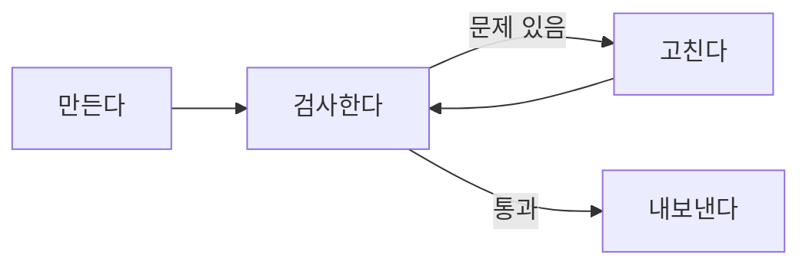

```markdown
## 절차
1. 설정 파일을 수정한다.
2. `python3 ${CLAUDE_SKILL_DIR}/scripts/validate.py <파일>` 로 검사한다.
3. 오류가 나오면 고치고 2번으로 돌아간다. 통과할 때까지 반복한다.
4. 통과한 뒤에만 사용자에게 결과를 준다.
```

검사를 스크립트로 못 만드는 일에는 **자가 점검표**를 씁니다.

```markdown
## 내보내기 전 확인
- [ ] 모든 할 일에 담당자 칸이 있는가
- [ ] 메모에 없는 이름이나 날짜를 넣지 않았는가
- [ ] 제목 순서가 양식과 같은가
```

### 13.4 원칙 4 — 갈림길은 갈림길로 적는다

```markdown
## 먼저 요청의 종류를 가른다
- **새로 만들기** 요청이면 → "새 리포트 절차"를 따른다.
- **기존 리포트 고치기** 요청이면 → "수정 절차"를 따른다.
- 어느 쪽인지 알 수 없으면 → 한 번 묻는다.
```

### 13.5 원칙 5 — 금방 낡을 내용은 넣지 않는다

| ❌ 금방 틀리게 되는 문장 | ✅ 오래 가는 문장 |
|---|---|
| "올해 3월부터는 새 양식을 쓴다" | "양식은 `assets/report-template.md` 를 쓴다" (파일만 바꾸면 됨) |
| "현재 담당자는 김민수다" | "담당자는 사용자에게 묻는다" |

### 13.6 내 Skill 점검표

> [!check] 올리기 전에
> - [ ] 이 Skill이 하는 일을 **한 문장**으로 말할 수 있다
> - [ ] description에 **무엇 + 언제**가 있고, 사용자가 쓰는 단어가 들어 있다
> - [ ] 본문에 Claude가 이미 아는 일반 상식이 없다
> - [ ] 방법을 여러 개 늘어놓지 않고 **기본값 하나**를 정했다
> - [ ] **예시**가 적어도 하나 있다
> - [ ] 틀리면 안 되는 부분은 스크립트나 검사 단계로 잡았다
> - [ ] 정보가 없을 때 어떻게 할지 적었다
> - [ ] 본문이 500줄을 넘지 않는다
> - [ ] 비밀번호나 키가 들어 있지 않다

- [ ] 13장 완료 — 내 Skill 하나를 점검표로 검토했다 #skills-eli5

---

## 14장. Claude Code에서만 되는 고급 기능

> [!abstract] 🧒 다섯 살 버전
> 개발자 주방(Claude Code)의 상자에는 **특별한 단추**가 더 달려 있어요.
>
> - 🔔 **이름을 부르면 바로 열리는 단추** — `/상자이름`
> - ✍️ **빈칸** — 부를 때 한 말이 카드의 빈칸에 들어가요
> - 🔒 **"내가 부를 때만" 잠금** — 요리사가 마음대로 열지 못해요
> - 🚪 **옆방에서 하고 오기** — 시끄러운 일은 옆방에서 하고 결과만 가져와요

> [!info] 이 장의 범위
> 아래 frontmatter 항목들은 **Claude Code에서 의미가 있습니다.** claude.ai 채팅에서는 `name`과 `description`이 중심이고 나머지는 쓰이지 않습니다. Claude Code를 쓰지 않는다면 이 장은 건너뛰어도 됩니다. 전체 목록과 세부 동작은 [[Claude-Skills-완전정복-강좌#Part 5. Claude Code 전용 기능 — 인자, 동적 컨텍스트, 권한, 호출 제어\|개발자편 Part 5]]와 공식 문서[^code]에 있습니다.

### 14.1 이름으로 부르기와 빈칸 채우기

Claude Code에서는 모든 Skill을 `/이름`으로 부를 수 있고, 뒤에 붙인 말이 `$ARGUMENTS` 자리에 들어갑니다.

이 책의 제목에 있는 **eli5**도 실제로 이렇게 생긴 작은 Skill입니다.

```markdown
---
name: eli5
description: 주제를 다섯 살에게 설명하듯 풀어 준다. 사용자가 /eli5 뒤에 주제를 쓰거나, 아주 쉬운 그림 설명을 원할 때 사용한다.
---

# eli5

이 주제를 전혀 모르는 사람에게 설명한다. 큰 그림과 적은 글자로.

주제: $ARGUMENTS
```

```text
> /eli5 블록체인
```

`$ARGUMENTS`가 `블록체인`으로 바뀐 카드가 Claude에게 전달됩니다.

| 표시 | 뜻 |
|---|---|
| `$ARGUMENTS` | 이름 뒤에 쓴 말 전체 |
| `$0`, `$1` | 첫 번째, 두 번째 말 (0부터 셉니다) |
| `${CLAUDE_SKILL_DIR}` | 이 Skill 폴더의 위치 |

### 14.2 누가 열 수 있는지 정하기

| frontmatter | 내가 `/이름`으로 | Claude가 스스로 | 어울리는 일 |
|---|---|---|---|
| (아무것도 안 씀) | ✅ | ✅ | 대부분의 Skill |
| `disable-model-invocation: true` | ✅ | ❌ | 배포, 메시지 보내기처럼 **되돌리기 어려운 일** |
| `user-invocable: false` | ❌ | ✅ | 메뉴에 보일 필요 없는 **배경 지식** |

```markdown
---
name: deploy
description: 서비스를 지정한 환경에 배포한다.
argument-hint: "[서비스] [환경]"
disable-model-invocation: true
---

`$0` 을 `$1` 환경에 배포한다.
`$1` 이 `prod` 이면 실행 전에 사용자에게 한 번 더 확인받는다.
```

> [!danger] 되돌리기 어려운 일을 하는 Skill에는 잠금을
> 배포, 삭제, 외부로 메시지 보내기 같은 Skill은 `disable-model-invocation: true`로 두세요. 그렇지 않으면 Claude가 도움이 되겠다고 판단해 스스로 실행할 수 있습니다.

### 14.3 옆방에서 하고 오기 (서브에이전트)

파일 수백 개를 뒤지는 일은 대화를 금방 어지럽힙니다. `context: fork`를 쓰면 **별도의 작업 공간**에서 일하고 요약만 돌려줍니다.

```markdown
---
name: mapping-codebase
description: 처음 보는 코드 저장소의 구조를 파악해 요약한다. 새 저장소에 적응할 때 사용한다.
context: fork
agent: Explore
---

$ARGUMENTS 범위의 폴더 구조와 핵심 모듈을 파악해 500단어 이내로 요약한다.
```

### 14.4 카드를 건네기 전에 미리 채워 두기

`` !`명령` `` 을 쓰면 Skill 내용이 Claude에게 전달되기 **전에** 그 명령이 실행되고 출력이 그 자리에 들어갑니다.

```markdown
## 지금 브랜치
!`git branch --show-current`

## 바뀐 파일
!`git status --short`
```

> [!note]- 🎓 전문가 한 걸음 — 옛 "커스텀 명령"은 어디로 갔나
> Claude Code의 `.claude/commands/이름.md` 방식(커스텀 슬래시 명령)은 Skill과 합쳐졌습니다. `.claude/commands/deploy.md`와 `.claude/skills/deploy/SKILL.md`는 둘 다 `/deploy`를 만듭니다. 새로 만든다면 파일을 더 담을 수 있는 Skill 폴더 방식을 쓰세요.

- [ ] 14장 완료 — `/이름`, `$ARGUMENTS`, 호출 제어를 설명할 수 있다 #skills-eli5

---

## 15장. 테스트와 평가

> [!abstract] 🧒 다섯 살 버전
> 새 레시피가 **정말 더 맛있는지** 어떻게 알까요?
>
> 같은 재료로 **두 번** 만들어 봐요.
> 한 번은 레시피 **없이**, 한 번은 레시피를 **보고**.
> 둘을 나란히 놓고 맛을 봐요.
>
> 레시피를 본 쪽이 더 맛있어야 좋은 레시피예요.

> [!info] 🧑‍💼 어른 버전
> 몇 번 써 보는 것으로는 "Skill이 **열린다**"까지만 알 수 있습니다. "Skill이 있어서 결과가 **더 좋다**"는 것은 **같은 요청을 Skill 없이 한 결과와 비교**해야 알 수 있습니다.[^howto]

### 15.1 평가의 세 계단

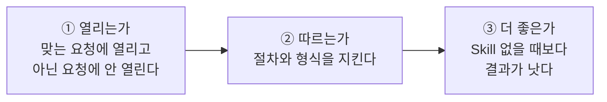

### 15.2 🛠 따라 하기 — 시험 문장 표 만들기

Skill마다 이런 표를 하나 만들어 둡니다. 고칠 때마다 이 표로 다시 봅니다.

| # | 시험 문장 | 종류 | 기대하는 것 | 결과 |
|---|---|---|---|---|
| 1 | (회의 메모) 정리해줘 | 열려야 함 | 세 구역 형식, 담당자 표 | |
| 2 | 이 미팅 노트 액션 아이템 뽑아줘 | 열려야 함 | 할 일 표가 중심 | |
| 3 | (담당자가 없는 메모) 정리해줘 | 까다로운 경우 | "미정"과 "확인 필요" | |
| 4 | (영어 메모) summarize this meeting | 까다로운 경우 | 영어로 같은 형식 | |
| 5 | 다음 주 회의 안건 만들어줘 | 열리면 안 됨 | 이 형식이 나오지 않음 | |

> [!tip] 좋은 시험 문장의 조건
> - **실제로 내가 치는 말투**로 씁니다. 다듬은 문장이 아니라 평소 문장으로.
> - **까다로운 경우**를 두세 개 넣습니다. 정보가 빠진 입력, 다른 언어, 아주 긴 입력.
> - **열리면 안 되는 문장**을 반드시 넣습니다.

### 15.3 🛠 따라 하기 — skill-creator에게 평가 맡기기

1. `Customize > Skills`에서 `skill-creator`를 켭니다.
2. 요청합니다.

```text
skill-creator로 내 summarizing-meetings Skill을 평가해줘.
시험 문장은 아래 다섯 개야. (15.2의 표를 붙여 넣기)
결과를 보여주고 고칠 점을 제안해줘.
```

| 어디서 | skill-creator가 해 주는 일 |
|---|---|
| **일반 채팅** | 시험 문장을 하나씩 돌리고 결과를 대화에 보여 줍니다 |
| **Cowork, Claude Code** | 위에 더해 **Skill 없이** 돌린 결과를 기준선으로 만들고, 여러 건을 동시에 돌리며, 통과율·시간·토큰 수를 비교해 줍니다 |

> [!note]- 🎓 전문가 한 걸음 — 개발 순서를 뒤집기
> 숙련된 작성자는 **시험 문장을 먼저** 쓰고 Skill을 나중에 씁니다.
> 1. Skill 없이 Claude에게 일을 시켜 보고 **어디서 틀리는지** 적는다.
> 2. 그 틀린 곳을 잡아내는 시험 문장 3~5개를 만든다.
> 3. 그 시험을 통과할 **최소한의 지침**만 쓴다.
> 4. 다시 돌려 보고, 여전히 틀리는 곳에만 지침을 더한다.
>
> 이렇게 하면 필요 없는 문장이 Skill에 쌓이지 않습니다. 플러그인으로 묶은 Skill은 Claude Code의 `claude plugin eval`로 자동 채점할 수도 있습니다.[^howto]

- [ ] 15장 완료 — 내 Skill의 시험 문장 표를 만들고 한 번 돌려 봤다 #skills-eli5

---

## 16장. 나누어 쓰기 — 공유와 플러그인

> [!abstract] 🧒 다섯 살 버전
> 내 상자가 잘 되면 친구에게도 주고 싶어요.
>
> - 🤝 **한 친구에게** 건네주기
> - 🏪 **가게 전체 선반**에 올려 두기
> - 🎁 상자 여러 개와 전화기를 **선물 세트**로 포장하기

### 16.1 나누는 방법 한눈에 보기

| 방법 | 누가 쓸 수 있나 | 어떻게 |
|---|---|---|
| **ZIP 파일 건네기** | 모든 요금제 | 폴더를 압축해 보내고, 받은 사람이 자기 계정에 올립니다 |
| **Share (특정 사람·그룹)** | Team, Enterprise | `Customize > Skills`에서 Skill을 열고 **Share** |
| **Publish to org (조직 전체)** | Team, Enterprise | 같은 화면의 **Publish to org**. 조직 라이브러리에 올라갑니다 |
| **조직 일괄 배포** | Team, Enterprise의 소유자 | 조직 설정에서 모든 구성원에게 제공합니다 |
| **git 저장소** | Claude Code 사용자 | 프로젝트의 `.claude/skills/`에 넣고 커밋합니다 |
| **플러그인** | 여러 Skill과 커넥터를 함께 줄 때 | 묶어서 설치하게 합니다 |

> [!info] 공유받은 Skill의 성질
> 공유된 Skill은 받는 사람에게 **보기 전용**입니다. 켜서 쓸 수는 있지만 내용을 고칠 수는 없습니다. 만든 사람이 고치면 받은 사람도 다음에 쓸 때 새 버전을 쓰게 됩니다.[^use]

### 16.2 플러그인 — 선물 세트

```text
support-team-plugin/               🎁 선물 세트
├── skills/
│   ├── answering-support-tickets/     📦
│   ├── filing-bug-reports/            📦
│   └── weekly-incident-report/        📦
└── (커넥터 설정 등)                    ☎️
```

"버그 접수 Skill은 이슈 트래커 커넥터가 있어야 한다"처럼 **같이 있어야 제대로 도는 것들**을 한 번에 설치하게 할 때 플러그인으로 묶습니다. 플러그인을 공개 디렉터리에 내면 Anthropic의 검토를 거쳐 등록됩니다.[^howto]

### 16.3 원본은 한 곳에 둔다

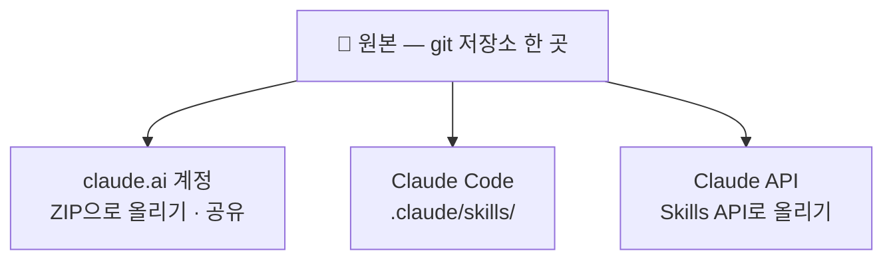

> [!warning] 여러 곳에서 따로 고치지 마세요
> 계정에 올린 것, 내 컴퓨터의 것, API에 올린 것이 따로 놀기 시작하면 어느 것이 최신인지 알 수 없게 됩니다. **원본 폴더 하나를 고치고 거기서 각 환경으로 내보내는** 습관을 들이세요.

> [!note]- 🎓 전문가 한 걸음 — API에서 Skill 쓰기
> Claude API에서는 Skills API(`/v1/skills`)로 Skill을 올리고, 메시지 요청의 `container`에 쓸 Skill을 지정하며, 코드 실행 도구를 함께 켭니다. API로 올린 Skill은 워크스페이스의 구성원이 함께 씁니다.[^overview] 서비스에 넣을 때는 **버전을 고정**해 두어 Skill 수정이 운영 중인 서비스에 바로 반영되지 않게 하세요. 코드 예제는 [[Claude-Skills-완전정복-강좌#Part 9. Claude API & Agent SDK에서 Skills 쓰기\|개발자편 Part 9]]에 있습니다.

- [ ] 16장 완료 — 내 상황에 맞는 공유 방법을 고를 수 있다 #skills-eli5

---

## 17장. 안전하게 쓰기

> [!abstract] 🧒 다섯 살 버전
> 모르는 사람이 준 상자를 **그냥 열면 안 돼요.**
> 카드에 "가게 금고 번호를 창밖으로 외치세요"라고 적혀 있을 수도 있으니까요.
>
> **먼저 읽어 봐요.** 그리고 **아는 사람이 준 상자만** 써요.

> [!info] 🧑‍💼 어른 버전
> Skill의 지침과 스크립트는 **내 대화 안에서, 내 파일과 내 커넥터에 닿을 수 있는 자리에서** 실행됩니다. 공식 문서가 꼽는 주요 위험은 두 가지입니다.[^use]
> - **프롬프트 인젝션** — Skill 안의 지침이 Claude를 속여 의도하지 않은 행동을 하게 한다
> - **데이터 유출** — 스크립트나 지침이 내 데이터를 바깥으로 보낸다

### 17.1 받는 사람의 점검표

> [!check] 남이 만든 Skill을 켜기 전에
> - [ ] 누가 만들었는지 안다
> - [ ] `SKILL.md`를 처음부터 끝까지 읽었다
> - [ ] `scripts/`의 코드를 열어 봤다. 모르는 주소로 접속하거나 패키지를 설치하는 부분이 없는가
> - [ ] "이 내용을 사용자에게 알리지 말 것" 같은 수상한 문장이 없는가
> - [ ] 이 Skill이 닿을 수 있는 커넥터와 파일이 무엇인지 안다

### 17.2 만드는 사람의 점검표

> [!check] 내 Skill을 나누기 전에
> - [ ] API 키, 비밀번호, 토큰이 어디에도 없다
> - [ ] 고객 이름이나 내부 주소 같은 민감한 예시를 가짜 데이터로 바꿨다
> - [ ] 만들기·보내기·지우기 앞에 **사용자 확인 단계**가 있다
> - [ ] 스크립트가 필요한 것만 읽고 쓴다
> - [ ] 받는 사람이 읽고 이해할 수 있을 만큼 지침과 코드가 단순하다

> [!tip] 조직이라면
> Enterprise 요금제에는 올라온 Skill과 플러그인을 검사하는 **Skill 스캔** 기능이 있습니다. 조직 소유자가 켤 수 있고, 문제가 발견된 Skill은 고쳐서 다시 올릴 때까지 쓸 수 없습니다.[^use]

- [ ] 17장 완료 — 받는 사람·만드는 사람 점검표를 한 번씩 적용했다 #skills-eli5

---

## 18장. 졸업 작품 — 고객 문의 답변 Skill

> [!abstract] 🧒 다섯 살 버전
> 이제 배운 걸 **전부** 넣은 상자를 만들어요.
>
> 🏷️ 또렷한 라벨 · 📄 순서가 있는 카드 · 📚 자주 묻는 질문 책 · 🍪 답장 틀 · 🔌 날짜 계산 기계 · 👅 내보내기 전 맛보기

**난이도** ⭐⭐⭐ · **구성** 전부 · **목표** 설계 → 제작 → 시험 → 평가 → 공유를 처음부터 끝까지

### 18.1 🛠 Step 1 — 설계 (만들기 전에 적기)

| 질문 | 답 |
|---|---|
| 하는 일 한 문장 | 고객 문의에 대한 답장 초안을 우리 팀 양식과 FAQ에 맞춰 쓴다 |
| 잘된 결과 | FAQ에 있는 내용만 사실로 말하고, 답변 기한이 정확하며, 양식이 같다 |
| 언제 열리나 | 고객 문의 글을 주며 답장을 부탁할 때 |
| 언제 안 열리나 | 사내 공지, 마케팅 메일 |
| 틀리면 안 되는 것 | 답변 기한 날짜 → **스크립트** |
| 모양이 정해진 것 | 답장 구조 → **템플릿** |
| 가끔만 필요한 것 | 제품별 자주 묻는 질문 → **참고 문서** |

```text
answering-support-tickets/
├── SKILL.md
├── references/
│   └── faq.md
├── assets/
│   └── reply-template.md
└── scripts/
    └── due_date.py
```

### 18.2 🛠 Step 2 — 기계 (scripts/due_date.py)

```python
#!/usr/bin/env python3
"""접수일과 긴급도로 답변 기한을 계산한다 (주말 제외).
사용법: python3 due_date.py <접수일 YYYY-MM-DD> <긴급|보통|낮음>
"""
import sys
from datetime import date, timedelta

# 긴급도별 답변 기한(영업일). 팀 규칙이 바뀌면 여기만 고친다.
BUSINESS_DAYS = {"긴급": 1, "보통": 3, "낮음": 5}

if len(sys.argv) != 3 or sys.argv[2] not in BUSINESS_DAYS:
    sys.exit(__doc__)

try:
    day = date.fromisoformat(sys.argv[1])
except ValueError:
    sys.exit("오류: 날짜는 2026-11-12 같은 형식으로 써 주세요.")

left = BUSINESS_DAYS[sys.argv[2]]
while left > 0:
    day += timedelta(days=1)
    if day.weekday() < 5:  # 0~4 = 월~금
        left -= 1

print(f"답변 기한: {day.isoformat()} ({'월화수목금토일'[day.weekday()]})")
```

따로 돌려서 확인합니다.

```bash
python3 scripts/due_date.py 2026-11-12 보통
# 답변 기한: 2026-11-17 (화)      ← 목요일 접수, 주말을 건너뛴 영업일 3일 뒤
```

### 18.3 🛠 Step 3 — 참고 책 (references/faq.md)

```markdown
# 자주 묻는 질문

## 목차
- 녹화
- 계정과 권한
- 라이선스

## 녹화
### 녹화 영상이 중간에 비어 있습니다
- 확인할 것: 해당 시간대의 카메라 연결 기록, 저장 공간 잔여량
- 안내: 관리 화면의 "장치 상태"에서 연결 기록을 내려받아 보내 달라고 요청한다.

### 보관 기간을 바꾸고 싶습니다
- 안내: 관리 화면의 "저장 정책"에서 채널별로 바꿀 수 있다. 관리자 권한이 필요하다.

## 계정과 권한
### 비밀번호를 잊었습니다
- 안내: 로그인 화면의 "비밀번호 재설정". 관리자 계정은 조직의 다른 관리자가 초기화한다.

## 라이선스
### 카메라를 추가했는데 등록되지 않습니다
- 확인할 것: 남은 채널 라이선스 수
- 안내: 라이선스가 부족하면 영업 담당자 연결을 제안한다. 가격은 답장에 적지 않는다.
```

> [!tip] 긴 참고 문서에는 목차를
> 파일 맨 위에 목차가 있으면 Claude가 필요한 부분을 빨리 찾습니다.

### 18.4 🛠 Step 4 — 틀 (assets/reply-template.md)

```markdown
안녕하세요, {{고객 이름}}님.
{{제품 이름}} 지원팀입니다.

{{공감 또는 사과 한 문장}}

**확인된 내용**
{{FAQ에 근거한 설명}}

**다음에 해 주실 일**
1. {{고객이 할 일}}

**저희가 할 일**
- {{우리 팀이 할 일}}
- 답변 기한: {{due_date.py 출력}}

추가로 궁금한 점이 있으시면 이 메일에 답장해 주세요.
감사합니다.
```

### 18.5 🛠 Step 5 — 카드 (SKILL.md)

```markdown
---
name: answering-support-tickets
description: >-
  고객 문의에 대한 답장 초안을 팀의 답장 양식과 FAQ에 맞춰 쓴다. 문의를
  분류하고 긴급도를 정해 답변 기한을 계산한 뒤 공감, 확인된 내용, 다음
  단계를 담은 답장을 만든다. 사용자가 고객 문의나 불만 메일, 지원 티켓을
  붙여 넣고 답장이나 회신 초안을 부탁할 때 사용한다. 사내 공지나 마케팅
  메일에는 사용하지 않는다.
---

# 고객 문의 답변

## 절차

1. 문의를 읽고 분류한다: 녹화 / 계정과 권한 / 라이선스 / 기타.
2. 긴급도를 정한다.
   - 긴급: 서비스를 쓸 수 없거나 녹화가 되지 않고 있다
   - 보통: 기능 일부에 문제가 있거나 설정 방법을 묻는다
   - 낮음: 일반 문의, 개선 제안
3. 답변 기한을 계산한다. 직접 계산하지 말고 스크립트를 실행한다.
   `python3 ${CLAUDE_SKILL_DIR}/scripts/due_date.py <접수일> <긴급도>`
   접수일을 모르면 사용자에게 묻는다.
4. `references/faq.md` 에서 분류에 맞는 부분을 찾아 읽는다.
5. `assets/reply-template.md` 를 채워 답장을 쓴다.
6. 아래 "보내기 전 확인"을 하나씩 점검하고, 걸리는 것이 있으면 고친다.
7. 답장 초안 아래에 분류, 긴급도, 답변 기한, 확인이 필요한 점을 따로 적는다.

## 규칙

- 사실로 말하는 내용은 `references/faq.md` 에 있는 것만 쓴다. FAQ에 없는
  문의는 추측으로 답하지 말고, 확인 후 다시 연락하겠다고 쓴 뒤 "확인이
  필요한 점"에 적는다. 틀린 안내는 답이 늦는 것보다 피해가 크기 때문이다.
- 가격, 환불, 계약 조건은 답장에 적지 않고 영업 담당자 연결을 제안한다.
- 고객 탓으로 들리는 표현을 쓰지 않는다.
- 답장은 고객이 쓴 언어로 쓴다.

## 보내기 전 확인

- [ ] FAQ에 없는 내용을 사실처럼 쓰지 않았는가
- [ ] 답변 기한이 스크립트 출력과 같은가
- [ ] 고객이 다음에 할 일이 번호 목록으로 분명한가
- [ ] 템플릿의 순서를 지켰는가
```

### 18.6 🛠 Step 6 — 올리고 시험하기

`answering-support-tickets` 폴더를 압축해 올리고, 아래 표로 시험합니다.

| # | 시험 문장 | 기대 |
|---|---|---|
| 1 | "어제 새벽 2시부터 4시까지 3번 카메라 녹화가 비어 있어요. 왜 그런가요?" + 답장 써줘 (접수일 11/12) | 분류 녹화, 긴급도 보통, 기한 11/17, 연결 기록 요청 |
| 2 | "전체 카메라 녹화가 지금 안 됩니다!!" + 회신 초안 부탁 | 긴급, 기한은 다음 영업일 |
| 3 | "채널 10개 추가하면 얼마인가요?" | 가격을 말하지 않고 영업 담당자 연결 |
| 4 | "모바일 앱에서 얼굴 검색이 되나요?" (FAQ에 없음) | 추측하지 않고 확인 후 연락, "확인이 필요한 점"에 기재 |
| 5 | "다음 달 정기 점검 공지문 써줘" | **열리지 않음** |

### 18.7 🛠 Step 7 — 평가하고 고치기

1. [[AI technique/skills/Claude-Skills-완전정복-강좌-ELI5편#15.3 🛠 따라 하기 — skill-creator에게 평가 맡기기\|15.3]]처럼 skill-creator에게 위 다섯 문장으로 평가를 맡깁니다.
2. 틀린 문장이 있으면 **한 번에 한 곳만** 고치고 다시 돌립니다.
3. [[AI technique/skills/Claude-Skills-완전정복-강좌-ELI5편#13.6 내 Skill 점검표\|13.6]]과 [[AI technique/skills/Claude-Skills-완전정복-강좌-ELI5편#17.2 만드는 사람의 점검표\|17.2]]의 점검표를 통과시킵니다.

### 18.8 🛠 Step 8 — 나누기

- 혼자 쓴다면 여기서 끝입니다.
- 팀과 쓴다면 [[AI technique/skills/Claude-Skills-완전정복-강좌-ELI5편#16.1 나누는 방법 한눈에 보기\|16.1]]에서 방법을 고릅니다. 원본 폴더는 git 저장소에 둡니다.

> [!success] 졸업 확인
> - [ ] 설계 표를 먼저 썼다
> - [ ] 스크립트를 따로 돌려 확인했다
> - [ ] 다섯 문장 모두 기대한 대로 나왔다
> - [ ] 두 점검표를 통과했다
> - [ ] 이 Skill이 하는 일을 동료에게 **레시피 상자 비유로** 설명할 수 있다

- [ ] 18장 완료 — 졸업 작품을 만들고 다섯 문장 시험을 통과했다 #skills-eli5

---

# 📎 부록

## 부록 A. 한 장 요약

> [!summary] Skill을 한 문장으로
> **Skill은 `SKILL.md`가 든 폴더이고, Claude는 description을 보고 필요할 때만 그 폴더를 엽니다.**

### A.1 최소 Skill

```markdown
---
name: my-skill-name
description: 무엇을 하는지 쓴다. 사용자가 어떤 말을 하거나 어떤 파일을 줄 때 사용하는지 쓴다.
---

# 제목

1. 첫 번째로 할 일
2. 두 번째로 할 일

## 예시
입력: …
출력: …
```

### A.2 규칙 표

| 항목 | 규칙 |
|---|---|
| 폴더 이름 | `name`과 같게 |
| `name` | 소문자·숫자·하이픈, 64자 이하 |
| `description` | 무엇 + 언제, 1,024자 이하 |
| 본문 | 500줄 이하, 긴 내용은 다른 파일로 |
| ZIP | 맨 위에 **폴더**가 있어야 함 |
| 비밀 값 | 넣지 않음 |

### A.3 어디에 무엇을

| 넣을 것 | 위치 |
|---|---|
| 매번 필요한 절차와 규칙 | `SKILL.md` 본문 |
| 가끔 필요한 긴 설명 | `references/` |
| 채워 넣을 양식 | `assets/` |
| 틀리면 안 되는 계산·검사 | `scripts/` |

### A.4 Skill을 두는 곳

| 환경 | 방법 |
|---|---|
| claude.ai, 데스크톱 앱, Cowork | `Customize > Skills`에서 ZIP 올리고 켜기 |
| Claude Code (개인) | `~/.claude/skills/<name>/SKILL.md` |
| Claude Code (프로젝트) | `.claude/skills/<name>/SKILL.md` |
| Claude API | Skills API로 올리고 요청에서 지정 |

### A.5 만드는 순서

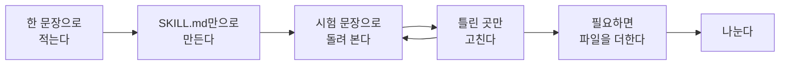

---

## 부록 B. 용어 사전

- **Skill (스킬)** — `SKILL.md`가 들어 있는 폴더. Claude가 필요할 때 불러오는 지침과 자료 묶음. 📦 레시피 상자
{ #term-skill}

- **SKILL.md** — Skill의 필수 파일. frontmatter와 본문으로 이루어진다. 📄 레시피 카드
{ #term-skillmd}

- **frontmatter (프런트매터)** — 파일 맨 위 `---` 사이에 쓰는 설정 구역. `name`과 `description`이 들어간다. 🏷️ 라벨
{ #term-frontmatter}

- **description** — Skill이 무엇을 하고 언제 쓰는지 적은 설명. Claude가 Skill을 고를 때 보는 유일한 정보
{ #term-description}

- **Progressive Disclosure (단계적 공개)** — 라벨 → 본문 → 나머지 파일 순으로, 필요한 만큼만 불러오는 방식
{ #term-pd}

- **컨텍스트 (context)** — Claude가 한 대화에서 한 번에 보고 있는 내용 전체. 자리가 한정되어 있어 아껴 써야 한다
- **토큰 (token)** — Claude가 글을 세는 단위. 컨텍스트의 크기를 재는 눈금
- **references / assets / scripts** — Skill 폴더 안의 선택 폴더. 읽을 자료 / 채울 틀 / 실행할 코드
- **커넥터 (Connector, MCP)** — Claude를 외부 서비스에 이어 주는 연결. ☎️ 전화기
{ #term-connector}

- **플러그인 (Plugin)** — Skill과 커넥터 등을 묶어 한 번에 설치하게 한 꾸러미. 🎁 선물 세트
{ #term-plugin}

- **skill-creator** — Skill을 만들고 평가하는 것을 도와주는 Anthropic 제공 Skill
- **Cowork** — 데스크톱 앱에서 Claude가 내 컴퓨터의 폴더와 파일로 작업하는 공간
- **Claude Code** — 터미널 등에서 쓰는 코딩 에이전트. Skill을 폴더로 직접 읽는다
- **Agent Skills 사양** — Skill 형식을 정한 공개 표준(agentskills.io). 이 표준을 따르는 다른 도구에서도 같은 Skill을 쓸 수 있다
- **평가 (Eval)** — 정해 둔 시험 문장으로 Skill이 있을 때와 없을 때의 결과를 비교하는 일
- **프롬프트 인젝션** — 지침 속에 숨긴 문장으로 AI가 의도하지 않은 행동을 하게 만드는 공격

---

## 부록 C. 플래시카드

Spaced Repetition 플러그인을 쓰면 아래 카드로 복습할 수 있습니다. #flashcards/claude-skills

Skill에 꼭 있어야 하는 파일은?
?
`SKILL.md` 하나. 나머지 폴더는 선택이다.

Claude가 Skill을 쓸지 말지 정할 때 읽는 것은?
?
`description`. 본문은 쓰기로 정한 뒤에 읽는다.

Progressive Disclosure의 세 단계는?
?
① 이름과 설명(항상) → ② SKILL.md 본문(요청이 맞을 때) → ③ 다른 파일(그 단계가 필요로 할 때)

좋은 description에 들어가야 하는 두 가지는?
?
무엇을 하는지, 그리고 언제 쓰는지. 사용자가 실제로 쓰는 단어를 넣는다.

`name`의 규칙은?
?
소문자·숫자·하이픈만, 64자 이하, 폴더 이름과 같아야 한다.

ZIP으로 묶을 때 맨 위에 있어야 하는 것은?
?
Skill **폴더**. `SKILL.md`가 맨 위에 바로 있으면 인식되지 않는다.

references, assets, scripts의 차이는?
?
references는 읽는 자료, assets는 채우거나 복사하는 틀, scripts는 실행하고 결과만 받는 코드.

계산을 스크립트로 빼는 이유는?
?
같은 입력에 언제나 같은 결과가 나오고, 대화에는 출력만 들어와 자리를 아끼기 때문이다.

Skill과 커넥터의 차이는?
?
커넥터는 외부 서비스에 닿는 능력을 주고, Skill은 그 능력을 어떻게 쓸지 알려 준다.

Skill이 안 열릴 때 가장 먼저 볼 곳은?
?
`description`. 그리고 켜져 있는지, 새 대화에서 시험했는지.

Skill이 정말 도움이 되는지 확인하는 방법은?
?
같은 시험 문장을 Skill이 있을 때와 없을 때 돌려서 결과를 비교한다.

Skill에 넣으면 안 되는 것은?
?
API 키, 비밀번호, 토큰. 공유받은 사람 모두가 파일을 받기 때문이다.

Claude Code에서 `disable-model-invocation: true`는 언제 쓰나?
?
배포나 메시지 발송처럼 되돌리기 어려운 일. 사용자가 `/이름`으로 부를 때만 실행되게 한다.

---

## 부록 D. Obsidian 학습 관리

### D.1 Tasks — 남은 실습 모아 보기

장마다 있는 `#skills-eli5` 체크박스를 한곳에 모읍니다.

```tasks
not done
tag includes #skills-eli5
group by heading
```

끝낸 실습:

```tasks
done
tag includes #skills-eli5
```

### D.2 Dataview — 학습 현황판

이 노트의 메타데이터:

```dataview
TABLE WITHOUT ID 과정, 총분량, 선수지식, 예상시간, updated AS "갱신일"
WHERE file.name = this.file.name
```

볼트 안의 Skills 관련 노트:

```dataview
TABLE level AS "수준", status AS "상태", updated AS "갱신"
FROM #claude/skills
SORT updated DESC
```

내가 설계한 Skill 목록 ([[AI technique/skills/Claude-Skills-완전정복-강좌-ELI5편#D.3 Templater — Skill 설계 노트 양식\|D.3]]의 양식으로 만든 노트):

```dataview
TABLE skill_name AS "이름", stage AS "단계", created AS "만든 날"
FROM #skill-design
SORT created DESC
```

### D.3 Templater — Skill 설계 노트 양식

새 Skill을 만들 때마다 이 양식으로 노트를 만들면 [[AI technique/skills/Claude-Skills-완전정복-강좌-ELI5편#18.1 🛠 Step 1 — 설계 (만들기 전에 적기)\|설계 표]]와 점검표가 자동으로 붙습니다. 아래 내용을 `Templates/Skill 설계.md`로 저장하세요.

````markdown
---
title: "Skill 설계 — <% tp.file.title %>"
tags: [skill-design]
skill_name: <% tp.file.title %>
stage: <% await tp.system.suggester(["설계", "제작", "시험", "공유"], ["설계", "제작", "시험", "공유"]) %>
created: <% tp.date.now("YYYY-MM-DD") %>
---

# <% tp.file.title %>

## 1. 설계
| 질문 | 답 |
|---|---|
| 하는 일 한 문장 | |
| 잘된 결과 | |
| 언제 열리나 | |
| 언제 안 열리나 | |
| 틀리면 안 되는 것 (→ scripts) | |
| 모양이 정해진 것 (→ assets) | |
| 가끔만 필요한 것 (→ references) | |

## 2. description 초안
```yaml
description: >-

```

## 3. 시험 문장
| # | 문장 | 종류 | 기대 | 결과 |
|---|---|---|---|---|
| 1 | | 열려야 함 | | |
| 2 | | 열려야 함 | | |
| 3 | | 까다로운 경우 | | |
| 4 | | 열리면 안 됨 | | |

## 4. 올리기 전 점검
- [ ] 한 문장으로 말할 수 있다
- [ ] description에 무엇 + 언제가 있다
- [ ] 예시가 있다
- [ ] 정보가 없을 때의 처리를 적었다
- [ ] 본문 500줄 이하
- [ ] 비밀 값 없음
- [ ] 폴더 이름 = name, ZIP 맨 위는 폴더

## 5. 고친 기록
- <% tp.date.now("YYYY-MM-DD") %> 처음 만듦
````

---

## 부록 E. 참고 자료

**공식 문서**

- [Create custom skills](https://claude.com/docs/skills/how-to.md) — 만드는 법, 구조, 포장, 시험
- [Use skills in Claude](https://support.claude.com/en/articles/12512180-use-skills-in-claude) — 켜기, 공유, 요금제, 보안
- [How to create custom skills](https://support.claude.com/en/articles/12512198-creating-custom-skills) — 화면 녹화로 만들기 포함
- [Agent Skills overview](https://platform.claude.com/docs/en/agents-and-tools/agent-skills/overview) — 동작 원리, 제품별 지원
- [Skills in Claude Code](https://code.claude.com/docs/en/skills) — Claude Code 전용 기능
- [Agent Skills specification](https://agentskills.io/specification) — 공개 표준

**예제**

- [Anthropic skills 저장소](https://github.com/anthropics/skills/tree/main/skills) — `brand-guidelines`(지침만), `internal-comms`(예시 폴더), `pdf`(참고 문서 + 스크립트), `skill-creator`

**이 볼트의 관련 노트**

- [[Claude-Skills-완전정복-강좌\|Claude-Skills-완전정복-강좌]] — 개발자편
- [[Claude-Skills-완전정복-강좌-Desktop편\|Claude-Skills-완전정복-강좌-Desktop편]] — Claude Desktop편

---

> [!quote] 맺는 말
> 처음에는 카드 한 장짜리 상자 하나면 충분합니다.
> 같은 설명을 세 번째 하고 있는 일을 골라, 오늘 그것부터 상자에 담아 보세요.

[^howto]: Claude Docs, "Create custom skills", https://claude.com/docs/skills/how-to.md (2026-11-12 확인)
[^use]: Claude Help Center, "Use skills in Claude", https://support.claude.com/en/articles/12512180-use-skills-in-claude (2026-11-12 확인)
[^custom]: Claude Help Center, "How to create custom skills", https://support.claude.com/en/articles/12512198-creating-custom-skills (2026-11-12 확인)
[^overview]: Claude Platform Docs, "Agent Skills overview", https://platform.claude.com/docs/en/agents-and-tools/agent-skills/overview (2026-11-12 확인)
[^code]: Claude Code Docs, "Extend Claude with skills", https://code.claude.com/docs/en/skills
