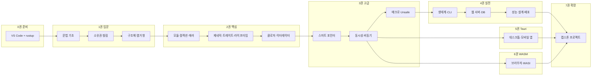
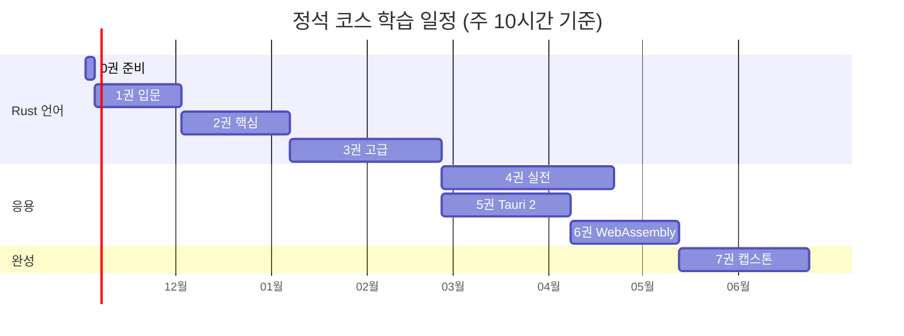

---
{"dg-publish":true,"permalink":"/programming/rust/00-rust/","title":"Rust 마스터 시리즈 — 전체 목차","tags":["rust","tauri","wasm","course/moc","type/toc"],"dg-note-properties":{"title":"Rust 마스터 시리즈 — 전체 목차","aliases":["Rust 강좌 목차","Rust Mastery TOC","시리즈 MOC"],"tags":["rust","tauri","wasm","course/moc","type/toc"],"series":"Rust 마스터 시리즈","volumes":7,"chapters":92,"level":"입문 → 고급","editor":"Visual Studio Code","rust-edition":"2024","rust-version":"1.85+ (stable)","tauri-version":"2.x","status":"목차 확정","version":1,"created":"2026-10-25","updated":"2026-10-25","cssclasses":["course","wide-page"]}}
---


# 🦀 Rust 마스터 시리즈 — 전체 목차

> [!abstract] 시리즈 소개
> **Visual Studio Code** 하나로 Rust 언어의 모든 문법부터 동시성·비동기·매크로·Unsafe까지, 그리고 Rust 생태계의 핵심 응용 기술인 **Tauri 2(데스크톱·모바일 앱)** 와 **WebAssembly(웹·서버리스)** 까지 다루는 7권 92장 구성의 단계별 강좌입니다.
> 
> - **대상 독자**: 프로그래밍 기초(변수, 함수, 조건문)를 아는 초보 개발자 — Rust 경험 0
> - **도달 목표**: 프로덕션 코드를 설계·리뷰·최적화할 수 있는 **고급 Rust 개발자**
> - **학습 방식**: 모든 장이 `비유 → 개념 → 예제 코드 → 한 줄씩 해설 → 실행 결과 → 흔한 실수 → 연습문제 → 체크리스트` 의 동일한 리듬
> - **기준 환경**: Rust stable (Edition 2024) · Tauri 2.x · wasm-bindgen 0.2 · Node.js 22 LTS · Windows / macOS / Ubuntu[^1]

> [!info]- 이 문서의 위치와 역할
> 이 파일은 시리즈 전체의 **MOC(Map of Contents, 지도 노트)** 입니다. 각 장 제목은 앞으로 만들어질 장 노트로 연결되는 위키링크이며, 아직 작성되지 않은 장은 Obsidian에서 흐린 색(미해결 링크)으로 보입니다. 장 노트를 만들면 링크가 자동으로 살아납니다.

---

## 📑 빠른 이동

| 권 | 제목 | 장 | 난이도 | 예상 학습 시간 |
|:---:|---|:---:|:---:|:---:|
| 0권 | [[programming/rust/00 Rust 마스터 시리즈 목차#0권. 시리즈 안내와 학습 환경\|시리즈 안내와 학습 환경]] | 3 | ⭐☆☆☆☆ | 4h |
| 1권 | [[programming/rust/00 Rust 마스터 시리즈 목차#1권. Rust 입문 — 언어의 기초\|Rust 입문 — 언어의 기초]] | 10 | ⭐⭐☆☆☆ | 40h |
| 2권 | [[programming/rust/00 Rust 마스터 시리즈 목차#2권. Rust 핵심 — 추상화와 표현력\|Rust 핵심 — 추상화와 표현력]] | 10 | ⭐⭐⭐☆☆ | 50h |
| 3권 | [[programming/rust/00 Rust 마스터 시리즈 목차#3권. Rust 고급 — 시스템의 깊이\|Rust 고급 — 시스템의 깊이]] | 11 | ⭐⭐⭐⭐☆ | 70h |
| 4권 | [[programming/rust/00 Rust 마스터 시리즈 목차#4권. Rust 실전 — 프로덕션 엔지니어링\|Rust 실전 — 프로덕션 엔지니어링]] | 14 | ⭐⭐⭐⭐☆ | 80h |
| 5권 | [[programming/rust/00 Rust 마스터 시리즈 목차#5권. Tauri 2 — 크로스플랫폼 앱 개발\|Tauri 2 — 크로스플랫폼 앱 개발]] | 17 | ⭐⭐⭐☆☆ | 60h |
| 6권 | [[programming/rust/00 Rust 마스터 시리즈 목차#6권. WebAssembly — 브라우저와 그 너머\|WebAssembly — 브라우저와 그 너머]] | 15 | ⭐⭐⭐⭐☆ | 50h |
| 7권 | [[programming/rust/00 Rust 마스터 시리즈 목차#7권. 확장 트랙과 캡스톤\|확장 트랙과 캡스톤]] | 12 | ⭐⭐⭐⭐⭐ | 60h+ |
| — | [[programming/rust/00 Rust 마스터 시리즈 목차#부록\|부록]] | 8 | — | 참고용 |

> [!tip] 추천 학습 경로
> - **정석 코스**: 0 → 1 → 2 → 3 → 4 → 5 → 6 → 7권 (약 6~8개월, 주 10시간 기준)
> - **앱 개발 우선 코스**: 0 → 1 → 2 → 3권(R18·R19·R20만) → 5권 → 4권 → 6권
> - **웹 개발 우선 코스**: 0 → 1 → 2 → 3권(R20) → 6권 → 4권(R31·R32) → 5권

---

## 🗺️ 학습 로드맵





---

## 🧩 Obsidian 활용 설계

### 필수·권장 플러그인

| 구분 | 플러그인 | 이 강좌에서의 용도 |
|---|---|---|
| 코어 | **Callouts**(내장) | 개념·팁·경고·정답 접기 등 13종 콜아웃 |
| 코어 | **Mermaid**(내장) | 메모리 구조, 흐름도, 시퀀스·상태 다이어그램 |
| 코어 | **MathJax**(내장) | 시간 복잡도 $O(n \log n)$, 메모리 크기 계산 |
| 코어 | **Canvas**(내장) | `Rust 학습 로드맵.canvas` — 권/장 관계 시각화 |
| 코어 | **Properties**(내장) | 장마다 난이도·시간·상태·선수 장 메타데이터 |
| 코어 | **Outline / Backlinks / Graph view** | 장 내부 탐색, 개념 간 역링크, 지식 그래프 |
| 커뮤니티 | **Dataview** | 진도 대시보드, 난이도별 장 목록, 미완료 장 집계 |
| 커뮤니티 | **Tasks** | 장별 학습 체크리스트·실습 과제를 한곳에서 추적 |
| 커뮤니티 | **Spaced Repetition** | 장 끝 `#flashcards` 로 핵심 개념 반복 암기 |
| 커뮤니티 | **Excalidraw** | 스택/힙, 포인터, 빌림 관계 손그림 다이어그램 |
| 커뮤니티 | **Templater** | 장 노트 표준 템플릿 자동 생성 |
| 커뮤니티 | **Advanced Tables** | 비교표·치트시트 편집 |
| 커뮤니티 | **Code Styler** | 코드 블록 제목·줄 번호·강조 줄 표시 |
| 커뮤니티 | **Execute Code** | 노트 안의 ` ```rust ` 블록을 바로 실행(선택) |
| 커뮤니티 | **Style Settings / Iconize** | `cssclasses: course` 테마, 권별 아이콘 |
| 커뮤니티 | **Kanban** | `학습 보드.md` — 할 일 / 학습 중 / 복습 / 완료 |

> [!warning] 플러그인 없이도 읽을 수 있어야 합니다
> 모든 장은 **커뮤니티 플러그인이 꺼져 있어도 내용이 온전히 읽히도록** 작성합니다. Dataview·Tasks 쿼리는 대시보드 노트에만 두고, 본문은 표준 Obsidian Markdown(콜아웃, 위키링크, 임베드, Mermaid, 수식, 각주)만 사용합니다. PDF로 내보내 출판할 때도 깨지지 않습니다.

### Vault 폴더 구조

```text
Rust-Mastery/
├─ 00 Rust 마스터 시리즈 목차.md        ← 지금 이 문서 (MOC)
├─ 01 학습 대시보드.md                 ← Dataview · Tasks 진도 현황
├─ 02 학습 보드.md                     ← Kanban
├─ Rust 학습 로드맵.canvas
├─ 0권 시리즈 안내/        S00 ~ S02
├─ 1권 Rust 입문/          R00 ~ R09
├─ 2권 Rust 핵심/          R10 ~ R19
├─ 3권 Rust 고급/          R20 ~ R30
├─ 4권 Rust 실전/          R31 ~ R44
├─ 5권 Tauri 2/            T00 ~ T16
├─ 6권 WebAssembly/        W00 ~ W14
├─ 7권 확장과 캡스톤/      X01 ~ X12
├─ 부록/                   A1 ~ A8
├─ _assets/                이미지 · Excalidraw · 다이어그램
├─ _code/                  장별 예제 Cargo 워크스페이스 (VS Code로 열기)
└─ _templates/             장 노트 템플릿 (Templater)
```

> [!note] 장 코드 체계
> `S`=시리즈 안내 · `R`=Rust 언어 · `T`=Tauri · `W`=WebAssembly · `X`=확장/캡스톤 · `A`=부록. 장 노트 파일명은 `코드 제목.md` (예: `R04 소유권.md`), 예제 코드는 `_code/r04-ownership/` 처럼 같은 코드로 맞춥니다.

### 장 노트 표준 구성 (모든 장 공통)

```yaml
---
code: R04
title: 소유권
volume: 1권 Rust 입문
difficulty: 2          # 1~5
time: 4h
prerequisites: ["[[R03 함수와 제어 흐름]]"]
status: 작성 예정       # 작성 예정 → 초안 → 검수 → 완료
learned: false
tags: [rust/ownership, 개념, 중요]
---
```

| 순서 | 블록 | Obsidian 요소 |
|:---:|---|---|
| 1 | 이 장에서 배울 것 · 난이도 · 선수 지식 | `> [!abstract]` + Properties |
| 2 | 동기 부여 — 왜 필요한가 (실생활 비유) | `> [!quote]` |
| 3 | 개념 설명 (N.1, N.2 …) | Mermaid · Excalidraw 임베드 · `==핵심==` |
| 4 | 예제 코드 → 줄별 해설 → 실행 결과 | ` ```rust ` · 해설 표 · ` ```text ` |
| 5 | 흔한 실수와 컴파일러 에러 읽기 | `> [!failure]` · `> [!bug]` |
| 6 | VS Code 실습 팁 | `> [!tip] VS Code` |
| 7 | 내부 동작 심화 (고급 독자용) | `> [!info]- 심화` (접힘) |
| 8 | 연습문제 (기초·응용·도전) | `> [!question]- 정답과 해설` (접힘) |
| 9 | 핵심 정리 | 요약 표 + 블록 ID `^핵심-id` |
| 10 | 플래시카드 | `#flashcards` · `질문::답` |
| 11 | 학습 체크리스트 | `- [ ]` Tasks |
| 12 | 다음 장 · 관련 장 | 위키링크 · 각주 참고문헌 |

### 콜아웃 사용 규칙

| 콜아웃 | 의미 | 콜아웃 | 의미 |
|---|---|---|---|
| `[!abstract]` | 장 개요 | `[!example]` | 실습 예제 |
| `[!note]` | 보충 설명 | `[!question]-` | 연습문제 정답(접힘) |
| `[!tip]` | 실전 팁·VS Code | `[!success]` | 체크포인트 통과 기준 |
| `[!info]-` | 심화 내용(접힘) | `[!failure]` | 컴파일 에러 사례 |
| `[!warning]` | 주의 | `[!bug]` | 흔한 버그 패턴 |
| `[!danger]` | UB·보안 위험 | `[!quote]` | 비유·명언·공식 문서 인용 |
| `[!todo]` | 실습 과제 | | |

---

## 📊 진도 대시보드

> [!example]- Dataview — 권별 진행률 (Dataview 플러그인 필요)
> ```dataview
> TABLE WITHOUT ID
>   volume AS "권",
>   length(rows) AS "전체 장",
>   length(filter(rows, (r) => r.learned)) AS "완료",
>   round(length(filter(rows, (r) => r.learned)) / length(rows) * 100) + "%" AS "진행률"
> FROM "Rust-Mastery"
> WHERE code
> GROUP BY volume
> SORT volume ASC
> ```

> [!example]- Dataview — 지금 공부할 장 (선수 장을 모두 끝낸 미완료 장)
> ```dataview
> TABLE code AS "코드", difficulty AS "난이도", time AS "시간"
> FROM "Rust-Mastery"
> WHERE code AND !learned AND all(map(prerequisites, (p) => p.learned))
> SORT code ASC
> LIMIT 5
> ```

> [!example]- Tasks — 남은 실습 과제
> ```tasks
> not done
> path includes Rust-Mastery
> tags include #실습
> group by filename
> ```

---

## 0권. 시리즈 안내와 학습 환경

> [!abstract] 0권 개요
> 강좌를 시작하기 전에 개발 환경과 학습 도구를 완벽히 준비합니다. **여기서 30분 투자하면 이후 90장 동안 막히지 않습니다.**
> **난이도** ⭐☆☆☆☆ · **분량** 3장 · **산출물** 동작하는 Rust 개발 환경 + 학습용 Obsidian Vault

#course/setup

### [[S00 이 강좌를 읽는 법\|S00 이 강좌를 읽는 법]]
- S0.1 왜 Rust인가 — 메모리 안전·성능·생산성의 세 마리 토끼
- S0.2 Rust가 쓰이는 곳 — 시스템, 웹, CLI, 데스크톱(Tauri), 브라우저(WASM), 임베디드
- S0.3 시리즈 구성과 7권의 관계 (로드맵 다이어그램)
- S0.4 장 노트 구성 읽는 법 — 콜아웃·해설 표·연습문제 활용
- S0.5 표기법 — 터미널(`$`, `PS>`), OS별 단축키(`Ctrl/Cmd`), 파일 경로 표기
- S0.6 막혔을 때 — 공식 문서, 컴파일러 메시지, 커뮤니티에서 질문하는 법

### [[S01 개발 환경 구축\|S01 개발 환경 구축]]
- S1.1 OS별 사전 준비
  - Windows — Visual Studio Build Tools(MSVC) · winget
  - macOS — Xcode Command Line Tools · Homebrew
  - Ubuntu — `build-essential` · `pkg-config` · `libssl-dev`
- S1.2 `rustup` 설치와 도구 체인 이해 — `rustup` / `rustc` / `cargo` 의 역할
- S1.3 구성 요소 설치 — `clippy`, `rustfmt`, `rust-src`, `rust-analyzer`
- S1.4 툴체인 관리 — stable / beta / nightly, `rust-toolchain.toml`, `rustup update`
- S1.5 Visual Studio Code 설치와 필수 확장
  - rust-analyzer · CodeLLDB · Even Better TOML · Error Lens · Dependi(crates) · GitLens
- S1.6 `settings.json` 추천 설정 — 저장 시 포맷, clippy 검사, 인레이 힌트
- S1.7 디버깅 설정 — `launch.json`, 중단점, 변수·호출 스택 보기, 조건부 중단점
- S1.8 터미널 환경 — VS Code 통합 터미널, PowerShell / zsh / bash
- S1.9 설치 확인 체크리스트와 문제 해결표
- ✅ 체크포인트: `cargo run` 으로 Hello World, F5로 중단점 정지

### [[S02 Obsidian 학습 Vault 구성\|S02 Obsidian 학습 Vault 구성]]
- S2.1 Vault 내려받기와 폴더 구조
- S2.2 필수 플러그인 설치와 설정 (Dataview, Tasks, Spaced Repetition …)
- S2.3 진도 관리 — Properties `learned`, 대시보드, Kanban 보드
- S2.4 나만의 노트 쓰기 — 장 노트 옆에 `💬 내 노트` 블록, 블록 참조로 질문 모으기
- S2.5 플래시카드 복습 루틴 — 1-3-7-21일 간격 반복
- S2.6 VS Code ↔ Obsidian 왕복 — `_code/` 폴더와 장 노트 연결

---

## 1권. Rust 입문 — 언어의 기초

> [!abstract] 1권 개요
> Rust 문법의 뼈대와 Rust만의 핵심 개념인 **소유권·빌림**을 익힙니다. 1권을 마치면 **간단한 명령줄 프로그램을 스스로 작성**할 수 있습니다.
> **난이도** ⭐⭐☆☆☆ · **분량** 10장 · **선수 지식** [[S01 개발 환경 구축\|S01 개발 환경 구축]]
> **미니 프로젝트** 숫자 맞히기 게임 · 온도 변환기 · 텍스트 통계기 · 할 일 관리 CLI(메모리 버전)

#rust/basics

### [[R00 Rust 첫걸음\|R00 Rust 첫걸음]]
- 0.1 첫 프로그램 `Hello, world!` — `rustc` 로 직접 컴파일하기
- 0.2 `fn main()` 해부 — 함수, 블록, 세미콜론, 매크로 `!`
- 0.3 컴파일 언어의 흐름 — 소스 → 컴파일러 → 실행 파일 (Mermaid)
- 0.4 컴파일러 오류 메시지 읽는 법 — `error[E….]`, `-->`, `help:`, `rustc --explain`
- 0.5 rust-analyzer 와 친해지기 — 타입 힌트, 정의로 이동(F12), 빠른 수정(`Ctrl+.`)

### [[R01 Cargo와 프로젝트 구조\|R01 Cargo와 프로젝트 구조]]
- 1.1 `cargo new` / `build` / `run` / `check` — 각각 언제 쓰나
- 1.2 `Cargo.toml` 해부 — `[package]`, `[dependencies]`, `edition`
- 1.3 `Cargo.lock` 과 재현 가능한 빌드
- 1.4 debug vs release 프로필, `target/` 폴더
- 1.5 외부 크레이트 추가 — `cargo add rand`, 시맨틱 버저닝
- 1.6 코드 품질 도구 — `cargo fmt`, `cargo clippy`, `cargo doc --open`
- 1.7 실습: **숫자 맞히기 게임** — 입력(`std::io`), 난수, 반복, 비교
- 1.8 출력 매크로 완전 정리 — `println!` / `print!` / `eprintln!` / `format!`, 서식 지정자 `{}` `{:?}` `{:#?}` `{:>8.2}` `{name}`

### [[R02 변수와 기본 타입\|R02 변수와 기본 타입]]
- 2.1 `let` 과 불변성 — 왜 기본이 불변인가
- 2.2 `mut`, 상수 `const`, 정적 변수 `static`
- 2.3 섀도잉(shadowing)과 타입 바꾸기
- 2.4 정수 타입 `i8`~`i128`, `u8`~`u128`, `isize`/`usize` — 범위와 선택 기준
- 2.5 정수 오버플로 — debug 패닉 vs release 래핑, `checked_` / `wrapping_` / `saturating_` / `overflowing_`
- 2.6 부동소수점 `f32`/`f64` 와 비교 함정(NaN, 오차)
- 2.7 `bool`, `char`(유니코드 스칼라 값, 4바이트)
- 2.8 복합 타입 — 튜플, 배열 `[T; N]`, 구조 분해
- 2.9 타입 추론과 타입 명시, 숫자 리터럴(`1_000`, `0xff`, `0b1010`, `1e6`, 접미사)
- 2.10 `as` 캐스팅과 손실 변환의 위험
- 2.11 심화: 메모리 크기와 정렬 — `std::mem::size_of` 표
- 2.12 실습: **온도 변환기**

### [[R03 함수와 제어 흐름\|R03 함수와 제어 흐름]]
- 3.1 함수 정의, 매개변수, 반환 타입
- 3.2 ==문(statement)과 표현식(expression)== — Rust 이해의 열쇠
- 3.3 블록 표현식과 마지막 표현식 반환
- 3.4 `if` / `else if` / `else` — 표현식으로서의 `if`
- 3.5 반복문 `loop` / `while` / `for` — 범위 `..` `..=`, `rev()`, `step_by()`
- 3.6 레이블 `'outer:` 와 `break` / `continue`, `loop` 에서 값 반환
- 3.7 발산 함수 `-> !` 맛보기
- 3.8 주석과 문서 주석 `//`, `/* */`, `///`, `//!`
- 3.9 실습: **피보나치·소수·FizzBuzz** 단계별 구현

### [[R04 소유권\|R04 소유권]]
- 4.1 메모리 관리 3가지 방식 — 수동(C), GC(Java/Go), 소유권(Rust)
- 4.2 스택과 힙 — 그림으로 이해하기 (Mermaid · Excalidraw)
- 4.3 ==소유권 3규칙== `^ownership-rules`
- 4.4 변수 범위(scope)와 자동 해제 — `Drop`, RAII
- 4.5 이동(move) — `String` 대입이 복사가 아닌 이유
- 4.6 복제 `Clone` 과 복사 `Copy` — 어떤 타입이 `Copy` 인가
- 4.7 함수 호출·반환과 소유권 이동
- 4.8 에러로 배우기 — `E0382 use of moved value`
- 4.9 심화: 드롭 순서, 부분 이동(partial move), `mem::take` / `replace` / `swap`

### [[R05 참조와 빌림\|R05 참조와 빌림]]
- 5.1 참조 `&T` — 소유하지 않고 빌려 보기
- 5.2 가변 참조 `&mut T`
- 5.3 ==빌림 규칙== — 공유 XOR 가변 `^borrow-rules`
- 5.4 댕글링 참조가 불가능한 이유
- 5.5 NLL(Non-Lexical Lifetimes) — 빌림이 끝나는 지점
- 5.6 빌림 검사기 에러 실전 해독 — `E0499`, `E0502`, `E0505`, `E0506`, `E0596`
- 5.7 재빌림(reborrow)과 자동 역참조
- 5.8 심화: 빌림 규칙이 막아 주는 버그들 — 반복자 무효화, 데이터 경쟁

### [[R06 슬라이스와 문자열\|R06 슬라이스와 문자열]]
- 6.1 슬라이스 `&[T]` 와 범위 인덱싱
- 6.2 `String` 의 내부 구조 — ptr / len / capacity
- 6.3 `&str` 와 문자열 리터럴 `&'static str`
- 6.4 ==`String` vs `&str` 선택 기준== `^string-vs-str`
- 6.5 UTF-8 — 바이트, `char`, 문자소(grapheme)의 차이 / 인덱싱이 안 되는 이유
- 6.6 문자열 연산 총정리 — `push_str`, `+`, `format!`, `chars`, `bytes`, `split`, `lines`, `trim`, `replace`, `find`, `parse::<T>()`
- 6.7 함수 인자는 `&str` 로 받기 — 역참조 강제(deref coercion) 맛보기
- 6.8 `OsString` / `PathBuf` / `CString` — 다른 문자열들 소개
- 6.9 실습: **텍스트 통계기** — 단어·줄·문자 수, 가장 긴 단어

### [[R07 구조체\|R07 구조체]]
- 7.1 구조체 정의와 인스턴스 생성
- 7.2 필드 초기화 축약, 구조체 갱신 문법 `..other`
- 7.3 튜플 구조체, 유닛 구조체
- 7.4 `impl` 블록 — 메서드 `&self` / `&mut self` / `self`
- 7.5 연관 함수와 생성자 관례 `new`, `Default`
- 7.6 `#[derive(Debug, Clone, PartialEq, Default)]`
- 7.7 구조체와 소유권 — 참조 필드는 왜 어려운가(→ [[R14 라이프타임\|R14 라이프타임]])
- 7.8 가시성 맛보기 — `pub` 필드와 캡슐화
- 7.9 실습: **도서 대여 관리 모델링**

### [[R08 열거형과 패턴 매칭\|R08 열거형과 패턴 매칭]]
- 8.1 열거형 정의와 데이터를 가진 변형(variant)
- 8.2 `Option<T>` — null 없는 세상
- 8.3 `match` 와 완전성(exhaustiveness) 검사
- 8.4 패턴 문법 총정리 — 리터럴, 범위 `1..=5`, 구조 분해, `|`, `_`, `..`, 가드 `if`, `@` 바인딩, 참조 패턴
- 8.5 `if let`, `while let`, `let ... else`, `matches!`
- 8.6 열거형에 `impl` 붙이기
- 8.7 심화: 열거형 메모리 레이아웃과 니치 최적화 — `size_of::<Option<&T>>()`
- 8.8 실습: **상태 기계(신호등) + 명령어 파서**

### [[R09 1권 종합 프로젝트 — 할 일 관리 CLI\|R09 1권 종합 프로젝트 — 할 일 관리 CLI]]
- 9.1 요구사항 정의와 설계 (Mermaid)
- 9.2 데이터 모델 — 구조체 + 열거형
- 9.3 명령 파싱 — `match` 와 문자열 처리
- 9.4 메모리 내 저장과 출력 포맷
- 9.5 리팩터링 — 함수 분리와 소유권 정리
- 9.6 셀프 코드 리뷰 체크리스트
- ✅ 1권 성취 기준: 소유권 에러를 스스로 해석하고 고칠 수 있다

---

## 2권. Rust 핵심 — 추상화와 표현력

> [!abstract] 2권 개요
> 모듈로 코드를 구조화하고, 컬렉션·에러 처리·제네릭·트레이트·라이프타임·클로저·이터레이터로 **관용적인(idiomatic) Rust** 를 씁니다. 2권을 마치면 **라이브러리 크레이트를 설계하고 테스트·문서화**할 수 있습니다.
> **난이도** ⭐⭐⭐☆☆ · **분량** 10장 · **선수 지식** 1권 전체
> **미니 프로젝트** 단어 빈도 분석기 · 설정 파일 파서 · 행렬 라이브러리 · `minigrep` 완전판

#rust/core

### [[R10 모듈과 패키지\|R10 모듈과 패키지]]
- 10.1 패키지 · 크레이트 · 모듈의 관계 (Mermaid)
- 10.2 `mod` 와 모듈 트리, 파일 분할 규칙 (`mod.rs` vs `이름.rs` + 폴더)
- 10.3 경로 `crate::` / `super::` / `self::`
- 10.4 가시성 `pub`, `pub(crate)`, `pub(super)`, `pub(in path)`
- 10.5 `use`, `as`, 중첩 경로, 글롭, 재수출 `pub use`
- 10.6 라이브러리 + 바이너리 크레이트 함께 쓰기
- 10.7 워크스페이스(workspace)와 멀티 크레이트
- 10.8 기능 플래그(features)와 조건부 컴파일 `#[cfg]`
- 10.9 크레이트 공개 API 설계 — prelude 패턴

### [[R11 컬렉션\|R11 컬렉션]]
- 11.1 `Vec<T>` — 생성, 접근(`[]` vs `get`), 순회, 용량과 재할당(그림)
- 11.2 `VecDeque<T>`, `LinkedList<T>`(왜 거의 안 쓰나)
- 11.3 `HashMap<K, V>` — 삽입, 조회, ==entry API==, 해시 함수
- 11.4 `HashSet<T>` 과 집합 연산
- 11.5 `BTreeMap` / `BTreeSet` — 정렬이 필요할 때
- 11.6 `BinaryHeap` — 우선순위 큐와 `Reverse`
- 11.7 연산별 시간 복잡도 표 — $O(1)$, $O(\log n)$, $O(n)$
- 11.8 컬렉션 선택 가이드 (결정 흐름도)
- 11.9 실습: **단어 빈도 분석기**

### [[R12 에러 처리\|R12 에러 처리]]
- 12.1 복구 불가능한 에러 `panic!` 과 백트레이스 `RUST_BACKTRACE=1`
- 12.2 복구 가능한 에러 `Result<T, E>`
- 12.3 `unwrap` / `expect` — 언제 써도 되는가
- 12.4 ==`?` 연산자== 와 에러 전파 `^result-question-mark`
- 12.5 `From` 트레이트로 에러 자동 변환
- 12.6 커스텀 에러 타입 — enum + `Display` + `std::error::Error` + `source()`
- 12.7 `Box<dyn Error>` 와 트레이드오프
- 12.8 `Option` / `Result` 콤비네이터 — `map`, `and_then`, `ok_or`, `unwrap_or_else`, `transpose`
- 12.9 `main() -> Result<(), E>` 와 종료 코드
- 12.10 에러 처리 설계 원칙 (→ [[R32 에러와 로깅 설계\|R32 에러와 로깅 설계]])
- 12.11 실습: **설정 파일 파서**

### [[R13 제네릭\|R13 제네릭]]
- 13.1 중복 제거 — 함수에서 제네릭으로
- 13.2 제네릭 구조체·열거형·메서드
- 13.3 트레이트 바운드 맛보기
- 13.4 심화: 단형화(monomorphization)와 코드 크기
- 13.5 상수 제네릭 `const N: usize`
- 13.6 `PhantomData` 맛보기
- 13.7 실습: **제네릭 행렬 라이브러리**(v1)

### [[R14 트레이트\|R14 트레이트]]
- 14.1 트레이트 정의와 구현
- 14.2 기본 구현과 메서드 오버라이드
- 14.3 트레이트 바운드 3가지 문법 — `impl Trait`, `<T: Trait>`, `where`
- 14.4 반환 위치 `impl Trait`
- 14.5 표준 트레이트 투어 — `Debug`, `Display`, `Clone`, `Copy`, `PartialEq`/`Eq`, `PartialOrd`/`Ord`, `Hash`, `Default`, `From`/`Into`, `TryFrom`/`TryInto`, `AsRef`/`AsMut`, `Borrow`, `ToOwned`, `Drop`
- 14.6 고아 규칙(orphan rule)과 일관성(coherence)
- 14.7 블랭킷 구현 `impl<T: Display> ToString for T`
- 14.8 트레이트 객체 `dyn Trait` 와 vtable (그림)
- 14.9 정적 디스패치 vs 동적 디스패치 비교표
- 14.10 dyn 호환성(object safety) 규칙
- 14.11 핵심 정리 `^trait-summary`

### [[R15 라이프타임\|R15 라이프타임]]
- 15.1 라이프타임이 필요한 이유 — 댕글링 참조 다시 보기
- 15.2 라이프타임 매개변수 `'a` 문법
- 15.3 함수 시그니처의 라이프타임 — `longest` 예제
- 15.4 구조체에 참조 담기
- 15.5 ==생략 규칙 3가지== `^lifetime-elision`
- 15.6 `'static` 의 진짜 의미 — 흔한 오해
- 15.7 라이프타임 바운드 `T: 'a`, 메서드의 라이프타임
- 15.8 실전 에러 해독 — `E0106`, `E0597`, `E0716`, `E0621`
- 15.9 심화: 분산(variance) 개요와 서브타이핑

### [[R16 테스트와 문서화\|R16 테스트와 문서화]]
- 16.1 `#[test]` 와 `assert!` / `assert_eq!` / `assert_ne!`
- 16.2 `#[should_panic]`, `Result` 반환 테스트, `#[ignore]`
- 16.3 단위 테스트 `#[cfg(test)] mod tests`
- 16.4 통합 테스트 `tests/` 폴더와 공통 모듈
- 16.5 `cargo test` 옵션 — 필터, `--nocapture`, `--test-threads`, `-- --ignored`
- 16.6 문서 주석 `///`, `//!`, 마크다운 섹션(Examples · Panics · Errors · Safety)
- 16.7 문서 테스트(doctest) — 문서가 곧 테스트
- 16.8 `cargo doc` 과 docs.rs 스타일 문서
- 16.9 VS Code 테스트 탐색기 — ▶ Run Test / Debug Test
- 16.10 실습: **TDD로 문자열 계산기 만들기**

### [[R17 클로저\|R17 클로저]]
- 17.1 클로저 문법과 타입 추론
- 17.2 환경 캡처 3가지 — 불변 참조, 가변 참조, 이동
- 17.3 `move` 클로저
- 17.4 `Fn` / `FnMut` / `FnOnce` 의 포함 관계 (Mermaid)
- 17.5 클로저를 인자로 — 제네릭 vs `&dyn Fn`
- 17.6 클로저를 반환 — `impl Fn` vs `Box<dyn Fn>`
- 17.7 실전 패턴 — 정렬 키, 콜백, 지연 계산, 메모이제이션
- 17.8 심화: 클로저의 실체 — 컴파일러가 만드는 익명 구조체

### [[R18 이터레이터\|R18 이터레이터]]
- 18.1 `Iterator` 트레이트와 `next`
- 18.2 `iter()` / `iter_mut()` / `into_iter()` 의 차이
- 18.3 어댑터 — `map`, `filter`, `filter_map`, `flat_map`, `enumerate`, `zip`, `chain`, `take`, `skip`, `take_while`, `peekable`, `rev`, `step_by`, `windows`, `chunks`
- 18.4 소비자 — `collect`, `sum`, `product`, `fold`, `reduce`, `count`, `any`, `all`, `find`, `position`, `min_by_key`, `max_by`
- 18.5 `collect` 의 마법 — `Vec`, `HashMap`, `String`, `Result<Vec<_>, _>`
- 18.6 직접 `Iterator` 구현하기, `IntoIterator` 구현
- 18.7 `for` 루프의 정체(desugar)
- 18.8 심화: 지연 평가와 제로 코스트 추상화 — 어셈블리 비교
- 18.9 실습: **로그 분석 파이프라인**

### [[R19 2권 종합 프로젝트 — minigrep 완전판\|R19 2권 종합 프로젝트 — minigrep 완전판]]
- 19.1 요구사항 — 검색, 대소문자 옵션, 여러 파일, 정규식(선택)
- 19.2 라이브러리 / 바이너리 분리 설계
- 19.3 에러 타입 설계와 `?` 전파
- 19.4 이터레이터로 리팩터링
- 19.5 단위·통합·문서 테스트 완비
- 19.6 `cargo doc` 으로 API 문서 발행
- ✅ 2권 성취 기준: 트레이트·제네릭으로 재사용 가능한 API를 설계할 수 있다

---

## 3권. Rust 고급 — 시스템의 깊이

> [!abstract] 3권 개요
> 스마트 포인터, 동시성, 비동기, 고급 타입 시스템, 매크로, Unsafe와 FFI까지 — **Rust가 왜 '시스템 언어'인지** 를 몸으로 이해합니다. 3권을 마치면 **표준 라이브러리 소스와 유명 크레이트 코드를 읽을 수** 있습니다.
> **난이도** ⭐⭐⭐⭐☆ · **분량** 11장 · **선수 지식** 2권 전체
> **미니 프로젝트** 트리·그래프 자료구조 · 병렬 이미지 처리기 · 비동기 채팅 서버 · derive 매크로 · C 라이브러리 바인딩

#rust/advanced

### [[R20 스마트 포인터\|R20 스마트 포인터]]
- 20.1 `Box<T>` — 힙 할당, 재귀 타입, 트레이트 객체
- 20.2 `Deref` / `DerefMut` 와 역참조 강제
- 20.3 `Drop` 과 조기 해제 `drop()`
- 20.4 `Rc<T>` 와 참조 카운팅 (Mermaid)
- 20.5 `RefCell<T>` 와 내부 가변성 — 런타임 빌림 검사
- 20.6 `Rc<RefCell<T>>` 패턴
- 20.7 `Weak<T>` 와 순환 참조 해결 — 부모 포인터가 있는 트리
- 20.8 `Cell<T>`, `OnceCell`, `LazyCell` / `LazyLock`
- 20.9 `Cow<'a, T>` — 필요할 때만 복제
- 20.10 ==스마트 포인터 선택표== `^smart-pointer-table`
- 20.11 심화: 메모리 레이아웃 — fat pointer, `RcBox` 구조
- 20.12 실습: **트리와 그래프 자료구조**

### [[R21 동시성\|R21 동시성]]
- 21.1 프로세스·스레드·동시성·병렬성 개념
- 21.2 `std::thread::spawn` 과 `JoinHandle::join`
- 21.3 `move` 클로저와 스레드
- 21.4 스코프 스레드 `thread::scope`
- 21.5 메시지 전달 — `mpsc` 채널, 다중 생산자
- 21.6 공유 상태 — `Mutex<T>`, `MutexGuard`, `Arc<T>`
- 21.7 `RwLock`, `Condvar`, `Barrier`
- 21.8 원자적 타입 `AtomicUsize` 와 메모리 순서(`Ordering`) 개요
- 21.9 ==`Send` 와 `Sync`== `^send-sync`
- 21.10 교착 상태(deadlock)와 예방 전략
- 21.11 데이터 경쟁을 컴파일 타임에 막는 원리
- 21.12 `rayon` 으로 손쉬운 데이터 병렬성
- 21.13 실습: **병렬 이미지 처리기**

### [[R22 비동기 프로그래밍 기초\|R22 비동기 프로그래밍 기초]]
- 22.1 왜 비동기인가 — 스레드 vs 이벤트 루프 (시퀀스 다이어그램)
- 22.2 `Future` 트레이트와 `poll`, `Waker`
- 22.3 `async fn` / `async` 블록 / `.await`
- 22.4 런타임의 역할 — 실행기(executor)와 리액터(reactor)
- 22.5 Tokio 시작하기 — `#[tokio::main]`, `tokio::spawn`, `JoinHandle`
- 22.6 동시 실행 — `join!`, `try_join!`, `select!`, `JoinSet`
- 22.7 시간 — `sleep`, `timeout`, `interval`
- 22.8 핵심 정리 `^async-summary`

### [[R23 비동기 프로그래밍 심화\|R23 비동기 프로그래밍 심화]]
- 23.1 비동기 I/O — 파일, `TcpListener` / `TcpStream`
- 23.2 `tokio::sync` — `mpsc`, `oneshot`, `broadcast`, `watch`, `Mutex`, `Semaphore`
- 23.3 `Stream` 과 `StreamExt`
- 23.4 블로킹 코드 다루기 — `spawn_blocking`, `block_in_place`
- 23.5 취소(cancellation)와 graceful shutdown — `CancellationToken`
- 23.6 `async fn` in traits 와 `Send` 바운드 문제
- 23.7 심화: `Pin` / `Unpin` — async 가 상태 기계로 변환되는 과정
- 23.8 흔한 실수 — `.await` 중 락 보유, 블로킹, 무한 spawn
- 23.9 실습: **비동기 채팅 서버**

### [[R24 고급 트레이트\|R24 고급 트레이트]]
- 24.1 연관 타입 vs 제네릭 매개변수
- 24.2 기본 제네릭 타입과 연산자 오버로딩 (`Add`, `Index`, `Neg` …)
- 24.3 완전 정규화 문법 `<T as Trait>::method`
- 24.4 슈퍼트레이트
- 24.5 확장 트레이트(extension trait) 패턴
- 24.6 봉인 트레이트(sealed trait) 패턴
- 24.7 마커 트레이트 — `Send`, `Sync`, `Sized`, `Unpin`, `Copy`
- 24.8 제네릭 연관 타입(GAT)
- 24.9 고차 트레이트 바운드(HRTB) `for<'a>`
- 24.10 `impl Trait` 의 캡처 규칙 (Edition 2024 변경점)

### [[R25 고급 타입\|R25 고급 타입]]
- 25.1 뉴타입 패턴과 타입 안전성
- 25.2 타입 별칭 `type`
- 25.3 never 타입 `!`
- 25.4 동적 크기 타입(DST)과 `?Sized`
- 25.5 함수 포인터 `fn` vs 클로저
- 25.6 제로 크기 타입(ZST)과 `PhantomData`
- 25.7 타입 상태(typestate) 패턴으로 잘못된 상태를 컴파일 에러로
- 25.8 심화: 분산(variance) 완전 정리 — 공변·반공변·불변

### [[R26 선언적 매크로\|R26 선언적 매크로]]
- 26.1 매크로 vs 함수 — 언제 매크로인가
- 26.2 `macro_rules!` 기본 구조 — 매처와 전사기
- 26.3 프래그먼트 지정자 표 — `expr`, `ident`, `ty`, `pat`, `tt`, `block`, `literal`, `path`, `lifetime`, `vis`, `item`, `meta`
- 26.4 반복 `$( ... ),*` 과 `$( ... );+`
- 26.5 재귀 매크로와 TT muncher
- 26.6 위생성(hygiene)과 `$crate`
- 26.7 매크로 내보내기 `#[macro_export]`
- 26.8 `cargo expand` 로 확장 결과 보기
- 26.9 실습: **`hashmap!` · DSL 매크로**

### [[R27 절차적 매크로\|R27 절차적 매크로]]
- 27.1 절차적 매크로 3종 — derive, attribute, function-like
- 27.2 `proc-macro` 크레이트 설정과 워크스페이스 구성
- 27.3 `TokenStream`, `syn` 으로 파싱, `quote!` 로 생성
- 27.4 실습: `#[derive(Builder)]` 직접 구현
- 27.5 속성 매크로 — `#[timed]` 함수 계측기
- 27.6 에러 보고 — `syn::Error`, 스팬(span)
- 27.7 테스트 — `trybuild` 로 컴파일 실패 테스트
- 27.8 심화: 실제 크레이트(serde_derive, tokio::main) 분석

### [[R28 Unsafe Rust\|R28 Unsafe Rust]]
- 28.1 Unsafe의 의미 — 컴파일러 대신 내가 보증한다
- 28.2 5가지 초능력 — 원시 포인터 역참조, unsafe 함수 호출, 가변 static, unsafe trait, union 필드
- 28.3 원시 포인터 `*const T` / `*mut T`
- 28.4 안전한 추상화로 감싸기 — `split_at_mut` 구현
- 28.5 `// SAFETY:` 주석 관례와 불변식 문서화
- 28.6 정의되지 않은 동작(UB) 목록
- 28.7 `MaybeUninit`, `ManuallyDrop`, `NonNull`
- 28.8 Edition 2024 변경점 — `unsafe_op_in_unsafe_fn`, `static mut` 참조 금지
- 28.9 Miri 로 UB 검출하기

### [[R29 FFI — C와의 상호 운용\|R29 FFI — C와의 상호 운용]]
- 29.1 ABI와 `extern "C"`
- 29.2 Rust에서 C 호출 — `unsafe extern "C" { ... }` (Edition 2024)
- 29.3 `build.rs` 와 `cc` 크레이트로 C 소스 함께 빌드
- 29.4 C에서 Rust 호출 — `#[unsafe(no_mangle)]`, `cdylib` / `staticlib`
- 29.5 데이터 변환 — `CString`, `CStr`, `#[repr(C)]`, 콜백
- 29.6 `bindgen` / `cbindgen` 자동 바인딩
- 29.7 메모리 소유권 경계 설계 — 누가 해제하는가
- 29.8 다른 언어와 연동 개요 — Python(PyO3), Node(napi-rs), C++(cxx) (→ 7권)
- 29.9 실습: **C 압축 라이브러리 안전 래퍼**

### [[R30 메모리 모델과 저수준 동시성\|R30 메모리 모델과 저수준 동시성]]
- 30.1 메모리 순서 완전 정리 — `Relaxed`, `Acquire`, `Release`, `AcqRel`, `SeqCst`
- 30.2 happens-before 관계
- 30.3 스핀락 직접 구현
- 30.4 락 프리 자료구조 입문 — 원자적 스택
- 30.5 `loom` 으로 동시성 테스트
- 30.6 커스텀 할당자 `GlobalAlloc`
- ✅ 3권 성취 기준: Unsafe 코드의 안전성을 논증하고 동시성 버그를 설계 단계에서 차단할 수 있다

---

## 4권. Rust 실전 — 프로덕션 엔지니어링

> [!abstract] 4권 개요
> 실무에서 매일 쓰는 크레이트 생태계, CLI·웹 서버·데이터베이스, 고급 테스트, 성능 최적화, 설계 패턴, CI/CD와 배포까지 — **"코드를 짤 줄 아는 사람"에서 "제품을 만드는 엔지니어"로**.
> **난이도** ⭐⭐⭐⭐☆ · **분량** 14장 · **선수 지식** 3권(R20~R23 필수)
> **실전 프로젝트** 노트 분석 CLI `mdstat` · 노트 REST API 서버 · 실시간 알림 서비스

#rust/production

### [[R31 생태계와 필수 크레이트\|R31 생태계와 필수 크레이트]]
- 31.1 crates.io · docs.rs · lib.rs 에서 크레이트 찾기
- 31.2 크레이트 평가 기준 — 다운로드, 유지보수, `unsafe` 사용, 라이선스
- 31.3 직렬화 `serde` + `serde_json` / `toml` / `serde_yaml` 계열 — 속성(`rename`, `default`, `skip`, `flatten`), enum 표현 방식
- 31.4 시간 `chrono` / `jiff`, 정규식 `regex`, 난수 `rand`, 식별자 `uuid`
- 31.5 유틸리티 `itertools`, `bytes`, `smallvec`, `indexmap`
- 31.6 의존성 관리 — `cargo tree`, `cargo update`, `cargo deny`, `cargo audit`

### [[R32 에러와 로깅 설계\|R32 에러와 로깅 설계]]
- 32.1 라이브러리는 `thiserror`, 애플리케이션은 `anyhow`
- 32.2 에러 컨텍스트 `.context()` 와 에러 체인
- 32.3 `tracing` — span, event, 레벨, 구조화 로그
- 32.4 `tracing-subscriber` — 필터 `RUST_LOG`, JSON 출력
- 32.5 관측성(observability) 개요 — OpenTelemetry 연동

### [[R33 CLI 애플리케이션\|R33 CLI 애플리케이션]]
- 33.1 `clap` derive API — 인자, 옵션, 서브커맨드, 검증
- 33.2 설정 파일 + 환경 변수 계층화
- 33.3 터미널 출력 — 색상, 진행률 표시(`indicatif`), 표
- 33.4 종료 코드와 시그널 처리
- 33.5 TUI 맛보기 — `ratatui`
- 33.6 실전 프로젝트 ①: **Markdown 노트 분석 CLI `mdstat`** — 재귀 탐색(`walkdir`), 태그·위키링크 분석, 깨진 링크 탐지, `rayon` 병렬화, JSON 출력
- 33.7 `cargo install` 과 배포

### [[R34 파일 시스템과 I/O\|R34 파일 시스템과 I/O]]
- 34.1 `std::fs` / `std::path` — 크로스플랫폼 경로 다루기
- 34.2 버퍼링 `BufReader` / `BufWriter`, `Read` / `Write` 트레이트
- 34.3 원자적 저장(임시 파일 + rename)과 인코딩(BOM·CRLF) 보존
- 34.4 파일 감시 `notify`
- 34.5 메모리 맵 `memmap2` 개요
- 34.6 압축·아카이브 — `flate2`, `zip`

### [[R35 네트워크 프로그래밍\|R35 네트워크 프로그래밍]]
- 35.1 TCP/UDP 기초와 `std::net`
- 35.2 Tokio 네트워킹 — 코덱과 프레이밍(`tokio-util`)
- 35.3 HTTP 클라이언트 `reqwest` — JSON, 타임아웃, 재시도
- 35.4 WebSocket `tokio-tungstenite`
- 35.5 gRPC `tonic` 맛보기
- 35.6 TLS — `rustls`

### [[R36 웹 API 서버 — axum\|R36 웹 API 서버 — axum]]
- 36.1 axum 아키텍처 — Router, Handler, Extractor, `tower::Service`
- 36.2 라우팅과 경로 매개변수 `/{id}` (axum 0.8)
- 36.3 JSON 요청/응답, 검증
- 36.4 상태 공유 `State` 와 의존성 주입
- 36.5 에러 응답 매핑 `IntoResponse`
- 36.6 미들웨어 — `tower-http`(CORS, Trace, Compression, Timeout)
- 36.7 인증 — JWT, 세션, 비밀번호 해싱(`argon2`)
- 36.8 실시간 — WebSocket, SSE

### [[R37 데이터베이스\|R37 데이터베이스]]
- 37.1 `sqlx` — 비동기 SQL, 커넥션 풀, `query` / `query_as`
- 37.2 컴파일 타임 검증 매크로 `query!` 와 오프라인 모드
- 37.3 마이그레이션 관리
- 37.4 트랜잭션과 에러 처리
- 37.5 ORM 비교 — `SeaORM`, `Diesel`
- 37.6 임베디드 저장소 — SQLite, `redb`, 캐시 `moka`
- 37.7 실전 프로젝트 ②: **노트 REST API 서버** (axum + sqlx + SQLite, CRUD·검색·태그)

### [[R38 고급 테스트 전략\|R38 고급 테스트 전략]]
- 38.1 테스트 피라미드와 Rust 프로젝트 구조
- 38.2 테스트 더블 — 트레이트 기반 의존성 주입, `mockall`
- 38.3 속성 기반 테스트 `proptest`
- 38.4 스냅샷 테스트 `insta`
- 38.5 HTTP 통합 테스트 — `tower::ServiceExt::oneshot`
- 38.6 퍼징 `cargo fuzz`
- 38.7 커버리지 `cargo llvm-cov`, 더 빠른 실행기 `cargo nextest`

### [[R39 성능 최적화와 프로파일링\|R39 성능 최적화와 프로파일링]]
- 39.1 측정이 먼저다 — 최적화 원칙
- 39.2 release 프로필 튜닝 — `opt-level`, `lto`, `codegen-units`, `panic`, `strip`, PGO 개요
- 39.3 벤치마크 `criterion` / `divan`
- 39.4 프로파일링 — `cargo flamegraph`, `perf`, `samply`, Instruments, VTune
- 39.5 할당 줄이기 — `with_capacity`, 버퍼 재사용, `Cow`, 아레나
- 39.6 캐시 친화적 데이터 배치 — AoS vs SoA
- 39.7 경계 검사 제거, 인라이닝, 분기 예측
- 39.8 SIMD — `std::simd`(nightly) 와 자동 벡터화
- 39.9 바이너리 크기 `cargo bloat`, 컴파일 시간 단축

### [[R40 설계 패턴과 관용구\|R40 설계 패턴과 관용구]]
- 40.1 빌더 패턴
- 40.2 뉴타입·타입 상태 패턴 응용
- 40.3 RAII 가드 패턴
- 40.4 전략 패턴 3가지 — 트레이트 / 클로저 / 열거형
- 40.5 상태 패턴의 Rust식 구현
- 40.6 상속 대신 조합 — 트레이트와 위임
- 40.7 액터 모델 — 채널 기반 설계
- 40.8 안티패턴 — `clone()` 남발, `unwrap()` 남발, `Rc<RefCell>` 과용, 과도한 제네릭

### [[R41 API 설계와 라이브러리 배포\|R41 API 설계와 라이브러리 배포]]
- 41.1 Rust API Guidelines 핵심 — 네이밍 `as_` / `to_` / `into_`, 변환 트레이트
- 41.2 유연한 인자 — `impl AsRef<Path>`, `impl Into<String>`
- 41.3 하위 호환성과 SemVer — `#[non_exhaustive]`, `cargo semver-checks`
- 41.4 기능 플래그 설계와 MSRV 정책
- 41.5 문서 품질 — 예제, `#![deny(missing_docs)]`
- 41.6 `cargo publish` 로 crates.io 배포

### [[R42 프로젝트 구조와 CI/CD\|R42 프로젝트 구조와 CI/CD]]
- 42.1 대규모 워크스페이스 구조화
- 42.2 Clippy lint 정책 — `[lints]` 테이블, pedantic
- 42.3 GitHub Actions — 테스트 매트릭스(3개 OS), 캐시, 릴리스
- 42.4 크로스 컴파일 — `cross`, `cargo-zigbuild`
- 42.5 Docker 멀티 스테이지 빌드와 경량 이미지
- 42.6 릴리스 자동화 — `cargo-dist`, `release-plz`

### [[R43 보안과 신뢰성\|R43 보안과 신뢰성]]
- 43.1 공급망 보안 — `cargo audit`, `cargo deny`, `cargo vet`
- 43.2 입력 검증과 경로 탐색(path traversal) 방어
- 43.3 비밀 관리 — `secrecy`, `zeroize`
- 43.4 패닉 안전성과 `catch_unwind`
- 43.5 장애 대응 — 재시도, 서킷 브레이커, 백프레셔

### [[R44 4권 종합 프로젝트 — 실시간 알림 서비스\|R44 4권 종합 프로젝트 — 실시간 알림 서비스]]
- 44.1 아키텍처 설계 (Mermaid C4 스타일)
- 44.2 API 서버 + 백그라운드 워커 + WebSocket 푸시
- 44.3 관측성 — tracing, 메트릭
- 44.4 부하 테스트와 병목 해결
- 44.5 컨테이너 배포
- ✅ 4권 성취 기준: 테스트·관측성·배포 파이프라인을 갖춘 서비스를 설계·운영할 수 있다

---

## 5권. Tauri 2 — 크로스플랫폼 앱 개발

> [!abstract] 5권 개요
> 웹 기술로 UI를 만들고 Rust로 시스템을 다루는 **Tauri 2** 로 Windows · macOS · Linux 데스크톱 앱과 Android · iOS 모바일 앱을 만듭니다. 마지막에는 **Obsidian 볼트와 호환되는 마크다운 노트 앱**을 완성합니다.
> **난이도** ⭐⭐⭐☆☆ · **분량** 17장 · **선수 지식** 2권 전체, [[R21 동시성\|R21 동시성]], [[R22 비동기 프로그래밍 기초\|R22 비동기 프로그래밍 기초]]
> **연계** Rust 개념 임베드 `![[R12 에러 처리#^result-question-mark]]` · `![[R21 동시성#^send-sync]]`

#tauri

### [[T00 Tauri 시작하기\|T00 Tauri 시작하기]]
- 0.1 Tauri란 — Electron · Flutter · Qt 비교표
- 0.2 OS별 사전 요구 사항 — WebView2 + MSVC / Xcode CLT / `libwebkit2gtk-4.1-dev`
- 0.3 Node.js LTS 와 패키지 매니저(npm · pnpm)
- 0.4 `create-tauri-app` 과 `tauri-cli`
- 0.5 VS Code 확장 — Tauri, rust-analyzer, CodeLLDB

### [[T01 Tauri 아키텍처\|T01 Tauri 아키텍처]]
- 1.1 Core 프로세스와 WebView 프로세스 (Mermaid)
- 1.2 OS별 WebView — WebView2 / WKWebView / WebKitGTK
- 1.3 TAO(창 관리)와 WRY(WebView 렌더링)
- 1.4 IPC 모델 — 커맨드(요청/응답)와 이벤트(발행/구독)
- 1.5 보안 우선 설계 — 기본 거부(deny by default)

### [[T02 첫 Tauri 앱\|T02 첫 Tauri 앱]]
- 2.1 프로젝트 생성 (vanilla-ts 템플릿)
- 2.2 폴더 구조 해부 — `src/` · `src-tauri/`
- 2.3 `tauri.conf.json` 해부 — `build`, `app`, `bundle`
- 2.4 `main.rs` 와 `lib.rs`, `tauri::Builder`
- 2.5 개발 모드 `tauri dev` 와 핫 리로드
- 2.6 실습: 인사말 앱 개조하기

### [[T03 커맨드와 IPC\|T03 커맨드와 IPC]]
- 3.1 `#[tauri::command]` 와 `generate_handler!`
- 3.2 인자 전달 — camelCase ↔ snake_case 자동 변환, serde 타입
- 3.3 반환값과 `Result` — 커스텀 에러를 `Serialize` 로
- 3.4 `async` 커맨드와 스레드 모델
- 3.5 특수 인자 — `AppHandle`, `WebviewWindow`, `State`, `Channel`
- 3.6 프론트엔드 `invoke` 와 타입 안전 래퍼
- 3.7 핵심 정리 `^tauri-command-summary`

### [[T04 상태 관리\|T04 상태 관리]]
- 4.1 `Builder::manage` 와 `State<'_, T>`
- 4.2 `Mutex` / `RwLock` / `Arc` 선택 기준
- 4.3 동기 Mutex vs `tokio::sync::Mutex`
- 4.4 `AppHandle` 로 어디서든 상태 접근

### [[T05 이벤트와 채널\|T05 이벤트와 채널]]
- 5.1 이벤트 `emit` / `listen` / `once` / `unlisten`
- 5.2 대상 지정 `emit_to` 와 창별 이벤트
- 5.3 `Channel<T>` 로 스트리밍 — 진행률·로그 전송
- 5.4 이벤트 vs 채널 vs 커맨드 선택표

### [[T06 보안 모델\|T06 보안 모델]]
- 6.1 Capabilities — 창별 권한 묶음
- 6.2 Permissions 와 Scope — 허용·거부 범위
- 6.3 앱 커맨드 권한 설정
- 6.4 CSP(콘텐츠 보안 정책)
- 6.5 격리 패턴(Isolation pattern)
- 6.6 위협 모델과 보안 체크리스트

### [[T07 공식 플러그인 활용\|T07 공식 플러그인 활용]]
- 7.1 플러그인 등록 3단계 — Cargo · npm · capabilities
- 7.2 `fs` · `dialog` · `opener` · `clipboard-manager`
- 7.3 `store` · `sql` · `http` · `notification`
- 7.4 `shell` · `process` · `os` · `log`
- 7.5 `global-shortcut` · `window-state` · `single-instance` · `autostart`

### [[T08 창과 시스템 통합\|T08 창과 시스템 통합]]
- 8.1 다중 창 — `WebviewWindowBuilder`
- 8.2 창 옵션 — 크기, 위치, 투명, 항상 위, 데코레이션 제거
- 8.3 커스텀 타이틀바
- 8.4 네이티브 메뉴와 컨텍스트 메뉴
- 8.5 시스템 트레이 아이콘
- 8.6 딥 링크와 파일 연결(file association)

### [[T09 파일 시스템과 데이터 저장\|T09 파일 시스템과 데이터 저장]]
- 9.1 경로 API — `app_data_dir`, `app_config_dir`, 리소스
- 9.2 Rust 커맨드에서 `std::fs` 직접 쓰기 vs `fs` 플러그인
- 9.3 Scope 로 접근 범위 제한, asset 프로토콜
- 9.4 설정 저장 — `store` 플러그인
- 9.5 SQLite — `sql` 플러그인 vs Rust 측 `sqlx`

### [[T10 프론트엔드 프레임워크 연동\|T10 프론트엔드 프레임워크 연동]]
- 10.1 Vite 기반 구성 원리
- 10.2 React · Vue · Svelte 템플릿 비교
- 10.3 SPA 라우팅과 상태 관리
- 10.4 타입 안전 바인딩 생성 (서드파티 도구 소개)
- 10.5 Rust 프론트엔드(Leptos · Yew)로 Tauri 앱 만들기 (→ [[W09 Rust 프론트엔드 프레임워크\|W09 Rust 프론트엔드 프레임워크]])

### [[T11 나만의 플러그인 만들기\|T11 나만의 플러그인 만들기]]
- 11.1 `tauri plugin new` 와 구조
- 11.2 `Builder` · 커맨드 · 상태 · 이벤트
- 11.3 권한 파일 자동 생성과 기본 권한 세트
- 11.4 JS 게스트 바인딩
- 11.5 배포 — crates.io + npm

### [[T12 테스트와 디버깅\|T12 테스트와 디버깅]]
- 12.1 로직 분리 — Tauri를 모르는 순수 Rust 모듈 테스트
- 12.2 `tauri::test` 모킹
- 12.3 프론트엔드 테스트 — Vitest, IPC 모킹
- 12.4 E2E — WebDriver(`tauri-driver`)
- 12.5 DevTools 와 CodeLLDB 로 양쪽 동시 디버깅

### [[T13 성능과 최적화\|T13 성능과 최적화]]
- 13.1 번들 크기 줄이기 — release 프로필, 프론트엔드 트리 셰이킹
- 13.2 IPC 비용 줄이기 — 바이너리 전송, 배치 처리
- 13.3 무거운 작업 — 비동기·스레드·WASM 활용
- 13.4 시작 시간 최적화

### [[T14 빌드·배포·자동 업데이트\|T14 빌드·배포·자동 업데이트]]
- 14.1 `tauri build` 와 번들 형식 — msi/nsis · dmg/app · deb/rpm/AppImage
- 14.2 아이콘 생성 `tauri icon`
- 14.3 코드 서명 — Windows 인증서, macOS 서명·공증
- 14.4 `updater` 플러그인과 서명 키
- 14.5 GitHub Actions 로 3개 OS 자동 빌드 · 릴리스

### [[T15 모바일 개발\|T15 모바일 개발]]
- 15.1 Android 환경(SDK · NDK)과 iOS 환경(Xcode)
- 15.2 `tauri android init` / `dev` / `build`
- 15.3 모바일 플러그인 — Kotlin · Swift 네이티브 코드 연동
- 15.4 모바일 UI 고려 사항과 제약

### [[T16 실전 프로젝트 — Obsidian 호환 마크다운 노트 앱\|T16 실전 프로젝트 — Obsidian 호환 마크다운 노트 앱]]
- 16.1 요구사항 — 볼트 열기, 파일 트리, 편집·미리보기, 위키링크, 자동 저장
- 16.2 설계 — Rust 백엔드 모듈 / 프론트엔드 모듈 / IPC 계약
- 16.3 바이트 단위 호환 저장 — BOM · CRLF · 원자적 저장 · 충돌 감지
- 16.4 CodeMirror 6 편집기와 Obsidian 문법 렌더러
- 16.5 파일 감시와 실시간 갱신(`notify` + 이벤트)
- 16.6 검색 · 백링크 · 태그 인덱스 (Rust 측 인덱서)
- 16.7 테스트와 3개 OS 배포
- ✅ 5권 성취 기준: 보안 설정을 갖춘 크로스플랫폼 앱을 설계·배포·업데이트할 수 있다

---

## 6권. WebAssembly — 브라우저와 그 너머

> [!abstract] 6권 개요
> Rust 코드를 **WebAssembly** 로 컴파일해 브라우저에서 네이티브에 가까운 속도로 실행하고, WASI·컴포넌트 모델로 서버·엣지·플러그인 시스템까지 확장합니다.
> **난이도** ⭐⭐⭐⭐☆ · **분량** 15장 · **선수 지식** 2권 전체, [[R22 비동기 프로그래밍 기초\|R22 비동기 프로그래밍 기초]], 기본 HTML/JavaScript
> **연계** `![[R06 슬라이스와 문자열#^string-vs-str]]` · `![[T03 커맨드와 IPC#^tauri-command-summary]]`

#wasm

### [[W00 WebAssembly 개발 환경\|W00 WebAssembly 개발 환경]]
- 0.1 타겟 추가 — `wasm32-unknown-unknown`, `wasm32-wasip1`, `wasm32-wasip2`
- 0.2 `wasm-bindgen-cli` · `wasm-pack` · `wasm-opt`(Binaryen) 설치와 도구 현황
- 0.3 로컬 웹 서버와 브라우저 DevTools
- 0.4 VS Code 확장 — WebAssembly(.wat 보기), Live Server

### [[W01 WebAssembly 개념\|W01 WebAssembly 개념]]
- 1.1 WASM의 탄생 배경과 설계 목표
- 1.2 스택 머신과 명령어
- 1.3 모듈 · 인스턴스 · 선형 메모리 · 테이블 · import/export (Mermaid)
- 1.4 바이너리 `.wasm` 과 텍스트 `.wat`
- 1.5 브라우저 로딩 흐름 — `instantiateStreaming`
- 1.6 샌드박스 보안 모델

### [[W02 첫 Rust WASM 모듈\|W02 첫 Rust WASM 모듈]]
- 2.1 `crate-type = ["cdylib"]` 라이브러리 만들기
- 2.2 `#[wasm_bindgen]` 으로 함수 내보내기
- 2.3 빌드 — `--target web` / `bundler` / `nodejs`
- 2.4 `pkg/` 생성물 해부 — `.wasm`, JS 글루, `.d.ts`
- 2.5 HTML에서 ES 모듈로 불러오기
- 2.6 실습: 피보나치 JS vs WASM 속도 비교

### [[W03 wasm-bindgen 깊이 보기\|W03 wasm-bindgen 깊이 보기]]
- 3.1 구조체와 `impl` 내보내기 — `constructor`, `getter`/`setter`
- 3.2 `js_name`, `skip`, `readonly` 속성
- 3.3 JS 함수 가져오기 — `extern "C"`, `js_namespace`, `module`
- 3.4 생성된 JS 글루 코드 읽기
- 3.5 핵심 정리 `^wasm-bindgen-summary`

### [[W04 JS와 데이터 주고받기\|W04 JS와 데이터 주고받기]]
- 4.1 숫자 · 불리언 — 비용 없는 전달
- 4.2 문자열 — UTF-8 ↔ UTF-16 변환 비용
- 4.3 바이트 배열 `&[u8]` / `Vec<u8>` / `Uint8Array`
- 4.4 `JsValue` 와 `js-sys` 타입(Array, Object, Function, Map)
- 4.5 `serde-wasm-bindgen` 으로 구조체 전달
- 4.6 소유권과 `free()` — WASM 메모리 누수 방지
- 4.7 선형 메모리 직접 공유 — 제로 카피 뷰

### [[W05 web-sys와 DOM 조작\|W05 web-sys와 DOM 조작]]
- 5.1 `web-sys` 기능 플래그 설정
- 5.2 `window` · `document` · 요소 생성과 조작
- 5.3 이벤트 리스너와 `Closure` 의 수명 관리
- 5.4 Canvas 2D 그리기
- 5.5 `requestAnimationFrame` 렌더 루프
- 5.6 실습: **콘웨이의 생명 게임**

### [[W06 비동기와 Promise\|W06 비동기와 Promise]]
- 6.1 `wasm-bindgen-futures` — `JsFuture` ↔ `Future`
- 6.2 `async fn` 내보내기 → JS `Promise`
- 6.3 `fetch` API 호출과 JSON 처리
- 6.4 타이머와 이벤트를 Future 로

### [[W07 성능 최적화와 크기 줄이기\|W07 성능 최적화와 크기 줄이기]]
- 7.1 프로필 설정 — `opt-level = "z"/"s"`, `lto`, `codegen-units`
- 7.2 `wasm-opt` 후처리
- 7.3 크기 분석 `twiggy` — 포매팅·패닉 코드 줄이기
- 7.4 `console_error_panic_hook` 과 디버그 빌드
- 7.5 JS ↔ WASM 경계 비용 최소화 전략
- 7.6 WASM SIMD 와 멀티스레딩(Web Workers · SharedArrayBuffer)
- 7.7 벤치마크 방법론

### [[W08 번들러와 배포\|W08 번들러와 배포]]
- 8.1 Vite 연동
- 8.2 webpack 연동
- 8.3 npm 패키지로 배포
- 8.4 정적 호스팅과 MIME · 압축 · 캐시 설정

### [[W09 Rust 프론트엔드 프레임워크\|W09 Rust 프론트엔드 프레임워크]]
- 9.1 Leptos · Yew · Dioxus 비교 — 반응성 모델, SSR, 생태계
- 9.2 Leptos 시작하기 — 시그널, 컴포넌트, `view!`
- 9.3 Trunk 로 빌드와 개발 서버
- 9.4 실습: **할 일 앱 (Leptos)**

### [[W10 WASI와 서버사이드 WASM\|W10 WASI와 서버사이드 WASM]]
- 10.1 WASI란 — 시스템 인터페이스 표준화
- 10.2 `wasm32-wasip1` / `wasip2` 빌드와 `wasmtime` 실행
- 10.3 파일 · 환경 변수 · 인자 접근과 권한(capability)
- 10.4 Rust 앱에 `wasmtime` 임베딩 — 플러그인 호스트 만들기
- 10.5 엣지·서버리스 플랫폼 개요

### [[W11 컴포넌트 모델\|W11 컴포넌트 모델]]
- 11.1 핵심 WASM 의 한계와 컴포넌트 모델의 등장
- 11.2 WIT(WebAssembly Interface Types) 문법
- 11.3 `wit-bindgen` 으로 게스트 구현
- 11.4 호스트에서 컴포넌트 로드와 호출
- 11.5 실습: **언어 중립 플러그인 시스템**

### [[W12 테스트와 디버깅\|W12 테스트와 디버깅]]
- 12.1 `wasm-bindgen-test` — Node · 헤드리스 브라우저
- 12.2 순수 로직은 네이티브로 테스트하는 구조
- 12.3 브라우저 DevTools 소스 디버깅(DWARF)
- 12.4 로깅 — `web_sys::console`, `tracing-wasm`

### [[W13 실전 프로젝트 — 이미지 필터 웹앱\|W13 실전 프로젝트 — 이미지 필터 웹앱]]
- 13.1 요구사항과 설계
- 13.2 파일 업로드 → `Uint8Array` → Rust
- 13.3 필터 구현 — 그레이스케일, 블러, 밝기·대비, 가장자리 검출
- 13.4 Canvas 출력과 Web Worker 로 UI 멈춤 방지
- 13.5 JS 구현과 성능·크기 비교

### [[W14 Tauri와 WASM 함께 쓰기\|W14 Tauri와 WASM 함께 쓰기]]
- 14.1 같은 로직, 세 가지 실행 위치 — Tauri 커맨드 / 프론트엔드 WASM / 서버
- 14.2 공용 로직 크레이트를 워크스페이스로 공유하기
- 14.3 선택 기준표 — 성능, 보안, 오프라인, 웹 배포
- 14.4 실습: 노트 앱의 마크다운 파서를 WASM으로 공유
- ✅ 6권 성취 기준: 웹·서버·데스크톱에서 같은 Rust 코어를 재사용하는 구조를 설계할 수 있다

---

## 7권. 확장 트랙과 캡스톤

> [!abstract] 7권 개요
> 관심 분야별 확장 트랙에서 Rust의 영역을 넓히고, **캡스톤 프로젝트**로 시리즈 전체 지식을 하나의 제품으로 통합합니다. 확장 트랙은 필요한 것만 골라 학습합니다.
> **난이도** ⭐⭐⭐⭐⭐ · **분량** 12장 · **선수 지식** 4권, 5권, 6권

#rust/expert

### 확장 트랙

| 코드 | 트랙 | 핵심 주제 | 대표 크레이트 |
|:---:|---|---|---|
| [[X01 네이티브 GUI\|X01 네이티브 GUI]] | 데스크톱 GUI | 즉시 모드 vs 보존 모드 UI | `egui`, `iced`, `slint` |
| [[X02 게임 개발\|X02 게임 개발]] | 게임 | ECS 아키텍처, 렌더링 루프 | `bevy` |
| [[X03 그래픽스와 GPU\|X03 그래픽스와 GPU]] | GPU | 셰이더, 컴퓨트 파이프라인 | `wgpu` |
| [[X04 임베디드 Rust\|X04 임베디드 Rust]] | 임베디드 | `no_std`, HAL, 비동기 임베디드 | `embedded-hal`, `embassy` |
| [[X05 시스템 프로그래밍\|X05 시스템 프로그래밍]] | OS·시스템 | 프로세스, 시그널, `no_std` 커널 맛보기 | `nix`, `rustix` |
| [[X06 다른 언어와 연동\|X06 다른 언어와 연동]] | 상호 운용 | Python·Node·C++ 바인딩 | `pyo3`, `maturin`, `napi-rs`, `cxx` |
| [[X07 데이터 처리와 분석\|X07 데이터 처리와 분석]] | 데이터 | 데이터프레임, 컬럼 지향 처리 | `polars`, `arrow` |
| [[X08 분산 시스템과 마이크로서비스\|X08 분산 시스템과 마이크로서비스]] | 백엔드 | gRPC, 메시지 큐, 분산 추적 | `tonic`, `lapin`, `opentelemetry` |
| [[X09 컴파일러와 인터프리터 만들기\|X09 컴파일러와 인터프리터 만들기]] | 언어 구현 | 렉서, 파서, AST, 바이트코드 VM | `logos`, `chumsky` |

### 캡스톤 프로젝트

### [[X10 캡스톤 설계 — Rust 노트 플랫폼\|X10 캡스톤 설계 — Rust 노트 플랫폼]]
- 10.1 제품 비전 — 데스크톱 앱 + 웹 뷰어 + 동기화 서버
- 10.2 전체 아키텍처 (Mermaid)
  ```text
  core(공용 크레이트) ─┬─ Tauri 데스크톱/모바일 앱 (5권)
                       ├─ WASM 웹 뷰어 (6권)
                       └─ axum 동기화 서버 + SQLite/Postgres (4권)
  ```
- 10.3 공용 코어 설계 — 파서, 인덱서, 충돌 해결(CRDT 개요)
- 10.4 마일스톤과 이슈 분할 (Kanban)

### [[X11 캡스톤 구현\|X11 캡스톤 구현]]
- 11.1 코어 크레이트 — 마크다운 파서·링크 그래프·전문 검색
- 11.2 동기화 서버 — 인증, 변경 이력, WebSocket 푸시
- 11.3 데스크톱 앱 — 오프라인 우선, 백그라운드 동기화
- 11.4 웹 뷰어 — WASM 렌더러, 읽기 전용 공유 링크
- 11.5 엔드투엔드 테스트와 성능 측정

### [[X12 캡스톤 출시와 회고\|X12 캡스톤 출시와 회고]]
- 12.1 CI/CD — 3개 OS 앱, 웹, 서버 동시 배포
- 12.2 자동 업데이트와 모니터링
- 12.3 코드 리뷰 체크리스트로 셀프 감사
- 12.4 회고 — 내가 성장한 지점, 다음 학습 목표
- 🏆 **시리즈 수료 기준**: 캡스톤을 완성하고 크레이트 1개를 crates.io 에 배포한다

---

## 부록

> [!abstract] 부록 개요
> 학습 중 수시로 찾아보는 참고 자료입니다. 각 장에서 이 부록의 해당 항목으로 링크합니다.

#reference

| 코드 | 제목 | 내용 |
|:---:|---|---|
| [[A1 컴파일러 에러 해결 사전\|A1 컴파일러 에러 해결 사전]] | 에러 코드 사전 | E0106 · E0277 · E0308 · E0382 · E0499 · E0502 · E0505 · E0597 · E0716 등 50여 개 — 원인·예시·해결·관련 장 |
| [[A2 Rust 문법 치트시트\|A2 Rust 문법 치트시트]] | 문법 요약 | 1~3권 전 문법을 한 장 표로 |
| [[A3 표준 라이브러리 지도\|A3 표준 라이브러리 지도]] | std 탐색 | 모듈별 핵심 타입·트레이트·함수 |
| [[A4 Tauri와 WASM 치트시트\|A4 Tauri와 WASM 치트시트]] | 응용 요약 | 설정 키, 권한 이름, CLI 명령, 빌드 옵션 |
| [[A5 VS Code 단축키와 설정\|A5 VS Code 단축키와 설정]] | 도구 | rust-analyzer 명령, 디버깅 단축키, 추천 설정 전체 |
| [[A6 Cargo 명령어 총정리\|A6 Cargo 명령어 총정리]] | 도구 | `cargo` 하위 명령 · 서드파티 `cargo-*` 도구 |
| [[A7 용어집\|A7 용어집]] | 용어 | 한영 대조 150여 개 + 관련 장 링크 |
| [[A8 참고 문헌과 다음 학습 자료\|A8 참고 문헌과 다음 학습 자료]] | 자료 | The Rust Programming Language, Rust by Example, Rustonomicon, Rust for Rustaceans, Rust Atomics and Locks, Zero To Production in Rust, Tauri 공식 문서, Rust and WebAssembly 등 |

---

## 🎓 성취 단계와 평가

| 단계 | 배지 | 완료 범위 | 할 수 있는 일 |
|:---:|:---:|---|---|
| 1 | 🌱 Rustacean 입문 | 0~1권 | 소유권 에러를 읽고 고치며, 간단한 CLI 작성 |
| 2 | 🌿 Rust 개발자 | 2권 | 트레이트·제네릭 기반 라이브러리 설계, 테스트·문서화 |
| 3 | 🌳 시스템 개발자 | 3권 | 동시성·비동기·매크로·Unsafe 코드 작성과 검증 |
| 4 | 🛠️ 프로덕션 엔지니어 | 4권 | 서비스 설계·테스트·성능 최적화·배포 |
| 5 | 🖥️ 앱 개발자 / 🌐 WASM 개발자 | 5권 / 6권 | 크로스플랫폼 앱, 웹·엣지 WASM 제품 개발 |
| 6 | 🦀 고급 Rust 개발자 | 7권 캡스톤 | 다중 플랫폼 제품 아키텍처 설계와 출시 |

> [!success] 각 권의 평가 방식
> 1. **장별 연습문제** — 기초 / 응용 / 도전 3단계, 접힌 정답 콜아웃으로 자가 채점
> 2. **권별 종합 프로젝트** — 요구사항 명세 + 채점 기준표(rubric)
> 3. **플래시카드 복습** — Spaced Repetition 으로 핵심 개념 장기 기억화
> 4. **코드 리뷰 체크리스트** — `cargo clippy -- -W clippy::pedantic` 경고 0개, 테스트 커버리지 목표

---

## 📈 분량 요약

| 권 | 장 수 | 예제 프로젝트 | 연습문제(예정) | 다이어그램(예정) |
|---|:---:|:---:|:---:|:---:|
| 0권 안내 | 3 | 1 | 6 | 4 |
| 1권 입문 | 10 | 6 | 60 | 20 |
| 2권 핵심 | 10 | 6 | 60 | 22 |
| 3권 고급 | 11 | 7 | 66 | 30 |
| 4권 실전 | 14 | 5 | 56 | 28 |
| 5권 Tauri | 17 | 4 | 51 | 30 |
| 6권 WASM | 15 | 5 | 45 | 25 |
| 7권 확장·캡스톤 | 12 | 10 | 24 | 20 |
| **합계** | **92** | **44** | **368** | **179** |


---

## 🃏 목차 플래시카드 #flashcards

Rust 시리즈에서 소유권 3규칙을 다루는 장은?::[[R04 소유권\|R04 소유권]]
`Rc<RefCell<T>>` 패턴과 순환 참조는 어느 장에서 배우나?::[[R20 스마트 포인터\|R20 스마트 포인터]]
`Pin` 과 async 상태 기계 변환을 다루는 장은?::[[R23 비동기 프로그래밍 심화\|R23 비동기 프로그래밍 심화]]
Tauri 의 Capabilities 와 CSP 를 다루는 장은?::[[T06 보안 모델\|T06 보안 모델]]
WIT 와 wit-bindgen 을 다루는 장은?::[[W11 컴포넌트 모델\|W11 컴포넌트 모델]]

---

## ✅ 시리즈 진행 체크리스트

- [ ] 0권 시리즈 안내와 학습 환경 #학습
- [ ] 1권 Rust 입문 — 종합 프로젝트 할 일 관리 CLI 완성 #학습
- [ ] 2권 Rust 핵심 — minigrep 완전판 완성 #학습
- [ ] 3권 Rust 고급 — 비동기 채팅 서버·derive 매크로 완성 #학습
- [ ] 4권 Rust 실전 — 실시간 알림 서비스 배포 #학습
- [ ] 5권 Tauri 2 — 마크다운 노트 앱 3개 OS 배포 #학습
- [ ] 6권 WebAssembly — 이미지 필터 웹앱 배포 #학습
- [ ] 7권 캡스톤 출시와 crates.io 배포 #학습

---

> [!quote] 시작하며
> "Rust 컴파일러는 엄격한 선생님이 아니라, 버그를 미리 잡아 주는 가장 부지런한 동료입니다."
> 
> 이제 [[S00 이 강좌를 읽는 법\|S00 이 강좌를 읽는 법]]으로 첫걸음을 내디뎌 보세요. 🦀

[^1]: 버전 기준: 2026년 10월 Rust stable(Edition 2024), Tauri 2.x. 각 장 노트의 `updated` 속성으로 개정 이력을 관리합니다.
