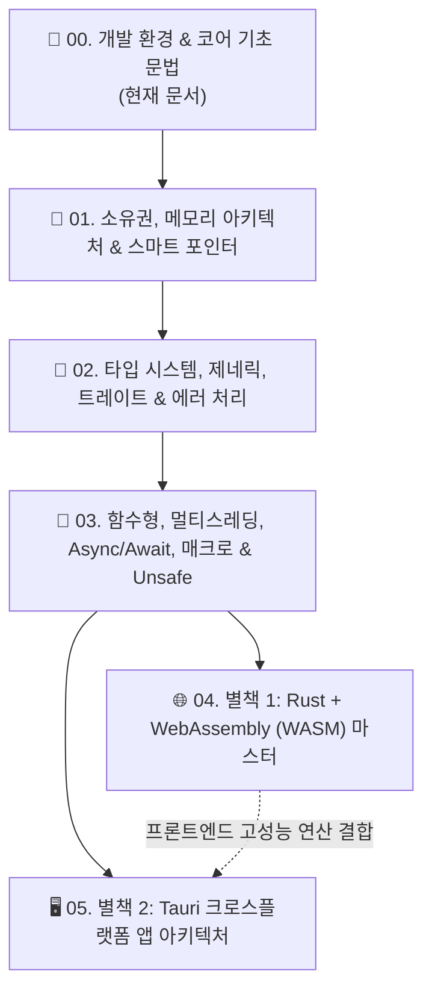
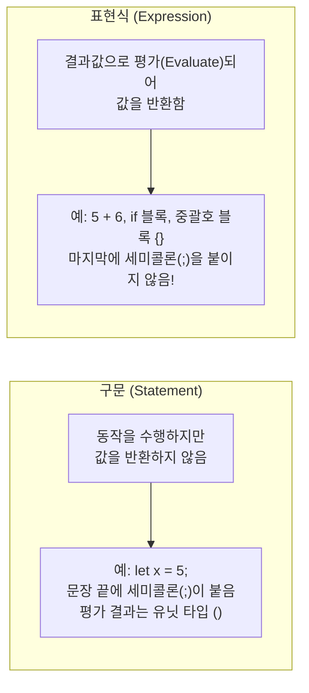

# 🦀 Rust 마스터클래스: 제로 베이스에서 시니어 아키텍트까지

> [!abstract]+ **출판사 서문 및 강좌 철학 (Course Philosophy)**
> 본 강좌 시리즈는 단순한 문법 요약집이 아닙니다. C/C++의 **압도적인 하드웨어 제어 성능**과 현대 고수준 언어(Haskell, OCaml, TypeScript)의 **표현력 및 메모리 안전성**을 동시에 달성한 **Rust(러스트)**의 모든 것을 파헤치는 **출판 수준의 완벽 가이드북**입니다.
> 
> 초보 개발자가 처음 변수(`let`)를 선언하는 순간부터 컴파일러 내부에서 일어나는 레지스터 할당, 스택/힙 메모리 레이아웃, 그리고 고급 비동기 런타임(`Tokio`)과 연관 기술(**WebAssembly**, **Tauri**)까지 한 줄의 코드도 대충 넘어가지 않고 **Step-by-Step**으로 해부합니다.

---

## 🗺️ 전체 커리큘럼 맵 (Map of Content - MOC)

옵시디언(Obsidian)의 볼트(Vault)에 아래 6개의 파일을 동일한 폴더에 저장하시면 내부 위키링크(`[[...]]`)를 통해 유기적으로 연결된 지식 그래프(Graph View)를 탐색할 수 있습니다.



| 권호 | 문서 링크 (Obsidian Wikilink) | 핵심 다루는 주제 | 난이도 |
| :---: | :--- | :--- | :---: |
| **제0권** | **[[programming/rust/00_Rust_Foundation_and_Setup\|00. 개발 환경 및 코어 기초 문법]]** | Playground & VS Code 완벽 세팅, `cargo`, 변수, 타입, 메모리 표현, 함수, 제어문 | ⭐☆☆☆☆ |
| **제1권** | **[[programming/rust/01_Ownership_and_Memory_Architecture\|01. 소유권과 메모리 아키텍처]]** | 스택/힙, 소유권(Ownership), 빌림(Borrowing), 슬라이스, 수명(`'a`), 스마트 포인터(`Box`, `Rc`, `RefCell`) | ⭐⭐⭐☆☆ |
| **제2권** | **[[programming/rust/02_Type_System_Generics_and_Traits\|02. 타입 시스템, 제네릭 및 트레이트]]** | 구조체, 열거형(ADT), 패턴 매칭, `Option`/`Result`, `?` 연산자, 제네릭, 트레이트, 정적/동적 디스패치(`dyn`) | ⭐⭐⭐☆☆ |
| **제3권** | **[[programming/rust/03_Advanced_Rust_Concurrency_and_Macros\|03. 고급 동시성, 비동기, 매크로 및 Unsafe]]** | 클로저, 이터레이터, `Send`/`Sync`, `Arc<Mutex<T>>`, `Future`와 `Pin`, `Tokio`, 선언적/절차적 매크로, `unsafe` | ⭐⭐⭐⭐⭐ |
| **별책1** | **[[programming/rust/04_WebAssembly_and_Frontend_Ecosystem\|04. WebAssembly (WASM) 마스터 가이드]]** | `wasm-bindgen`, `wasm-pack`, 선형 메모리 제로카피 공유, JS 상호운용, DOM 제어 및 프레임워크 연동 | ⭐⭐⭐⭐☆ |
| **별책2** | **[[programming/rust/05_Tauri_Cross_Platform_Architecture\|05. Tauri 크로스플랫폼 아키텍처]]** | Tauri v2 아키텍처, IPC 커맨드, 상태 관리(`State`), 양방향 이벤트, 보안(Capabilities), 실전 풀스택 앱 제작 | ⭐⭐⭐⭐☆ |

---

## 🛠️ Part 1. 실습 환경 완벽 구축 (Step-by-Step)

Rust를 학습하는 방법은 크게 두 가지입니다. 설치 없이 브라우저에서 즉시 컴파일러의 내부 동작까지 확인하는 **Rust Playground**와, 실무 프로젝트를 진행하는 **Visual Studio Code (VS Code)**입니다.

### 1.1 무설치 웹 환경: Rust Playground 200% 활용법

인터넷 브라우저만 있다면 [https://play.rust-lang.org](https://play.rust-lang.org) 에 접속하여 즉시 코드를 실행할 수 있습니다.

> [!tip]+ **초보자를 위한 Rust Playground 핵심 조작 Step-by-Step**
> 1. **Run (실행 버튼)**: 좌측 상단 빨간색 `Run` 버튼을 누르면 코드가 컴파일되고 하단 패널에 `Standard Output` 결과가 출력됩니다.
> 2. **Mode (빌드 모드 선택)**:
>    - `Debug`: 컴파일 속도가 빠르며 디버깅 심볼과 오버플로우 검사(Overflow Check)가 포함됩니다.
>    - `Release`: LLVM 백엔드의 강력한 최적화(`-O3` 수준)가 적용되어 극한의 실행 속도를 냅니다.
> 3. **Channel (컴파일러 채널)**:
>    - `Stable`: 실무 표준 안정화 버전 (기본값 권장).
>    - `Nightly`: 최신 실험적 기능을 테스트할 때 사용.
> 4. **고급 기능 (`...` 버튼 또는 `Run` 옆 드롭다운 메뉴)**:
>    - **MIR (Mid-level Intermediate Representation)**: Rust의 빌림 검사기(Borrow Checker)가 소유권을 분석할 때 사용하는 중간 표현 코드를 볼 수 있습니다.
>    - **ASM (Assembly)**: 내 Rust 코드가 실제 CPU 명령어(x86_64 어셈블리)로 어떻게 변환되었는지 확인할 수 있습니다. (고급 개발자로 가는 지름길!)
> 5. **Tools (우측 상단)**:
>    - `Rustfmt`: 코드를 공식 스타일 가이드에 맞춰 자동 정렬합니다.
>    - `Clippy`: 단순 문법 오류를 넘어 **"더 러스트다운(Idiomatic) 코드"**로 고칠 수 있도록 정적 분석 조언을 해줍니다.

---

### 1.2 전문가용 로컬 환경: Visual Studio Code + `rustup` 구축

실제 프로젝트나 **[[programming/rust/04_WebAssembly_and_Frontend_Ecosystem\|WebAssembly]]**, **[[programming/rust/05_Tauri_Cross_Platform_Architecture\|Tauri]]** 실습을 위해서는 로컬 개발 환경이 필수입니다.

#### Step 1: `rustup` (Rust 툴체인 설치 관리자) 설치
- **macOS / Linux**: 터미널을 열고 아래 명령어를 실행합니다.
  ```bash
  curl --proto '=https' --tlsv1.2 -sSf https://sh.rustup.rs | sh
  ```
- **Windows**:
  1. [Visual Studio C++ 빌드 도구(Build Tools)](https://visualstudio.microsoft.com/visual-cpp-build-tools/)를 먼저 설치합니다 ("C++를 사용한 데스크톱 개발" 체크 필수 - 링커 `link.exe`가 필요하기 때문입니다).
  2. [https://rustup.rs](https://rustup.rs)에서 `rustup-init.exe`를 다운로드하여 실행합니다.

설치 후 터미널에서 버전을 확인합니다:
```bash
rustc --version   # Rust 컴파일러
cargo --version   # Rust 패키지 매니저 및 빌드 시스템
```

#### Step 2: VS Code 필수 확장 프로그램(Extensions) 4대장 설치
VS Code의 좌측 확장(Extensions, `Ctrl+Shift+X` / `Cmd+Shift+X`) 탭에서 다음 4가지를 반드시 설치하세요.

1. **`rust-analyzer`** (필수 ⭐): 공식 언어 서버(LSP)입니다. 코드를 타이핑하는 즉시 추론된 타입을 회색 글씨(Inlay Hints)로 보여주고 실시간 에러 검사를 수행합니다.
2. **`CodeLLDB`** (필수 ⭐): 브레이크포인트( 중단점)를 걸고 메모리와 변수 상태를 한 줄씩 추적할 수 있는 네이티브 디버거입니다.
3. **`Even Better TOML`**: 프로젝트 설정 파일인 `Cargo.toml`의 문법 강조 및 자동 완성을 지원합니다.
4. **`Error Lens`**: 컴파일러의 에러 메시지를 마우스를 올리지 않아도 해당 코드 줄 우측에 즉시 표시해 줍니다.

> [!example]- **추천 VS Code `settings.json` 설정 (클릭하여 펼치기)**
> 저장할 때마다 자동으로 코드 포맷팅을 맞추고 `clippy`로 코드 품질을 검사하도록 설정합니다.
> ```json
> {
>   "editor.formatOnSave": true,
>   "[rust]": {
>     "editor.defaultFormatter": "rust-lang.rust-analyzer"
>   },
>   "rust-analyzer.check.command": "clippy",
>   "rust-analyzer.inlayHints.typeHints.enable": true,
>   "rust-analyzer.inlayHints.parameterHints.enable": true
> }
> ```

#### Step 3: 첫 Cargo 프로젝트 생성 및 구조 해부
터미널에서 원하는 작업 폴더로 이동한 뒤 아래 명령어를 입력합니다.

```bash
cargo new hello_masterclass
cd hello_masterclass
code .
```

생성된 디렉토리 구조는 다음과 같습니다:
```text
hello_masterclass/
├── Cargo.toml      # 프로젝트 메타데이터 및 외부 라이브러리(Crate) 의존성 명세서
└── src/
    └── main.rs     # 애플리케이션 진입점(Entry Point) 소스 코드
```

- **코드 빌드 및 실행**: 터미널에서 `cargo run` 입력 (컴파일 + 실행 동시 진행)
- **빠른 문법 검사**: `cargo check` 입력 (실행 파일을 만들지 않고 문법과 소유권 에러만 초고속으로 검사)

---

## 🧱 Part 2. 변수, 불변성(Immutability), 그리고 섀도잉(Shadowing)

Rust의 가장 중요한 설계 철학은 **"기본적으로 안전하고 예측 가능해야 한다"**입니다.

### 2.1 왜 변수가 기본적으로 불변(Immutable)인가?

다른 언어(Python, JS, C++)에서는 변수를 만들면 언제든 값을 바꿀 수 있습니다. 하지만 대규모 프로그램에서 한 변수의 값이 어디서 바뀌는지 추적하지 못하면 치명적인 버그와 동시성(멀티스레드) 경쟁 상태(Race Condition)가 발생합니다.

따라서 Rust에서 `let`으로 선언한 변수는 **기본적으로 값을 변경할 수 없는 불변(Immutable)** 상태입니다. 값을 변경하려면 명시적으로 `mut` (mutable) 키워드를 붙여야 합니다.

### 2.2 섀도잉(Shadowing) vs 가변 변수(`mut`) 완벽 비교

초보자들이 가장 헷갈려하는 개념이 `let mut`과 같은 이름으로 다시 `let`을 선언하는 **섀도잉(Shadowing)**의 차이입니다.

```rust
// [실습 방법]
// 1. Rust Playground에 아래 코드를 복사하여 붙여넣고 'Run'을 클릭하거나,
// 2. VS Code의 src/main.rs에 붙여넣고 터미널에서 'cargo run'을 실행하세요.

const MAX_CONNECTIONS: u32 = 10_000; // 상수는 컴파일 타임에 값이 확정되며 타입 명시가 필수입니다.

fn main() {
    // 1. 기본 불변 변수 (Immutable Variable)
    let x = 5;
    println!("초기 x의 값: {x}");
    // x = 6; // ❌ 컴파일 에러! (E0384: cannot assign twice to immutable variable `x`)

    // 2. 가변 변수 (Mutable Variable) - 'mut' 키워드 사용
    let mut score = 100;
    println!("변경 전 score: {score}");
    score = 250; // ✅ 'mut'이 있으므로 같은 타입(정수) 내에서 값 변경 가능!
    println!("변경 후 score: {score}");
    // score = "문자열"; // ❌ 에러! 'mut'이라도 변수의 '타입' 자체는 절대 바꿀 수 없습니다.

    // 3. 변수 섀도잉 (Variable Shadowing)
    // 기존 변수 'spaces'를 가리고 완전히 새로운 변수를 선언합니다.
    let spaces = "   ";          // 타입: &str (문자열 슬라이스)
    let spaces = spaces.len();   // 타입: usize (부호 없는 정수) -> 타입 변환까지 깔끔하게 허용!
    println!("공백의 개수: {spaces}");

    // 4. 블록 스코프(Block Scope) 내부에서의 섀도잉
    let count = 10;
    {
        // 이 중괄호 블록 안에서만 기존 count를 가립니다.
        let count = count * 2;
        println!("내부 블록 count: {count}"); // 출력: 20
    }
    // 내부 블록이 끝나면 섀도잉이 해제되어 원래의 count로 돌아옵니다.
    println!("외부 블록 count: {count}");     // 출력: 10
    println!("최대 연결 제한: {MAX_CONNECTIONS}");
}
```

#### 🔍 Step-by-Step 코드 해설
1. **`const MAX_CONNECTIONS: u32 = 10_000;`**:
   - 상수(`const`)는 `mut`과 함께 사용할 수 없으며, 프로그램 전체 스코프(전역 포함)에서 선언할 수 있습니다.
   - 숫자 리터럴 사이의 언더스코어(`_`)는 가독성을 위한 기호로, 컴파일러는 `10000`과 동일하게 취급합니다.
   - 메모리 관점에서 `const`는 별도의 메모리 주소를 차지하기보다 컴파일 시점에 사용되는 위치마다 값이 직접 인라인(Inline) 복사됩니다[^1].
2. **`let mut score = 100;`**:
   - 스택(Stack) 메모리에 할당된 동일한 메모리 슬롯의 값을 `100`에서 `250`으로 덮어씁니다(In-place mutation).
3. **`let spaces = spaces.len();` (섀도잉)**:
   - 기존 변수를 수정하는 것이 아니라, 컴파일러가 내부적으로 새로운 메모리 슬롯을 만들고 이름표(`spaces`)만 새 슬롯으로 옮겨 붙이는 기법입니다.
   - 따라서 `spaces_str`, `spaces_num`처럼 불필요한 변수 이름을 고민할 필요 없이, 값을 가공한 뒤 **다시 불변 상태로 잠가버릴 수 있다**는 엄청난 장점이 있습니다.

---

## 🧬 Part 3. 스칼라(Scalar)와 복합(Compound) 데이터 타입 심층 해부

Rust는 **정적 타입(Statically Typed)** 언어입니다. 컴파일 시점에 모든 변수의 메모리 크기(Byte)와 타입이 $100\%$ 확정되어야 합니다.

### 3.1 스칼라 타입 (Scalar Types)

스칼라 타입은 하나의 단일 값을 표현합니다.

| 분류 | 크기 / 종류 | 타입 키워드 | 표현 범위 (수식) | 비고 |
| :--- | :--- | :--- | :--- | :--- |
| **부호 있는 정수** | 8, 16, 32, 64, 128비트, 아키텍처 | `i8`, `i16`, `i32`, `i64`, `i128`, `isize` | $-2^{n-1} \sim 2^{n-1} - 1$ | 기본 정수 추론 타입은 `i32` |
| **부호 없는 정수** | 8, 16, 32, 64, 128비트, 아키텍처 | `u8`, `u16`, `u32`, `u64`, `u128`, `usize` | $0 \sim 2^n - 1$ | 배열 인덱싱에는 반드시 `usize` 사용 |
| **부동 소수점** | 32비트, 64비트 | `f32`, `f64` | IEEE-754 표준 준수 | 기본 실수 추론 타입은 `f64` |
| **불리언** | 1바이트 (8비트) | `bool` | `true` 또는 `false` | 메모리 정렬(Alignment)을 위해 1 Byte 사용 |
| **문자** | **4바이트 (32비트)** | `char` | 유니코드 스칼라 값 ($\text{U+0000} \sim \text{U+10FFFF}$) | C언어(1 Byte ASCII)와 달리 한글/이모지 완벽 지원 |

> [!warning]+ **정수 오버플로우(Integer Overflow)와 Rust의 방어 기제**
> 예를 들어 `u8` 타입은 $0$부터 $2^8 - 1 = 255$까지만 저장할 수 있습니다. 만약 실행 중에 `256`이 들어가면 어떻게 될까요?
> - **Debug 모드 (`cargo run`)**: 즉시 프로그램을 안전하게 종료(**Panic**)시켜 버그를 알려줍니다.
> - **Release 모드 (`cargo run --release`)**: 성능 극대화를 위해 오버플로우 검사를 생략하고 2의 보수 순환(Wrapping, $256 \rightarrow 0$)을 수행합니다.
> - **시니어 개발자의 팁**: 오버플로우 가능성이 있는 연산은 표준 라이브러리의 명시적 메서드를 사용하세요!
>   - `wrapping_add`: 순환 허용 (`255u8.wrapping_add(1)` $\rightarrow$ `0`)
>   - `checked_add`: 오버플로우 발생 시 `None` 반환 (`Option<u8>`)
>   - `saturating_add`: 최대/최소값에 고정 (`255u8.saturating_add(10)` $\rightarrow$ `255`)

### 3.2 복합 타입 (Compound Types): 튜플(Tuple)과 배열(Array)

복합 타입은 여러 값을 하나의 그룹으로 묶습니다.

```rust
fn main() {
    // 1. 다양한 정수 리터럴 표기법과 명시적 오버플로우 처리
    let hex_val: u32 = 0xff;          // 16진수 (255)
    let binary_val: u8 = 0b1111_0000; // 2진수 (240)
    let byte_val: u8 = b'A';          // u8 전용 ASCII 바이트 리터럴 (65)

    // 안전한 오버플로우 제어 실습
    let max_u8: u8 = 250;
    let saturated = max_u8.saturating_add(20); // 255를 넘지 않고 255에 고정됨
    let checked = max_u8.checked_add(20);      // 오버플로우이므로 None 반환
    println!("hex: {hex_val}, bin: {binary_val}, byte: {byte_val}");
    println!("Saturating 결과: {saturated}, Checked 결과: {checked:?}");

    // 2. 문자(char) 타입: 4바이트 유니코드
    let korean_char: char = '한';
    let crab_emoji: char = '🦀';
    println!("문자 크기: {} 바이트 ({korean_char}, {crab_emoji})", std::mem::size_of::<char>());

    // 3. 튜플 (Tuple): 서로 다른 타입의 값들을 고정된 길이로 묶음
    let user_profile: (i32, f64, char) = (1024, 98.6, 'S');
    
    // 구조 분해 할당 (Destructuring)
    let (id, score, rank) = user_profile;
    println!("구조 분해 -> ID: {id}, 점수: {score}, 등급: {rank}");
    
    // 점(.) 인덱스로 직접 접근
    println!("첫 번째 요소 직접 접근: {}", user_profile.0);

    // 참고: 아무 값도 없는 빈 튜플 () 은 '유닛(Unit) 타입'이라고 부르며,
    // C/Java의 void 역할을 대신하는 실제 타입(크기 0 바이트)입니다.

    // 4. 배열 (Array): '동일한 타입'의 요소를 '고정된 길이'로 스택(Stack) 메모리에 연속 배치
    // 타입 표기법: [타입; 길이]
    let months: [&str; 3] = ["Jan", "Feb", "Mar"];
    let buffer: [u8; 5] = [0; 5]; // [0, 0, 0, 0, 0] 으로 초기화하는 단축 문법

    println!("두 번째 달: {}", months[1]);
    println!("초기화된 버퍼: {buffer:?}"); // ':?'는 디버그 출력 포맷터입니다.
}
```

#### 🔍 Step-by-Step 코드 해설
1. **`std::mem::size_of::<char>()`**:
   - 제네릭 함수로, 특정 타입이 메모리에서 차지하는 바이트 수를 반환합니다. `char`는 항상 $4\text{ Bytes}$를 출력합니다.
2. **`{checked:?}`**:
   - 일반 변수 출력(`{}`)은 `Display` 트레이트를 사용하고, `:?`는 개발자용 구조 확인을 위한 `Debug` 트레이트를 사용합니다. `Option`이나 배열(`buffer`)을 출력할 때 매우 유용합니다.
3. **배열의 메모리 안전성 (Bounds Checking)**:
   - C언어에서는 길이 5짜리 배열의 `buffer[10]`에 접근하면 엉뚱한 메모리를 읽어오는 보안 취약점(Buffer Overread)이 발생합니다.
   - 반면 Rust는 런타임에 인덱스가 배열 길이를 벗어나면 **즉시 패닉(Panic)을 발생시켜 잘못된 메모리 접근을 원천 차단**합니다.

---

## ⚙️ Part 4. 함수(Functions), 구문(Statement)과 표현식(Expression), 그리고 제어문

Rust는 함수형 언어의 영향을 강하게 받은 **표현식 중심 언어(Expression-oriented Language)**입니다. 이 개념을 이해하면 왜 Rust에서 함수 마지막 줄에 세미콜론(`;`)을 빼는지 완벽하게 이해할 수 있습니다.

### 4.1 구문(Statement) vs 표현식(Expression)의 결정적 차이



- **핵심 규칙**: 표현식 끝에 세미콜론(`;`)을 붙이는 순간, 그 표현식은 **구문(Statement)으로 변환**되어 반환값이 증발하고 빈 튜플인 유닛 값 `()`만 남게 됩니다!

### 4.2 함수와 제어문(`if`, `loop`, `while`, `for`) 완벽 마스터 실습

```rust
fn main() {
    // 1. 블록 표현식(Block Expression)을 이용한 변수 초기화
    let calculated_y = {
        let base = 10;
        base * 3 + 5 // ⚠️ 세미콜론(;)이 없습니다! 이 값이 블록 밖으로 반환되어 calculated_y에 대입됩니다.
    };
    println!("블록 표현식 결과: {calculated_y}"); // 35

    // 2. 함수 호출
    let area = calculate_rectangle_area(12, 5);
    println!("사각형 넓이: {area}");

    // 3. 표현식으로서의 if-else (삼항 연산자 ? : 를 대체)
    let temperature = 28;
    let status = if temperature >= 30 {
        "폭염 경보" // 세미콜론 없음 (표현식)
    } else if temperature >= 20 {
        "쾌적한 날씨"
    } else {
        "쌀쌀함"
    }; // let 구문을 끝내는 세미콜론
    println!("현재 상태: {status}");

    // 4. 값을 반환하는 무한 루프 (loop)
    let mut counter = 0;
    let loop_result = loop {
        counter += 1;
        if counter == 5 {
            // break 뒤에 식을 적으면 loop 밖으로 해당 값을 반환합니다!
            break counter * 100;
        }
    };
    println!("loop 반환값: {loop_result}"); // 500

    // 5. 루프 레이블(Loop Labels)을 이용한 중첩 루프 제어
    // 작은따옴표(')로 시작하는 레이블을 붙여 바깥쪽 루프를 한 번에 탈출할 수 있습니다.
    let mut outer_count = 0;
    'outer_loop: loop {
        println!("외부 루프 진입: {outer_count}");
        let mut inner_count = 10;

        loop {
            println!("  -> 내부 루프: {inner_count}");
            if inner_count == 9 {
                break; // 안쪽 루프만 탈출
            }
            if outer_count == 1 {
                break 'outer_loop; // 바깥쪽 'outer_loop 까지 한 번에 완전 탈출!
            }
            inner_count -= 1;
        }
        outer_count += 1;
    }

    // 6. for 루프와 Range(범위) 표현식
    // 1..4 는 1 이상 4 미만 (1, 2, 3)
    // 1..=4 는 1 이상 4 이하 (1, 2, 3, 4)
    print!("카운트다운: ");
    for number in (1..=5).rev() {
        print!("{number}! ");
    }
    println!("발사 🚀");
}

/// 사각형의 가로(width)와 세로(height)를 받아 넓이를 반환하는 함수
/// 매개변수 타입과 반환 타입(-> u32)은 반드시 명시해야 합니다.
fn calculate_rectangle_area(width: u32, height: u32) -> u32 {
    // return width * height; 라고 써도 되지만,
    // Rust에서는 함수의 마지막 표현식에 세미콜론을 생략하여 암시적으로 반환하는 것이 표준(Idiomatic)입니다.
    width * height
}
```

#### 🔍 Step-by-Step 코드 해설
1. **`fn calculate_rectangle_area(width: u32, height: u32) -> u32`**:
   - Rust는 함수의 매개변수와 반환 타입에 대해서는 절대 자동 추론을 하지 않습니다. 이는 함수의 시그니처 자체가 외부와의 명확한 **계약(Contract)** 역할을 하여, 함수 내부 코드를 보지 않고도 입출력을 파악하게 해 주기 위함입니다.
   - 만약 `width * height` 뒤에 실수로 `;`을 붙여서 `width * height;`로 쓰면, 컴파일러는 친절하게 다음과 같은 에러를 띄웁니다:
     `mismatched types: expected u32, found () -> help: remove this semicolon to return this value`.
2. **`if` 표현식의 타입 규칙**:
   - `let status = if ... { "폭염" } else { 100 };` 처럼 참일 때와 거짓일 때의 반환 타입이 다르면 컴파일 에러가 발생합니다. 모든 분기(Branch)는 반드시 동일한 타입으로 평가되어야 합니다.
3. **`(1..=5).rev()`**:
   - C 스타일의 `for (int i = 0; i < 5; i++)` 문법은 인덱스 실수(Off-by-one error)를 유발하기 때문에 Rust에는 아예 존재하지 않습니다. 대신 이터레이터(Iterator) 기반의 범위(`1..=5`)와 역순 어댑터(`.rev()`)를 조합하여 안전하고 선언적으로 반복문을 작성합니다.

---

## ✅ 제0권 학습 점검 체크리스트 (Self-Check)

옵시디언에서 아래 체크박스를 클릭하며 학습 내용을 점검해 보세요.

- [ ] Rust Playground에서 코드를 실행하고 MIR 및 ASM(어셈블리) 출력을 확인해 보았다.
- [ ] `let`, `let mut`, `const`, 그리고 변수 섀도잉(Shadowing)의 메모리 및 타입 변경 차이를 설명할 수 있다.
- [ ] 정수 오버플로우가 Debug 모드와 Release 모드에서 어떻게 다르게 동작하는지 알고 있으며, `checked_add`와 `saturating_add`를 사용할 수 있다.
- [ ] 구문(Statement)과 표현식(Expression)의 차이를 이해하고, 왜 함수 마지막 줄에 세미콜론(`;`)을 생략하는지 설명할 수 있다.
- [ ] 루프 레이블(`'label: loop`)과 값을 반환하는 `break` 문을 활용할 수 있다.

> [!success]+ **다음 단계로 이동하기**
> 기초 체력을 완벽히 다지셨습니다! 이제 Rust를 세상의 모든 다른 언어와 차별화하는 가장 위대한 핵심 개념인 **소유권(Ownership)과 메모리 아키텍처**를 정복하러 떠나봅시다.
> 👉 **다음 강좌**: **[[programming/rust/01_Ownership_and_Memory_Architecture\|제1권: 소유권, 빌림, 생명주기와 스마트 포인터]]**

[^1]: 만약 프로그램 실행 내내 고정된 단일 메모리 주소를 가지는 전역 변수가 필요하다면 `const` 대신 `static` 키워드를 사용합니다 (`static GLOBAL_VERSION: &str = "1.0.0";`).