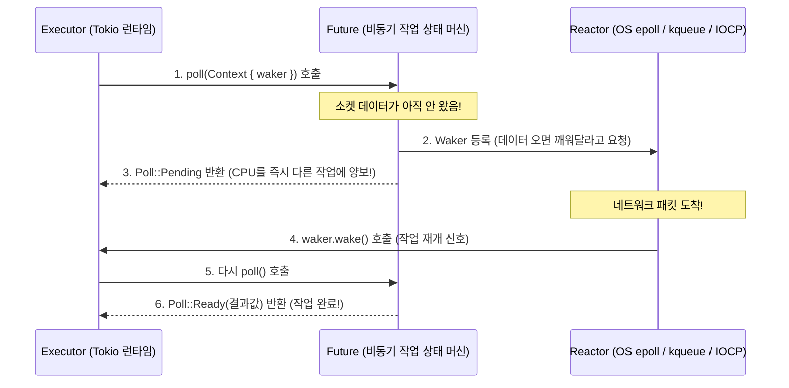

# 📕 제3권: 함수형 패러다임, 동시성, 비동기(Async/Await), 매크로 및 Unsafe

> [!abstract]+ **이 장의 핵심 목표**
> 이 권을 완벽히 소화하면 당신은 어디서든 **고급(Senior) Rust 엔지니어**로 인정받을 수 있습니다. 함수형 클로저와 이터레이터의 어셈블리 수준 최적화부터, 멀티스레딩(`Arc<Mutex<T>>`, 채널), 현대 백엔드와 Tauri의 핵심인 **비동기 상태 머신(`Future`, `Pin`, `Tokio`)**, 코드를 생성하는 코드인 **메타프로그래밍(매크로)**, 그리고 하드웨어와 C언어의 경계를 허무는 **`unsafe` Rust**까지 모든 고급 기법을 총망라합니다.
> 
> - 이전 강좌: **[[programming/rust/02_Type_System_Generics_and_Traits\|제2권: 타입 시스템, 제네릭 및 트레이트]]**
> - 연관 기술 강좌: **[[programming/rust/04_WebAssembly_and_Frontend_Ecosystem\|별책 1: Rust + WebAssembly (WASM) 마스터]]** | **[[programming/rust/05_Tauri_Cross_Platform_Architecture\|별책 2: Tauri 크로스플랫폼 아키텍처]]**

---

## 🔗 Part 1. 함수형 프로그래밍: 클로저(Closures)와 이터레이터(Iterators)

### 1.1 클로저가 주변 환경(Environment)을 캡처하는 3가지 방식

일반 함수(`fn`)와 달리 **클로저(`|x| x + 1`)**는 자신이 정의된 스코프의 주변 변수를 캡처(Capture)하여 사용할 수 있습니다. 컴파일러는 클로저 본문이 외부 변수를 어떻게 쓰느냐에 따라 다음 3가지 트레이트 중 하나 이상을 자동으로 구현합니다:

1. **`Fn`**: 외부 변수를 **불변 참조(`&T`)**로만 빌려 쓰는 클로저 (여러 번 동시 호출 가능).
2. **`FnMut`**: 외부 변수의 값을 수정하기 위해 **가변 참조(`&mut T`)**로 빌려 쓰는 클로저.
3. **`FnOnce`**: 외부 변수의 **소유권을 아예 클로저 내부로 이동(`T`)**시켜 소비하는 클로저 (소유권을 써버리므로 **단 한 번만** 호출 가능!). 모든 클로저는 최소한 한 번은 호출할 수 있으므로 포함 관계는 $\text{Fn} \subset \text{FnMut} \subset \text{FnOnce}$입니다.

### 1.2 지연 평가(Lazy Evaluation) 이터레이터와 제로 비용 루프

```rust
fn main() {
    // 1. 클로저의 캡처 모드 실습 (FnMut & move)
    let mut log_history = vec![String::from("시스템 부팅")];

    // 클로저가 log_history에 값을 추가(push)하므로 컴파일러는 자동으로 가변 빌림(&mut)으로 캡처합니다 (FnMut).
    let mut record_event = |msg: &str| {
        log_history.push(format!("[LOG] {msg}"));
    };

    record_event("데이터베이스 연결 완료");
    record_event("인증 서버 준비 완료");
    println!("기록된 로그: {log_history:?}");

    // 'move' 키워드: 클로저가 참조 대신 외부 변수의 '소유권'을 강제로 가져오도록 지정 (스레드 전달 시 필수!)
    let secret_key = String::from("SUPER_SECRET_TOKEN");
    let consume_key = move || {
        println!("클로저가 소유한 키 출력: {secret_key}");
        drop(secret_key); // 소유권을 완전히 소멸시킴 -> 이 클로저는 FnOnce가 됩니다!
    };
    consume_key();
    // consume_key(); // ❌ 에러! FnOnce 클로저는 소유한 값을 이미 소비했으므로 두 번 호출할 수 없습니다.

    // 2. 고성능 함수형 이터레이터 체이닝 (Zero-Cost Abstraction)
    let transactions = vec![120, -50, 300, 45, -10, 800, 15];

    // 💡 주의: map, filter 같은 이터레이터 어댑터는 '지연 평가(Lazy)'됩니다!
    // 마지막에 collect(), sum(), fold() 같은 소비 어댑터(Consuming Adapter)를 호출하기 전까지는 아무 연산도 하지 않습니다.
    let valid_high_value_txs: Vec<i32> = transactions
        .iter()                         // 불변 참조(&i32) 이터레이터 생성 (소유권 이동은 .into_iter())
        .copied()                       // &i32 -> i32로 복사
        .filter(|&amount| amount > 0)   // 양수 거래만 필터링
        .map(|amount| amount * 110 / 100) // 부가세 10% 추가
        .filter(|&total| total >= 100)  // 100원 이상만 추출
        .collect();                     // 결과를 Vec<i32> 컬렉션으로 수집!

    // fold를 이용한 누적 집계 (초기값 0부터 시작하여 합산)
    let total_revenue: i32 = valid_high_value_txs.iter().fold(0, |acc, &x| acc + x);

    println!("조건을 만족하는 거래 목록: {valid_high_value_txs:?}");
    println!("총 매출 합계: {total_revenue}원");
}
```

> [!tip] **왜 이터레이터 체이닝이 수동 `for` 루프보다 같거나 더 빠를까요?**
> 고수준 언어(JavaScript, Python)에서 `.filter().map()`을 쓰면 단계마다 임시 배열이 메모리에 생성되어 느려집니다. 반면 Rust의 이터레이터 체인은 컴파일 시점에 단일 루프로 완전히 합쳐지고(**Loop Fusion**), 배열 경계 검사(Bounds Check)까지 생략되어 수동으로 짠 어셈블리 루프와 100% 동일한 기계어로 번역됩니다!

---

## 🧵 Part 2. 겁 없는 동시성 (Fearless Concurrency)

멀티스레드 프로그래밍은 원래 개발자의 악몽입니다. 하지만 Rust는 소유권과 타입 시스템을 스레드 경계까지 확장하여 **잘못된 멀티스레드 코드는 아예 컴파일조차 되지 않도록** 막아줍니다.

### 2.1 동시성 마커 트레이트: `Send`와 `Sync`

- **`Send`**: 이 타입의 **소유권**을 다른 스레드로 안전하게 이동(Move)할 수 있음을 보장합니다. (예: `String`, `Vec<T>`, `Arc<T>`는 `Send`이지만, 비원자적 카운터를 쓰는 `Rc<T>`는 `Send`가 아닙니다!)
- **`Sync`**: 이 타입의 **불변 참조자(`&T`)**를 여러 스레드에서 동시에 안전하게 공유할 수 있음을 보장합니다. 즉, `T`가 `Sync`라는 것은 `&T`가 `Send`라는 것과 동치입니다:
  $$\text{Type } T \text{ is } \texttt{Sync} \iff \&T \text{ is } \texttt{Send}$$

### 2.2 메시지 패싱(`mpsc`), 공유 상태(`Arc<Mutex<T>>`), 그리고 범위 스레드(`thread::scope`)

```rust
use std::sync::{mpsc, Arc, Mutex};
use std::thread;
use std::time::Duration;

fn main() {
    // =========================================================================
    // 기법 1: 메시지 패싱 (Message Passing) - mpsc (Multiple Producer, Single Consumer)
    // "메모리를 공유하여 통신하지 말고, 통신을 통해 메모리를 공유하라"
    // =========================================================================
    let (tx, rx) = mpsc::channel(); // 송신자(tx)와 수신자(rx) 생성

    for worker_id in 1..=3 {
        let tx_clone = tx.clone(); // 여러 스레드가 보낼 수 있도록 송신자 복제
        thread::spawn(move || {
            let report = format!("워커 #{worker_id} 작업 완료 보고서");
            tx_clone.send(report).expect("채널 수신자가 닫혔습니다");
            // 💡 send()를 호출하는 순간 report 변수의 소유권이 채널을 타고 메인 스레드로 이동합니다!
        });
    }
    drop(tx); // 원본 송신자를 닫아야 모든 워커가 끝났을 때 아래 수신 루프가 정상 종료됩니다!

    for received_msg in rx {
        println!("📩 [채널 수신]: {received_msg}");
    }

    // =========================================================================
    // 기법 2: 원자적 참조 카운팅 + 뮤텍스 (Arc<Mutex<T>>)
    // 여러 스레드가 동일한 메모리의 값을 안전하게 수정해야 할 때의 표준 패턴
    // =========================================================================
    let shared_balance = Arc::new(Mutex::new(0));
    let mut handles = vec![];

    for _ in 0..10 {
        let balance_clone = Arc::clone(&shared_balance); // 원자적(Atomic)으로 참조 카운트 증가
        let handle = thread::spawn(move || {
            // .lock()을 호출하여 뮤텍스 락(MutexGuard)을 획득할 때까지 대기합니다.
            let mut num = balance_clone.lock().unwrap();
            *num += 100; 
            // 이 블록이 끝나면 MutexGuard가 자동으로 drop되면서 락(Lock)이 즉시 해제됩니다! (데드락 방지)
        });
        handles.push(handle);
    }

    for handle in handles {
        handle.join().unwrap(); // 모든 스레드가 끝날 때까지 대기
    }
    println!("💰 [Arc<Mutex> 최종 잔액]: {}원", *shared_balance.lock().unwrap());

    // =========================================================================
    // 기법 3: 범위 지정 스레드 (Scoped Threads - std::thread::scope) ⭐ 최신 실무 표준!
    // 일반 thread::spawn은 스레드가 언제 끝날지 몰라 지역 변수를 빌려(&) 쓸 수 없었지만,
    // thread::scope는 블록이 끝나기 전에 모든 스레드의 종료(join)를 컴파일러가 100% 보장하므로
    // Arc 없이도 지역 변수를 일반 참조자(&)로 그냥 빌려 쓸 수 있습니다!
    // =========================================================================
    let local_data = vec![10, 20, 30, 40, 50];
    
    thread::scope(|s| {
        s.spawn(|| {
            // move나 Arc 없이도 메인 스레드의 local_data를 직접 불변 참조(&)로 읽음!
            println!("🔍 [범위 스레드 1] 데이터 길이: {}", local_data.len());
        });
        s.spawn(|| {
            let sum: i32 = local_data.iter().sum();
            println!("🔍 [범위 스레드 2] 데이터 총합: {sum}");
        });
    }); // 여기서 두 스레드가 모두 자동으로 join 됩니다!
}
```

---

## ⚡ Part 3. 비동기 프로그래밍 아키텍처 (`Async / Await`, `Future`, `Pin`, `Tokio`)

OS 스레드는 생성할 때마다 스택 메모리(보통 $2\text{MB}$)를 차지하고 컨텍스트 스위칭(Context Switching) 비용이 큽니다. 수만 개의 네트워크 연결이나 비동기 I/O를 처리하기 위해 Rust는 **제로 비용 상태 머신 기반의 `async / await`**를 제공합니다.

### 3.1 Rust의 `Future`는 어떻게 동작하는가? (Poll 기반 상태 머신)

JavaScript의 `Promise`는 생성되는 즉시 백그라운드에서 실행되지만(Eager), **Rust의 `Future`는 `.await`를 호출하여 실행기(Executor)가 폴링(`poll`)하기 전까지는 아무 일도 하지 않는 순수한 상태 머신(Lazy State Machine)**입니다!



> [!info]+ **왜 `Pin<P>` (고정/피닝) 개념이 존재하는가?**
> `async fn` 내부에서 지역 변수와 그 지역 변수를 가리키는 참조자(`&`)를 만든 상태로 `.await` 지점을 통과하면, 컴파일러가 생성한 `Future` 상태 머신 구조체는 **자기 자신의 필드를 가리키는 자기 참조 구조체(Self-Referential Struct)**가 됩니다.
> 만약 이 구조체가 메모리에서 다른 주소로 이동(Move)해 버리면 내부 포인터가 옛날 주소를 가리켜 박살 납니다! 이를 막기 위해 **"이 데이터는 메모리 주소가 절대 이동하지 않도록 압정으로 꽂아 고정했다"**는 것을 타입 시스템으로 보장하는 래퍼가 바로 `Pin<P>`입니다.

### 3.2 `Tokio` 비동기 런타임 실전 마스터 코드

> [!note] **실행 안내**
> Rust Playground는 기본적으로 `tokio` 크레이트가 내장되어 있어 아래 코드를 **그대로 복사해서 Run을 누르면 즉시 실행**됩니다!
> 로컬 VS Code에서 실행할 때는 터미널에서 `cargo add tokio --features full`을 실행하여 `Cargo.toml`에 의존성을 추가하세요.

```rust
use std::time::Duration;
use tokio::sync::mpsc;
use tokio::time::sleep;

// #[tokio::main] 매크로는 일반 main 함수를 비동기 런타임(Executor) 위에서 돌아가도록 변환합니다.
#[tokio::main]
async fn main() {
    println!("🚀 [Tokio 비동기 서버 시뮬레이션 시작]");

    // 1. tokio::join! 매크로: 여러 비동기 작업을 동시에(Concurrently) 실행하고 모두 끝날 때까지 대기
    let (user_res, order_res) = tokio::join!(
        fetch_from_db("Users 테이블", 150),
        fetch_from_db("Orders 테이블", 100)
    );
    println!("동시 조회 완료 -> 1: {user_res}, 2: {order_res}");

    // 2. tokio::spawn: 비동기 그린 스레드(Task)를 백그라운드 런타임에 독립적으로 띄움
    let (tx, mut rx) = mpsc::channel::<String>(32);

    let producer_task = tokio::spawn(async move {
        for i in 1..=3 {
            sleep(Duration::from_millis(50)).await; // OS 스레드를 블로킹하지 않고 양보!
            tx.send(format!("실시간 이벤트 패킷 #{i}")).await.unwrap();
        }
    });

    while let Some(packet) = rx.recv().await {
        println!("📡 [비동기 스트림 수신]: {packet}");
    }
    producer_task.await.unwrap();

    // 3. tokio::select! 매크로: 여러 비동기 작업 중 '가장 먼저 완료되는 작업 하나'만 채택하고 나머지는 취소!
    // 실무에서 타임아웃(Timeout) 구현이나 취소 토큰 처리에 가장 많이 쓰입니다.
    tokio::select! {
        res = fetch_from_db("느린 외부 결제 API", 500) => {
            println!("결제 응답 도착: {res}");
        }
        _ = sleep(Duration::from_millis(200)) => {
            println!("⏰ [타임아웃 경고] 외부 API 응답이 200ms를 초과하여 요청을 자동 취소했습니다!");
        }
    }
}

/// 데이터베이스 조회를 시뮬레이션하는 비동기 함수
async fn fetch_from_db(query_target: &str, delay_ms: u64) -> String {
    println!("  ⏳ '{query_target}' 조회 시작 (예상 소요: {delay_ms}ms)...");
    sleep(Duration::from_millis(delay_ms)).await;
    format!("'{query_target}' 결과 데이터 (200 OK)")
}
```

---

## 🪄 Part 4. 메타프로그래밍: 매크로(Macros) 마스터하기

`println!`, `vec!`, `#[derive(Debug)]`처럼 우리가 매일 쓰던 문법들이 바로 **매크로(Macro)**입니다. 함수가 런타임에 값을 받아 값을 반환한다면, 매크로는 **컴파일 시점에 추상 구문 트리(AST, 코드 조각)를 입력받아 새로운 Rust 코드를 자동으로 작성해 주는 코드 생성기**입니다.

### 4.1 선언적 매크로 (`macro_rules!`) 직접 만들기

패턴 매칭과 유사한 문법으로 가변 인자를 받는 나만의 DSL(도메인 특화 언어)이나 유틸리티 매크로를 만들 수 있습니다.

- **핵심 지시자(Designators)**:
  - `$x:expr`: 표현식 (예: `1 + 2`, `"hello"`, 함수 호출 등)
  - `$i:ident`: 식별자 (변수 이름이나 함수 이름)
  - `$t:ty`: 타입 (예: `i32`, `String`)
  - `$( ... ),*`: 0번 이상 콤마(`,`)로 구분되어 반복됨을 의미하는 정규표현식 스타일 패턴

```rust
use std::collections::HashMap;

// Python이나 JS의 딕셔너리 리터럴처럼 HashMap을 한 줄로 우아하게 생성하는 매크로 직접 제작!
// 사용법: hash_map! { "key1" => 10, "key2" => 20 }
macro_rules! hash_map {
    // 1. 빈 맵 호출 시: hash_map! {}
    () => {
        HashMap::new()
    };

    // 2. 키 => 값 쌍이 반복될 때 (마지막 콤마 $(,)? 까지 유연하게 허용!)
    ( $( $key:expr => $val:expr ),+ $(,)? ) => {
        {
            let mut temp_map = HashMap::new();
            // 반복 패턴 $( ... )* 내부의 코드가 입력된 개수만큼 자동으로 펼쳐집니다(Expand)!
            $(
                temp_map.insert($key, $val);
            )+
            temp_map
        }
    };
}

fn main() {
    let server_ports = hash_map! {
        "http" => 80,
        "https" => 443,
        "postgres" => 5432,
        "redis" => 6379,
    };

    println!("매크로로 생성한 해시맵: {server_ports:?}");
}
```

> [!info]+ **절차적 매크로 (Procedural Macros) 아키텍처 개요**
> `#[derive(Serialize)]`, `#[tokio::main]`, `#[tauri::command]`처럼 어트리뷰트 형태로 동작하는 매크로를 **절차적 매크로**라고 합니다. 별도의 크레이트(`proc-macro = true`)에서 `TokenStream`을 입력받아, **`syn`** 크레이트로 Rust 구문 트리를 파싱하고 **`quote!`** 매크로로 새로운 Rust 코드를 조립하여 반환하는 방식으로 동작합니다.

---

## ⚠️ Part 5. `unsafe` Rust와 FFI (Foreign Function Interface)

Rust 컴파일러의 정적 분석은 매우 보수적입니다. 운영체제 커널 개발, 하드웨어 레지스터 직접 제어, 혹은 C/C++ 라이브러리 호출처럼 컴파일러가 안전성을 증명할 수 없지만 개발자가 직접 불변성/유효성을 보장할 수 있을 때 **`unsafe` 블록**을 사용합니다.

### 5.1 `unsafe`가 허용하는 5대 초능력 (Five Superpowers)

> [!danger] **오해 금지: `unsafe`는 빌림 검사기(Borrow Checker)를 끄지 않습니다!**
> `unsafe` 블록 안에서도 일반적인 참조자(`&`, `&mut`)의 소유권과 수명 규칙은 100% 똑같이 작동합니다. 단지 아래 **5가지 동작만 추가로 허용**될 뿐입니다:
> 1. **원시 포인터(Raw Pointers: `*const T`, `*mut T`) 역참조**
> 2. `unsafe fn` 함수나 메서드 호출 (C언어 FFI 포함)
> 3. 가변 정적 변수(`static mut`) 접근 또는 수정
> 4. `unsafe trait` 구현
> 5. `union` (C 스타일 공용체)의 필드 접근

```rust
use std::slice;

/// 안전한 추상화(Safe Abstraction)로 감싼 배열 분할 함수 직접 구현해보기
/// 표준 라이브러리의 split_at_mut이 실제로 내부에서 이렇게 구현되어 있습니다!
fn split_slice_mut(values: &mut [i32], mid: usize) -> (&mut [i32], &mut [i32]) {
    let len = values.len();
    // 1. 안전한 경계 검사를 먼저 철저히 수행합니다!
    assert!(mid <= len, "분할 인덱스가 슬라이스 길이를 초과했습니다!");

    // 2. 만약 안전한 Rust로 (&mut values[..mid], &mut values[mid..])를 반환하려고 하면?
    // 컴파일러는 values 전체를 두 번 가변 빌림(&mut)했다고 오해하여 에러(E0499)를 냅니다!
    // 하지만 우리는 [0..mid]와 [mid..len]이 절대 겹치지 않는 서로 다른 메모리 영역임을 100% 알고 있습니다.
    let ptr: *mut i32 = values.as_mut_ptr(); // 가변 원시 포인터 추출

    unsafe {
        // 원시 포인터 연산(.add)과 포인터로부터 슬라이스를 조립하는 작업은 unsafe 블록 안에서만 가능합니다.
        (
            slice::from_raw_parts_mut(ptr, mid),
            slice::from_raw_parts_mut(ptr.add(mid), len - mid),
        )
    }
}

// C 표준 라이브러리(libc)의 abs 함수를 직접 호출하는 FFI (Foreign Function Interface) 선언
unsafe extern "C" {
    fn abs(input: i32) -> i32;
}

fn main() {
    let mut data = vec![1, 2, 3, 4, 5, 6];
    
    // split_slice_mut 함수 자체는 내부의 unsafe를 안전하게 검증했으므로 외부에서는 일반 안전한 함수로 호출합니다!
    let (left, right) = split_slice_mut(&mut data, 3);
    left[0] = 100;
    right[0] = 400;
    println!("안전하게 분할 수정된 데이터: {data:?}"); // [100, 2, 3, 400, 5, 6]

    // 원시 포인터(Raw Pointer) 생성 자체는 안전한 코드에서도 가능하지만, 역참조(*)는 unsafe가 필요합니다.
    let num = 42;
    let raw_const = &num as *const i32;

    unsafe {
        println!("원시 포인터 역참조 값: {}", *raw_const);
        println!("C 표준 라이브러리 abs(-99) 직접 호출 결과: {}", abs(-99));
    }
}
```

---

## ✅ 제3권 학습 점검 체크리스트 (Self-Check)

- [ ] 클로저의 3가지 트레이트(`Fn`, `FnMut`, `FnOnce`)와 `move` 키워드의 역할을 설명할 수 있다.
- [ ] 멀티스레드에서 `Send`/`Sync`의 의미와 `Arc<Mutex<T>>`, `mpsc::channel`, `thread::scope`의 사용처를 구분할 수 있다.
- [ ] Rust의 `Future`가 왜 지연 평가(Lazy) 상태 머신인지, 그리고 `Pin`이 왜 필요한지 이해했다.
- [ ] `Tokio`의 `tokio::join!`, `tokio::spawn`, `tokio::select!`를 활용하여 비동기 동시성 코드를 작성할 수 있다.
- [ ] `macro_rules!`로 가변 인자 매크로를 작성할 수 있으며, `unsafe` 블록을 안전한 함수 인터페이스 뒤에 캡슐화(Safe Abstraction)하는 철학을 이해했다.

> [!success]+ **🎉 코어 Rust 전 과정 마스터 완료! 이제 연관 기술로 확장해 보세요!**
> 축하합니다! 당신은 이제 Rust 언어 자체의 모든 핵심 문법과 아키텍처를 마스터하셨습니다. 이제 이 강력한 무기를 가지고 웹 브라우저에서 네이티브 속도를 내는 **WebAssembly(WASM)**와, 차세대 데스크톱/모바일 앱 프레임워크인 **Tauri**를 정복하러 가봅시다!
> - 🌐 **[[programming/rust/04_WebAssembly_and_Frontend_Ecosystem\|별책 1: Rust + WebAssembly (WASM) 마스터 가이드]]**
> - 🖥️ **[[programming/rust/05_Tauri_Cross_Platform_Architecture\|별책 2: Tauri v2 크로스플랫폼 아키텍처 마스터 가이드]]**