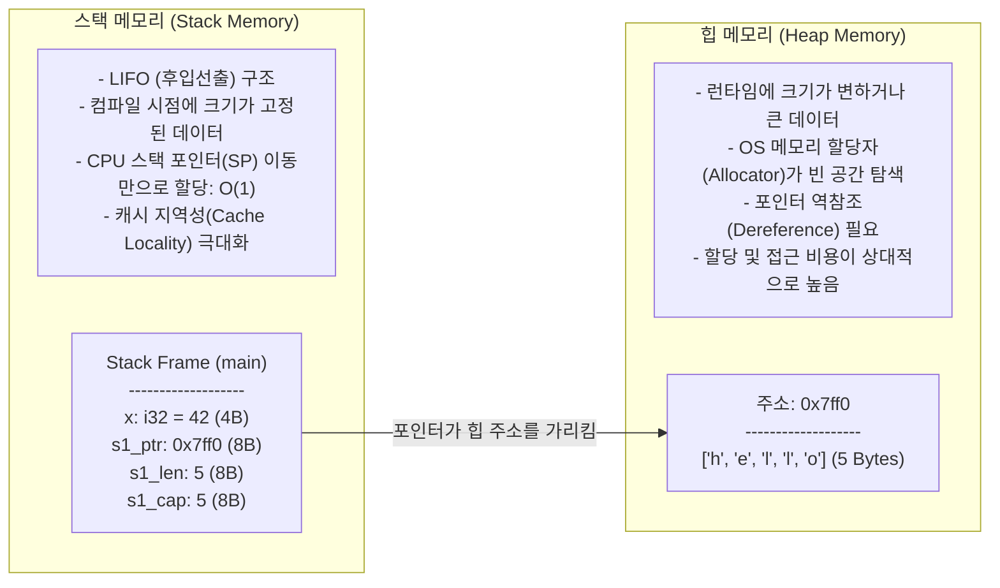
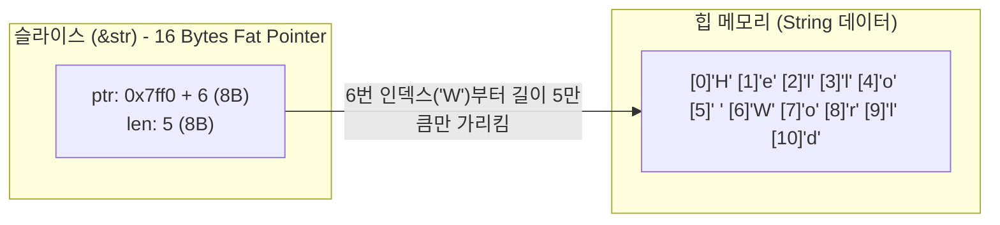

# 📗 제1권: 소유권(Ownership), 메모리 아키텍처 및 스마트 포인터

> [!abstract]+ **이 장의 핵심 목표**
> **"가비지 컬렉터(GC)도 없고, 개발자가 직접 `free()`를 호출하지도 않는데 어떻게 메모리 누수(Memory Leak)와 댕글링 포인터(Dangling Pointer)가 $0\%$일 수 있는가?"**
> 이 질문에 대한 해답이 바로 Rust의 심장인 **소유권(Ownership)**, **빌림(Borrowing)**, 그리고 **생명주기(Lifetimes)** 시스템입니다. 초보자들이 겪는 이른바 *"빌림 검사기와의 사투(Fighting the Borrow Checker)"*를 완벽히 끝내고, 컴파일러의 시선으로 메모리를 꿰뚫어 보는 능력을 길러드립니다.
> 
> - 이전 강좌: **[[programming/rust/Rust/00_Rust_Foundation_and_Setup\|제0권: 개발 환경 및 코어 기초 문법]]**
> - 다음 강좌: **[[programming/rust/Rust/02_Type_System_Generics_and_Traits\|제2권: 타입 시스템, 제네릭 및 트레이트]]**

---

## 🧠 Part 1. 컴퓨터 메모리 아키텍처: 스택(Stack) vs 힙(Heap)

소유권을 이해하려면 먼저 프로그램이 실행될 때 RAM(메모리)을 어떻게 두 영역으로 나누어 쓰는지 정확히 알아야 합니다.



- **할당 속도 비교**:
  - **스택(Stack)**: 현재 스택 포인터 주소가 $A_{\text{sp}}$일 때, 크기 $S$ 바이트인 변수를 할당하는 연산은 단순히 레지스터 값을 $A_{\text{sp}} - S$로 변경하는 단일 CPU 명령어이므로 시간 복잡도는 $O(1)$입니다.
  - **힙(Heap)**: 운영체제 커널 및 메모리 할당자(`malloc`, `jemalloc` 등)가 요청된 크기에 맞는 빈 메모리 블록을 찾고 장부(Bookkeeping)를 기록한 뒤 주소를 반환해야 하므로 훨씬 느립니다.

---

## 🔑 Part 2. 소유권(Ownership)의 3대 절대 법칙과 이동(Move)

> [!important]+ **소유권(Ownership)의 3대 법칙 (암기 필수 ⭐)**
> 1. Rust의 모든 값에는 그 값을 소유하는 **소유자(Owner)** 변수가 존재한다.
> 2. 한 시점에 값의 소유자는 **단 하나뿐**이다.
> 3. 소유자 변수가 자신이 속한 **스코프(Scope, `{}`)를 벗어나면**, 그 값은 즉시 메모리에서 파기(**Drop**)된다.

### 2.1 왜 `i32`는 복사(Copy)되고 `String`은 이동(Move)되는가?

초보자가 가장 먼저 마주치는 충격적인 컴파일 에러(`E0382`)를 통해 내부 메모리 동작을 살펴봅시다.

```rust
fn main() {
    // Case A: 스택에만 존재하는 고정 크기 타입 (Copy Semantics)
    let a = 10;
    let b = a; // 4바이트 정수 10이 그대로 복사됨
    println!("a = {a}, b = {b}"); // ✅ 둘 다 정상 출력!

    // Case B: 힙 메모리를 사용하는 동적 크기 타입 (Move Semantics)
    // String::from은 런타임에 힙(Heap) 메모리를 요청하여 문자열을 저장합니다.
    let s1 = String::from("Rust");
    
    // ⚠️ 여기서 '복사'가 아니라 소유권 '이동(Move)'이 일어납니다!
    let s2 = s1; 

    // println!("s1 = {s1}"); // ❌ 컴파일 에러! (E0382: borrow of moved value: `s1`)
    println!("s2 = {s2}");    // ✅ 오직 새로운 소유자인 s2만 사용할 수 있습니다.

    // Case C: 만약 정말로 힙 메모리 데이터까지 깊은 복사(Deep Copy)하고 싶다면?
    let s3 = s2.clone(); // 명시적으로 .clone() 호출 (비용이 큰 연산임을 코드에 드러냄)
    println!("s2 = {s2}, s3 = {s3}"); // ✅ 둘 다 별도의 힙 메모리를 소유하므로 정상 동작!
}
```

#### 🔍 컴파일러 내부 아키텍처 분석: 왜 `s1`을 무효화시킬까?
1. `String` 타입은 **스택**에 3가지 메타데이터(포인터 `ptr`, 길이 `len`, 용량 `capacity`, 64비트 시스템 기준 총 $8 \times 3 = 24\text{ Bytes}$)를 저장하고, 실제 문자열 데이터(`"Rust"`)는 **힙**에 저장합니다.
2. 만약 `let s2 = s1;`을 했을 때 스택의 $24\text{ Bytes}$만 복사하고 `s1`과 `s2`를 둘 다 살려두면 어떻게 될까요?
3. `main` 함수가 끝나는 순간 법칙 3에 의해 `s1`과 `s2`가 모두 같은 힙 메모리 주소를 해제하려고 시도하는 **이중 해제(Double Free) 치명적 보안 버그**가 발생합니다!
4. 따라서 Rust는 `let s2 = s1;` 순간 **`s1`을 컴파일 타임에 즉시 무효화(Invalidate)**시켜 버립니다. 이를 **이동(Move)**이라고 부릅니다. 힙 메모리는 전혀 건드리지 않고 스택에서 $24\text{ Bytes}$만 복사한 뒤 소유권 이름표만 옮기므로 성능 오버헤드가 $0$입니다!

### 2.2 함수 호출과 소유권, 그리고 `Drop` 트레이트 (RAII 패턴)

변수를 함수의 인자로 넘기는 것도 `let` 대입과 똑같이 **소유권이 이동(Move)**하거나 **복사(Copy)**됩니다. 또한 변수가 스코프를 벗어날 때 정확히 어느 시점에 메모리가 해제되는지 직접 눈으로 확인해 봅시다.

```rust
// 구조체가 메모리에서 해제될 때 자동으로 호출되는 Drop 트레이트를 구현해 봅니다.
struct CustomResource {
    name: String,
}

impl Drop for CustomResource {
    fn drop(&mut self) {
        println!("🗑️ [메모리 자동 해제] '{}' 리소스가 힙에서 완전히 정리되었습니다!", self.name);
    }
}

fn main() {
    let res1 = CustomResource { name: String::from("데이터베이스 커넥션 A") };
    {
        let res2 = CustomResource { name: String::from("임시 파일 버퍼 B") };
        println!("--- 내부 블록 실행 중 ---");
        // 이 중괄호가 끝나는 즉시 res2가 자동으로 drop 됩니다!
    }
    println!("--- 내부 블록 종료 직후 ---");

    let text = String::from("소유권 테스트");
    take_ownership(text); // text의 소유권이 함수 내부로 이동(Move)됨!
    // println!("{text}"); // ❌ 에러! text는 이미 함수로 이동되어 사라졌습니다.

    let num = 77;
    make_copy(num);       // i32는 Copy 트레이트를 구현하므로 값이 복사되어 전달됨
    println!("num은 여전히 살아있음: {num}"); // ✅ 정상

    println!("--- main 함수 종료 직전 ---");
} // 여기서 res1이 자동으로 drop 됩니다.

fn take_ownership(some_string: String) {
    println!("함수 내부에서 받은 문자열: {some_string}");
} // some_string이 스코프를 벗어나며 여기서 힙 메모리가 즉시 해제(drop)됩니다.

fn make_copy(some_integer: i32) {
    println!("함수 내부에서 받은 정수: {some_integer}");
}
```

---

## 🤝 Part 3. 빌림(Borrowing)과 참조자(References)

함수를 호출할 때마다 소유권을 넘겨주고 다시 반환받아야 한다면 코딩이 너무나 불편할 것입니다. 그래서 Rust는 소유권을 넘기지 않고 **값을 잠시 빌려 쓰는 참조자(Reference, `&`)** 기능을 제공합니다.

### 3.1 참조자와 빌림의 핵심 법칙 (Aliasing XOR Mutability)

> [!danger]+ **빌림 검사기(Borrow Checker)의 황금 법칙 (절대 규칙 ⭐)**
> 특정 메모리 데이터에 대해 **특정 시점**에 다음 두 가지 중 **오직 하나만** 허용됩니다:
> 1. **불변 참조자(`&T`)는 원하는 만큼 무한정 많이** 동시에 만들 수 있다. (여러 명이 동시에 읽기만 하는 것은 100% 안전하므로)
> 2. **가변 참조자(`&mut T`)는 단 하나만** 존재할 수 있다! 또한 가변 참조자가 살아있는 동안에는 **그 어떤 불변 참조자도 동시에 존재할 수 없다.**
> 
> $$\text{Valid Borrow State} \iff (\text{Count}(\&\text{mut } T) == 1 \land \text{Count}(\&T) == 0) \lor (\text{Count}(\&\text{mut } T) == 0 \land \text{Count}(\&T) \ge 0)$$

이 규칙 덕분에 Rust에서는 컴파일만 통과하면 **데이터 경쟁(Data Race)이 원천적으로 발생할 수 없습니다.**

### 3.2 비어휘적 수명 (NLL: Non-Lexical Lifetimes)의 이해

과거의 Rust는 참조자의 수명을 무조건 중괄호(`}`)가 끝날 때까지로 계산했지만, 현대 Rust 컴파일러는 **참조자가 마지막으로 사용된 코드 줄**에서 즉시 빌림이 끝난 것으로 똑똑하게 판단합니다.

```rust
fn main() {
    let mut document = String::from("초안: Rust 가이드");

    // 1. 여러 개의 불변 참조자(&) 동시 생성 -> ✅ 가능 (읽기 전용)
    let r1 = &document;
    let r2 = &document;
    println!("읽기 전용 1: {r1}, 읽기 전용 2: {r2}");
    // 💡 NLL(Non-Lexical Lifetimes) 작동!
    // r1과 r2는 이 아랫줄부터 더 이상 사용되지 않으므로, 여기서 불변 빌림이 즉시 종료됩니다!

    // 2. 가변 참조자(&mut) 생성 -> ✅ 가능! (위에서 r1, r2의 수명이 끝났기 때문)
    let r3 = &mut document;
    append_signature(r3);
    // 만약 여기서 println!("{r1}"); 을 쓰려고 하면 r1의 수명이 여기까지 연장되어
    // r3(&mut)와 기간이 겹치므로 E0502 컴파일 에러가 발생합니다!

    println!("최종 문서 내용: {document}");

    // 3. 역참조 연산자(*)를 이용한 값 직접 수정
    let mut counter = 10;
    let count_ref = &mut counter;
    *count_ref += 50; // 참조자가 가리키는 실제 메모리 위치로 찾아가(역참조) 값을 수정
    println!("수정된 카운터: {counter}"); // 60
}

/// 소유권을 빼앗지 않고 가변 참조자(&mut String)만 빌려서 내용을 수정하는 함수
fn append_signature(doc: &mut String) {
    doc.push_str(" [검수 완료]");
}
```

---

## 🍰 Part 4. 슬라이스(Slices)와 팻 포인터(Fat Pointer)

**슬라이스(Slice)**는 컬렉션 전체가 아닌, **연속된 메모리 시퀀스의 일부분만 소유권 없이 참조**하는 타입입니다.

### 4.1 왜 `&String` 대신 문자열 슬라이스 `&str`을 써야 하는가?



일반 포인터가 메모리 주소($8\text{ Bytes}$)만 가진 것과 달리, 슬라이스(`&str`, `&[T]`)는 **`(시작 주소 포인터, 길이)` 두 가지를 묶어서 들고 있는 $16\text{ Bytes}$ 크기의 팻 포인터(Fat Pointer)**입니다.

```rust
fn main() {
    let my_string = String::from("Hello Rust World");

    // 1. String의 일부분 또는 전체를 &str 슬라이스로 전달
    let word1 = extract_first_word(&my_string[0..5]);
    let word2 = extract_first_word(&my_string); // &String은 자동으로 &str로 변환됩니다 (Deref Coercion)
    println!("word1: {word1}, word2: {word2}");

    // 2. 코드 바이너리(RODATA 영역)에 박혀있는 문자열 리터럴 자체도 타입이 '&str'입니다!
    let literal_str: &str = "Fast Systems Programming";
    let word3 = extract_first_word(literal_str);
    println!("word3: {word3}");

    // 3. 일반 배열 슬라이스 (&[i32])
    let numbers = [10, 20, 30, 40, 50];
    let middle_slice: &[i32] = &numbers[1..4]; // 1번 인덱스부터 3번 인덱스까지 참조
    assert_eq!(middle_slice, &[20, 30, 40]);
    println!("배열 슬라이스: {middle_slice:?}");
}

/// 💡 시니어의 베스트 프랙티스:
/// 함수 매개변수로 문자열을 읽기만 할 때는 절대 `s: &String`으로 받지 마세요!
/// `s: &str`로 선언하면 `String`과 문자열 리터럴(`&str`)을 모두 받을 수 있어 훨씬 범용적입니다.
fn extract_first_word(s: &str) -> &str {
    let bytes = s.as_bytes();

    for (i, &item) in bytes.iter().enumerate() {
        if item == b' ' {
            return &s[0..i]; // 공백을 찾으면 처음부터 공백 직전까지의 슬라이스 반환
        }
    }
    &s[..] // 공백이 없으면 문자열 전체 슬라이스 반환
}
```

> [!warning] **UTF-8 문자열 슬라이싱 주의사항**
> Rust의 문자열(`String`, `&str`)은 내부적으로 **UTF-8**로 인코딩됩니다. 영문자(ASCII)는 글자당 $1\text{ Byte}$이지만, 한글은 글자당 **$3\text{ Bytes}$**, 이모지는 **$4\text{ Bytes}$**를 차지합니다.
> 만약 `"안녕하세요"`에서 `&s[0..1]`처럼 한글 $3\text{ Bytes}$의 중간 지점을 자르려고 하면 런타임에 즉시 패닉(`byte index 1 is not a char boundary`)이 발생합니다!

---

## ⏳ Part 5. 생명주기(Lifetimes, `'a`) 완벽 해부

참조자(`&`)는 자신이 가리키는 원본 데이터가 먼저 메모리에서 사라지면 **댕글링 포인터(Dangling Pointer, 죽은 메모리를 가리키는 포인터)**가 됩니다. Rust 컴파일러는 이를 막기 위해 모든 참조자에 **생명주기(Lifetime)**를 부여하여 검증합니다.

### 5.1 왜 함수에 `'a` 같은 생명주기 어노테이션이 필요한가?

다음 함수를 보겠습니다: `fn longest(x: &str, y: &str) -> &str`
컴파일러 입장에서 이 함수가 반환하는 `&str`이 `x`에서 나온 것인지, `y`에서 나온 것인지 런타임 조건문에 따라 달라지므로 알 수가 없습니다. 따라서 개발자가 **"입력된 `x`와 `y` 중 더 짧게 사는 쪽의 수명(`'a`)만큼만 반환된 참조자도 살아있을 수 있다"**고 컴파일러에게 명시적인 계약서를 써주어야 합니다.

```rust
// 'a (틱 에이)는 생명주기 매개변수입니다.
// 의미: x의 수명과 y의 수명의 교집합(더 짧은 쪽)을 'a라고 할 때, 반환값도 최소한 'a 동안은 유효하다!
fn longest<'a>(x: &'a str, y: &'a str) -> &'a str {
    if x.len() > y.len() {
        x
    } else {
        y
    }
}

// 구조체가 내부 필드로 참조자를 가질 때도 반드시 생명주기 명시가 필요합니다!
// 의미: HighlightedExcerpt 인스턴스는 자신이 참조하는 part 문자열보다 더 오래 살 수 없다.
#[derive(Debug)]
struct HighlightedExcerpt<'a> {
    part: &'a str,
}

fn main() {
    let string1 = String::from("아주 긴 문자열입니다");
    let result;
    {
        let string2 = String::from("짧은 문자열");
        result = longest(string1.as_str(), string2.as_str());
        // string2가 살아있는 이 블록 내부에서는 result 사용이 100% 안전합니다!
        println!("더 긴 문자열: '{result}'");
    }
    // 만약 이 중괄호 밖에서 println!("{result}"); 를 호출하면?
    // 컴파일러는 result의 수명이 더 짧은 string2의 수명('a)과 같다고 판단하므로
    // string2가 죽은 이후에 result를 쓰는 것을 칼같이 차단합니다! (E0597 에러)

    // 구조체 생명주기 실습
    let novel = String::from("오래전 멀고 먼 은하계에. 스타워즈가 시작되었다.");
    let first_sentence = novel.split('.').next().expect("마침표를 찾을 수 없습니다");
    let excerpt = HighlightedExcerpt {
        part: first_sentence,
    };
    println!("발췌문 구조체: {excerpt:?}");

    // 'static 생명주기: 프로그램이 시작할 때부터 종료될 때까지 영원히 살아있는 수명
    let static_str: &'static str = "나는 프로그램 바이너리에 박혀있어 영원히 살아있습니다.";
    println!("{static_str}");
}
```

> [!info]+ **생명주기 생략 규칙 (Lifetime Elision Rules) 3가지**
> 아까 Part 4의 `fn extract_first_word(s: &str) -> &str`에서는 왜 `'a`를 안 써도 컴파일이 되었을까요? 너무 자주 나오는 패턴 3가지는 컴파일러가 자동으로 `'a`를 채워 넣기 때문입니다:
> 1. 입력 참조자 매개변수마다 각각 고유한 수명(`'a`, `'b`, ...)을 부여한다.
> 2. **만약 입력 수명 매개변수가 딱 1개뿐이라면**, 모든 출력 참조자에 그 수명(`'a`)을 그대로 부여한다. (`extract_first_word`가 여기에 해당!)
> 3. **만약 메서드여서 매개변수 중 `&self` 또는 `&mut self`가 있다면**, 모든 출력 참조자에 `self`의 수명을 부여한다.

---

## 📦 Part 6. 스마트 포인터(Smart Pointers)와 내부 가변성(Interior Mutability)

일반 참조자(`&T`)는 단순히 데이터를 빌려오기만 하지만, **스마트 포인터(Smart Pointer)**는 포인터처럼 동작하면서도 **데이터를 직접 소유**하고 추가적인 메타데이터(참조 카운트, 힙 할당 제어, 런타임 빌림 검사 등)를 제공하는 구조체입니다.

### 6.1 핵심 스마트 포인터 4종 비교표

| 스마트 포인터 | 소유자 수 | 스레드 안전성 | 빌림 검사 시점 | 핵심 용도 |
| :--- | :---: | :---: | :---: | :--- |
| **`Box<T>`** | 단일 ($1$) | 안전 (`Send`/`Sync`) | **컴파일 타임** | 스택 대신 힙에 데이터 할당, 재귀적 타입(트리/연결 리스트) 정의 |
| **`Rc<T>`** | **다중 ($N$)** | 단일 스레드 전용 | **컴파일 타임** (불변만 허용) | 그래프 구조 등에서 하나의 데이터를 여러 곳에서 공동 소유 (Reference Counting) |
| **`RefCell<T>`** | 단일 ($1$) | 단일 스레드 전용 | **런타임 (Runtime)** | **내부 가변성(Interior Mutability)**: 불변 참조자(`&`)를 통해 내부 값을 수정해야 할 때 |
| **`Arc<T>`** | **다중 ($N$)** | **멀티스레드 안전** | **컴파일 타임** | 멀티스레드 환경에서 원자적(Atomic) 참조 카운팅 공유 (제3권에서 심화) |

### 6.2 `Box<T>`와 `Rc<RefCell<T>>` 조합 마스터 실습

실무에서 트리(Tree)나 그래프(Graph), 혹은 GUI 상태 관리에서 가장 많이 쓰이는 디자인 패턴이 바로 **다중 소유권(`Rc`) + 내부 가변성(`RefCell`)의 결합인 `Rc<RefCell<T>>`**입니다!

```rust
use std::cell::RefCell;
use std::rc::Rc;

// 1. Box<T>를 활용한 재귀적 데이터 구조 (단일 연결 리스트: Cons List)
// Box는 포인터 크기가 8바이트로 고정되어 있으므로 컴파일러가 List의 크기를 정확히 계산할 수 있습니다.
#[derive(Debug)]
enum List {
    Cons(i32, Box<List>),
    Nil,
}

// 2. Rc<RefCell<T>>를 활용하여 여러 노드가 공유하는 값을 동적으로 변경하는 구조
#[derive(Debug)]
struct SharedNode {
    value: Rc<RefCell<i32>>,
    name: String,
}

fn main() {
    // --- 실습 1: Box<T> ---
    let boxed_list = List::Cons(
        1,
        Box::new(List::Cons(2, Box::new(List::Cons(3, Box::new(List::Nil))))),
    );
    println!("Box 연결 리스트: {boxed_list:?}");

    // --- 실습 2: Rc<RefCell<T>> (다중 소유 + 내부 가변성) ---
    // 정수 100을 RefCell로 감싸서 내부 가변성을 부여하고, 다시 Rc로 감싸서 다중 소유가 가능하게 만듭니다.
    let shared_counter = Rc::new(RefCell::new(100));

    // Rc::clone(&shared_counter)는 데이터를 깊은 복사하는 것이 아니라,
    // 참조 카운트(Reference Count) 숫자만 1 증가시키는 매우 가벼운 연산입니다!
    let node_a = SharedNode {
        value: Rc::clone(&shared_counter),
        name: String::from("노드 A"),
    };
    let node_b = SharedNode {
        value: Rc::clone(&shared_counter),
        name: String::from("노드 B"),
    };

    println!("현재 강한 참조 카운트(strong_count): {}", Rc::strong_count(&shared_counter)); // 3 (원본 + A + B)

    // 💡 마법 같은 순간: shared_counter, node_a, node_b는 모두 'let' (불변)으로 선언되었지만,
    // RefCell의 .borrow_mut()을 통해 런타임에 가변 빌림을 얻어 내부 값을 변경할 수 있습니다!
    *shared_counter.borrow_mut() += 50;

    println!("변경 후 node_a에서 읽은 값: {}", node_a.value.borrow()); // 150
    println!("변경 후 node_b에서 읽은 값: {}", node_b.value.borrow()); // 150
}
```

#### 🔍 Step-by-Step 코드 해설
1. **왜 `enum List { Cons(i32, List), Nil }`은 안 될까요?**:
   - `List` 안에 또 `List`가 직접 들어있으면 메모리 크기가 $\text{Size} = 4 + (4 + (4 + \dots)) = \infty$가 되어 컴파일러가 스택 크기를 계산할 수 없습니다(`E0072: recursive type has infinite size`). 이를 `Box<List>`로 감싸면 포인터 크기($8\text{ Bytes}$)로 고정되어 해결됩니다.
2. **`RefCell<T>`의 런타임 빌림 검사**:
   - `.borrow()`는 불변 참조(`Ref<T>`)를 반환하고, `.borrow_mut()`는 가변 참조(`RefMut<T>`)를 반환합니다.
   - 만약 한 스코프 안에서 `.borrow_mut()`을 두 번 동시에 호출하면 컴파일은 통과하지만 **런타임에 `already borrowed: BorrowMutError` 패닉이 발생**합니다.

---

## ✅ 제1권 학습 점검 체크리스트 (Self-Check)

- [ ] 스택(Stack)과 힙(Heap)의 메모리 할당 메커니즘 차이와 `String`의 3가지 스택 메타데이터(`ptr`, `len`, `cap`)를 그릴 수 있다.
- [ ] 소유권의 3대 법칙을 외우고 있으며, 왜 `let s2 = s1;`에서 이동(Move)이 일어나는지 이중 해제(Double Free) 관점에서 설명할 수 있다.
- [ ] 빌림 규칙(불변 참조 $N$개 또는 가변 참조 $1$개)과 NLL(Non-Lexical Lifetimes)의 동작 원리를 이해했다.
- [ ] 함수 매개변수로 `&String` 대신 `&str` 슬라이스를 받아야 하는 이유를 설명할 수 있다.
- [ ] 생명주기 어노테이션 `'a`의 의미와 `Box<T>`, `Rc<T>`, `RefCell<T>`의 역할 차이를 구분할 수 있다.

> [!success]+ **다음 단계로 이동하기**
> Rust에서 가장 어렵다는 소유권과 생명주기의 산을 넘으셨습니다! 이제 이 탄탄한 메모리 모델 위에 우아하고 확장성 높은 아키텍처를 설계하는 **타입 시스템, 패턴 매칭, 에러 처리 및 트레이트(Trait)**를 마스터해 봅시다.
> 👉 **다음 강좌**: **[[programming/rust/Rust/02_Type_System_Generics_and_Traits\|제2권: 타입 시스템, 제네릭 및 트레이트]]**