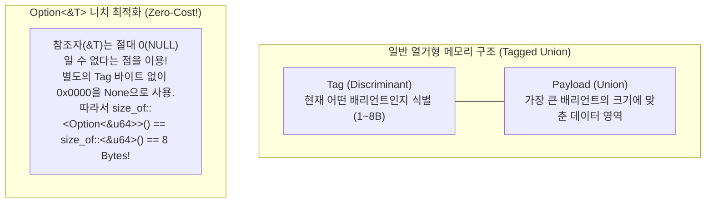
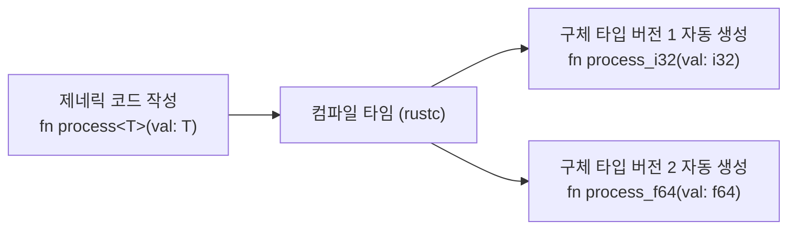

# 📙 제2권: 대수적 타입 시스템, 패턴 매칭, 에러 처리 및 트레이트(Trait)

> [!abstract]+ **이 장의 핵심 목표**
> Rust에는 전통적인 객체지향 언어(Java, C++)의 클래스 상속(`extends`)이나 `null` 포인터, 그리고 `try-catch` 예외(Exception)가 아예 존재하지 않습니다. 대신 **대수적 데이터 타입(Algebraic Data Types: `struct`와 `enum`)**, **패턴 매칭(`match`)**, 값으로서의 에러 처리(**`Option<T>` / `Result<T, E>`**), 그리고 조합 중심의 다형성을 제공하는 **트레이트(Trait)**를 통해 훨씬 더 견고하고 유지보수하기 쉬운 소프트웨어를 구축합니다.
> 
> - 이전 강좌: **[[programming/rust/Rust/01_Ownership_and_Memory_Architecture\|제1권: 소유권, 빌림, 생명주기와 스마트 포인터]]**
> - 다음 강좌: **[[programming/rust/Rust/03_Advanced_Rust_Concurrency_and_Macros\|제3권: 함수형, 동시성, 비동기 런타임, 매크로 및 Unsafe]]**

---

## 🏗️ Part 1. 구조체(Structs)와 메서드 문법

구조체(`struct`)는 관련된 여러 데이터를 묶어 의미 있는 도메인 모델을 만드는 **곱 타입(Product Type)**[^1]입니다. 데이터 정의(`struct`)와 동작 정의(`impl` 블록)가 명확히 분리되어 있는 것이 특징입니다.

### 1.1 구조체의 3가지 형태와 `impl` 블록 완벽 실습

```rust
// #[derive(Debug, Clone)]은 컴파일러에게 출력용 Debug 트레이트와 복제용 Clone 트레이트 코드를
// 자동으로 생성(자동 파생)하라고 지시하는 어트리뷰트입니다.
#[derive(Debug, Clone)]
struct ServerConfig {
    host: String,
    port: u16,
    use_tls: bool,
    max_connections: usize,
}

// 튜플 구조체 (Tuple Struct): 필드 이름은 없지만 타입 자체에 강력한 의미를 부여할 때 (Newtype 패턴)
#[derive(Debug, Copy, Clone)]
struct Milliseconds(u64);

// 유닛 유사 구조체 (Unit-Like Struct): 필드가 전혀 없어 메모리 크기가 0 바이트(Zero-Sized Type, ZST)임.
// 주로 트레이트만 구현할 때 사용합니다.
struct HealthCheckService;

// impl 블록: ServerConfig 구조체에 연관 함수와 메서드를 구현합니다.
impl ServerConfig {
    // 1. 연관 함수 (Associated Function): 첫 번째 매개변수가 self가 아닌 함수.
    // 다른 언어의 정적 메서드(Static Method)나 생성자(Constructor) 역할을 합니다.
    // Self(대문자 S)는 현재 impl 대상 타입인 ServerConfig의 별칭입니다.
    pub fn new(host: impl Into<String>, port: u16) -> Self {
        Self {
            host: host.into(), // &str이 들어오든 String이 들어오든 자동으로 String으로 변환!
            port,              // 필드 초기화 단축 문법 (port: port 와 동일)
            use_tls: true,
            max_connections: 1024,
        }
    }

    // 2. 불변 참조 메서드 (&self): 인스턴스의 데이터를 읽기만 할 때 (가장 흔함)
    pub fn endpoint_url(&self) -> String {
        let protocol = if self.use_tls { "https" } else { "http" };
        format!("{protocol}://{}:{}", self.host, self.port)
    }

    // 3. 가변 참조 메서드 (&mut self): 인스턴스 내부 필드 값을 변경할 때
    pub fn scale_up(&mut self, factor: usize) {
        self.max_connections *= factor;
    }

    // 4. 소유권 소비 메서드 (self): 호출 후 원본 인스턴스를 소멸시키거나 다른 타입으로 변환할 때
    pub fn into_host_string(self) -> String {
        self.host // self의 소유권을 가져와서 host 필드만 빼내고 나머지는 즉시 메모리 해제!
    }
}

fn main() {
    let mut prod_server = ServerConfig::new("api.rust-master.io", 443);
    prod_server.scale_up(4);
    println!("프로덕션 엔드포인트: {}", prod_server.endpoint_url());
    println!("서버 설정 상세: {prod_server:#?}"); // :#? 는 줄바꿈과 들여쓰기가 적용된 예쁜 디버그 출력!

    // 구조체 갱신 문법 (Struct Update Syntax: ..)
    // 기존 구조체의 일부 필드만 바꾸고 나머지는 그대로 가져올 때 사용합니다.
    let dev_server = ServerConfig {
        host: String::from("localhost"),
        port: 8080,
        use_tls: false,
        ..prod_server // max_connections(usize는 Copy 타입)가 그대로 복사됨!
    };
    println!("개발 서버 엔드포인트: {}", dev_server.endpoint_url());

    // 소유권 소비 메서드 호출
    let extracted_host = prod_server.into_host_string();
    println!("추출된 호스트명: {extracted_host}");
    // println!("{prod_server:?}"); // ❌ 에러! into_host_string(self)가 소유권을 소비했으므로 사용 불가!

    let timeout = Milliseconds(5000);
    let _service = HealthCheckService;
    println!("타임아웃: {}ms, 유닛 구조체 크기: {} 바이트", timeout.0, std::mem::size_of::<HealthCheckService>());
}
```

---

## 🎭 Part 2. 열거형(Enums)과 패턴 매칭(Pattern Matching)의 예술

C나 Java의 `enum`은 단순한 정수 상수의 집합에 불과합니다. 하지만 Rust의 `enum`은 **각각의 배리언트(Variant, 선택지)마다 서로 다른 타입과 개수의 데이터를 직접 품을 수 있는 합 타입(Sum Type / Tagged Union)**입니다!

### 2.1 열거형의 메모리 레이아웃과 니치 최적화 (Niche Optimization)



### 2.2 고급 패턴 매칭 (`match`, 가드, `@` 바인딩, `if let`, `let else`)

Rust의 `match`는 **완전성 검사(Exhaustiveness Check)**를 강제합니다. 즉, 가능한 모든 경우의 수를 처리하지 않으면 컴파일 자체가 되지 않아 실수로 예외 케이스를 누락하는 버그를 원천 차단합니다.

```rust
#[derive(Debug)]
enum PaymentMethod {
    Cash,                                           // 데이터 없음
    CreditCard { company: String, digits: u16 },    // 익명 구조체 형태 내장
    Crypto(String, f64),                            // 튜플 형태 내장 (코인명, 수량)
}

#[derive(Debug)]
struct Transaction {
    id: u64,
    amount: u32,
    method: PaymentMethod,
}

fn process_transaction(tx: &Transaction) {
    // match 표현식: 구조 분해(Destructuring), 매치 가드(if), @ 바인딩을 한 번에 활용!
    match tx {
        // 1. 특정 값 매칭 + @ 바인딩 (범위 조건을 만족하는 값을 변수에 즉시 바인딩)
        Transaction {
            id,
            amount: vip_amount @ 1_000_000.., // 100만 이상인 경우 vip_amount 변수에 값을 묶음
            method: PaymentMethod::CreditCard { company, .. }, // '..'으로 나머지 필드 무시
        } => {
            println!("👑 [VIP 결제 감지] 거래 #{id}: {company} 카드로 {vip_amount}원 대액 결제 승인!");
        }

        // 2. 매치 가드 (Match Guard): 패턴 뒤에 추가적인 if 조건식 결합
        Transaction {
            id,
            amount,
            method: PaymentMethod::Crypto(coin, qty),
        } if *qty > 10.0 => {
            println!("🪙 [대량 암호화폐] 거래 #{id}: {coin} {qty}개 (원화 환산: {amount}원)");
        }

        // 3. OR 패턴 (|) 및 일반 분해
        Transaction {
            id,
            amount,
            method: PaymentMethod::Cash | PaymentMethod::Crypto(_, _),
        } => {
            println!("💵 [일반 현금/코인] 거래 #{id}: {amount}원 처리 완료");
        }

        // 4. 나머지 모든 신용카드 케이스 (이 분기가 없으면 Exhaustiveness 에러 발생!)
        Transaction {
            id,
            amount,
            method: PaymentMethod::CreditCard { company, digits },
        } => {
            println!("💳 [일반 카드] 거래 #{id}: {company}(끝자리 {digits}) {amount}원 결제");
        }
    }
}

fn main() {
    let txs = vec![
        Transaction {
            id: 1,
            amount: 2_500_000,
            method: PaymentMethod::CreditCard { company: String::from("현대"), digits: 1234 },
        },
        Transaction {
            id: 2,
            amount: 50_000,
            method: PaymentMethod::Crypto(String::from("ETH"), 15.5),
        },
    ];

    for tx in &txs {
        process_transaction(tx);
    }

    // 💡 실무 꿀팁 1: 'if let' - 단 하나의 패턴만 관심 있고 나머지는 무시할 때
    let config_port: Option<u16> = Some(9090);
    if let Some(port) = config_port {
        println!("설정된 포트 번호: {port}");
    }

    // 💡 실무 꿀팁 2: 'let ... else' (Rust 1.65+ 최신 문법 ⭐)
    // 패턴이 일치하면 변수를 현재 스코프에 바로 풀어놓고, 실패하면 즉시 함수에서 탈출(Early Return)할 때!
    // 중첩된 if-match 들여쓰기 지옥(Pyramid of Doom)을 완벽히 없애줍니다.
    let Some(valid_port) = config_port else {
        eprintln!("포트가 설정되지 않아 종료합니다.");
        return;
    };
    println!("let-else로 깔끔하게 추출한 포트: {valid_port}");
}
```

---

## 🛡️ Part 3. `null`과 예외가 없는 세상: `Option<T>`와 `Result<T, E>`

1965년 토니 호어(Tony Hoare)가 발명한 `null` 참조는 수많은 시스템 장애를 일으켜 *"10억 달러짜리 실수(Billion-dollar mistake)"*라 불립니다. Rust에는 `null`이 없습니다! 대신 표준 라이브러리에 정의된 두 개의 열거형으로 **값의 부재(`Option`)**와 **실패 가능성(`Result`)**을 타입 시스템 수준에서 완벽히 제어합니다.

```rust
// 표준 라이브러리에 내장된 실제 정의 (별도 import 없이 바로 사용 가능)
enum Option<T> {
    Some(T), // 값이 존재함
    None,    // 값이 없음
}

enum Result<T, E> {
    Ok(T),   // 작업 성공 (결과값 T 포함)
    Err(E),  // 작업 실패 (에러 정보 E 포함)
}
```

### 3.1 에러 전파 연산자 `?`와 커스텀 에러 설계 아키텍처

함수 안에서 `Result`를 반환하는 작업을 연달아 호출할 때마다 `match`를 쓰면 코드가 길어집니다. 이때 표현식 끝에 **물음표 연산자(`?`)**를 붙이면 다음과 같이 동작합니다:
- 결과가 `Ok(val)`이면: `Ok` 껍질을 벗겨내고 `val`을 즉시 꺼내줍니다.
- 결과가 `Err(e)`이면: `From` 트레이트를 통해 현재 함수의 에러 타입으로 자동 변환한 뒤, **즉시 현재 함수를 종료하고 호출자(Caller)에게 `Err`를 반환(전파)**합니다!

```rust
use std::fmt;
use std::num::ParseIntError;

// 1. 실무형 도메인 커스텀 에러 열거형 정의
#[derive(Debug)]
pub enum AccountError {
    EmptyInput,
    InvalidNumberFormat(ParseIntError),
    NegativeBalance(i64),
}

// 2. 사용자 친화적인 에러 메시지 출력을 위한 Display 트레이트 구현
impl fmt::Display for AccountError {
    fn fmt(&self, f: &mut fmt::Formatter<'_>) -> fmt::Result {
        match self {
            Self::EmptyInput => write!(f, "입력 문자열이 비어 있습니다."),
            Self::InvalidNumberFormat(e) => write!(f, "숫자 파싱 실패: {e}"),
            Self::NegativeBalance(val) => write!(f, "잔액은 음수가 될 수 없습니다 (입력값: {val})"),
        }
    }
}

// 3. 표준 Error 트레이트 구현
impl std::error::Error for AccountError {}

// 4. ⭐ 핵심: ParseIntError를 AccountError로 자동 변환해 주는 From 트레이트 구현!
// 이 구현이 있어야 '?' 연산자가 parse()의 에러를 자동으로 AccountError로 바꿔줍니다.
impl From<ParseIntError> for AccountError {
    fn from(err: ParseIntError) -> Self {
        Self::InvalidNumberFormat(err)
    }
}

/// 문자열로 된 잔액을 받아 파싱하고 보너스 1000원을 더한 결과를 반환하는 함수
fn parse_and_add_bonus(raw_input: &str) -> Result<u64, AccountError> {
    let trimmed = raw_input.trim();
    if trimmed.is_empty() {
        return Err(AccountError::EmptyInput);
    }

    // 💡 '?' 연산자의 위력!
    // trimmed.parse::<i64>()가 실패하면 ParseIntError가 발생하고,
    // 위에서 구현한 From 트레이트를 통해 자동으로 AccountError::InvalidNumberFormat으로 변환되어 즉시 반환됩니다!
    let balance: i64 = trimmed.parse::<i64>()?;

    if balance < 0 {
        return Err(AccountError::NegativeBalance(balance));
    }

    Ok((balance as u64) + 1000)
}

fn main() {
    let test_inputs = vec!["  50000 ", "", "오만원", "-3000"];

    for input in test_inputs {
        match parse_and_add_bonus(input) {
            Ok(final_amount) => println!("✅ 성공 (입력: '{input}') -> 최종 금액: {final_amount}원"),
            Err(err) => println!("❌ 실패 (입력: '{input}') -> 사유: {err}"),
        }
    }

    // 💡 Option/Result 함수형 조합기(Combinators) 활용 팁
    let maybe_name: Option<&str> = Some("rustacean");
    // map, filter, unwrap_or_else를 체이닝하여 조건문 없이 깔끔하게 데이터 변환
    let upper_name = maybe_name
        .filter(|name| name.len() >= 5)
        .map(|name| name.to_uppercase())
        .unwrap_or_else(|| String::from("GUEST"));
    println!("변환된 사용자 이름: {upper_name}");
}
```

> [!tip]+ **실무 프로젝트의 에러 처리 표준 크레이트 2대장 (`thiserror` vs `anyhow`)**
> 실제 상용 프로젝트(`Cargo.toml`)에서는 위에서 직접 작성한 `fmt::Display`와 `From` 보일러플레이트 코드를 매크로로 자동 생성해 주는 라이브러리를 씁니다:
> 1. **라이브러리(Library) 개발 시 $\rightarrow$ `thiserror` 크레이트**:
>    ```rust
>    #[derive(thiserror::Error, Debug)]
>    pub enum DataStoreError {
>        #[error("데이터베이스 연결 끊김")]
>        Disconnected(#[from] std::io::Error), // #[from] 하나로 From 트레이트 자동 생성!
>    }
>    ```
> 2. **애플리케이션(Binary/App) 개발 시 $\rightarrow$ `anyhow` 크레이트**:
>    모든 종류의 에러를 `anyhow::Result<T>` 하나로 통합해서 받고 `.context("설정 파일을 읽는 중 실패")?`처럼 에러 발생 맥락을 쉽게 추가할 수 있습니다.

---

## 🧩 Part 4. 제네릭(Generics)과 트레이트(Traits): 제로 비용 추상화의 비밀

### 4.1 제네릭과 단형성화 (Monomorphization)

C++이나 Rust의 제네릭이 Java의 제네릭(Type Erasure)보다 압도적으로 빠른 이유는 **단형성화(Monomorphization)** 덕분입니다.



즉, 개발자는 추상화된 제네릭 코드 한 벌만 작성하지만, 컴파일러가 실제로 사용된 타입들을 찾아 각각 전용 함수를 찍어내므로 **런타임 성능 손실이 정확히 $0$ (Zero-Cost Abstraction)**입니다!

### 4.2 트레이트(Trait): 정적 디스패치(`impl Trait`) vs 동적 디스패치(`dyn Trait`)

트레이트는 다른 언어의 인터페이스(Interface)나 타입 클래스(Type Class)와 유사합니다. 하지만 Rust에서는 트레이트를 사용할 때 **컴파일 타임에 함수를 결정할 것인가(Static Dispatch)**, 아니면 **런타임에 가상 함수 테이블(vtable)을 통해 결정할 것인가(Dynamic Dispatch)**를 개발자가 직접 선택할 수 있습니다!

| 비교 항목 | 정적 디스패치 (`T: Trait` 또는 `impl Trait`) | 동적 디스패치 (`&dyn Trait` 또는 `Box<dyn Trait>`) |
| :--- | :--- | :--- |
| **함수 결정 시점** | 컴파일 타임 (Monomorphization) | 런타임 (vtable 포인터 조회) |
| **인라인 최적화** | ✅ 컴파일러가 함수 본문을 인라인(Inline)화 가능 | ❌ 런타임에 결정되므로 인라인 최적화 불가 |
| **실행 속도 / 바이너리** | ⚡ **초고속** / 코드 복제로 인해 바이너리 크기 증가 가능 | 🐢 약간의 간접 참조 비용 / 바이너리 크기 작음 |
| **이종 컬렉션 구성** | ❌ `Vec<T>`에는 동일한 단일 구체 타입만 저장 가능 | ✅ `Vec<Box<dyn Trait>>`에 서로 다른 구조체들을 함께 저장 가능! |

```rust
use std::fmt::Display;
use std::ops::Add;

// 1. 트레이트 정의 (기본 구현 메서드 포함)
pub trait Renderable {
    // 반드시 구현해야 하는 필수 메서드
    fn render(&self) -> String;

    // 기본 동작을 제공하는 디폴트 메서드 (필요시 오버라이딩 가능)
    fn preview(&self) {
        println!("[미리보기] {}", self.render());
    }
}

struct Button {
    label: String,
}

struct TextBox {
    content: String,
    placeholder: String,
}

// Button에 대해 Renderable 트레이트 구현
impl Renderable for Button {
    fn render(&self) -> String {
        format!("[ 🔘 {} ]", self.label)
    }
}

// TextBox에 대해 Renderable 트레이트 구현
impl Renderable for TextBox {
    fn render(&self) -> String {
        if self.content.is_empty() {
            format!("| _{}_ |", self.placeholder)
        } else {
            format!("| {} |", self.content)
        }
    }
}

// 2. 정적 디스패치 (Static Dispatch) + 다중 트레이트 바운드 (where 절 활용)
// T는 Renderable이면서 동시에 Clone도 가능해야 함을 명시합니다.
fn render_static<T>(component: &T)
where
    T: Renderable + Clone,
{
    println!("정적 디스패치 렌더링: {}", component.render());
}

// 3. 연산자 오버로딩 (Operator Overloading): std::ops::Add 트레이트 구현
#[derive(Debug, Copy, Clone, PartialEq)]
struct Vector2D {
    x: f64,
    y: f64,
}

impl Add for Vector2D {
    type Output = Self; // 연관 타입 (Associated Type): 덧셈 결과의 타입 지정

    fn add(self, rhs: Self) -> Self::Output {
        Self {
            x: self.x + rhs.x,
            y: self.y + rhs.y,
        }
    }
}

fn main() {
    let btn = Button { label: String::from("결제하기") };
    let input = TextBox {
        content: String::new(),
        placeholder: String::from("이메일을 입력하세요"),
    };

    // 정적 디스패치 호출 (컴파일 시점에 Button 전용 함수로 변환됨)
    render_static(&btn);

    // 💡 동적 디스패치 (Dynamic Dispatch): 트레이트 객체 (Box<dyn Renderable>)
    // Button과 TextBox는 서로 다른 크기의 구조체이지만, Box<dyn Renderable>로 감싸면
    // 하나의 Vec 안에 서로 다른 UI 컴포넌트들을 모두 담아 다형성 루프를 돌릴 수 있습니다!
    let ui_screen: Vec<Box<dyn Renderable>> = vec![
        Box::new(btn),
        Box::new(input),
        Box::new(Button { label: String::from("취소") }),
    ];

    println!("--- 전체 UI 화면 동적 디스패치 렌더링 ---");
    for widget in &ui_screen {
        widget.preview(); // 런타임에 vtable을 참조하여 각 구조체에 맞는 render() 호출
    }

    // 연산자 오버로딩 확인
    let v1 = Vector2D { x: 1.5, y: 2.0 };
    let v2 = Vector2D { x: 3.5, y: 4.0 };
    let v3 = v1 + v2; // 내부적으로 v1.add(v2)가 호출됨!
    println!("벡터 덧셈 결과: {v3:?}");
}
```

> [!info]+ **고아 규칙 (Orphan Rule / Coherence)**
> Rust에서 어떤 타입 `T`에 대해 트레이트 `Trait`를 구현(`impl Trait for T`)하려면, **`Trait` 혹은 `T` 둘 중 최소한 하나는 반드시 현재 내 크레이트(프로젝트)에서 정의한 것이어야 합니다.**
> 예를 들어 외부 표준 라이브러리의 `Vec<T>`에 외부 표준 라이브러리의 `Display` 트레이트를 내 마음대로 구현할 수는 없습니다. 이 규칙 덕분에 외부 라이브러리를 추가했을 때 기존 메서드 동작이 충돌하거나 덮어씌워지는 대참사가 원천 방지됩니다.

---

## ✅ 제2권 학습 점검 체크리스트 (Self-Check)

- [ ] 구조체의 3가지 메서드 수신자(`&self`, `&mut self`, `self`)가 각각 소유권을 어떻게 다루는지 설명할 수 있다.
- [ ] `enum`을 활용한 대수적 데이터 타입 설계와 `match` 가드, `@` 바인딩, 그리고 `let ... else` 구문을 자유자재로 사용할 수 있다.
- [ ] `Option<T>`와 `Result<T, E>`의 차이점을 알고, `From` 트레이트와 `?` 연산자가 결합하여 에러를 전파하는 원리를 이해했다.
- [ ] 제네릭의 단형성화(Monomorphization)가 왜 런타임 비용이 $0$인지 설명할 수 있다.
- [ ] 정적 디스패치(`impl Trait`)와 동적 디스패치(`Box<dyn Trait>`)의 장단점과 vtable 구조를 구분할 수 있다.

> [!success]+ **다음 단계로 이동하기**
> 이제 중급을 넘어 **시니어 Rust 개발자의 영역**으로 진입합니다! 함수형 이터레이터 최적화, 멀티스레드 동시성, `Tokio` 비동기 런타임, 컴파일러를 확장하는 매크로, 그리고 `unsafe` Rust까지 정복하러 갑시다.
> 👉 **다음 강좌**: **[[programming/rust/Rust/03_Advanced_Rust_Concurrency_and_Macros\|제3권: 함수형, 동시성, 비동기 런타임, 매크로 및 Unsafe]]**

[^1]: 타입 이론에서 구조체(`struct { a: A, b: B }`)가 가질 수 있는 상태의 총 가짓수는 $|A| \times |B|$이므로 **곱 타입(Product Type)**이라 부르고, 열거형(`enum { A, B }`)가 가질 수 있는 상태의 총 가짓수는 $|A| + |B|$이므로 **합 타입(Sum Type)**이라 부릅니다.