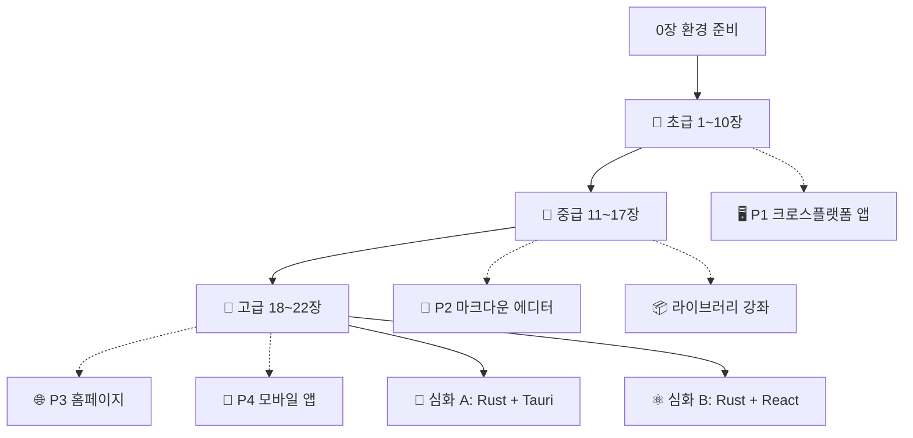

---
{"dg-publish":true,"permalink":"/programming/rust/rust-master/1-rust/","dg-note-properties":{}}
---

<aside>  
🦀

**이 강좌는 한 편의 이야기입니다.**

신입 개발자 **하린**이 스타트업 **Crab Labs**에 입사해, 시니어 멘토 **페리스**와 함께 매일 마주치는 **문제**를 Rust로 **해결**하며 초급에서 고급 개발자로 성장하는 여정을 따라갑니다. 모든 실습은 **Antigravity IDE**에서 진행합니다.

</aside>

<aside>  
🌱

**초급**

문법 기초, 소유권, 구조체·열거형, 컬렉션, 에러 처리, 모듈

</aside>

<aside>  
🌿

**중급**

제네릭, 트레이트, 라이프타임, 클로저·이터레이터, 스마트 포인터, 동시성

</aside>

<aside>  
🌳

**고급**

async, 고급 트레이트·타입, 매크로, unsafe·FFI, 패턴과 성능

</aside>

<aside>  
🏗️

**프로젝트**

크로스플랫폼 앱, 마크다운 에디터, 홈페이지, 모바일 앱

</aside>

---

## 📑 목차

---

## 1. 등장인물

|인물|소개|
|---|---|
|👩‍💻 **하린**|Python을 조금 다루어 본 신입 개발자. "빠르고 안전한 프로그램"을 만들고 싶어 Rust를 배우기 시작한다.|
|🦀 **페리스**|Crab Labs의 시니어 개발자이자 멘토. 답을 바로 알려주기보다 "컴파일러가 뭐라고 했어?"라고 되묻는 것을 좋아한다.|
|🤖 **에이전트**|Antigravity IDE에 내장된 AI 에이전트. 컴파일 오류 설명과 테스트 작성을 도와주지만, 페리스는 "원리를 이해한 뒤에 맡겨라"고 당부한다.|

## 2. 각 장의 구성

모든 장은 같은 리듬으로 진행됩니다.

<aside>  
🧩

**문제** — 하린이 마주친 상황과 컴파일 오류

</aside>

<aside>  
💡

**해결** — 동작하는 샘플 코드와 설명

</aside>

<aside>  
🤖

**Antigravity 팁** — IDE와 에이전트 활용법

</aside>

<aside>  
⚠️

**함정** — 초보자가 자주 빠지는 실수

</aside>

## 3. 학습 로드맵

|단계|마치면 할 수 있는 것|예상 시간|
|---|---|---|
|🌱 초급|소유권을 이해하고 컴파일러와 싸우지 않으며 CLI 프로그램을 만든다|약 20시간|
|🌿 중급|재사용 가능한 라이브러리를 설계하고, 멀티스레드 프로그램을 안전하게 작성한다|약 25시간|
|🌳 고급|비동기 서버, 매크로, FFI를 다루고 다른 사람의 Rust 코드를 리뷰한다|약 25시간|
|🏗️ 프로젝트|데스크톱·웹·모바일에서 동작하는 실제 제품을 만든다|약 30시간|

---

## 4. 커리큘럼

### 🧰 준비

[0장. 첫 출근 — Antigravity IDE와 Rust 환경 준비](https://app.notion.com/p/0-Antigravity-IDE-Rust-4127dbaee6b6811b9cc3cd00b2c324b7?pvs=21)

### 🌱 초급 — 문법의 뿌리

[1장. 변수와 가변성 — "값이 왜 안 바뀌죠?"](https://app.notion.com/p/1-4127dbaee6b6811389d7fd51f207326f?pvs=21)

[2장. 타입과 함수 — "숫자가 넘쳐요!"](https://app.notion.com/p/2-4127dbaee6b681a2abc9c45d8a257181?pvs=21)

[3장. 제어 흐름 — "재시도 로직을 만들어라"](https://app.notion.com/p/3-4127dbaee6b6812d939fef9beaee8042?pvs=21)

[4장. 소유권 — "borrow of moved value"와의 첫 만남](https://app.notion.com/p/4-borrow-of-moved-value-4127dbaee6b6813a8290da0e5be94ce3?pvs=21)

[5장. 참조와 빌림, 슬라이스 — "빌려주되 동시에 고치지 마라"](https://app.notion.com/p/5-4127dbaee6b681dd8fcef8bc912434f7?pvs=21)

[6장. 구조체와 메서드 — "데이터에 이름을 붙여라"](https://app.notion.com/p/6-4127dbaee6b68181a2d1d311483bd8e7?pvs=21)

[7장. 열거형과 패턴 매칭 — "null은 없다"](https://app.notion.com/p/7-null-4127dbaee6b681a58f4fe60241a00ad8?pvs=21)

[8장. 컬렉션 — Vec, String, HashMap](https://app.notion.com/p/8-Vec-String-HashMap-4127dbaee6b68194b70ed65689b55946?pvs=21)

[9장. 에러 처리 — "파일이 없으면 어떻게 해요?"](https://app.notion.com/p/9-4127dbaee6b681b1904bcfa588519575?pvs=21)

[10장. 모듈·크레이트·패키지 — "[main.rs](http://main.rs)가 1000줄이 됐어요"]([https://app.notion.com/p/10-main-rs-1000-4127dbaee6b681bd9276dbd79e7353c8?pvs=21](https://app.notion.com/p/10-main-rs-1000-4127dbaee6b681bd9276dbd79e7353c8?pvs=21))

### 🌿 중급 — 추상화와 안전한 동시성

[11장. 제네릭 — "같은 코드를 타입마다 복붙하고 있어요"](https://app.notion.com/p/11-4127dbaee6b681079357e4b875660766?pvs=21)

[12장. 트레이트 — "서로 다른 타입을 같은 방식으로 다루기"](https://app.notion.com/p/12-4127dbaee6b681cd88a5da7da2960e5c?pvs=21)

[13장. 라이프타임 — "이 참조는 얼마나 살아 있나요?"](https://app.notion.com/p/13-4127dbaee6b681d6a732c9a56b0c8861?pvs=21)

[14장. 클로저와 이터레이터 — "for문 없이 데이터를 다루기"](https://app.notion.com/p/14-for-4127dbaee6b681fd92ded6d78f0a45fe?pvs=21)

[15장. 스마트 포인터 — Box, Rc, RefCell, Weak](https://app.notion.com/p/15-Box-Rc-RefCell-Weak-4127dbaee6b681fabbaeeeb315473171?pvs=21)

[16장. 테스트와 문서화 — "월요일에 깨지지 않는 코드"](https://app.notion.com/p/16-4127dbaee6b6816481d5ddbe6902fb04?pvs=21)

[17장. 두려움 없는 동시성 — 스레드, 채널, Arc<Mutex>](https://app.notion.com/p/17-Arc-Mutex-4127dbaee6b6817787c7e3db65862304?pvs=21)

### 🌳 고급 — 전문가의 도구

[18장. async/await와 Tokio — "1만 개의 요청을 동시에"](https://app.notion.com/p/18-async-await-Tokio-1-4127dbaee6b681aba00cc37c3c39e380?pvs=21)

[19장. 고급 트레이트와 타입 — "라이브러리 작성자의 도구"](https://app.notion.com/p/19-4127dbaee6b681af8960d26e48fe898b?pvs=21)

[20장. 매크로 — "코드를 생성하는 코드"](https://app.notion.com/p/20-4127dbaee6b68151b046c029a9b103b7?pvs=21)

[21장. unsafe와 FFI — "C 라이브러리를 불러야 해요"](https://app.notion.com/p/21-unsafe-FFI-C-4127dbaee6b68131bd6ef0c0565c9c12?pvs=21)

[22장. 성능·디자인 패턴·문법 마스터 체크리스트](https://app.notion.com/p/22-4127dbaee6b68174a4d4eef83a85c24c?pvs=21)

### 🏗️ 실전 프로젝트

[P1. 크로스플랫폼 어플라이언스 — Windows·macOS·Ubuntu 시스템 모니터](https://app.notion.com/p/P1-Windows-macOS-Ubuntu-4127dbaee6b6810a9c90d67def6365f4?pvs=21)

[P2. Obsidian 스타일 마크다운 에디터 만들기 — CrabNote](https://app.notion.com/p/P2-Obsidian-CrabNote-4127dbaee6b68130a69bc3387b99e818?pvs=21)

[P3. Rust로 홈페이지 만들기 — Axum + Askama + 마크다운 블로그](https://app.notion.com/p/P3-Rust-Axum-Askama-4127dbaee6b681bf8775c3f07cbbda35?pvs=21)

[P4. Android·iOS 모바일 앱 만들기 — Tauri 2 (대안: Dioxus, UniFFI)](https://app.notion.com/p/P4-Android-iOS-Tauri-2-Dioxus-UniFFI-4127dbaee6b6819e8fdae0ef8f219bed?pvs=21)

### 📦 라이브러리 강좌

[Rust 라이브러리 강좌 — 실무 필수 크레이트 12선](https://app.notion.com/p/Rust-12-4127dbaee6b681dca48ec86263bd43fa?pvs=21)

serde · clap · anyhow/thiserror · tokio · reqwest · axum · sqlx · tracing · rayon · regex · chrono · egui — 각각 독립된 강좌로 구성되어 있습니다.

### 🧩 심화 과정 — 플러그인 플랫폼 만들기

<aside>  
🧩

**A · Rust + Tauri**

멀티 OS Obsidian 스타일 에디터 + Tauri 플러그인 크레이트 + **WASM(Extism) 서드파티 플러그인**

</aside>

<aside>  
⚛️

**B · Rust + React**

멀티 OS Obsidian 스타일 에디터 + **JS 플러그인(Web Worker 샌드박스 + 권한)** + 개발자 SDK

</aside>

[Rust + Tauri 심화 과정 — 플러그인을 지원하는 멀티 OS 마크다운 에디터](https://app.notion.com/p/Rust-Tauri-OS-4127dbaee6b6819baf0be1cf71599e71?pvs=21)

[Rust + React 심화 과정 — JS 플러그인 생태계를 갖춘 멀티 OS 마크다운 에디터](https://app.notion.com/p/Rust-React-JS-OS-4127dbaee6b681959a15f4331ff16802?pvs=21)

---

## 5. 학습 진도 관리

각 항목의 **상태**를 바꾸고 **실습 완료**를 체크하며 진도를 관리하세요. 보드 보기로 바꾸면 단계별 칸반으로 볼 수 있습니다.

[🦀 Rust 학습 진도 트래커](https://app.notion.com/p/5c2bac5a3c89409ea0193ad9ccffbe9a?pvs=21)

---

### ℹ️ 이 강좌의 기준

- 기준일: 2026년 11월 8일
- 작성자: @goose
- Rust **2024 Edition**, stable 툴체인을 기준으로 합니다.
- 외부 크레이트(라이브러리)는 빠르게 버전이 올라갑니다. API가 다르면 [docs.rs](https://docs.rs)에서 해당 버전 문서를 확인하세요.
- 본문의 샘플 코드는 설명을 위해 작성되었으며, 특히 egui·Tauri·sysinfo처럼 빠르게 변하는 크레이트는 설치된 버전에 맞춘 수정이 필요할 수 있습니다.
- 공식 교재 [The Rust Programming Language](https://doc.rust-lang.org/book/)와 함께 보면 더욱 좋습니다.