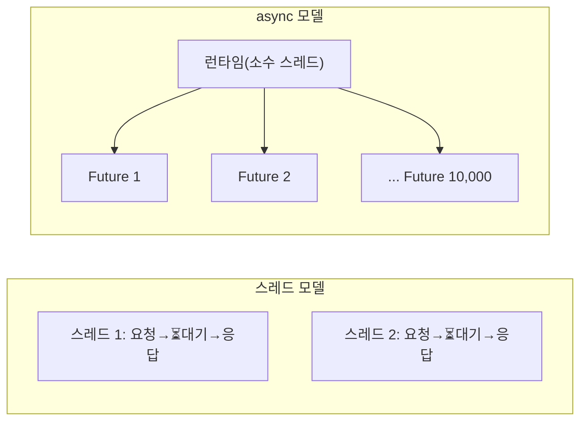

---
{"dg-publish":true,"permalink":"/programming/rust/rust-master/18-async-await-tokio-1/","dg-note-properties":{}}
---


> 📖 **스토리** — 고급 과정 첫 과제. 외부 API 100곳의 상태를 확인하는 모니터를 만들어야 한다. 하나에 0.5초씩 순서대로 호출하면 50초. 스레드 100개는 너무 무겁다. 페리스: "기다리는 동안 다른 일을 하면 돼. 그게 async야."

## 🔍 원리 — 스레드 vs async



- `async fn` 은 호출해도 바로 실행되지 않고 **Future**(나중에 완료될 작업)를 반환합니다.
- `.await` 는 Future가 준비될 때까지 **현재 작업을 양보**하고, 그동안 런타임이 다른 Future를 진행시킵니다.
- Rust 표준 라이브러리에는 런타임이 없으므로 **Tokio** 같은 런타임을 씁니다.

```bash
cargo add tokio --features full
```

## 🧩 문제 1 — main에서 `.await` 를 쓸 수 없다

## 💡 해결 1 — `#[tokio::main]`

```rust
use tokio::time::{sleep, Duration};

async fn check(api: &str) -> (String, bool) {
    sleep(Duration::from_millis(500)).await;   // 네트워크 호출을 흉내 (블로킹 아님)
    (api.to_string(), !api.contains("down"))
}

#[tokio::main]
async fn main() {
    let one = check("payments").await;          // 순차 실행: 0.5초
    println!("{one:?}");

    // join!: 여러 Future를 동시에 진행 → 총 0.5초
    let (a, b, c) = tokio::join!(check("users"), check("orders"), check("down-service"));
    println!("{a:?} {b:?} {c:?}");
}
```

## 🧩 문제 2 — 개수가 정해지지 않은 100개 작업을 동시에 돌리고 싶다

## 💡 해결 2 — `tokio::spawn` + `JoinSet` + 동시성 제한

```rust
use std::sync::Arc;
use tokio::sync::Semaphore;
use tokio::task::JoinSet;
use tokio::time::{sleep, Duration, Instant};

async fn check(id: usize) -> (usize, bool) {
    sleep(Duration::from_millis(500)).await;
    (id, id % 17 != 0)
}

#[tokio::main]
async fn main() {
    let start = Instant::now();
    let limit = Arc::new(Semaphore::new(20));      // 동시에 최대 20개만 (상대 서버 보호)
    let mut set = JoinSet::new();

    for id in 0..100 {
        let limit = Arc::clone(&limit);
        set.spawn(async move {                     // 런타임에 독립 태스크로 등록
            let _permit = limit.acquire().await.unwrap();
            check(id).await
        });
    }

    let mut down = vec![];
    while let Some(res) = set.join_next().await {
        let (id, ok) = res.expect("태스크 panic");
        if !ok { down.push(id); }
    }
    down.sort();
    println!("장애: {down:?}, 소요 {:?}", start.elapsed()); // 약 2.5초 (100/20 × 0.5)
}
```

## 🧩 문제 3 — 느린 서버는 2초 뒤 포기하고, Ctrl+C로 우아하게 종료하고 싶다

## 💡 해결 3 — `timeout` 과 `select!`

```rust
use tokio::sync::mpsc;
use tokio::time::{interval, timeout, Duration};

#[tokio::main]
async fn main() {
    // 1) 타임아웃
    match timeout(Duration::from_secs(2), tokio::time::sleep(Duration::from_secs(5))).await {
        Ok(_) => println!("제시간 완료"),
        Err(_) => println!("⏰ 2초 초과 → 포기"),
    }

    // 2) 비동기 채널 + select!: 여러 이벤트 중 먼저 오는 것을 처리
    let (tx, mut rx) = mpsc::channel::<String>(32);
    tokio::spawn(async move {
        for i in 0..3 {
            tx.send(format!("이벤트 {i}")).await.unwrap();
            tokio::time::sleep(Duration::from_millis(300)).await;
        }
    });

    let mut tick = interval(Duration::from_millis(250));
    loop {
        tokio::select! {
            Some(msg) = rx.recv() => println!("📨 {msg}"),
            _ = tick.tick() => println!("💓 heartbeat"),
            _ = tokio::signal::ctrl_c() => { println!("👋 종료"); break; }
            else => break,   // 모든 가지가 비활성화되면
        }
    }
}
```

<aside>  
⚠️

**함정 — async 안에서 블로킹 금지**

- `std::thread::sleep`, 무거운 CPU 계산, 동기 파일 I/O는 런타임 스레드를 막아 다른 태스크를 멈춥니다. → `tokio::time::sleep`, `tokio::fs`, `tokio::task::spawn_blocking` 을 쓰세요.
- `std::sync::Mutex` 가드를 잡은 채로 `.await` 하면 안 됩니다. 필요하면 `tokio::sync::Mutex` 를 쓰세요.  
    </aside>

## 🔍 원리 — Future는 상태 기계

```rust
// 표준 라이브러리의 정의 (개념)
pub trait Future {
    type Output;
    fn poll(self: Pin<&mut Self>, cx: &mut Context<'_>) -> Poll<Self::Output>;
}
// Poll::Ready(v) 또는 Poll::Pending. 런타임은 Pending이면 Waker가 깨울 때까지 다른 일을 한다.
```

- 컴파일러는 `async fn` 을 `.await` 지점마다 상태를 가진 **열거형 상태 기계**로 변환합니다. 스레드 스택이 필요 없어 수백만 개도 가벼습니다.
- `Pin` 은 자기 자신을 참조할 수 있는 상태 기계가 메모리에서 옮겨지지 않도록 보장합니다.
- 트레이트에도 `async fn` 을 쓸 수 있습니다(Rust 1.75+). 단, `dyn` 으로 쓰려면 아직 `async-trait` 크레이트나 `Box<dyn Future>` 반환이 필요합니다.

```rust
trait HealthCheck {
    async fn ping(&self) -> bool;
}
```

---

## 🏋️ 연습 문제

- Q1. URL 5개를 동시에 "가짜 다운로드"(각기 다른 sleep)하고, 가장 먼저 끝난 것의 이름만 출력하세요.
    
    ```rust
    use tokio::task::JoinSet;
    use tokio::time::{sleep, Duration};
    
    #[tokio::main]
    async fn main() {
        let mut set = JoinSet::new();
        for (i, ms) in [300, 100, 500, 200, 400].into_iter().enumerate() {
            set.spawn(async move { sleep(Duration::from_millis(ms)).await; format!("url-{i}") });
        }
        if let Some(Ok(first)) = set.join_next().await {
            println!("가장 빠름: {first}");  // url-1
        }
        set.abort_all();                     // 나머지는 취소
    }
    ```