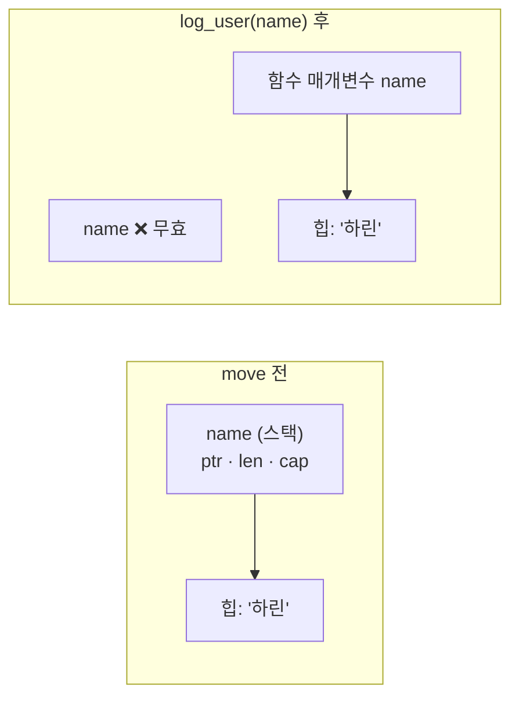

---
{"dg-publish":true,"permalink":"/programming/rust/rust-master/4-borrow-of-moved-value/","dg-note-properties":{}}
---


> 📖 **스토리** — 하린은 사용자 이름을 로그에 남기는 함수를 만들었다. 함수를 호출한 뒤 이름을 한 번 더 출력하려는데 컴파일러가 화를 냈다. 페리스가 웃었다. "드디어 Rust의 심장에 도착했구나."

## 🧩 문제 1 — E0382: borrow of moved value

```rust
fn log_user(name: String) {
    println!("[LOG] {name}");
}

fn main() {
    let name = String::from("하린");
    log_user(name);
    println!("환영합니다, {name}"); // ❌ value borrowed here after move
}
```

## 🔍 원리 — 소유권 3원칙

<aside>  
📜

1. Rust의 모든 값에는 **소유자(owner)**인 변수가 있다.
2. 소유자는 **한 순간에 하나**뿐이다.
3. 소유자가 스코프를 벗어나면 값은 **자동으로 해제(drop)**된다.  
    </aside>

`String` 은 문자열 내용을 **힙(heap)**에 두고, 스택에는 (포인터, 길이, 용량)만 둡니다. `log_user(name)` 을 호출하면 이 소유권이 함수의 매개변수로 **이동(move)**하고, 함수가 끝나면 문자열은 해제됩니다. 그래서 `main` 의 `name` 은 더 이상 쓸 수 없습니다.



<aside>  
🦀

**페리스**: "이 규칙 덕분에 Rust에는 가비지 컬렉터가 없는데도 **이중 해제, 해제 후 사용, 메모리 누수** 같은 C/C++의 고질적인 버그가 컴파일 단계에서 막혀."

</aside>

## 💡 해결 — 세 가지 방법

빌려주기 (권장)

소유권을 넘기지 않고 **참조(&)**만 빌려줍니다. 5장에서 자세히 다룹니다.

```rust
fn log_user(name: &str) {
    println!("[LOG] {name}");
}

fn main() {
    let name = String::from("하린");
    log_user(&name);              // 빌려줌
    println!("환영합니다, {name}"); // ✅
}
```

복제하기

힙 데이터까지 통째로 복사합니다. 간단하지만 비용이 듭니다.

```rust
log_user(name.clone());
println!("환영합니다, {name}"); // ✅
```

돌려받기

함수가 소유권을 다시 반환합니다. 가능하지만 번거로워서 잘 쓰지 않습니다.

```rust
fn log_user(name: String) -> String {
    println!("[LOG] {name}");
    name
}
let name = log_user(name);
```

## 🧩 문제 2 — 그런데 숫자는 왜 move가 안 돼요?

```rust
let a = 5;
let b = a;
println!("{a} {b}"); // ✅ 잘 됨
```

## 💡 해결 2 — `Copy` 타입

크기가 고정되어 스택에만 있는 값(정수, 실수, `bool`, `char`, Copy 타입만 담은 튜플·배열, `&T`)은 **복사**가 너무 싸기 때문에 move 대신 자동으로 복사됩니다. 이런 타입은 `Copy` 트레이트를 구현합니다.

```rust
#[derive(Debug, Clone, Copy)]
struct Point { x: i32, y: i32 }   // 필드가 모두 Copy면 직접 만든 타입도 Copy 가능

fn main() {
    let p1 = Point { x: 1, y: 2 };
    let p2 = p1;                  // 복사
    println!("{p1:?} {p2:?}");    // ✅
}
```

## 🧩 문제 3 — 값은 정확히 언제 해제되지?

## 💡 해결 3 — `Drop` 으로 직접 확인하기

```rust
struct Connection(&'static str);

impl Drop for Connection {
    fn drop(&mut self) {
        println!("🔌 {} 연결 종료", self.0);
    }
}

fn main() {
    let _db = Connection("DB");
    {
        let _cache = Connection("Cache");
        println!("블록 끝");
    } // ← 여기서 Cache drop
    let temp = Connection("Temp");
    drop(temp);                    // 명시적으로 일찍 해제
    println!("main 끝");
} // ← 여기서 DB drop
```

```
블록 끝
🔌 Cache 연결 종료
🔌 Temp 연결 종료
main 끝
🔌 DB 연결 종료
```

<aside>  
🔍

**RAII** — 자원(파일, 소켓, 락)을 값의 수명에 묶어 스코프를 벗어날 때 자동 정리하는 패턴입니다. Rust에서는 `File`, `MutexGuard` 등 표준 라이브러리 전체가 이 방식으로 동작합니다. 변수는 선언된 **역순으로** drop됩니다.

</aside>

---

## 🏋️ 연습 문제

- Q1. 다음 중 컴파일 오류가 나는 것은? (a) `let v = vec![1]; let w = v; println!("{:?}", v);` (b) `let t = (1, 2.0); let u = t; println!("{:?}", t);`
    
    (a). `Vec` 는 힙을 소유하므로 move되고, (b)의 튜플은 Copy 타입만 담고 있어 복사됩니다.
    
- Q2. `let s1 = String::from("a"); let s2 = s1; let s3 = s2.clone();` 이후 사용할 수 있는 변수는?
    
    `s2` 와 `s3`. `s1` 은 `s2` 로 move되었습니다.