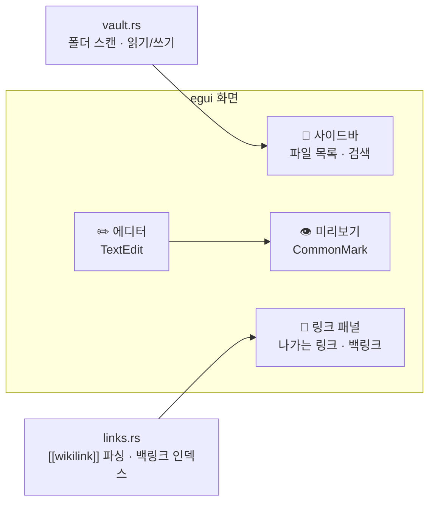

---
{"dg-publish":true,"permalink":"/programming/rust/rust-master/p2-obsidian-crab-note/","dg-note-properties":{}}
---


<aside>  
🏗️

**프로젝트 2** · 선수 지식: 1~17장 · 사용 크레이트: `eframe`/`egui`, `egui_commonmark`, `rfd`, `walkdir`, `regex`

로컬 폴더(Vault)의 `.md` 파일을 편집하고, 실시간 미리보기·`[[위키링크]]`·백링크·검색을 지원하는 **Obsidian 스타일 데스크톱 에디터**를 순수 Rust로 만듭니다. Windows·macOS·Ubuntu에서 모두 동작합니다.

</aside>

> 📖 **스토리** — 팀 위키를 마크다운 파일로 관리하자는 의견이 나왔다. 페리스: "만들어 보자. 파일 트리, 에디터, 미리보기, 그리고 노트끼리 연결되는 링크. 그게 Obsidian의 핵심이야."

## 🎯 아키텍처



```bash
cargo new crabnote && cd crabnote
cargo add eframe egui_commonmark rfd walkdir regex
```

<aside>  
⚠️

`egui_commonmark` 는 특정 `egui` 버전과 짝을 이룹니다. `cargo tree -d` 로 egui가 두 버전 섞여 있지 않은지 확인하고, 섞여 있으면 두 크레이트의 버전을 맞추세요. Ubuntu에서는 `sudo apt install libxkbcommon-dev libgtk-3-dev` 가 필요할 수 있습니다(파일 대화상자용).

</aside>

## 🧩 문제 1 — 폴더 안의 노트를 모두 찾고 읽고 쓸 수 있어야 한다

## 💡 해결 1 — `vault.rs`

```rust
// src/vault.rs
use std::path::{Path, PathBuf};
use walkdir::WalkDir;

#[derive(Debug, Clone)]
pub struct Note {
    pub title: String,   // 파일 이름(확장자 제외) = 위키링크 대상 이름
    pub path: PathBuf,
}

pub struct Vault {
    pub root: PathBuf,
    pub notes: Vec<Note>,
}

impl Vault {
    pub fn open(root: impl AsRef<Path>) -> std::io::Result<Self> {
        let root = root.as_ref().to_path_buf();
        let mut notes: Vec<Note> = WalkDir::new(&root)
            .into_iter()
            .filter_map(Result::ok)
            .filter(|e| e.file_type().is_file())
            .filter(|e| e.path().extension().is_some_and(|x| x == "md"))
            .filter(|e| !e.path().components().any(|c| c.as_os_str() == ".obsidian"))
            .map(|e| Note {
                title: e.path().file_stem().unwrap().to_string_lossy().into_owned(),
                path: e.into_path(),
            })
            .collect();
        notes.sort_by_key(|n| n.title.to_lowercase());
        Ok(Self { root, notes })
    }

    pub fn read(&self, note: &Note) -> std::io::Result<String> {
        std::fs::read_to_string(&note.path)
    }

    pub fn write(&self, note: &Note, body: &str) -> std::io::Result<()> {
        std::fs::write(&note.path, body)
    }

    pub fn create(&mut self, title: &str) -> std::io::Result<Note> {
        let safe: String = title.chars().filter(|c| !r#"\/:*?"<>|"#.contains(*c)).collect();
        let path = self.root.join(format!("{safe}.md"));
        if !path.exists() {
            std::fs::write(&path, format!("# {safe}\n"))?;
        }
        let note = Note { title: safe, path };
        if !self.notes.iter().any(|n| n.path == note.path) {
            self.notes.push(note.clone());
            self.notes.sort_by_key(|n| n.title.to_lowercase());
        }
        Ok(note)
    }

    pub fn find(&self, title: &str) -> Option<&Note> {
        self.notes.iter().find(|n| n.title.eq_ignore_ascii_case(title))
    }
}
```

## 🧩 문제 2 — `[[노트 이름]]` 링크와 "나를 가리키는 노트(백링크)"를 찾고 싶다

## 💡 해결 2 — `links.rs` (정규식 + 역인덱스)

```rust
// src/links.rs
use regex::Regex;
use std::collections::{BTreeSet, HashMap};
use std::sync::LazyLock;

// [[대상]] 또는 [[대상|표시 텍스트]] 또는 [[대상#제목]]
static WIKILINK: LazyLock<Regex> =
    LazyLock::new(|| Regex::new(r"\[\[([^\]|#]+)(?:#[^\]|]*)?(?:\|[^\]]*)?\]\]").unwrap());

/// 본문에서 나가는 링크 대상 이름들을 중복 없이 반환
pub fn outgoing(body: &str) -> BTreeSet<String> {
    WIKILINK
        .captures_iter(body)
        .map(|c| c[1].trim().to_string())
        .collect()
}

/// 전체 노트에서 백링크 인덱스 생성: 대상 이름(소문자) → 링크를 건 노트 제목들
pub fn backlink_index<'a>(notes: impl Iterator<Item = (&'a str, String)>) -> HashMap<String, BTreeSet<String>> {
    let mut index: HashMap<String, BTreeSet<String>> = HashMap::new();
    for (title, body) in notes {
        for target in outgoing(&body) {
            index.entry(target.to_lowercase()).or_default().insert(title.to_string());
        }
    }
    index
}

/// 미리보기용: [[Note|보임]] → **보임** 처럼 강조 표시로 변환
pub fn render_for_preview(body: &str) -> String {
    static DISPLAY: LazyLock<Regex> =
        LazyLock::new(|| Regex::new(r"\[\[([^\]|]+)(?:\|([^\]]*))?\]\]").unwrap());
    DISPLAY
        .replace_all(body, |c: &regex::Captures| {
            let shown = c.get(2).map_or(&c[1], |m| m.as_str());
            format!("**🔗{shown}**")
        })
        .into_owned()
}

#[cfg(test)]
mod tests {
    use super::*;

    #[test]
    fn parses_variants() {
        let links = outgoing("[[A]] 그리고 [[B|비]] 그리고 [[C#제목]] 그리고 [[A]]");
        assert_eq!(links.into_iter().collect::<Vec<_>>(), vec!["A", "B", "C"]);
    }

    #[test]
    fn builds_backlinks() {
        let notes = vec![("일기", "[[Rust]] 공부".to_string()), ("회의", "[[rust]] 도입".to_string())];
        let idx = backlink_index(notes.iter().map(|(t, b)| (*t, b.clone())));
        assert_eq!(idx["rust"].len(), 2);
    }
}
```

## 🧩 문제 3 — 화면을 만들고 입력할 때마다 미리보기를 갱신하고 싶다

## 💡 해결 3 — 즉시 모드(immediate mode) GUI — egui

egui는 **매 프레임마다 `update()` 에서 화면 전체를 다시 그리는** 방식입니다. 상태는 앱 구조체에만 있고, UI는 그 상태를 그리는 함수일 뿐이라 동기화 버그가 생기지 않습니다.

```rust
// src/main.rs
mod links;
mod vault;

use eframe::egui;
use egui_commonmark::{CommonMarkCache, CommonMarkViewer};
use std::collections::{BTreeSet, HashMap};
use vault::{Note, Vault};

fn main() -> eframe::Result {
    let options = eframe::NativeOptions {
        viewport: egui::ViewportBuilder::default()
            .with_title("CrabNote")
            .with_inner_size([1280.0, 800.0]),
        ..Default::default()
    };
    eframe::run_native("CrabNote", options, Box::new(|cc| Ok(Box::new(App::new(cc)))))
}

#[derive(Default)]
struct App {
    vault: Option<Vault>,
    current: Option<Note>,
    text: String,
    dirty: bool,
    search: String,
    new_title: String,
    backlinks: HashMap<String, BTreeSet<String>>,
    md_cache: CommonMarkCache,
    status: String,
}

impl App {
    fn new(cc: &eframe::CreationContext<'_>) -> Self {
        install_korean_font(&cc.egui_ctx);
        Self { status: "폴더 열기로 Vault를 선택하세요".into(), ..Default::default() }
    }

    fn open_vault(&mut self) {
        if let Some(dir) = rfd::FileDialog::new().pick_folder() {
            match Vault::open(&dir) {
                Ok(v) => {
                    self.status = format!("{}개 노트를 불러왔습니다", v.notes.len());
                    self.vault = Some(v);
                    self.rebuild_backlinks();
                }
                Err(e) => self.status = format!("열기 실패: {e}"),
            }
        }
    }

    fn rebuild_backlinks(&mut self) {
        if let Some(v) = &self.vault {
            let pairs = v.notes.iter().filter_map(|n| v.read(n).ok().map(|b| (n.title.as_str(), b)));
            self.backlinks = links::backlink_index(pairs);
        }
    }

    fn select(&mut self, note: Note) {
        self.save();                                  // 다른 노트로 가기 전에 자동 저장
        if let Some(v) = &self.vault {
            self.text = v.read(&note).unwrap_or_default();
            self.current = Some(note);
            self.dirty = false;
        }
    }

    fn open_link(&mut self, title: &str) {
        let Some(v) = self.vault.as_mut() else { return };
        let note = match v.find(title) {
            Some(n) => n.clone(),
            None => match v.create(title) {          // Obsidian처럼 없는 링크는 새 노트 생성
                Ok(n) => n,
                Err(e) => { self.status = format!("생성 실패: {e}"); return; }
            },
        };
        self.select(note);
    }

    fn save(&mut self) {
        if !self.dirty { return; }
        if let (Some(v), Some(n)) = (&self.vault, &self.current) {
            match v.write(n, &self.text) {
                Ok(()) => { self.dirty = false; self.status = format!("💾 {} 저장됨", n.title); }
                Err(e) => self.status = format!("저장 실패: {e}"),
            }
        }
        self.rebuild_backlinks();
    }
}

impl eframe::App for App {
    fn update(&mut self, ctx: &egui::Context, _frame: &mut eframe::Frame) {
        // ⌨️ 단축키: Ctrl/Cmd + S
        if ctx.input(|i| i.modifiers.command && i.key_pressed(egui::Key::S)) {
            self.save();
        }

        // 상단 메뉴
        egui::TopBottomPanel::top("menu").show(ctx, |ui| {
            ui.horizontal(|ui| {
                if ui.button("📂 폴더 열기").clicked() { self.open_vault(); }
                if ui.button("💾 저장").clicked() { self.save(); }
                ui.separator();
                ui.label(&self.status);
            });
        });

        // 왼쪽: 파일 목록 + 검색 + 새 노트
        let mut clicked: Option<Note> = None;
        let mut create: Option<String> = None;
        egui::SidePanel::left("files").default_width(220.0).show(ctx, |ui| {
            ui.text_edit_singleline(&mut self.search).on_hover_text("제목 검색");
            ui.horizontal(|ui| {
                ui.text_edit_singleline(&mut self.new_title);
                if ui.button("＋").clicked() && !self.new_title.trim().is_empty() {
                    create = Some(std::mem::take(&mut self.new_title));
                }
            });
            ui.separator();
            egui::ScrollArea::vertical().id_salt("file_list").show(ui, |ui| {
                if let Some(v) = &self.vault {
                    let q = self.search.to_lowercase();
                    for note in v.notes.iter().filter(|n| n.title.to_lowercase().contains(&q)) {
                        let selected = self.current.as_ref().is_some_and(|c| c.path == note.path);
                        if ui.selectable_label(selected, format!("📄 {}", note.title)).clicked() {
                            clicked = Some(note.clone());
                        }
                    }
                }
            });
        });
        if let Some(n) = clicked { self.select(n); }
        if let Some(t) = create { self.open_link(&t); }

        // 오른쪽: 링크·백링크 패널
        let mut follow: Option<String> = None;
        egui::SidePanel::right("links").default_width(200.0).show(ctx, |ui| {
            ui.heading("🔗 나가는 링크");
            for target in links::outgoing(&self.text) {
                if ui.link(&target).clicked() { follow = Some(target); }
            }
            ui.separator();
            ui.heading("↩️ 백링크");
            if let Some(cur) = &self.current {
                if let Some(srcs) = self.backlinks.get(&cur.title.to_lowercase()) {
                    for src in srcs {
                        if ui.link(src).clicked() { follow = Some(src.clone()); }
                    }
                } else {
                    ui.weak("아직 이 노트를 가리키는 노트가 없습니다");
                }
            }
        });
        if let Some(t) = follow { self.open_link(&t); }

        // 가운데: 에디터 | 미리보기
        egui::CentralPanel::default().show(ctx, |ui| {
            if self.current.is_none() {
                ui.centered_and_justified(|ui| ui.heading("🦀 노트를 선택하거나 새로 만드세요"));
                return;
            }
            ui.columns(2, |cols| {
                egui::ScrollArea::vertical().id_salt("editor").show(&mut cols[0], |ui| {
                    let resp = ui.add(
                        egui::TextEdit::multiline(&mut self.text)
                            .code_editor()
                            .desired_width(f32::INFINITY)
                            .desired_rows(40),
                    );
                    if resp.changed() { self.dirty = true; }
                });
                egui::ScrollArea::vertical().id_salt("preview").show(&mut cols[1], |ui| {
                    let preview = links::render_for_preview(&self.text);
                    CommonMarkViewer::new().show(ui, &mut self.md_cache, &preview);
                });
            });
        });
    }

    fn on_exit(&mut self, _gl: Option<&eframe::glow::Context>) {
        self.save();                                   // 종료 시 자동 저장
    }
}

/// egui 기본 폰트에는 한글이 없으므로 한글 폰트를 등록한다.
fn install_korean_font(ctx: &egui::Context) {
    // assets/NotoSansKR-Regular.ttf 를 프로젝트에 넣어 두세요 (OFL 라이선스)
    let mut fonts = egui::FontDefinitions::default();
    fonts.font_data.insert(
        "noto_kr".into(),
        std::sync::Arc::new(egui::FontData::from_static(include_bytes!("../assets/NotoSansKR-Regular.ttf"))),
    );
    for family in [egui::FontFamily::Proportional, egui::FontFamily::Monospace] {
        fonts.families.entry(family).or_default().insert(0, "noto_kr".into());
    }
    ctx.set_fonts(fonts);
}
```

<aside>  
📌

egui는 빠르게 발전하는 라이브러리라 버전에 따라 세부 API가 다를 수 있습니다(예: `id_source` → `id_salt`, `FontData` 를 `Arc` 로 감싸는지 여부, `run_native` 클로저가 `Result` 를 반환하는지 여부). 컴파일 오류가 나면 에이전트에게 "_설치된 eframe 버전에 맞게 고쳐줘_"라고 요청하거나 [docs.rs](http://docs.rs)의 해당 버전 예제를 참고하세요.

</aside>

## 🔍 여기서 쓰인 Rust 문법 복습

|코드|배운 곳|
|---|---|
|`let mut clicked: Option<Note> = None;` 후 클로저 밖에서 처리|5장 빌림 규칙 (클로저 안에서 `self` 를 두 번 빌리지 않기 위한 패턴)|
|`let Some(v) = ... else { return };`|7장 let-else|
|`LazyLock<Regex>`|17장 스레드 안전 지연 초기화|
|`impl Iterator<Item = (&'a str, String)>`|12·13·14장|
|`std::mem::take(&mut self.new_title)`|값을 꺼내고 기본값을 남기기|

---

## 🏋️ 도전 과제 (Obsidian 기능 키우기)

- [ ] **전문 검색**: 제목뿐 아니라 본문까지 검색 (rayon으로 병렬화)
- [ ] **파일 감시**: `notify` 크레이트로 외부에서 바뀐 파일 자동 반영
- [ ] **태그**: `#tag` 를 파싱해 태그별 노트 목록
- [ ] **그래프 뷰**: `egui::Painter` 로 노트를 점, 링크를 선으로 그리기 (힘 기반 배치)
- [ ] **데일리 노트**: `chrono` 로 `2026-11-08.md` 자동 생성
- [ ] **배포**: `cargo-bundle` 또는 `cargo-packager` 로 .app / .msi / .deb 만들기

<aside>  
💡

**대안 설계** — 웹 기술(HTML/CSS)로 UI를 만들고 싶다면 **Tauri**(P4)로 같은 에디터를 만들 수 있습니다. 이때 `vault.rs` 와 `links.rs` 는 그대로 재사용되고, 프론트엔드만 바뀝니다. **핵심 로직을 UI와 분리**해 둔 덕분입니다.

</aside>