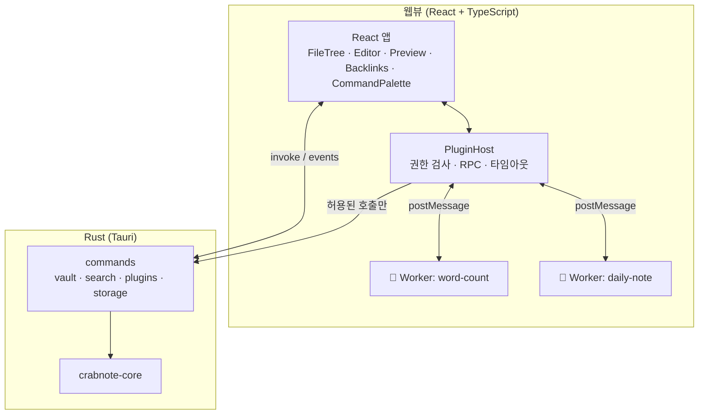

---
{"dg-publish":true,"permalink":"/programming/rust/rust-master/rust-react/rust-react-js-os/","dg-note-properties":{}}
---

<aside>  
⚛️

**심화 과정 B · Rust + React**

React(TypeScript)로 화면을, Rust로 파일·인덱스·보안을 담당하는 Obsidian 스타일 에디터 **CrabNote React**를 만듭니다. Tauri 2 셸로 Windows·macOS·Ubuntu에서 실행되며, 외부 개발자가 **JavaScript/TypeScript로 만든 플러그인**을 권한 기반 샌드박스에서 실행합니다.

</aside>

> 📖 **스토리** — React 개발자 **민준**이 팀에 합류했다. "플러그인 작성자는 대부분 웹 개발자예요. Rust를 배우라고 하면 아무도 안 만들 걸요." 하린이 고개를 끄덕였다. "그럼 UI는 React, 플러그인은 JS, **문지기는 Rust**로 가자."

## 🎯 아키텍처

|계층|기술|책임|
|---|---|---|
|UI|React 19, Vite, TypeScript, zustand, CodeMirror 6, react-markdown|화면, 상태, 사용자 인터랙션|
|플러그인|Web Worker + RPC + 권한 모델|외부 JS 코드를 DOM·IPC에서 격리|
|코어|Rust, Tauri 2, crabnote-core, notify, rayon|파일 접근, 인덱싱, 검색, 경로 보안, 플러그인 설치 검증|

<aside>  
🔀

**심화 과정 A(Rust + Tauri)와의 관계** — Rust 코어(`crabnote-core`)는 A의 T2와 같은 코드를 재사용합니다(이 과정에도 필요한 부분을 다시 실었습니다). 차이는 프론트엔드(React)와 플러그인 모델(JS 워커 vs WASM)입니다.

</aside>

## ✅ 선수 지식

- [ ] 본 강좌 1~17장, P4(Tauri)
- [ ] React 기초: 컴포넌트, props, `useState`/`useEffect`
- [ ] TypeScript 기초: 타입, `async/await`, `Promise`

## 📚 챕터

[R1. React + Rust 아키텍처와 프로젝트 설정](https://app.notion.com/p/R1-React-Rust-4127dbaee6b681c9a601e19d6043398f?pvs=21)

[R2. Rust 백엔드 — Vault 커맨드, 에러 타입, 플러그인 설치·저장소](https://app.notion.com/p/R2-Rust-Vault-4127dbaee6b681ffaea3c1daa37f7c0a?pvs=21)

[R3. React 에디터 UI — 파일 트리, CodeMirror, 미리보기, 백링크, 커맨드 팔레트](https://app.notion.com/p/R3-React-UI-CodeMirror-4127dbaee6b681f2888bc5206b88defc?pvs=21)

[R4. Obsidian 스타일 JS 플러그인 호스트 — Web Worker 샌드박스와 권한 모델](https://app.notion.com/p/R4-Obsidian-JS-Web-Worker-4127dbaee6b681d0b7d9e8af17301634?pvs=21)

[R5. 플러그인 개발자 가이드 — SDK 타입, 템플릿, 샘플 플러그인 4종, 배포](https://app.notion.com/p/R5-SDK-4-4127dbaee6b6819c84f8e20b1ab9ef68?pvs=21)

[R6. 테스트와 멀티 OS 빌드·배포](https://app.notion.com/p/R6-OS-4127dbaee6b6811a9eddfff6f28292ac?pvs=21)