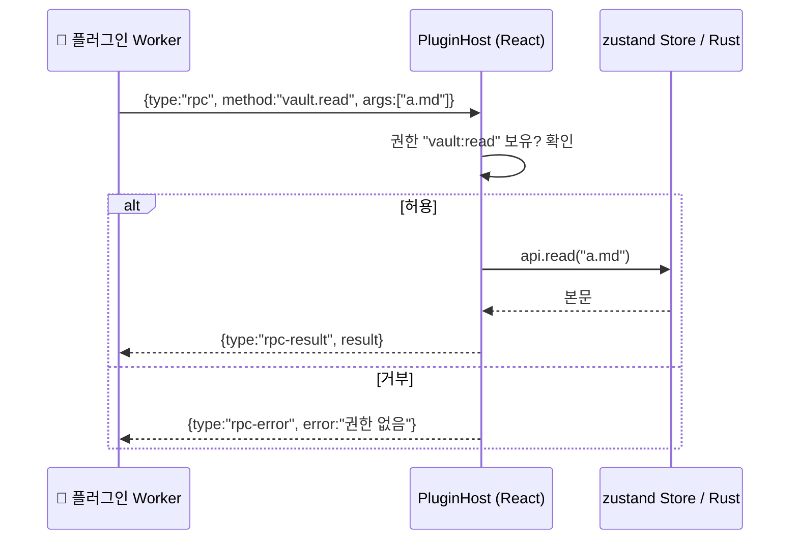

---
{"dg-publish":true,"permalink":"/programming/rust/rust-master/rust-react/t4-obsidian-js-web-worker/","dg-note-properties":{}}
---


> 📖 민준: "Obsidian 플러그인은 앱 내부 객체에 마음대로 접근해요. 그래서 강력하지만, 악성 플러그인 하나면 Vault 전체가 위험하죠." 하린: "우리는 플러그인을 **별도 스레드에 가두고**, 허용한 API만 메시지로 주고받게 하자."

## 🔍 원리 — 플러그인 실행 모델 비교

|모델|접근 범위|UI 확장력|안전성|
|---|---|---|---|
|메인 스레드 직접 실행 (Obsidian 방식)|DOM·앱 객체·IPC 전부|최고|낮음 — 신뢰 기반|
|sandboxed iframe|별도 문서, postMessage|높음(자체 UI)|중간~높음|
|**Web Worker + RPC (이 과정)**|허용된 API만, DOM·IPC 없음|명령·훅·상태표시줄·알림|높음 — 권한 기반|



<aside>  
🔒

**워커가 막아주는 것**: DOM 접근 불가(화면 조작·피싱 UI 불가), 메인 윈도우에 주입된 Tauri IPC 객체에 접근 불가, CSP 상속으로 외부 네트워크·외부 스크립트 차단(R1), 무한 루프는 `terminate()` 로 강제 종료. 플러그인이 할 수 있는 일은 **호스트가 제공한 RPC 메서드**뿐입니다.

</aside>

## 🧩 문제 1 — 플러그인이 쓸 수 있는 기능과 필요한 권한을 정의해야 한다

## 💡 해결 1 — `permissions.ts`

```tsx
// src/plugins/permissions.ts
export const PERMISSIONS = {
  "editor:read": "현재 노트 내용과 선택 영역 읽기",
  "editor:write": "현재 노트 수정 (저장 시 변환 포함)",
  "vault:read": "Vault의 모든 노트 목록과 내용 읽기",
  "ui:status": "상태 표시줄에 텍스트 표시",
} as const;
export type Permission = keyof typeof PERMISSIONS;

/** RPC 메서드 → 필요한 권한 (null = 권한 불필요). 여기에 없는 메서드는 모두 거부 */
export const METHOD_PERMISSION: Record<string, Permission | null> = {
  "editor.getText": "editor:read",
  "editor.getSelection": "editor:read",
  "editor.replaceSelection": "editor:write",
  "editor.setText": "editor:write",
  "vault.list": "vault:read",
  "vault.read": "vault:read",
  "ui.setStatus": "ui:status",
  "ui.notice": null,
  "storage.get": null,      // 플러그인 자신의 저장소만 (Rust가 id별로 분리)
  "storage.set": null,
};

export function isKnownPermission(p: string): p is Permission {
  return p in PERMISSIONS;
}
```

## 🧩 문제 2 — 워커 안에서 플러그인이 쓸 SDK가 필요하다

## 💡 해결 2 — 워커 부트스트랩 `bootstrap.js`

플러그인 코드 앞에 이 코드를 붙여 하나의 워커 스크립트로 만듭니다. 플러그인은 전역 `crabnote` 객체만 보게 됩니다.

```jsx
// src/plugins/bootstrap.js  — Vite에서 `?raw` 로 문자열로 불러옴
(() => {
  const pending = new Map();      // rpc id → {resolve, reject}
  const commands = new Map();     // command id → handler
  const saveHooks = [];
  let seq = 0;

  const rpc = (method, ...args) =>
    new Promise((resolve, reject) => {
      const id = ++seq;
      pending.set(id, { resolve, reject });
      postMessage({ type: "rpc", id, method, args });
    });

  const reply = (id, result, error) => postMessage({ type: "response", id, result, error });

  self.onmessage = async (e) => {
    const m = e.data;
    if (m.type === "rpc-result" || m.type === "rpc-error") {
      const p = pending.get(m.id);
      if (!p) return;
      pending.delete(m.id);
      m.type === "rpc-result" ? p.resolve(m.result) : p.reject(new Error(m.error));
      return;
    }
    try {
      if (m.type === "run-command") {
        const handler = commands.get(m.commandId);
        if (!handler) throw new Error(`없는 명령: ${m.commandId}`);
        await handler();
        reply(m.id, null);
      } else if (m.type === "hook" && m.name === "onSave") {
        let text = m.payload.text;
        for (const h of saveHooks) {
          const r = await h({ ...m.payload, text });
          if (typeof r === "string") text = r;   // 문자열을 반환하면 변환, 아니면 그대로
        }
        reply(m.id, text);
      }
    } catch (err) {
      reply(m.id, null, String(err && err.message ? err.message : err));
    }
  };

  const api = Object.freeze({
    registerCommand(cmd, handler) {
      commands.set(cmd.id, handler);
      postMessage({ type: "register-command", command: { id: String(cmd.id), name: String(cmd.name) } });
    },
    onSave(handler) {
      if (saveHooks.length === 0) postMessage({ type: "register-hook", name: "onSave" });
      saveHooks.push(handler);
    },
    editor: Object.freeze({
      getText: () => rpc("editor.getText"),
      getSelection: () => rpc("editor.getSelection"),
      replaceSelection: (text) => rpc("editor.replaceSelection", text),
      setText: (text) => rpc("editor.setText", text),
    }),
    vault: Object.freeze({
      list: () => rpc("vault.list"),
      read: (path) => rpc("vault.read", path),
    }),
    ui: Object.freeze({
      notice: (msg) => rpc("ui.notice", msg),
      setStatus: (text) => rpc("ui.setStatus", text),
    }),
    storage: Object.freeze({
      get: () => rpc("storage.get"),
      set: (value) => rpc("storage.set", value),
    }),
  });

  self.crabnote = Object.freeze({
    apiVersion: 1,
    onload(fn) {
      Promise.resolve()
        .then(() => fn(api))
        .then(
          () => postMessage({ type: "ready" }),
          (err) => postMessage({ type: "error", message: String(err && err.message ? err.message : err) }),
        );
    },
  });
})();
```

```tsx
// src/vite-env.d.ts 에 추가 (?raw import 타입)
declare module "*?raw" { const content: string; export default content; }
```

## 🧩 문제 3 — 플러그인을 로드하고, 권한 동의를 받고, 메시지를 중계하고, 멈춘 플러그인을 죽여야 한다

## 💡 해결 3 — `PluginHost.ts`

```tsx
// src/plugins/PluginHost.ts
import bootstrap from "./bootstrap.js?raw";
import { api, JsPlugin, JsPluginManifest } from "../lib/api";
import { useStore } from "../store";
import { editorBridge } from "../lib/editorBridge";
import { isKnownPermission, METHOD_PERMISSION, Permission, PERMISSIONS } from "./permissions";

type Loaded = {
  manifest: JsPluginManifest;
  worker: Worker;
  url: string;
  granted: Set<Permission>;
  ready: boolean;
  hooks: Set<string>;
};
type Pending = { resolve: (v: unknown) => void; reject: (e: Error) => void; timer: ReturnType<typeof setTimeout> };

const APP_VERSION = "1.0.0";

class PluginHost {
  private plugins = new Map<string, Loaded>();
  private pending = new Map<number, Pending>();
  private seq = 0;
  private loading: Promise<void> | null = null;

  /** 활성 플러그인을 모두 로드 (중복 호출·StrictMode 안전) */
  loadAll(): Promise<void> {
    this.loading ??= (async () => {
      const list = await api.listPlugins();
      for (const p of list) {
        if (p.enabled && !this.plugins.has(p.manifest.id)) await this.load(p);
      }
      useStore.getState().setBeforeSave((ctx) => this.runOnSave(ctx));
    })().finally(() => { this.loading = null; });
    return this.loading;
  }

  async reload() {
    for (const id of [...this.plugins.keys()]) this.unload(id);
    await this.loadAll();
    useStore.getState().notify(`🧩 플러그인 ${this.plugins.size}개 로드됨`);
  }

  list() { return [...this.plugins.values()].map((p) => ({ manifest: p.manifest, ready: p.ready })); }

  /** 최초 1회(또는 권한이 늘었을 때) 사용자 동의 */
  private consent(m: JsPluginManifest): Set<Permission> | null {
    const unknown = m.permissions.filter((p) => !isKnownPermission(p));
    if (unknown.length) { useStore.getState().notify(`⛔ ${m.name}: 알 수 없는 권한 ${unknown.join(", ")}`); return null; }
    const requested = m.permissions as Permission[];
    const key = `crabnote.consent.${m.id}`;
    let saved: string[] = [];
    try { saved = JSON.parse(localStorage.getItem(key) ?? "[]"); } catch { /* 무시 */ }
    if (requested.every((p) => saved.includes(p))) return new Set(requested);

    const lines = requested.map((p) => `• ${PERMISSIONS[p]}`).join("\n") || "• (추가 권한 없음)";
    const ok = confirm(`🧩 "${m.name}" v${m.version} (${m.author})\n다음 권한을 허용할까요?\n\n${lines}`);
    if (!ok) return null;
    localStorage.setItem(key, JSON.stringify(requested));
    return new Set(requested);
  }

  private async load(p: JsPlugin) {
    const m = p.manifest;
    if (m.min_app_version && m.min_app_version.localeCompare(APP_VERSION, undefined, { numeric: true }) > 0) {
      useStore.getState().notify(`⛔ ${m.name}은 앱 ${m.min_app_version} 이상이 필요합니다`);
      return;
    }
    const granted = this.consent(m);
    if (!granted) return;

    // 부트스트랩 + 플러그인 코드를 하나의 클래식 워커 스크립트로
    const src = `${bootstrap}\n;(function () {\n${p.code}\n})();\n//# sourceURL=plugin-${m.id}.js`;
    const url = URL.createObjectURL(new Blob([src], { type: "text/javascript" }));
    const worker = new Worker(url, { name: `plugin:${m.id}` });
    const lp: Loaded = { manifest: m, worker, url, granted, ready: false, hooks: new Set() };
    this.plugins.set(m.id, lp);

    worker.onmessage = (e: MessageEvent) => void this.onMessage(lp, e.data);
    worker.onerror = (e) => {
      useStore.getState().notify(`💥 ${m.name}: ${e.message}`);
      this.unload(m.id);
    };
  }

  unload(id: string) {
    const lp = this.plugins.get(id);
    if (!lp) return;
    lp.worker.terminate();                 // 즉시 중단 (무한 루프여도)
    URL.revokeObjectURL(lp.url);
    this.plugins.delete(id);
    const s = useStore.getState();
    s.unregisterSource(id);
    s.setStatusItem(id, null);
  }

  private async onMessage(lp: Loaded, m: any) {
    const store = useStore.getState();
    switch (m?.type) {
      case "ready":
        lp.ready = true;
        break;
      case "error":
        store.notify(`💥 ${lp.manifest.name}: ${String(m.message).slice(0, 200)}`);
        break;
      case "register-command": {
        const cmdId = String(m.command?.id ?? "");
        store.registerCommand({
          id: `${lp.manifest.id}:${cmdId}`,
          name: String(m.command?.name ?? cmdId).slice(0, 80),
          source: lp.manifest.id,
          run: () => this.request(lp, { type: "run-command", commandId: cmdId }, 10_000).then(() => {}, (e) => store.notify(`🧩 ${e.message}`)),
        });
        break;
      }
      case "register-hook":
        if (m.name === "onSave") lp.hooks.add("onSave");
        break;
      case "rpc":
        try {
          const result = await this.handleRpc(lp, String(m.method), Array.isArray(m.args) ? m.args : []);
          lp.worker.postMessage({ type: "rpc-result", id: m.id, result });
        } catch (err) {
          lp.worker.postMessage({ type: "rpc-error", id: m.id, error: String((err as Error).message ?? err) });
        }
        break;
      case "response": {
        const p = this.pending.get(m.id);
        if (!p) return;
        clearTimeout(p.timer);
        this.pending.delete(m.id);
        m.error ? p.reject(new Error(m.error)) : p.resolve(m.result);
        break;
      }
    }
  }

  /** 호스트 → 플러그인 요청. 제한 시간 안에 응답이 없으면 플러그인을 종료 */
  private request(lp: Loaded, msg: object, timeoutMs: number): Promise<unknown> {
    const id = ++this.seq;
    return new Promise((resolve, reject) => {
      const timer = setTimeout(() => {
        this.pending.delete(id);
        this.unload(lp.manifest.id);
        reject(new Error(`${lp.manifest.name} 응답 없음(${timeoutMs}ms) → 플러그인을 중지했습니다`));
      }, timeoutMs);
      this.pending.set(id, { resolve, reject, timer });
      lp.worker.postMessage({ ...msg, id });
    });
  }

  /** 플러그인 → 호스트 RPC. 권한을 검사한 뒤에만 실행 */
  private async handleRpc(lp: Loaded, method: string, args: unknown[]): Promise<unknown> {
    if (!(method in METHOD_PERMISSION)) throw new Error(`알 수 없는 API: ${method}`);
    const need = METHOD_PERMISSION[method];
    if (need && !lp.granted.has(need)) throw new Error(`권한 없음: ${need} (manifest.json의 permissions에 추가하세요)`);

    const s = useStore.getState();
    const str = (i: number) => String(args[i] ?? "");
    switch (method) {
      case "editor.getText": return s.text;
      case "editor.getSelection": return editorBridge.getSelection();
      case "editor.replaceSelection": editorBridge.replaceSelection(str(0)); return null;
      case "editor.setText": s.setText(str(0)); return null;
      case "vault.list": return s.notes.map((n) => ({ path: n.path, title: n.title }));
      case "vault.read": return api.read(str(0));                    // Rust가 Vault 경계를 다시 검사
      case "ui.notice": s.notify(`🧩 ${lp.manifest.name}: ${str(0).slice(0, 200)}`); return null;
      case "ui.setStatus": s.setStatusItem(lp.manifest.id, str(0).slice(0, 80)); return null;
      case "storage.get": return api.pluginStorageGet(lp.manifest.id);
      case "storage.set": return api.pluginStorageSet(lp.manifest.id, args[0] ?? null);
    }
    throw new Error(`미구현 API: ${method}`);
  }

  /** store.save()가 저장 직전에 호출. onSave 훅을 플러그인 순서대로 체인 */
  async runOnSave(ctx: { path: string; title: string; text: string }) {
    let text = ctx.text;
    const notices: string[] = [];
    for (const lp of [...this.plugins.values()]) {
      if (!lp.ready || !lp.hooks.has("onSave")) continue;
      try {
        const r = await this.request(lp, { type: "hook", name: "onSave", payload: { ...ctx, text } }, 2000);
        if (typeof r === "string" && r !== text) {
          if (lp.granted.has("editor:write")) text = r;          // 변환은 쓰기 권한이 있을 때만
          else notices.push(`${lp.manifest.name}: editor:write 권한이 없어 변환을 무시했습니다`);
        }
      } catch (e) {
        notices.push((e as Error).message);                       // 실패해도 저장은 계속
      }
    }
    return { text, notices };
  }
}

export const pluginHost = new PluginHost();
```

<aside>  
⚠️

**함정 — onSave 훅의 재진입**: 플러그인이 onSave 안에서 `editor.setText()` 를 부르면 `dirty` 가 다시 켜져 저장이 반복될 수 있습니다. 그래서 훅에서는 **문자열을 반환**하는 방식만 문서화하고, 호스트가 결과를 한 번에 반영합니다.

</aside>

<aside>  
📌

예제에서는 권한 동의를 `localStorage` 에 기록했지만, 제품에서는 R2의 Rust 저장소에 기록하고 플러그인 버전이 바뀌면 다시 확인하는 것이 좋습니다. `confirm()` 대신 React 모달로 권한별 설명을 보여주세요. 브라우저 내장 `confirm`·`prompt`·`alert` 는 OS 웹뷰(특히 macOS WebKit)에 따라 동작이 다를 수 있으므로, 제품에서는 `@tauri-apps/plugin-dialog` 의 `ask()`·`message()` 나 React 모달을 쓰세요(예제는 간결함을 위해 내장 대화상자 사용).

</aside>

## 🧩 문제 4 — 사용자가 플러그인을 설치·관리할 화면이 필요하다

## 💡 해결 4 — `PluginManager.tsx`

```tsx
// src/components/PluginManager.tsx
import { useEffect, useState } from "react";
import { open } from "@tauri-apps/plugin-dialog";
import { api, JsPlugin } from "../lib/api";
import { pluginHost } from "../plugins/PluginHost";
import { PERMISSIONS, isKnownPermission } from "../plugins/permissions";

export function PluginManager({ onClose }: { onClose: () => void }) {
  const [list, setList] = useState<JsPlugin[]>([]);
  const [dir, setDir] = useState("");
  const refresh = async () => { setList(await api.listPlugins()); setDir(await api.pluginsDir()); };
  useEffect(() => { void refresh(); }, []);

  async function install() {
    const file = await open({ filters: [{ name: "CrabNote 플러그인", extensions: ["zip"] }] });
    if (typeof file !== "string") return;
    const sha = prompt("배포처가 제공한 SHA-256 (없으면 비워두기)") || undefined;
    try {
      const m = await api.installPlugin(file, sha);
      alert(`✅ ${m.name} v${m.version} 설치됨`);
      await pluginHost.reload();
      await refresh();
    } catch (e) { alert((e as { message: string }).message); }
  }

  async function toggle(p: JsPlugin) {
    await api.setPluginEnabled(p.manifest.id, !p.enabled);
    await pluginHost.reload();
    await refresh();
  }

  return (
    <div className="palette-backdrop" onClick={onClose}>
      <div className="palette" onClick={(e) => e.stopPropagation()}>
        <h3>🧩 플러그인</h3>
        <p><small>폴더: {dir}</small></p>
        <button onClick={install}>📦 zip에서 설치</button>
        <ul>
          {list.map((p) => (
            <li key={p.manifest.id}>
              <label>
                <input type="checkbox" checked={p.enabled} onChange={() => void toggle(p)} />
                <b>{p.manifest.name}</b> v{p.manifest.version} — {p.manifest.author}
              </label>
              <div><small>{p.manifest.description}</small></div>
              <div><small>권한: {p.manifest.permissions.map((x) => (isKnownPermission(x) ? PERMISSIONS[x] : `⚠️ ${x}`)).join(", ") || "없음"}</small></div>
            </li>
          ))}
        </ul>
      </div>
    </div>
  );
}
```

```tsx
// App.tsx 에 추가: 명령 팔레트에서 열기
const [showPlugins, setShowPlugins] = useState(false);
// useEffect 안:
s.registerCommand({ id: "core:plugins", name: "플러그인 관리", source: "core", run: () => setShowPlugins(true) });
// JSX:
{showPlugins && <PluginManager onClose={() => setShowPlugins(false)} />}
```

## 🔒 보안 점검표

<aside>  
🛡️

- [ ] 플러그인 코드는 Worker에서만 실행되고, 메인 스레드에서 `eval` 하지 않는다
- [ ] 모든 RPC는 허용 목록(`METHOD_PERMISSION`)에 있어야 하고, 권한을 검사한다
- [ ] 플러그인에서 온 문자열은 길이를 자르고 `String()` 으로 강제 변환한다
- [ ] 화면에는 텍스트로만 표시한다 (React는 기본적으로 이스케이프, `dangerouslySetInnerHTML` 금지)
- [ ] 훅·명령에 타임아웃을 두고 초과 시 `terminate()`
- [ ] CSP로 네트워크·외부 스크립트를 막았다 (R1)
- [ ] 설치는 Rust가 체크섬·Zip Slip·크기를 검증한다 (R2)  
    </aside>