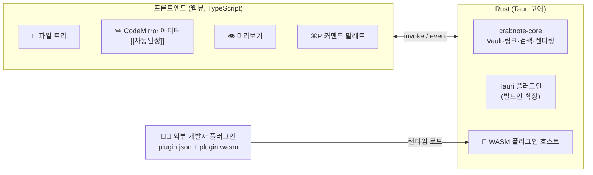

---
{"dg-publish":true,"permalink":"/programming/rust/rust-master/rust-tauri/rust-tauri-os/","dg-note-properties":{}}
---

<aside>  
🧩

**심화 과정 A · Rust + Tauri**

Windows·macOS·Ubuntu에서 동작하는 Obsidian 스타일 마크다운 에디터 **CrabNote Pro**를 Tauri 2로 만들고, **외부 개발자가 만든 플러그인을 앱 재빌드 없이 설치**할 수 있는 WebAssembly 플러그인 시스템을 설계합니다.

</aside>

> 📖 **스토리** — 입사 2년 차. P2에서 만든 CrabNote가 사내에서 인기를 끌자 대표가 제품화를 결정했다. 고객사들의 요구는 단 하나였다. "**우리 회사 양식에 맞는 기능을 우리가 직접 만들어 넣고 싶어요.**" 페리스가 화이트보드에 썼다. "안전한 플러그인 = 샌드박스 + 작은 API + 권한."

## 🎯 완성될 제품

|Obsidian 핵심 기능|CrabNote Pro 구현|장|
|---|---|---|
|로컬 폴더 Vault|경로 안전성 검사가 들어간 Rust Vault 엔진|T2|
|`[[위키링크]]`·백링크·태그|링크 인덱스 + 이름 변경 시 링크 자동 갱신|T2|
|전문 검색|rayon 병렬 검색|T2|
|외부 변경 감지|notify 파일 감시 + 이벤트|T2|
|편집기·미리보기·퀵 스위처|CodeMirror 6 + Rust 마크다운 렌더링(XSS 정화)|T3|
|코어 플러그인|Tauri 플러그인 크레이트|T4|
|커뮤니티 플러그인|Extism 기반 WASM 샌드박스 플러그인 + 개발자용 PDK|T5|
|멀티 OS 배포·업데이트|GitHub Actions + tauri-action + updater|T6|

## 🔍 플러그인 설계의 핵심 결정

<aside>  
🔧

**빌트인 확장 (T4)**

Tauri 플러그인 크레이트. Rust 코드를 앱과 함께 **컴파일**. 빠르고 모든 권한을 가짐. 우리 팀이나 신뢰하는 파트너용.

</aside>

<aside>  
🧩

**서드파티 플러그인 (T5)**

WebAssembly. 앱을 다시 빌드하지 않고 **런타임에 설치**. 파일·네트워크 접근이 기본 차단된 샌드박스. **하나의 .wasm이 모든 OS에서 동작**.

</aside>

<aside>  
🔀

**심화 과정 B(Rust + React)와의 차이** — A는 플러그인을 **Rust 쪽(WASM)**에서 실행해 텍스트 처리·변환에 강하고, B는 Obsidian처럼 **JavaScript 플러그인**을 React 프론트엔드의 워커 샌드박스에서 실행해 UI 확장에 강합니다. 두 과정을 모두 마치면 두 가지 플러그인 아키텍처를 모두 설계할 수 있습니다.

</aside>

## ✅ 선수 지식

- [ ] 본 강좌 1~18장 (특히 12장 트레이트, 17장 동시성)
- [ ] P2 마크다운 에디터, P4 Tauri 모바일 앱
- [ ] 라이브러리 강좌 serde, anyhow/thiserror, rayon, regex

## 📚 챕터

[T1. 아키텍처와 멀티 OS 프로젝트 설계](https://app.notion.com/p/T1-OS-4127dbaee6b681c383e0ef903c4fd161?pvs=21)

[T2. crabnote-core — Vault·링크·검색 엔진과 Tauri 커맨드](https://app.notion.com/p/T2-crabnote-core-Vault-Tauri-4127dbaee6b6815b8b0fde5cf3528aed?pvs=21)

[T3. 에디터 UI — CodeMirror, 미리보기, 위키링크 자동완성, 퀵 스위처](https://app.notion.com/p/T3-UI-CodeMirror-4127dbaee6b68181b332c11f7c3024c4?pvs=21)

[T4. 플러그인 ① — Tauri 플러그인 크레이트 (빌트인 확장)](https://app.notion.com/p/T4-Tauri-4127dbaee6b681608c85cbd979a3c793?pvs=21)

[T5. 플러그인 ② — 외부 개발자용 WASM 플러그인 시스템 (Extism)](https://app.notion.com/p/T5-WASM-Extism-4127dbaee6b681728fbad8b238864663?pvs=21)

[T6. 멀티 OS 빌드·배포·자동 업데이트](https://app.notion.com/p/T6-OS-4127dbaee6b6817a9177e1605ba7b132?pvs=21)