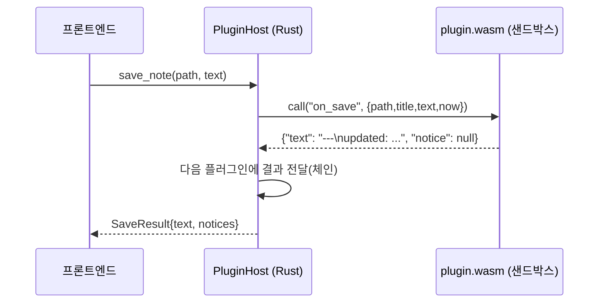

---
{"dg-publish":true,"permalink":"/programming/rust/rust-master/rust-tauri/t5-wasm-extism/","dg-note-properties":{}}
---


> 📖 고객사 A: "저장할 때마다 문서 상단에 작성일·수정일을 자동으로 넣고 싶어요." 고객사 B: "목차 자동 생성 명령이 필요해요." 보안팀: "외부 코드가 사용자의 다른 파일을 읽거나 몰래 인터넷으로 보내면 절대 안 됩니다."

## 🔍 원리 — 왜 WebAssembly인가?

|방식|재빌드 없이 설치|샌드박스|OS 독립|비고|
|---|---|---|---|---|
|동적 라이브러리 (.dll/.dylib/.so)|✅|❌ 앱과 같은 권한|❌ OS별 빌드|Rust ABI 불안정, 크래시 시 앱도 종료|
|스크립트 엔진 (Lua/Rhai)|✅|△|✅|플러그인 언어가 제한됨|
|**WebAssembly (Extism)**|✅|✅ 기본 차단|✅ 하나의 .wasm|Rust·Go·JS·Zig 등 여러 언어로 작성 가능|

**Extism**은 Wasmtime 위에서 동작하는 플러그인 프레임워크로, 호스트용 SDK(`extism`)와 플러그인 개발용 PDK(`extism-pdk`)를 제공합니다. 호스트와 플러그인은 **바이트(우리는 JSON)만 주고받으며**, 플러그인은 WASI를 주지 않으면 파일·네트워크·시계에 접근할 수 없습니다.



## 📋 플러그인 계약 (API v1)

```json
// <앱 데이터>/plugins/frontmatter/plugin.json
{
  "id": "frontmatter",
  "name": "자동 프런트매터",
  "version": "1.0.0",
  "author": "Acme Corp",
  "description": "저장 시 created/updated 날짜를 기록합니다",
  "api_version": 1,
  "entry": "plugin.wasm",
  "hooks": ["on_save"]
}
```

|내보내는 함수|입력 (JSON)|출력 (JSON)|언제|
|---|---|---|---|
|`on_save`|`{path, title, text, now}`|`{text?, notice?}`|저장 직전 (hooks에 "on_save")|
|`commands`|`""`|`[{id, name}]`|로드 시 / 팔레트 열 때 (hooks에 "commands")|
|`run_command`|`{command, path, title, text, selection, now}`|`{text?, insert?, notice?}`|사용자가 명령 실행|

<aside>  
💡

WASM에는 시계가 없으므로 호스트가 `now` 를 넣어 줍니다. 이처럼 **플러그인이 필요한 정보는 호스트가 골라서 주는 것**이 샌드박스 설계의 핵심입니다. `api_version` 으로 계약을 버전 관리해, 나중에 v2를 만들어도 v1 플러그인을 안전하게 거부하거나 호환 실행할 수 있습니다.

</aside>

## 🧩 문제 1 — 앱이 플러그인을 찾고, 안전하게 실행하고, 고장 나도 버텨야 한다

## 💡 해결 1 — 호스트 구현 `src-tauri/src/plugins.rs`

```toml
# src-tauri/Cargo.toml 에 추가
extism = "1"
chrono = "0.4"
```

```rust
// src-tauri/src/plugins.rs
use crate::AppState;
use extism::{Manifest, Plugin, Wasm};
use serde::{Deserialize, Serialize};
use std::collections::BTreeSet;
use std::path::{Path, PathBuf};
use std::time::Duration;
use tauri::State;

pub const API_VERSION: u32 = 1;
const MAX_FAILURES: u32 = 3;

#[derive(Debug, Clone, Serialize, Deserialize)]
pub struct PluginManifest {
    pub id: String,
    pub name: String,
    pub version: String,
    #[serde(default)] pub author: String,
    #[serde(default)] pub description: String,
    pub api_version: u32,
    #[serde(default = "default_entry")] pub entry: String,
    #[serde(default)] pub hooks: Vec<String>,
}
fn default_entry() -> String { "plugin.wasm".into() }

#[derive(Debug, Clone, Serialize, Deserialize)]
pub struct PluginCommand {
    #[serde(default)] pub plugin_id: String,
    pub id: String,
    pub name: String,
}

#[derive(Debug, Default, Serialize, Deserialize)]
pub struct CommandOut {
    pub text: Option<String>,
    pub insert: Option<String>,
    pub notice: Option<String>,
}

#[derive(Deserialize, Default)]
struct SaveOut { text: Option<String>, notice: Option<String> }

#[derive(Serialize)]
struct NoteCtx<'a> {
    #[serde(skip_serializing_if = "Option::is_none")] command: Option<&'a str>,
    path: &'a str,
    title: &'a str,
    text: &'a str,
    selection: &'a str,
    now: String,
}

pub struct LoadedPlugin {
    pub manifest: PluginManifest,
    pub enabled: bool,
    instance: Plugin,
    failures: u32,
}

impl LoadedPlugin {
    fn has_hook(&self, h: &str) -> bool { self.manifest.hooks.iter().any(|x| x == h) }

    /// 플러그인 호출. 실패가 누적되면 자동으로 비활성화 (한 플러그인이 앱을 망치지 않게)
    fn call(&mut self, func: &str, input: &str) -> Result<String, String> {
        match self.instance.call::<&str, String>(func, input) {
            Ok(out) => { self.failures = 0; Ok(out) }
            Err(e) => {
                self.failures += 1;
                if self.failures >= MAX_FAILURES { self.enabled = false; }
                Err(format!("[{}] {func} 실패: {e}", self.manifest.id))
            }
        }
    }
}

#[derive(Default)]
pub struct PluginHost {
    dir: PathBuf,
    plugins: Vec<LoadedPlugin>,
}

fn now() -> String { chrono::Local::now().format("%Y-%m-%d %H:%M").to_string() }

impl PluginHost {
    /// <dir>/<plugin-id>/plugin.json 을 모두 로드. 실패한 플러그인은 건너뛰고 에러 목록으로 반환
    pub fn load_all(dir: &Path) -> (Self, Vec<String>) {
        let disabled = read_disabled(dir);
        let mut host = PluginHost { dir: dir.to_path_buf(), plugins: vec![] };
        let mut errors = vec![];
        let Ok(entries) = std::fs::read_dir(dir) else { return (host, errors) };
        for entry in entries.flatten().filter(|e| e.path().is_dir()) {
            match load_one(&entry.path()) {
                Ok(mut p) => {
                    if host.plugins.iter().any(|x| x.manifest.id == p.manifest.id) {
                        errors.push(format!("중복된 플러그인 id: {}", p.manifest.id));
                        continue;
                    }
                    p.enabled = !disabled.contains(&p.manifest.id);
                    host.plugins.push(p);
                }
                Err(e) => errors.push(format!("{}: {e}", entry.path().display())),
            }
        }
        (host, errors)
    }

    /// on_save 훅을 가진 활성 플러그인을 순서대로 적용 (앞 플러그인의 결과가 다음 플러그인의 입력)
    pub fn run_on_save(&mut self, path: &str, title: &str, mut text: String) -> (String, Vec<String>) {
        let mut notices = vec![];
        for p in self.plugins.iter_mut().filter(|p| p.enabled && p.has_hook("on_save")) {
            let ctx = NoteCtx { command: None, path, title, text: &text, selection: "", now: now() };
            let input = serde_json::to_string(&ctx).unwrap();
            match p.call("on_save", &input).and_then(|o| serde_json::from_str::<SaveOut>(&o).map_err(|e| e.to_string())) {
                Ok(out) => {
                    if let Some(t) = out.text { text = t; }
                    if let Some(n) = out.notice { notices.push(format!("{}: {n}", p.manifest.name)); }
                }
                Err(e) => notices.push(e),   // 실패해도 저장은 계속된다 (원문 보존)
            }
        }
        (text, notices)
    }

    pub fn commands(&mut self) -> Vec<PluginCommand> {
        let mut all = vec![];
        for p in self.plugins.iter_mut().filter(|p| p.enabled && p.has_hook("commands")) {
            if let Ok(out) = p.call("commands", "") {
                if let Ok(cmds) = serde_json::from_str::<Vec<PluginCommand>>(&out) {
                    all.extend(cmds.into_iter().map(|mut c| { c.plugin_id = p.manifest.id.clone(); c }));
                }
            }
        }
        all
    }

    pub fn run_command(&mut self, plugin_id: &str, command: &str, path: &str, text: &str, selection: &str) -> Result<CommandOut, String> {
        let p = self.plugins.iter_mut().find(|p| p.manifest.id == plugin_id && p.enabled)
            .ok_or_else(|| format!("플러그인을 찾을 수 없거나 비활성입니다: {plugin_id}"))?;
        let title = path.trim_end_matches(".md").rsplit('/').next().unwrap_or(path);
        let ctx = NoteCtx { command: Some(command), path, title, text, selection, now: now() };
        let out = p.call("run_command", &serde_json::to_string(&ctx).unwrap())?;
        serde_json::from_str(&out).map_err(|e| format!("플러그인 응답 형식 오류: {e}"))
    }

    pub fn set_enabled(&mut self, id: &str, enabled: bool) {
        if let Some(p) = self.plugins.iter_mut().find(|p| p.manifest.id == id) {
            p.enabled = enabled;
            p.failures = 0;
        }
        let disabled: Vec<&str> = self.plugins.iter().filter(|p| !p.enabled).map(|p| p.manifest.id.as_str()).collect();
        let _ = std::fs::write(self.dir.join("disabled.json"), serde_json::to_string(&disabled).unwrap());
    }
}

fn read_disabled(dir: &Path) -> BTreeSet<String> {
    std::fs::read_to_string(dir.join("disabled.json"))
        .ok()
        .and_then(|s| serde_json::from_str(&s).ok())
        .unwrap_or_default()
}

fn load_one(dir: &Path) -> Result<LoadedPlugin, String> {
    let raw = std::fs::read_to_string(dir.join("plugin.json")).map_err(|e| format!("plugin.json 없음: {e}"))?;
    let manifest: PluginManifest = serde_json::from_str(&raw).map_err(|e| format!("plugin.json 형식 오류: {e}"))?;

    if manifest.api_version != API_VERSION {
        return Err(format!("지원하지 않는 api_version {} (앱은 {API_VERSION})", manifest.api_version));
    }
    let id_ok = !manifest.id.is_empty() && manifest.id.chars().all(|c| c.is_ascii_lowercase() || c.is_ascii_digit() || c == '-');
    let entry_ok = !manifest.entry.contains("..") && !manifest.entry.contains('/') && !manifest.entry.contains('\\');
    if !id_ok || !entry_ok {
        return Err("id(영소문자·숫자·-) 또는 entry(파일 이름만) 형식이 잘못되었습니다".into());
    }

    // 🔒 샌드박스 설정: WASI 없음(파일·네트워크·환경변수 차단), 호스트 함수 없음, 실행 시간·메모리 제한
    let manifest_wasm = Manifest::new([Wasm::file(dir.join(&manifest.entry))])
        .with_timeout(Duration::from_secs(2))      // 무한 루프 플러그인 방어
        .with_memory_max(512);                     // 512 페이지 × 64KiB = 32MiB
    let instance = Plugin::new(&manifest_wasm, [], false).map_err(|e| format!("WASM 로드 실패: {e}"))?;

    Ok(LoadedPlugin { manifest, enabled: true, instance, failures: 0 })
}

// ---------- 프론트엔드에 노출하는 커맨드 ----------

#[derive(Serialize)]
pub struct PluginInfo { manifest: PluginManifest, enabled: bool }

#[tauri::command]
pub fn list_plugins(state: State<'_, AppState>) -> Vec<PluginInfo> {
    state.plugins.lock().unwrap().plugins.iter()
        .map(|p| PluginInfo { manifest: p.manifest.clone(), enabled: p.enabled })
        .collect()
}

#[tauri::command]
pub fn plugin_commands(state: State<'_, AppState>) -> Vec<PluginCommand> {
    state.plugins.lock().unwrap().commands()
}

#[tauri::command]
pub fn run_plugin_command(plugin_id: String, command_id: String, path: String, text: String, selection: String,
                          state: State<'_, AppState>) -> Result<CommandOut, String> {
    state.plugins.lock().unwrap().run_command(&plugin_id, &command_id, &path, &text, &selection)
}

#[tauri::command]
pub fn set_plugin_enabled(id: String, enabled: bool, state: State<'_, AppState>) {
    state.plugins.lock().unwrap().set_enabled(&id, enabled);
}

#[tauri::command]
pub fn reload_plugins(state: State<'_, AppState>) -> Vec<String> {
    let mut guard = state.plugins.lock().unwrap();
    let (host, errors) = PluginHost::load_all(&guard.dir.clone());
    *guard = host;
    errors
}

#[tauri::command]
pub fn plugins_dir(state: State<'_, AppState>) -> String {
    state.plugins.lock().unwrap().dir.display().to_string()
}
```

<aside>  
📌

Extism의 `Manifest` 옵션 이름(`with_timeout`, `with_memory_max`)과 `Plugin::new` 시그니처는 버전에 따라 달라질 수 있습니다. 컴파일 오류가 나면 [docs.rs/extism](https://docs.rs/extism)에서 설치된 버전을 확인하세요. 플러그인 호출은 동기식이므로, 무거운 플러그인이 많아지면 `async` 커맨드 + `spawn_blocking` 으로 UI 스레드를 막지 않게 하세요.

</aside>

## 🧩 문제 2 — 외부 개발자는 플러그인을 어떻게 만드나?

## 💡 해결 2 — 플러그인 개발자 가이드 (PDK) — 샘플 ① 자동 프런트매터

```bash
rustup target add wasm32-unknown-unknown
cargo new --lib frontmatter && cd frontmatter
```

```toml
# example-plugins/frontmatter/Cargo.toml
[package]
name = "frontmatter"
version = "1.0.0"
edition = "2024"

[lib]
crate-type = ["cdylib"]        # WASM 모듈로 빌드

[dependencies]
extism-pdk = "1"
serde = { version = "1", features = ["derive"] }
```

```rust
// example-plugins/frontmatter/src/lib.rs
use extism_pdk::*;
use serde::{Deserialize, Serialize};

#[derive(Deserialize)]
struct Note { text: String, now: String }

#[derive(Serialize)]
struct SaveOut { text: String, notice: Option<String> }

/// 호스트가 저장 직전에 호출. Json<T> 래퍼가 JSON 직렬화를 처리한다.
#[plugin_fn]
pub fn on_save(Json(note): Json<Note>) -> FnResult<Json<SaveOut>> {
    Ok(Json(SaveOut { text: upsert(&note.text.replace("\r\n", "\n"), &note.now), notice: None }))
}

/// 프런트매터가 있으면 updated만 갱신(없는 created는 추가), 없으면 새로 만든다.
fn upsert(text: &str, now: &str) -> String {
    if let Some(rest) = text.strip_prefix("---\n") {
        if let Some(end) = rest.find("\n---") {
            let (fm, body) = rest.split_at(end);     // body는 "\n---..." 로 시작
            let mut lines: Vec<String> = fm.lines().filter(|l| !l.starts_with("updated:")).map(String::from).collect();
            if !lines.iter().any(|l| l.starts_with("created:")) {
                lines.push(format!("created: {now}"));
            }
            lines.push(format!("updated: {now}"));
            return format!("---\n{}{body}", lines.join("\n"));
        }
    }
    format!("---\ncreated: {now}\nupdated: {now}\n---\n{text}")
}

#[cfg(test)]   // 순수 함수는 호스트 타깃에서 일반 cargo test로 검증
mod tests {
    use super::upsert;
    #[test] fn adds_new() {
        assert_eq!(upsert("# A", "T1"), "---\ncreated: T1\nupdated: T1\n---\n# A");
    }
    #[test] fn updates_existing() {
        let once = upsert("# A", "T1");
        assert_eq!(upsert(&once, "T2"), "---\ncreated: T1\nupdated: T2\n---\n# A");
    }
}
```

## 💡 해결 3 — 샘플 ② 목차 생성 명령 플러그인

```rust
// example-plugins/toc/src/lib.rs   (Cargo.toml은 frontmatter와 동일, name = "toc")
use extism_pdk::*;
use serde::{Deserialize, Serialize};

#[derive(Serialize)]
struct Cmd { id: &'static str, name: &'static str }

#[derive(Deserialize)]
struct Ctx { command: String, text: String }

#[derive(Serialize, Default)]
struct Out {
    #[serde(skip_serializing_if = "Option::is_none")] insert: Option<String>,
    #[serde(skip_serializing_if = "Option::is_none")] notice: Option<String>,
}

#[plugin_fn]
pub fn commands(_input: String) -> FnResult<Json<Vec<Cmd>>> {
    Ok(Json(vec![
        Cmd { id: "insert-toc", name: "목차 삽입" },
        Cmd { id: "count-headings", name: "제목 개수 세기" },
    ]))
}

#[plugin_fn]
pub fn run_command(Json(ctx): Json<Ctx>) -> FnResult<Json<Out>> {
    let heads = headings(&ctx.text);
    let out = match ctx.command.as_str() {
        "insert-toc" => {
            let min = heads.iter().map(|(l, _)| *l).min().unwrap_or(1);
            let toc: String = heads.iter()
                .map(|(level, title)| format!("{}- [[#{title}]]\n", "  ".repeat(level - min)))
                .collect();
            Out { insert: Some(format!("## 목차\n{toc}\n")), notice: Some(format!("제목 {}개", heads.len())) }
        }
        "count-headings" => Out { notice: Some(format!("제목 {}개", heads.len())), ..Default::default() },
        other => return Err(WithReturnCode::new(Error::msg(format!("알 수 없는 명령: {other}")), 1)),
    };
    Ok(Json(out))
}

/// 코드 블록(```) 안의 #은 제목이 아니다
fn headings(text: &str) -> Vec<(usize, String)> {
    let mut in_code = false;
    text.lines()
        .filter_map(|line| {
            if line.trim_start().starts_with("```") { in_code = !in_code; return None; }
            if in_code { return None; }
            let level = line.chars().take_while(|&c| c == '#').count();
            let rest = line.get(level..)?;
            (1..=6).contains(&level).then(|| rest.strip_prefix(' ')).flatten()
                .map(|t| (level, t.trim().to_string()))
        })
        .collect()
}
```

<aside>  
📌

`extism-pdk` 의 에러 반환 타입(`WithReturnCode`, `Error`) 세부는 버전에 따라 다를 수 있습니다. 간단히 하려면 에러 대신 `Out { notice: Some("알 수 없는 명령".into()), .. }` 을 돌려주는 것도 좋은 선택입니다.

</aside>

## 💡 해결 4 — 빌드·테스트·설치

```bash
# 1) 단위 테스트 (호스트 타깃)
cargo test

# 2) WASM 빌드 — 이 파일 하나가 Windows·macOS·Linux 모두에서 동작한다
cargo build --release --target wasm32-unknown-unknown

# 3) Extism CLI로 앱 없이 독립 실행 테스트
extism call target/wasm32-unknown-unknown/release/toc.wasm commands --input ""
extism call target/wasm32-unknown-unknown/release/toc.wasm run_command \
  --input '{"command":"insert-toc","text":"# A\n## B"}'

# 4) 설치: <앱 데이터>/plugins/toc/ 에 plugin.json + plugin.wasm 복사 후 앱에서 "플러그인 다시 불러오기"
```

|OS|플러그인 폴더 (`app_data_dir`/plugins)|
|---|---|
|Windows|`%APPDATA%\com.crablabs.crabnote\plugins`|
|macOS|`~/Library/Application Support/com.crablabs.crabnote/plugins`|
|Ubuntu|`~/.local/share/com.crablabs.crabnote/plugins`|

## 🧩 문제 3 — 사용자가 플러그인을 켜고 끄고 폴더를 열 수 있어야 한다

## 💡 해결 5 — 플러그인 관리 화면

```tsx
// src/plugins-view.ts
import { invoke } from "@tauri-apps/api/core";

type Info = { manifest: { id: string; name: string; version: string; author: string; description: string }; enabled: boolean };

export async function renderPluginManager(root: HTMLElement) {
  const list = await invoke<Info[]>("list_plugins");
  const dir = await invoke<string>("plugins_dir");
  root.replaceChildren();

  const header = document.createElement("p");
  header.textContent = `플러그인 폴더: ${dir}`;
  const reload = document.createElement("button");
  reload.textContent = "🔄 다시 불러오기";
  reload.onclick = async () => {
    const errors = await invoke<string[]>("reload_plugins");
    if (errors.length) alert(errors.join("\n"));
    await renderPluginManager(root);
  };
  root.append(header, reload);

  for (const p of list) {
    const row = document.createElement("label");
    row.className = "plugin-row";
    const cb = document.createElement("input");
    cb.type = "checkbox";
    cb.checked = p.enabled;
    cb.onchange = () => invoke("set_plugin_enabled", { id: p.manifest.id, enabled: cb.checked });
    const info = document.createElement("span");
    info.textContent = `${p.manifest.name} v${p.manifest.version} — ${p.manifest.author} · ${p.manifest.description}`;
    row.append(cb, info);
    root.append(row);
  }
}
```

<aside>  
🤖

**Antigravity 팁** — 플러그인 계약을 문서로 정리해 두면 에이전트가 새 플러그인을 빠르게 만듭니다. "_plugin-sdk/[README.md](http://README.md)의 API v1 계약을 따르는 플러그인을 만들어줘. 기능: 선택한 텍스트를 표(Markdown table)로 변환. 단위 테스트와 extism call 검증까지_"

</aside>

## 🔒 보안 체크리스트

<aside>  
🛡️

- [ ] WASI를 끄고 호스트 함수도 주지 않았다 → 플러그인은 파일·네트워크에 접근 불가
- [ ] 실행 시간(2초)·메모리(32MiB) 제한을 걸었다
- [ ] 3회 연속 실패 시 자동 비활성화한다
- [ ] `id`·`entry` 를 검증해 경로 조작을 막았다
- [ ] 플러그인 출력은 다시 마크다운으로 취급되어 T2의 ammonia 정화를 거친다
- [ ] (마켓플레이스 도입 시) 배포본에 ed25519 서명을 달고 설치 전에 검증한다  
    </aside>

<aside>  
🔍

**다음 단계 — 호스트 함수(Host Functions)**: 플러그인에 "다른 노트 읽기" 같은 기능이 필요해지면 Extism의 호스트 함수(`host_fn!`)로 호스트 기능을 하나씩 노출하고, `plugin.json` 에 `permissions: ["vault:read"]` 를 두어 설치 시 사용자에게 동의를 받는 구조로 확장하세요. 또 Extism은 Go·JavaScript·Zig 등 다른 언어 PDK도 제공하므로 Rust를 모르는 개발자도 플러그인을 만들 수 있습니다.

</aside>