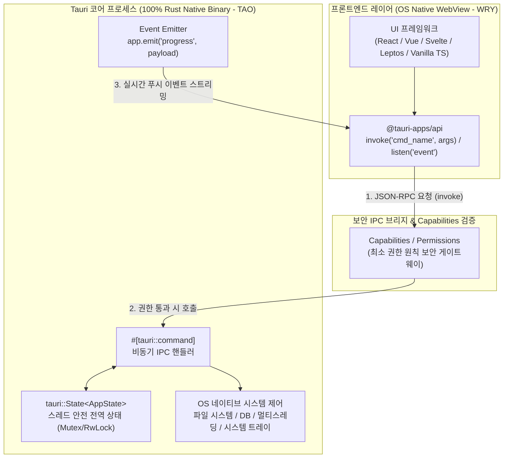

# 🖥️ 별책 2: Tauri v2 크로스플랫폼 아키텍처 마스터 가이드

> [!abstract]+ **왜 전 세계가 Electron에서 Tauri로 이동하고 있는가?**
> VS Code, Slack, Discord 등을 만든 **Electron**은 앱 하나마다 **Chromium 브라우저 전체와 Node.js 런타임**을 통째로 번들링합니다. 그 결과 간단한 메모장 앱을 만들어도 설치 파일이 $150\text{MB}$를 넘고 기본 RAM 점유율이 $300\text{MB}$에 달합니다.
> 
> 반면 **Tauri(타우리)**는 운영체제에 이미 내장된 네이티브 웹뷰(Windows의 **WebView2**, macOS/iOS의 **WKWebView**, Linux/Android의 **WebKitGTK/System WebView**)를 UI 렌더러로 활용하고, 백엔드 코어 로직은 **100% 순수 Rust 바이너리**로 구동합니다!
> - **설치 파일 크기**: $150\text{MB} \rightarrow \mathbf{2 \sim 5\text{MB}}$ ($95\%$ 이상 감소!)
> - **메모리 사용량**: 절반 이하로 절감
> - **보안성**: Node.js 노출 없이 컴파일된 Rust 바이너리와 세밀한 권한 제어(Capabilities)로 해킹 및 역공학(Reverse Engineering) 방어
> - **Tauri v2의 혁신**: 하나의 코드베이스로 **Windows, macOS, Linux 데스크톱은 물론 iOS와 Android 모바일 앱**까지 동시에 빌드!
> 
> - 선수 과목: **[[programming/rust/Rust/02_Type_System_Generics_and_Traits\|제2권: 타입 시스템과 에러 처리]]** | **[[programming/rust/Rust/03_Advanced_Rust_Concurrency_and_Macros\|제3권: 동시성과 비동기 Tokio]]**
> - 연관 기술: **[[programming/rust/WebAssembly/04_WebAssembly_and_Frontend_Ecosystem\|별책 1: Rust + WebAssembly (WASM) 마스터]]**

---

## 🏛️ Part 1. Tauri v2 내부 아키텍처 심층 해부

Tauri 애플리케이션은 크게 **프론트엔드 프로세스(WebView)**와 **코어 프로세스(Rust Backend)** 두 부분으로 나뉘며, 이 둘은 직렬화된 JSON 메시지를 주고받는 **IPC (Inter-Process Communication, 프로세스 간 통신)** 브리지로 대화합니다.



- **TAO**: Rust로 작성된 크로스플랫폼 윈도우 생성 및 이벤트 루프 관리 라이브러리 (창 크기, 메뉴바, 시스템 트레이 제어).
- **WRY**: 각 OS의 네이티브 WebView(WebView2, WKWebView, WebKitGTK)를 추상화하여 통합 제어하는 Rust 렌더링 라이브러리.

---

## 🛠️ Part 2. Step-by-Step Tauri v2 프로젝트 생성 및 디렉토리 구조

### Step 1: OS별 사전 준비 및 프로젝트 스캐폴딩

터미널에서 공식 생성 도구를 실행하면 프론트엔드 종류(Vanilla TS, React, Vue, Svelte, 혹은 Rust Leptos/Yew)를 대화형으로 선택할 수 있습니다.

```bash
# Cargo를 이용한 Tauri v2 프로젝트 생성
cargo install create-tauri-app --locked
cargo create-tauri-app my-tauri-studio
cd my-tauri-studio

# 개발 모드 실행 (Rust 컴파일 + 프론트엔드 핫 리로드 동시 실행!)
cargo tauri dev
```

### Step 2: 생성된 프로젝트 구조 완벽 이해

```text
my-tauri-studio/
├── package.json                 # 프론트엔드 의존성 (@tauri-apps/api 등)
├── src/                         # 🎨 프론트엔드 소스 폴더 (HTML / CSS / TypeScript / WASM)
│   └── main.ts
└── src-tauri/                   # 🦀 Rust 백엔드 코어 폴더 (가장 중요!)
    ├── Cargo.toml               # Rust 크레이트 의존성 (tauri, serde, tokio 등)
    ├── tauri.conf.json          # 앱 이름, 창 해상도, 번들 아이콘, CSP 보안 설정
    ├── capabilities/            # 🔒 Tauri v2 핵심: 창(Window)별 세부 API 접근 권한 정의
    │   └── default.json
    └── src/
        ├── lib.rs               # 모바일/데스크톱 공용 앱 빌더 및 커맨드 구현
        └── main.rs              # 데스크톱 실행 진입점
```

---

## 📡 Part 3. Tauri의 4대 핵심 기법 완벽 마스터

시니어 Tauri 개발자가 되기 위해 반드시 알아야 할 4가지 핵심 메커니즘을 알아봅니다:
1. **IPC 커맨드 (`#[tauri::command]`)와 커스텀 에러 직렬화**
2. **스레드 안전 상태 관리 (`tauri::State` + `Mutex`)**
3. **양방향 실시간 이벤트 스트리밍 (`app.emit` / `listen`)**
4. **Tauri v2 보안 모델 (`Capabilities` & `Permissions`)**

### Step 3: `src-tauri/Cargo.toml` 설정

백엔드에서 JSON 직렬화를 담당하는 `serde`와 비동기 작업을 위한 `tokio`를 설정합니다.

```toml
[package]
name = "my-tauri-studio"
version = "0.1.0"
edition = "2024"

[lib]
name = "my_tauri_studio_lib"
crate-type = ["staticlib", "cdylib", "rlib"]

[build-dependencies]
tauri-build = { version = "2", features = [] }

[dependencies]
tauri = { version = "2", features = ["tray-icon"] }
serde = { version = "1.0", features = ["derive"] }
serde_json = "1.0"
tokio = { version = "1", features = ["full"] }
thiserror = "2.0"
```

---

## 💻 Part 4. 실전 아키텍처 구현: 비동기 작업 매니저 & 보안 볼트 백엔드 (`src-tauri/src/lib.rs`)

아래 코드는 실무 상용 Tauri 앱에서 사용하는 모든 표준 패턴(커스텀 에러 반환, 비동기 커맨드, 전역 `State` 공유, 백그라운드 스레드 진행률 이벤트 전송)을 하나도 빠짐없이 담고 있습니다.

```rust
use serde::{Deserialize, Serialize};
use std::collections::HashMap;
use std::sync::Mutex;
use std::time::Duration;
use tauri::{AppHandle, Emitter, Manager, State};

// =============================================================================
// 1. 실무형 에러 처리: Tauri 커맨드에서 Result<T, E>를 반환하려면
// 에러 타입 E가 반드시 serde::Serialize를 구현해야 프론트엔드(Promise.catch)로 전달됩니다!
// =============================================================================
#[derive(Debug, thiserror::Error)]
pub enum VaultError {
    #[error("키 '{0}'에 해당하는 보안 노트를 찾을 수 없습니다.")]
    NoteNotFound(String),
    #[error("내용이 비어있거나 보안 정책에 위배됩니다.")]
    InvalidInput,
    #[error("내부 상태 락(Mutex) 획득 실패")]
    LockError,
}

// VaultError를 프론트엔드가 읽기 쉬운 문자열로 직렬화하여 전달
impl Serialize for VaultError {
    fn serialize<S>(&self, serializer: S) -> Result<S::Ok, S::Error>
    where
        S: serde::Serializer,
    {
        serializer.serialize_str(self.to_string().as_ref())
    }
}

// =============================================================================
// 2. 프론트엔드 <-> Rust 간 주고받을 DTO (Data Transfer Object) 구조체
// =============================================================================
#[derive(Debug, Clone, Serialize, Deserialize)]
#[serde(rename_all = "camelCase")] // Rust의 snake_case 필드를 JS 표준인 camelCase로 자동 변환!
pub struct SecureNote {
    pub id: String,
    pub title: String,
    pub encrypted_body: String,
    pub access_count: u32,
}

#[derive(Clone, Serialize)]
#[serde(rename_all = "camelCase")]
pub struct BackupProgressPayload {
    pub step: u32,
    pub total_steps: u32,
    pub status_message: String,
}

// =============================================================================
// 3. 전역 애플리케이션 상태 (Application State)
// 여러 IPC 커맨드가 동시에 다른 스레드에서 호출될 수 있으므로 반드시 Mutex나 RwLock으로 감쌉니다!
// =============================================================================
pub struct AppVaultState {
    pub notes: Mutex<HashMap<String, SecureNote>>,
    pub total_operations: Mutex<u64>,
}

impl Default for AppVaultState {
    fn default() -> Self {
        Self {
            notes: Mutex::new(HashMap::new()),
            total_operations: Mutex::new(0),
        }
    }
}

// =============================================================================
// 4. IPC 커맨드 (Commands) 구현 - 프론트엔드에서 invoke()로 직접 호출하는 함수들
// =============================================================================

/// [커맨드 1] 새로운 보안 노트를 저장하고 전체 연산 횟수를 반환합니다.
/// State<'_, AppVaultState>는 Tauri가 자동으로 의존성 주입(DI)해 주는 전역 상태입니다!
#[tauri::command]
fn save_secure_note(
    id: String,
    title: String,
    body: String,
    state: State<'_, AppVaultState>,
) -> Result<u64, VaultError> {
    if title.trim().is_empty() || body.trim().is_empty() {
        return Err(VaultError::InvalidInput);
    }

    // 간단한 XOR 난독화 시뮬레이션
    let encrypted_body: String = body.chars().map(|c| ((c as u8) ^ 0x2A) as char).collect();

    let mut notes_map = state.notes.lock().map_err(|_| VaultError::LockError)?;
    let mut ops_count = state.total_operations.lock().map_err(|_| VaultError::LockError)?;

    notes_map.insert(
        id.clone(),
        SecureNote {
            id,
            title,
            encrypted_body,
            access_count: 0,
        },
    );

    *ops_count += 1;
    Ok(*ops_count)
}

/// [커맨드 2] 저장된 노트를 조회하고 접근 횟수를 1 증가시킵니다.
#[tauri::command]
fn get_secure_note(
    id: String,
    state: State<'_, AppVaultState>,
) -> Result<SecureNote, VaultError> {
    let mut notes_map = state.notes.lock().map_err(|_| VaultError::LockError)?;

    let note = notes_map
        .get_mut(&id)
        .ok_or_else(|| VaultError::NoteNotFound(id))?;

    note.access_count += 1;
    Ok(note.clone())
}

/// [커맨드 3] 비동기(async) 커맨드 + 실시간 이벤트 스트리밍 (app.emit)
/// 무거운 백업 작업을 수행할 때 UI가 멈추지(Freeze) 않도록 비동기로 실행하며 진행률을 실시간 푸시합니다!
#[tauri::command]
async fn start_cloud_backup(app: AppHandle) -> Result<String, VaultError> {
    let total_steps = 5;

    for step in 1..=total_steps {
        // 비동기 대기 (메인 UI 스레드를 절대 블로킹하지 않음!)
        tokio::time::sleep(Duration::from_millis(400)).await;

        let payload = BackupProgressPayload {
            step,
            total_steps,
            status_message: format!("암호화 블록 #{step}/{total_steps} 동기화 완료..."),
        };

        // 💡 프론트엔드 전체 창으로 'backup-progress' 이벤트를 실시간 발송!
        let _ = app.emit("backup-progress", payload);
    }

    Ok(String::from("모든 보안 볼트 백업이 성공적으로 완료되었습니다!"))
}

// =============================================================================
// 5. Tauri 애플리케이션 빌더 및 초기화 진입점
// =============================================================================
#[cfg_attr(mobile, tauri::mobile_entry_point)]
pub fn run() {
    tauri::Builder::default()
        // 1. 전역 상태(AppVaultState)를 Tauri 컨테이너에 등록합니다.
        .manage(AppVaultState::default())
        // 2. 앱 시작 시 실행되는 setup 훅
        .setup(|app| {
            let main_window = app.get_webview_window("main").unwrap();
            main_window.set_title("🦀 Rust Masterclass - Tauri v2 Secure Vault")?;
            Ok(())
        })
        // 3. 위에서 작성한 #[tauri::command] 함수들을 IPC 핸들러에 등록합니다.
        .invoke_handler(tauri::generate_handler![
            save_secure_note,
            get_secure_note,
            start_cloud_backup
        ])
        .run(tauri::generate_context!())
        .expect("Tauri 애플리케이션 실행 중 치명적 오류 발생");
}
```

---

## 🎨 Part 5. 프론트엔드(TypeScript)에서 Rust 백엔드 호출 및 이벤트 수신하기

이제 프론트엔드(`src/main.ts`)에서 `@tauri-apps/api`를 사용해 위에서 만든 Rust 커맨드를 어떻게 호출하고 이벤트를 구독하는지 살펴봅시다.

```typescript
import { invoke } from "@tauri-apps/api/core";
import { listen } from "@tauri-apps/api/event";

// 1. Rust의 #[serde(rename_all = "camelCase")] 구조체와 1:1 매핑되는 TypeScript 인터페이스
interface SecureNote {
  id: string;
  title: string;
  encryptedBody: string;
  accessCount: number;
}

interface BackupProgressPayload {
  step: number;
  totalSteps: number;
  statusMessage: string;
}

async function initializeFrontend() {
  // 2. Rust 백엔드가 발송하는 'backup-progress' 실시간 이벤트 구독 (Event Listener)
  const unlisten = await listen<BackupProgressPayload>("backup-progress", (event) => {
    const { step, totalSteps, statusMessage } = event.payload;
    const percent = Math.round((step / totalSteps) * 100);
    console.log(`📊 [진행률 ${percent}%]: ${statusMessage}`);
    
    const progressEl = document.getElementById("progress-status");
    if (progressEl) {
      progressEl.textContent = `[${percent}%] ${statusMessage}`;
    }
  });

  // 3. invoke()를 이용한 Rust IPC 커맨드 호출 실습
  try {
    // (A) 노트 저장 커맨드 호출 (Rust의 save_secure_note 함수 실행)
    const totalOps = await invoke<number>("save_secure_note", {
      id: "note-001",
      title: "마스터 키 백업 코드",
      body: "RUST-TAURI-WASM-2026",
    });
    console.log(`✅ 노트 저장 성공! 누적 연산 횟수: ${totalOps}`);

    // (B) 노트 조회 커맨드 호출
    const note = await invoke<SecureNote>("get_secure_note", { id: "note-001" });
    console.log("🔐 조회된 보안 노트:", note);

    // (C) 비동기 클라우드 백업 시작
    const finalResult = await invoke<string>("start_cloud_backup");
    console.log("🎉 백업 최종 결과:", finalResult);

  } catch (rustError) {
    // Rust 커맨드가 Err(VaultError)를 반환하면 자동으로 이 catch 블록으로 들어옵니다!
    console.error("❌ Rust 백엔드 에러 발생:", rustError);
  }
}

window.addEventListener("DOMContentLoaded", initializeFrontend);
```

---

## 🔒 Part 6. Tauri v2 보안 아키텍처: Capabilities (최소 권한 원칙)

만약 프론트엔드에 XSS(교차 사이트 스크립팅) 취약점이 발생하더라도, 공격자가 사용자의 하드디스크 파일을 지우거나 쉘 명령어를 실행하지 못하도록 Tauri v2는 **`src-tauri/capabilities/default.json`** 파일을 통해 창(Window)별로 허용된 권한만 엄격하게 열어줍니다.

```json
{
  "$schema": "../gen/schemas/desktop-schema.json",
  "identifier": "default-capability",
  "description": "메인 윈도우에 허용된 최소 권한 명세서",
  "windows": ["main"],
  "permissions": [
    "core:default",
    "core:event:allow-listen",
    "core:event:allow-emit"
  ]
}
```

- 만약 파일 시스템 플러그인(`tauri-plugin-fs`)을 추가하더라도, 위 `permissions` 배열에 `"fs:allow-read-text-file"`과 허용할 폴더 범위(Scope, 예: `$APPDATA/*`)를 명시적으로 적어주지 않으면 Rust 코어 게이트웨이가 접근을 **100% 차단**합니다.

### 🚀 상용 배포용 설치 파일(Installer) 빌드하기

개발이 끝났다면 아래 명령어 한 줄로 현재 OS에 최적화된 초경량 설치 파일(`.msi`, `.exe`, `.dmg`, `.app`, `.deb`, `.AppImage`)을 생성할 수 있습니다:

```bash
cargo tauri build
```

---

## ✅ 별책 2 학습 점검 체크리스트 (Self-Check)

- [ ] Tauri가 Electron 대비 설치 용량과 메모리 점유율을 혁신적으로 줄일 수 있었던 아키텍처적 이유(OS Native WebView + Rust Binary)를 설명할 수 있다.
- [ ] `#[tauri::command]` 함수에서 커스텀 에러(`Result<T, E>`)를 반환하기 위해 에러 타입에 `serde::Serialize`를 구현해야 하는 이유를 알고 있다.
- [ ] `tauri::State`와 `Mutex`를 결합하여 여러 IPC 호출 간에 안전하게 전역 상태를 공유할 수 있다.
- [ ] 무거운 백엔드 작업을 `async` 커맨드로 처리하면서 `app.emit()`과 프론트엔드의 `listen()`으로 실시간 진행률을 스트리밍할 수 있다.
- [ ] Tauri v2의 `capabilities/default.json`이 어떻게 최소 권한 보안 모델을 강제하는지 이해했다.

---

> [!success]+ **🎓 전 과정 수료를 진심으로 축하드립니다!**
> **[[programming/rust/Rust/00_Rust_Foundation_and_Setup\|제0권 기초]]**부터 **[[programming/rust/Rust/01_Ownership_and_Memory_Architecture\|제1권 소유권]]**, **[[programming/rust/Rust/02_Type_System_Generics_and_Traits\|제2권 타입 시스템]]**, **[[programming/rust/Rust/03_Advanced_Rust_Concurrency_and_Macros\|제3권 비동기/매크로/Unsafe]]**, 그리고 **[[programming/rust/WebAssembly/04_WebAssembly_and_Frontend_Ecosystem\|별책 1 WebAssembly]]**와 **[[programming/rust/Tauri/05_Tauri_Cross_Platform_Architecture\|별책 2 Tauri]]**까지 모두 완주하셨습니다!
> 
> 이제 옵시디언(Obsidian)에 저장된 이 6권의 마스터클래스 노트를 나만의 레퍼런스 사전으로 활용하시면서, 세상에 없던 빠르고 안전한 시스템과 애플리케이션을 직접 만들어 보세요. **Happy Coding, Rustacean! 🦀🚀**