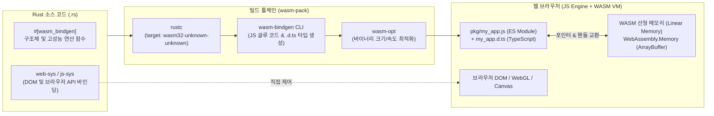

# 🌐 별책 1: Rust + WebAssembly (WASM) 마스터 가이드

> [!abstract]+ **왜 WebAssembly(WASM)의 표준 언어는 Rust인가?**
> **WebAssembly(WASM)**는 웹 브라우저(V8, SpiderMonkey, WebKit) 및 서버리스 엣지 환경에서 네이티브에 육박하는 속도로 실행되는 이진 명령어 포맷(Binary Instruction Format)입니다.
> Go나 C#(.NET), Python으로 WASM을 빌드하면 무거운 **가비지 컬렉터(GC)와 런타임 전체**가 WASM 파일 안에 함께 패킹되어 파일 크기가 수 $\text{MB} \sim$ 수십 $\text{MB}$로 폭증합니다. 반면 **Rust는 런타임과 GC가 아예 없기 때문에** 수 $\text{KB}$ 단위의 초소형 `.wasm` 바이너리를 생성하며, 예측 가능한 결정론적(Deterministic) 고성능을 발휘합니다! (실제로 Figma, Photoshop Web, AutoCAD Web, 1Password 등이 이 아키텍처를 사용합니다.)
> 
> - 선수 과목: **[[programming/rust/Rust/01_Ownership_and_Memory_Architecture\|제1권: 소유권과 메모리]]** | **[[programming/rust/Rust/02_Type_System_Generics_and_Traits\|제2권: 타입 시스템과 트레이트]]**
> - 연관 기술: **[[programming/rust/Tauri/05_Tauri_Cross_Platform_Architecture\|별책 2: Tauri 크로스플랫폼 앱 아키텍처]]**

---

## 🏗️ Part 1. Rust + WASM 전체 아키텍처와 툴체인 해부

JavaScript와 WebAssembly가 어떻게 데이터를 주고받고 메모리를 공유하는지 아키텍처 다이어그램으로 먼저 이해해 봅시다.



### 1.1 핵심 생태계 크레이트 4대장 역할 정리

| 도구 / 크레이트 | 역할 및 설명 |
| :--- | :--- |
| **`wasm-pack`** | Rust 코드를 컴파일하고, JS 래퍼 코드와 TypeScript 정의 파일(`.d.ts`), `package.json`까지 한 번에 묶어 NPM 패키지로 만들어주는 통합 빌드 CLI 도구입니다. |
| **`wasm-bindgen`** | 원래 WASM 스펙은 숫자(`i32`, `f64`)만 주고받을 수 있습니다. `#[wasm_bindgen]` 매크로는 문자열(`String`), 구조체, 클로저 등 복잡한 타입을 JS와 자연스럽게 주고받도록 다리(Bridge)를 놓아줍니다. |
| **`js-sys`** | `Array`, `Date`, `Promise`, `Math`, `Uint8Array` 등 표준 ECMAScript(JavaScript) 내장 객체와 함수를 Rust에서 그대로 호출할 수 있게 해주는 바인딩 크레이트입니다. |
| **`web-sys`** | `window`, `document`, `HtmlCanvasElement`, `WebGlRenderingContext`, `fetch` 등 웹 브라우저의 모든 Web API를 Rust 타입으로 완벽히 옮겨놓은 크레이트입니다. |

---

## 🛠️ Part 2. Step-by-Step WASM 프로젝트 구축 및 설정

VS Code 터미널을 열고 처음부터 끝까지 따라 해 보세요.

### Step 1: WASM 타겟 및 `wasm-pack` 설치

```bash
# 1. Rust 컴파일러에 WebAssembly 크로스 컴파일 타겟 추가
rustup target add wasm32-unknown-unknown

# 2. wasm-pack 빌드 도구 설치
cargo install wasm-pack

# 3. 라이브러리(--lib) 형태로 새 프로젝트 생성
cargo new --lib rust_wasm_engine
cd rust_wasm_engine
```

### Step 2: `Cargo.toml` 최적화 설정 작성

생성된 `Cargo.toml` 파일을 열고 아래와 같이 수정합니다. **각 설정이 왜 필요한지 주석을 통해 완벽히 이해하세요.**

```toml
[package]
name = "rust_wasm_engine"
version = "0.1.0"
edition = "2024"

[lib]
# cdylib: C/WASM 호환 동적 라이브러리(.wasm)를 생성하라고 컴파일러에 지시합니다.
# rlib: Rust 단위 테스트를 실행할 때도 사용할 수 있도록 함께 지정합니다.
crate-type = ["cdylib", "rlib"]

[dependencies]
wasm-bindgen = "0.2"
js-sys = "0.3"
# 브라우저 콘솔에 패닉(Panic) 발생 시 스택 트레이스를 예쁘게 찍어주는 필수 유틸리티
console_error_panic_hook = "0.1"

# web-sys는 수천 개의 브라우저 API를 담고 있어 필요한 기능만 features 배열에 명시해서 켭니다!
[dependencies.web-sys]
version = "0.3"
features = [
    "console",
    "Window",
    "Document",
    "Element",
    "HtmlElement",
    "HtmlCanvasElement",
    "CanvasRenderingContext2d",
]

# 💡 시니어의 WASM 바이너리 다이어트(Size Optimization) 프로필 설정!
[profile.release]
opt-level = "z"     # 실행 속도('3') 대신 바이너리 용량 최소화('s' 또는 'z')에 최적화
lto = true          # Link Time Optimization 활성화 (사용하지 않는 죽은 코드 완벽 제거)
codegen-units = 1   # 단일 코드 생성 유닛으로 묶어 최적화 효율 극대화
panic = "abort"     # 패닉 발생 시 스택 되감기(Unwinding) 코드를 제거하여 용량 대폭 절감
```

---

## 💻 Part 3. 실전 프로젝트: 제로 카피(Zero-Copy) 선형 메모리 물리/이미지 엔진 구현

> [!important]+ **고급 WASM 아키텍처의 핵심: 왜 데이터를 복사하면 안 되는가?**
> 초보자는 프레임마다 JavaScript 배열을 Rust로 넘기고(`wasm_fn(js_array)`), Rust에서 계산한 새 배열을 다시 JS로 반환받습니다. 이렇게 하면 매 프레임마다 수 메가바이트의 배열이 **직렬화/역직렬화되며 복사(Copy)**되어 오히려 순수 JS보다 느려집니다!
> 
> **시니어의 해법 (Zero-Copy Linear Memory View)**:
> 1. 대규모 버퍼(`Vec<u8>` 또는 `Vec<f64>`)는 **Rust(WASM 선형 메모리) 내부에 고정**시켜 둡니다.
> 2. Rust는 버퍼 전체가 아닌 **버퍼의 시작 메모리 주소 포인터(`*const u8`) 딱 하나만** JS에게 알려줍니다.
> 3. JavaScript는 `new Uint8ClampedArray(wasm.memory.buffer, ptr, len)`를 통해 **복사 비용 $0$으로 Rust의 메모리를 직접 바라보고** `<canvas>`에 즉시 렌더링합니다!

### Step 3: `src/lib.rs` 전체 소스 코드 작성 및 해설

```rust
use wasm_bindgen::prelude::*;
use web_sys::{console, window};

// 1. JavaScript의 외부 함수를 Rust 안으로 가져오기 (Import JS to Rust)
#[wasm_bindgen]
extern "C" {
    // 브라우저의 alert 함수를 Rust에서 호출할 수 있도록 바인딩
    fn alert(s: &str);

    // JS의 console.log를 다양한 이름으로 매핑 (다형성 바인딩)
    #[wasm_bindgen(js_namespace = console)]
    fn log(s: &str);
}

// Rust의 println! 대신 브라우저 콘솔에 출력하는 편리한 매크로 정의
macro_rules! console_log {
    ($($t:tt)*) => (log(&format_args!($($t)*).to_string()))
}

// 2. 모듈 로드 시 자동으로 한 번 실행되는 초기화 함수
#[wasm_bindgen(start)]
pub fn init_engine() {
    // WASM 내부에서 패닉이 발생하면 "unreachable" 같은 암호 같은 에러 대신
    // 정확한 Rust 파일명과 줄 번호를 브라우저 F12 콘솔에 출력해 줍니다!
    console_error_panic_hook::set_once();
    console_log!("🦀 [Rust WASM Engine] 초기화 완료!");
}

// 3. web-sys를 이용해 Rust에서 직접 브라우저 DOM 요소 생성 및 조작하기
#[wasm_bindgen]
pub fn mount_status_banner(message: &str) -> Result<(), JsValue> {
    let win = window().ok_or("전역 window 객체를 찾을 수 없습니다")?;
    let doc = win.document().ok_or("document 객체를 찾을 수 없습니다")?;
    let body = doc.body().ok_or("body 태그를 찾을 수 없습니다")?;

    // <div class="wasm-banner"> 요소 생성 및 텍스트 주입
    let banner = doc.create_element("div")?;
    banner.set_class_name("wasm-banner");
    banner.set_inner_html(&format!("⚡ <strong>WASM Native DOM:</strong> {message}"));

    body.append_child(&banner)?;
    Ok(())
}

// 4. 고성능 픽셀 버퍼 프로세서 구조체 (JS에서 new PixelProcessor(w, h) 로 생성 가능!)
#[wasm_bindgen]
pub struct PixelProcessor {
    width: u32,
    height: u32,
    // RGBA (픽셀당 4바이트) 데이터를 담는 연속된 선형 메모리 버퍼
    pixels: Vec<u8>,
    tick_count: u32,
}

#[wasm_bindgen]
impl PixelProcessor {
    // #[wasm_bindgen(constructor)]를 붙이면 JS에서 'new PixelProcessor(w, h)' 문법으로 호출됩니다!
    #[wasm_bindgen(constructor)]
    pub fn new(width: u32, height: u32) -> PixelProcessor {
        let size = (width * height * 4) as usize;
        let pixels = vec![0; size];
        console_log!("캔버스 버퍼 할당 완료: {}x{} ({} Bytes)", width, height, size);

        PixelProcessor {
            width,
            height,
            pixels,
            tick_count: 0,
        }
    }

    pub fn width(&self) -> u32 {
        self.width
    }

    pub fn height(&self) -> u32 {
        self.height
    }

    /// ⭐ 핵심: 배열 전체를 복사하지 않고 WASM 선형 메모리 내의 시작 주소 포인터(*const u8)만 반환!
    pub fn buffer_ptr(&self) -> *const u8 {
        self.pixels.as_ptr()
    }

    /// 매 프레임마다 실시간 플라즈마 그라데이션 효과를 초고속으로 연산하는 메서드
    pub fn render_next_frame(&mut self) {
        self.tick_count = self.tick_count.wrapping_add(1);
        let t = self.tick_count as f64 * 0.05;

        for y in 0..self.height {
            for x in 0..self.width {
                let idx = ((y * self.width + x) * 4) as usize;
                let fx = x as f64 / self.width as f64;
                let fy = y as f64 / self.height as f64;

                // 삼각함수 파동 합성 연산 (CPU 집약적 작업)
                let r = ((fx * 10.0 + t).sin() * 127.0 + 128.0) as u8;
                let g = ((fy * 10.0 - t).cos() * 127.0 + 128.0) as u8;
                let b = (((fx + fy) * 10.0 + t).sin() * 127.0 + 128.0) as u8;

                self.pixels[idx] = r;     // Red
                self.pixels[idx + 1] = g; // Green
                self.pixels[idx + 2] = b; // Blue
                self.pixels[idx + 3] = 255; // Alpha (불투명)
            }
        }
    }
}
```

---

## 🚀 Part 4. 빌드 및 프론트엔드(HTML / TypeScript) 연동 실습

### Step 4: `wasm-pack`으로 웹 모듈 빌드하기

터미널에서 아래 명령어를 실행합니다:

```bash
wasm-pack build --target web --release
```

빌드가 완료되면 프로젝트 폴더 안에 `pkg/` 디렉토리가 생성됩니다:
- `pkg/rust_wasm_engine_bg.wasm`: 컴파일된 고성능 WebAssembly 바이너리
- `pkg/rust_wasm_engine.js`: 브라우저에서 바로 `import` 할 수 있는 ES Module 래퍼
- `pkg/rust_wasm_engine.d.ts`: VS Code 자동 완성을 위한 TypeScript 타입 정의서

### Step 5: `index.html`에서 제로 카피 렌더링 연결하기

프로젝트 루트에 `index.html`을 만들고 VS Code의 `Live Server` 확장이나 `python3 -m http.server 8080`으로 실행해 보세요.

```html
<!DOCTYPE html>
<html lang="ko">
<head>
  <meta charset="UTF-8" />
  <title>Rust + WASM Zero-Copy Engine</title>
  <style>
    body { font-family: system-ui, sans-serif; background: #0f172a; color: #f8fafc; text-align: center; padding: 2rem; }
    canvas { border: 2px solid #38bdf8; border-radius: 12px; box-shadow: 0 10px 30px rgba(0,0,0,0.5); margin-top: 1rem; }
    .wasm-banner { background: #1e293b; padding: 12px; border-radius: 8px; display: inline-block; margin-bottom: 1rem; }
  </style>
</head>
<body>
  <h1>🦀 Rust + WebAssembly 실시간 제로카피 렌더러</h1>
  <div id="app"></div>
  <canvas id="viewport" width="400" height="300"></canvas>

  <script type="module">
    // 1. wasm-pack이 생성한 초기화 함수(init)와 구조체(PixelProcessor), 함수를 import 합니다.
    import init, { PixelProcessor, mount_status_banner } from "./pkg/rust_wasm_engine.js";

    async function run() {
      // 2. WASM 모듈을 로드하고 인스턴스화합니다. 반환값(wasm)을 통해 선형 메모리(memory)에 접근합니다!
      const wasm = await init();

      // 3. Rust가 직접 DOM에 상태 배너를 마운트하도록 호출
      mount_status_banner("Zero-Copy Linear Memory 활성화됨 (60 FPS)");

      const width = 400;
      const height = 300;
      const processor = new PixelProcessor(width, height);

      const canvas = document.getElementById("viewport");
      const ctx = canvas.getContext("2d");

      function renderLoop() {
        // 4. Rust에게 다음 프레임 픽셀 계산 명령
        processor.render_next_frame();

        // 5. ⭐ 핵심: Rust 메모리의 시작 포인터를 가져와서 복사 없이(Zero-Copy) 뷰만 생성!
        // 주의: Rust 내부에서 Vec 재할당이 일어나면 wasm.memory.buffer가 갱신될 수 있으므로 매 프레임 뷰를 잡는 것이 안전합니다.
        const ptr = processor.buffer_ptr();
        const byteLength = width * height * 4;
        const pixelView = new Uint8ClampedArray(wasm.memory.buffer, ptr, byteLength);

        // 6. 캔버스에 즉시 그리기
        const imageData = new ImageData(pixelView, width, height);
        ctx.putImageData(imageData, 0, 0);

        requestAnimationFrame(renderLoop);
      }

      requestAnimationFrame(renderLoop);
    }

    run();
  </script>
</body>
</html>
```

---

## ⚛️ Part 5. 순수 Rust 프론트엔드 프레임워크 생태계 (`Leptos` & `Yew`)

JavaScript/React와 Rust WASM을 섞어 쓰는 것을 넘어, 아예 **프론트엔드 UI 전체를 100% Rust로 작성**하는 생태계도 성숙해 있습니다.

- **Yew**: React와 유사한 가상 돔(Virtual DOM) 및 훅(`use_state`, `use_effect`) 기반의 프레임워크.
- **Leptos** (최신 트렌드 ⭐): 가상 돔 오버헤드가 없는 **세밀한 반응형(Fine-Grained Reactivity, SolidJS 스타일)** 아키텍처와 풀스택 서버 함수(Server Functions)를 지원하는 초고속 프레임워크입니다.

```rust
// [참고 예제] Leptos 프레임워크를 이용한 반응형 카운터 컴포넌트 구조
use leptos::prelude::*;

#[component]
pub fn ReactiveCounter(initial_value: i32) -> impl IntoView {
    // Signal 생성: 값이 바뀌면 전체 재렌더링 없이 해당 텍스트 노드만 정확히 업데이트됩니다!
    let (count, set_count) = signal(initial_value);

    // 파생 시그널 (Derived Signal)
    let double_count = move || count.get() * 2;

    view! {
        <div class="counter-box">
            <h3>"Leptos Fine-Grained Reactive Counter"</h3>
            <p>"현재 값: " <strong>{count}</strong> " (2배 값: " {double_count} ")"</p>
            <button on:click=move |_| set_count.update(|n| *n += 1)>
                "+1 증가"
            </button>
        </div>
    }
}
```

---

## ✅ 별책 1 학습 점검 체크리스트 (Self-Check)

- [ ] Rust가 Go나 C# 대비 WebAssembly 타겟에서 압도적으로 작은 바이너리 크기를 가지는 이유(No GC, No Runtime)를 설명할 수 있다.
- [ ] `Cargo.toml`에서 `crate-type = ["cdylib"]` 설정과 `[profile.release]`의 `opt-level = "z"`, `lto = true`의 역할을 이해했다.
- [ ] `#[wasm_bindgen]`을 이용해 Rust 구조체와 메서드를 JS로 내보내고, `web-sys`로 DOM을 조작할 수 있다.
- [ ] 대용량 데이터를 다룰 때 직렬화 복사를 피하고 `wasm.memory.buffer`와 포인터(`as_ptr()`)를 이용한 **Zero-Copy Linear Memory View** 기법을 구현할 수 있다.

> [!success]+ **다음 단계로 이동하기**
> 웹 브라우저 내부를 정복하셨군요! 이제 이 웹 프론트엔드(HTML/TS/WASM) 기술과 강력한 네이티브 OS 백엔드(파일 시스템, 멀티스레드, 시스템 트레이)를 결합하여 초경량 데스크톱 및 모바일 앱을 만드는 **Tauri**를 마스터해 봅시다!
> 👉 **다음 강좌**: **[[programming/rust/Tauri/05_Tauri_Cross_Platform_Architecture\|별책 2: Tauri v2 크로스플랫폼 아키텍처 마스터 가이드]]**