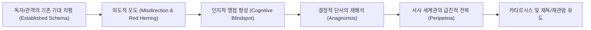
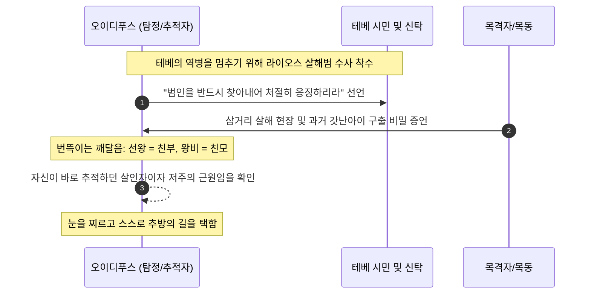
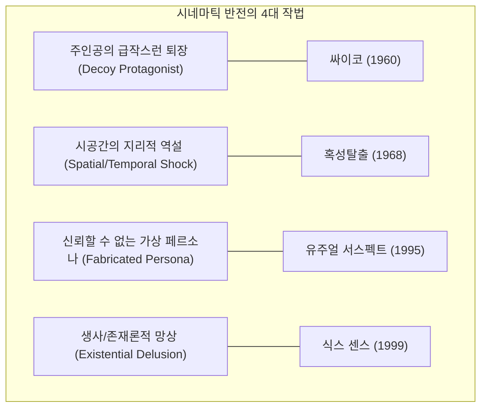
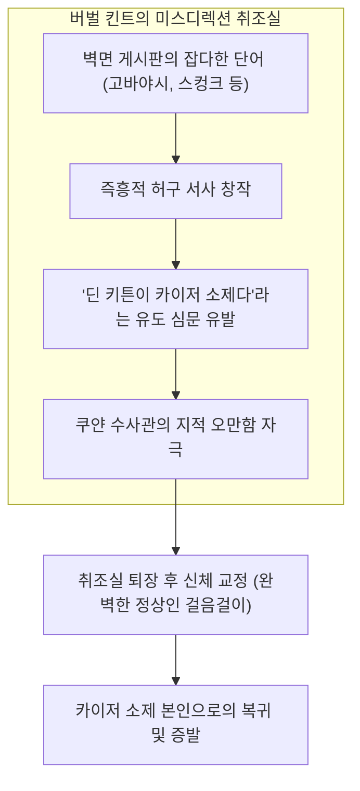
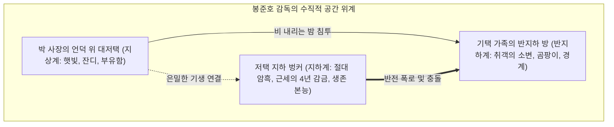

# 반전의 연대기 (The Chronicles of Plot Twists)
> **"우리가 보고 믿는 세계의 이면에는 언제나 정교하게 은폐된 또 하나의 진실이 숨쉬고 있다."**

---

## 📖 도서 안내 및 옵시디언(Obsidian) 환경 설정 가이드

> [!abstract] 이 책의 목적과 구성
> 본 도서는 고대 그리스 비극에서부터 현대 시네마, 그리고 인류 역사의 물줄기와 현대 범죄사에 이르기까지 인류를 전율케 한 **가장 위대한 반전(Plot Twist / Peripeteia & Anagnorisis)** 들을 학술적·서사학적 깊이로 해부한 전문 분석서입니다.
> 
> 단순한 줄거리 나열을 넘어 **① 전체 서사 전개(Setup & Progression)**, **② 반전에 이르게 되는 인지적 맹점과 복선 구조(Narrative Mechanics)**, **③ 결정적 폭로의 순간(The Climax Revelation)**, **④ 심층 분석 및 공인 아카이브·비평 웹사이트**를 체계적으로 정리하였습니다.

> [!tip] 추천 옵시디언 플러그인 (Recommended Plugins)
> 본 문서는 옵시디언의 네이티브 환경 및 다음 플러그인들과 100% 호환되도록 설계되었습니다.
> - **Dataview**: 본문 속 `Type::`, `Year::`, `TwistCategory::` 인라인 메타데이터 자동 쿼리 가능
> - **Admonition / Callout**: 경고, 인용구, 배경지식, 핵심 반전 콜아웃 시각화
> - **Mermaid.js**: 내장 다이어그램 엔진을 통한 서사 구조 왜곡 흐름도 렌더링
> - **Advanced Tables**: 챕터별 분석 및 비교 매트릭스 표 렌더링

---

## 📑 전체 목차 (Table of Contents)

- [[writing/reversal/The_Chronicles_of_Plot_Twists#서문 반전(Plot Twist)의 서사학과 인지심리학적 기제\|#서문 반전(Plot Twist)의 서사학과 인지심리학적 기제]]
	- 1. 아리스토텔레스의 《시학》: 페리페테이아와 아나그노리시스
	- 2. 인지적 편향과 미스디렉션(Misdirection)의 메커니즘
- [[writing/reversal/The_Chronicles_of_Plot_Twists#제1부 고대 신화와 고전문학 서사적 반전의 원형\|#제1부 고대 신화와 고전문학 서사적 반전의 원형]]
	- 1. 소포클레스의 《오이디푸스 왕 (Oedipus Rex)》 (기원전 429년경)
	- 2. 아라비안 나이트 《천일야화 중 세 개의 사과 (The Three Apples)》 (9~10세기)
	- 3. 기 드 모파상의 《목걸이 (The Necklace)》 (1884)
- [[writing/reversal/The_Chronicles_of_Plot_Twists#제2부 근현대 추리·심리소설의 황금기 서술 트릭의 정점\|#제2부 근현대 추리·심리소설의 황금기 서술 트릭의 정점]]
	- 4. 애거서 크리스티의 《애크로이드 살인사건 (The Murder of Roger Ackroyd)》 (1926)
	- 5. 애거서 크리스티의 《그리고 아무도 없었다 (And Then There Were None)》 (1939)
	- 6. 조지 오웰의 《1984 (Nineteen Eighty-Four)》 (1949)
	- 7. 히가시노 게이고의 《용의자 X의 헌신 (The Devotion of Suspect X)》 (2005)
- [[writing/reversal/The_Chronicles_of_Plot_Twists#제3부 영화사(Cinema)를 뒤흔든 시네마틱 반전의 걸작들\|#제3부 영화사(Cinema)를 뒤흔든 시네마틱 반전의 걸작들]]
	- 8. 알프레드 히치콕의 《싸이코 (Psycho)》 (1960)
	- 9. 프랭클린 J. 샤프너의 《혹성탈출 (Planet of the Apes)》 (1968)
	- 10. 어빈 커슈너의 《스타워즈 에피소드 5: 제국의 역습 (The Empire Strikes Back)》 (1980)
	- 11. 브라이언 싱어의 《유주얼 서스펙트 (The Usual Suspects)》 (1995)
	- 12. M. 나이트 샤말란의 《식스 센스 (The Sixth Sense)》 (1999)
	- 13. 크리스토퍼 놀란의 《메멘토 (Memento)》 (2000)
	- 14. 박찬욱의 《올드보이 (Oldboy)》 (2003)
	- 15. 데이비드 핀처의 《파이트 클럽 (Fight Club)》 (1999)
	- 16. 봉준호의 《기생충 (Parasite)》 (2019)
- [[writing/reversal/The_Chronicles_of_Plot_Twists#제4부 역사의 물줄기를 바꾼 지정학적 기만과 군사적 대반전\|#제4부 역사의 물줄기를 바꾼 지정학적 기만과 군사적 대반전]]
	- 17. 제2차 세계대전의 판도를 뒤바꾼 《포티튜드 작전 (Operation Fortitude)》 (1944)
	- 18. 시체 한 구로 히틀러를 완벽히 속인 《민스미트 작전 (Operation Mincemeat)》 (1943)
	- 19. 미국의 참전을 촉발한 밀약의 폭로 《치머만 전보 사건 (Zimmermann Telegram)》 (1917)
	- 20. 말 한마디로 냉전을 무너뜨린 《베를린 장벽의 우발적 붕괴 (Fall of the Berlin Wall)》 (1989)
- [[writing/reversal/The_Chronicles_of_Plot_Twists#제5부 현실이 픽션을 압도한 세기의 사기극과 범죄 실화\|#제5부 현실이 픽션을 압도한 세기의 사기극과 범죄 실화]]
	- 21. 나치 2인자 괴링을 농락한 위작범 《한 판 메이헤런 사건 (Han van Meegeren)》 (1945)
	- 22. 실리콘밸리 역사상 최대의 바이오 유니콘 사기극 《테라노스 스캔들 (Theranos)》 (2015)
	- 23. 장갑 하나로 뒤집힌 세기의 살인 재판 《O. J. 심슨 사건 (The O.J. Simpson Trial)》 (1995)
	- 24. 33년 만에 밝혀진 진실과 무죄 판결 《이춘재 연쇄살인 8차 사건 재심》 (1988~2020)
- [[writing/reversal/The_Chronicles_of_Plot_Twists#제6부 반전의 6대 유형학 및 작법론 (Narrative Mechanics Matrix)\|#제6부 반전의 6대 유형학 및 작법론 (Narrative Mechanics Matrix)]]
- [[writing/reversal/The_Chronicles_of_Plot_Twists#종합 데이터베이스 및 공식 아카이브 웹사이트 안내\|#종합 데이터베이스 및 공식 아카이브 웹사이트 안내]]

---

# 서문: 반전(Plot Twist)의 서사학과 인지심리학적 기제



### 1. 아리스토텔레스의 《시학》: 페리페테이아와 아나그노리시스
서양 서사 이론의 시초인 아리스토텔레스는 《시학(Poetics)》에서 비극이 관객에게 공포와 연민을 통한 정화(카타르시스)를 유발하기 위해 반드시 갖추어야 할 두 가지 핵심 요소로 **페리페테이아(Peripeteia, 운명의 급변/상황의 역전)** 와 **아나그노리시스(Anagnorisis, 발견/인지/무지에서 앎으로의 전환)** 를 꼽았습니다.

반전이란 단순한 '깜짝 쇼(Jump Scare)'나 인위적인 속임수가 아닙니다. 훌륭한 반전은 작품 전체에 흩뿌려져 있던 파편화된 복선들이 단 하나의 퍼즐 조각으로 인해 완벽한 다른 그림으로 재배열되는 **'지적·정서적 개안(Epiphany)'** 입니다.

### 2. 인지적 편향과 미스디렉션(Misdirection)의 메커니즘
인간의 뇌는 정보를 효율적으로 처리하기 위해 **도식(Schema)** 과 **확증 편향(Confirmation Bias)** 을 사용합니다. 탁월한 서사 창작자와 군사 기만 작전의 설계자들은 바로 인간 인지의 이 취약점을 공략합니다:
1. **주의 분산(Distraction)**: 거대한 사건(전쟁, 끔찍한 살인, 화려한 스펙터클)을 전면에 배치하여 미세하지만 결정적인 단서에 주의를 기울이지 못하게 만듭니다.
2. **신뢰할 수 없는 서술자(Unreliable Narrator)**: 관찰자이자 화자의 시선을 빌려 그의 편견과 정신적 왜곡을 독자의 것으로 내면화시킵니다.
3. **가짜 진실의 사전 확립(False Frame)**: 극 초반에 관객이 반박의 여지가 없다고 느끼는 거짓 가정을 자연스럽게 주입합니다.

---

# 제1부: 고대 신화와 고전문학 서사적 반전의 원형

## 1. 소포클레스의 《오이디푸스 왕 (Oedipus Rex)》 (기원전 429년경)
`Type:: Literature` `Year:: -429` `Author:: Sophocles` `TwistCategory:: Tragic Identity Revelation`

> [!abstract] 작품 개요 및 서사 전개
> 고대 그리스 테베(Thebes)에 끔찍한 역병과 기근이 닥칩니다. 왕 오이디푸스는 델포이의 신탁을 받아, 선왕 라이오스를 살해한 범인을 찾아내 도시에서 추방하거나 처형해야만 재앙이 끝난다는 사실을 알게 됩니다. 오이디푸스는 정의롭고 총명한 군주로서 온 힘을 다해 라이오스 살해범을 추적하기 시작합니다. 그는 백성들 앞에서 살인자를 저주하며 반드시 그를 찾아내 단죄하겠다고 맹세합니다.
> 
> 조사가 진행될수록 단서들은 기이한 방향으로 수렴합니다. 라이오스 왕이 살해당했던 삼거리의 위치, 당시 생존했던 목격자의 증언, 그리고 과거 오이디푸스가 코린토스를 떠나며 들었던 저주받은 신탁("아비를 죽이고 어미와 동침하리라")이 서서히 오버랩됩니다.

> [!danger] 결정적 반전 (The Revelation)
> 도시를 구하기 위해 추적하던 **선왕 살해범이자 저주받은 원흉은 바로 오이디푸스 자신**이었습니다. 코린토스의 왕 폴리보스는 양부였으며, 삼거리에서 사소한 시비로 죽였던 노인은 친부 라이오스였고, 자신이 아내로 맞이하여 자식까지 낳은 왕비 이오카스테는 자신의 친모였습니다.

> [!tip] 서사학적 분석: 인지(Anagnorisis)와 역전(Peripeteia)의 일치
> 아리스토텔레스가 《시학》에서 가장 완벽한 플롯의 본보기로 극찬한 구조입니다. 추적자(수사관)가 궁극적으로 도망자(진범)였다는 이 모티프는 이후 《엔젤 하트》, 《셔터 아일랜드》 등 수많은 현대 심리 스릴러의 불멸의 원형이 되었습니다.



> [!info] 추천 및 연구 사이트
> - **The Perseus Digital Library (Tufts University)**: 그리스 원전 및 영문 대역본 정밀 분석
>   - URL: `https://www.perseus.tufts.edu/hopper/text?doc=Perseus:text:1999.01.0192`
> - **Internet History Sourcebooks Project (Fordham University)**: 고대 그리스 비극 구조와 시학 연구
>   - URL: `https://sourcebooks.fordham.edu/ancient/asbook.asp`

---

## 2. 아라비안 나이트 《세 개의 사과 (The Three Apples)》 (9~10세기)
`Type:: Folktale` `Year:: 900` `Origin:: One Thousand and One Nights` `TwistCategory:: Double Confession & Reverse Detective`

> [!abstract] 작품 개요 및 서사 전개
> 바그다드의 칼리프 하룬 알 라시드는 변복을 하고 야간 순찰을 돌던 중 티그리스 강에서 무거운 궤짝 하나를 건져 올립니다. 궤짝을 열자 그 안에는 토막 난 젊은 여인의 시신이 들어 있었습니다. 격노한 칼리프는 명재상 자파르(Ja'far)에게 사흘 안에 진범을 찾아내지 못하면 자파르와 그의 일족 전체를 교수형에 처하겠다고 위협합니다.
> 
> 기한 마지막 날까지 단서를 찾지 못한 자파르가 처형대로 끌려가는 순간, 군중 속에서 두 명의 남자가 뛰쳐나와 서로 자신이 진범이라고 자백합니다. 한 명은 젊은 미남이었고, 다른 한 명은 늙은 노인이었습니다. 두 사람은 상대방을 구하기 위해서가 아니라, 서로 자기가 죽였으니 자기를 처형해 달라고 치열하게 다툽니다.

> [!danger] 결정적 반전 (The Revelation)
> 젊은 남편은 병든 아내가 극도로 구하기 힘든 사과를 먹고 싶어 하자 바스라까지 다녀와 세 개의 사과를 구해다 주었습니다. 그러나 며칠 뒤 한 흑인 노예가 사과 하나를 들고 지나가며 "내 연인이 자기 남편이 바스라에서 구해다 준 사과라며 내게 주었다"고 떠벌리는 것을 목격합니다. 질투와 분노에 눈이 먼 남편은 아내의 부정을 확신하고 아내를 토막 살해하여 강에 던진 것이었습니다.
> 
> 그러나 집으로 돌아왔을 때, 자신의 어린 아들이 사과 하나가 없어 울고 있었습니다. "노예가 제 사과를 빼앗아 갔어요"라는 아이의 말을 듣고 남편은 노예의 거짓말로 인해 무고한 아내를 살해했음을 깨달았던 것입니다. 그리고 그 거짓말을 퍼뜨려 비극을 낳은 노예는 바로 **수사를 맡은 재상 자파르 자신의 노예인 라이한(Rayhan)** 이었습니다.

> [!tip] 서사학적 가치: 역사상 최초의 '살인 미스터리' 서사
> 이 단편은 근대 추리소설이 정립되기 수백 년 전, **'시체 발견 ➔ 시한부 수사 ➔ 이중 자백 ➔ 오해에 의한 살인 ➔ 수사관의 최측근에 숨어 있던 원인 제공자'** 라는 정교한 복선과 반전 구조를 완성한 문학사적 보석입니다.

> [!info] 추천 및 연구 사이트
> - **The Arabian Nights Archive (University of Wollongong)**: 에드워드 레인 및 리처드 버튼 번역 주석본
>   - URL: `https://www.wollongong.edu.au/`
> - **British Library Asian and African Studies**: 아라비안 나이트 필사본 및 서사 구조학
>   - URL: `https://www.bl.uk/collection-guides/arabic-manuscripts`

---

## 3. 기 드 모파상의 《목걸이 (The Necklace)》 (1884)
`Type:: Literature` `Year:: 1884` `Author:: Guy de Maupassant` `TwistCategory:: Irony of Fate`

> [!abstract] 전체 서사 및 발단
> 하급 공무원의 아내인 마틸드 루아젤은 타고난 미모에도 불구하고 가난한 삶에 늘 불만을 품고 상류층의 화려한 사교계를 동경합니다. 남편이 각고의 노력 끝에 교육부 장관 주최 무도회 초대장을 구해오자, 그녀는 남편의 저축을 털어 드레스를 맞추고 부유한 친구 포레스티에 부인에게서 눈부신 다이아몬드 목걸이를 빌립니다. 무도회에서 마틸드는 모든 남성의 시선을 사로잡으며 생애 최고의 황홀경을 맛봅니다.
> 
> 그러나 집으로 돌아온 직후, 목걸이가 사라졌음을 발견합니다. 마차 안, 길거리 어디에서도 목걸이는 발견되지 않습니다. 루아젤 부부는 친구에게 진실을 말하지 못한 채, 보석상을 전전하여 똑같이 생긴 3만 6천 프랑짜리 다이아몬드 목걸이를 찾아냅니다. 그들은 온갖 고리대금과 빚을 끌어모아 목걸이를 사서 친구에게 돌려줍니다.

> [!danger] 결정적 반전 (The Revelation)
> 빚을 갚기 위해 부부는 하녀를 내보내고 다락방으로 이사하여, 남편은 밤마다 장부 정리를 하고 마틸드는 거친 집안일과 빨래를 하며 10년의 세월을 피눈물 속에 보냅니다. 마틸드의 젊음과 아름다움은 완전히 마모되어 거친 노동자 여인이 되었습니다.
> 
> 10년 만에 빚을 모두 청산한 어느 일요일, 샹젤리제 거리에서 여전히 젊고 우아한 포레스티에 부인을 우연히 마주칩니다. 마틸드가 비로소 당당하게 10년 전 목걸이를 잃어버려 새것을 사서 갚느라 고생했다는 진실을 밝히자, 충격을 받은 친구는 그녀의 손을 잡으며 외칩니다.
> **"오, 가엾은 마틸드! 내 목걸이는 기껏해야 500프랑밖에 안 하는 가짜 모조품(가짜 보석)이었어!"**

> [!tip] 실존적 허탈감과 계급적 허영의 파멸
> 모파상은 10년 동안 인물들이 겪은 육체적·정신적 고통을 극도로 사실적으로 묘사한 뒤, 단 마지막 한 문장의 대화로 그 모든 고통을 완전한 무의미로 전복시킵니다. 인류 문학사에서 '아이러니(Irony)'가 빚어낸 가장 냉혹하고 완벽한 단편 결말입니다.

> [!info] 추천 및 연구 사이트
> - **Bibliothèque nationale de France (BnF Gallica)**: 모파상 단편집 원문 아카이브
>   - URL: `https://gallica.bnf.fr/ark:/12148/bpt6k1049298c`
> - **Short Story Criticism (Gale Literature Resource)**: 모파상의 리얼리즘과 결말 기법 연구
>   - URL: `https://www.gale.com/databases/literature-resource-center`

---

# 제2부: 근현대 추리·심리소설의 황금기 서술 트릭의 정점

## 4. 애거서 크리스티의 《애크로이드 살인사건 (The Murder of Roger Ackroyd)》 (1926)
`Type:: Literature` `Year:: 1926` `Author:: Agatha Christie` `TwistCategory:: Unreliable Narrator`

> [!abstract] 서사 전개 및 사건 발생
> 영국의 평화로운 시골 마을 킹스 애벗. 마을의 부호 로저 애크로이드가 자신의 서재에서 펜스프링 나이프로 목을 찔려 살해당합니다. 살해 직전 그는 자살한 연인 페라즈 부인이 보낸 편지를 읽고 있었으며, 편지에는 그녀를 협박했던 인물의 정체가 적혀 있었습니다.
> 
> 은퇴 후 이 마을에서 호박을 재배하던 명탐정 에르퀼 포와로가 사건을 맡게 되고, 마을의 신망 받는 의사인 제임스 셰퍼드(Dr. James Sheppard)가 포와로의 조수이자 셜록 홈즈 시리즈의 왓슨과 같은 관찰자로서 수사 일기를 기록해 나갑니다. 알리바이, 사라진 의문의 발자국, 녹음기 소리 등 온갖 복잡한 단서들이 얽힙니다.

> [!danger] 결정적 반전 (The Revelation)
> 포와로가 모든 용의자를 불러 모은 최종 브리핑에서 밝혀낸 진범은 바로 **이 소설의 서술자이자 독자가 내내 신뢰했던 의사 제임스 셰퍼드**였습니다.
> 
> 셰퍼드는 자신이 페라즈 부인을 협박하던 범인이었으며, 편지가 도착한 밤 애크로이드를 살해했습니다. 그는 죽은 애크로이드의 목소리를 녹음한 받아쓰기 기계를 타이머로 작동시켜 살해 추정 시간을 조작했고, 자신이 작성하던 '수사 기록'에 거짓말은 한 줄도 쓰지 않는 대신 **교묘하게 자신이 살인을 저지른 순간의 행동을 문장 사이의 행간으로 은폐**했던 것입니다.

```markdown
셰퍼드 의사의 교묘한 서술 트릭 예시:
"문은 잠겨 있었다. 나는 서재 안으로 들어가 필요한 일을 마친 후 밖으로 나왔다."
-> 독자는 그가 환자를 돌보거나 서류를 확인했다고 믿었으나, 실제로는 시체를 만들고 증거를 인멸한 시간이었음.
```

> [!tip] 추리 문학계의 대논쟁 (The Grand Fair Play Debate)
> 출간 당시 이 소설은 "독자를 배신했다"는 이유로 영국 추리작가 클럽(Detection Club)에서 격렬한 윤리 논쟁을 불러일으켰습니다. 그러나 셰퍼드의 기록을 다시 정독해 보면 단 하나의 사실적 모순도 없다는 점이 증명되면서, '신뢰할 수 없는 서술자(Unreliable Narrator)' 기법의 영원한 기념비가 되었습니다.

> [!info] 추천 및 연구 사이트
> - **The Agatha Christie Official Archive**: 크리스티 저작 공식 플롯 분석 및 해설
>   - URL: `https://www.agathachristie.com/stories/the-murder-of-roger-ackroyd`
> - **The Detection Club Archives (Exeter University)**: 1920년대 페어플레이 규약 논쟁 기록
>   - URL: `https://www.exeter.ac.uk/specialcollections/`

---

## 5. 애거서 크리스티의 《그리고 아무도 없었다 (And Then There Were None)》 (1939)
`Type:: Literature` `Year:: 1939` `Author:: Agatha Christie` `TwistCategory:: Impossible Closed Circle`

> [!abstract] 고립된 무인도의 서사 전개
> 과거 법의 심판을 피한 살인 혐의를 지닌 8명의 남녀가 정체불명의 인물 'U.N. 오언(U.N. Owen = Unknown)'의 초대를 받아 외딴 바위섬 인디언 섬(현 군인 섬)의 저택에 모입니다. 저택에는 두 명의 고용인이 기다리고 있었습니다. 첫날 저녁 식사 후 축음기에서 각자가 과거에 저지른 죄과를 폭로하는 목소리가 흘러나오고, 저택 거실 탁자에는 10개의 인디언 도자기 인형이, 각 방에는 '열 꼬마 인디언' 동요 액자가 걸려 있습니다.
> 
> 그날 밤부터 동요의 가사에 정확히 맞추어 한 명씩 기괴하게 살해당하기 시작하며, 사람이 죽을 때마다 식탁 위의 도자기 인형이 하나씩 깨집니다. 섬은 폭풍우로 고립되었고, 외부에서 침입한 흔적은 전혀 없습니다. 살아남은 이들은 서로를 의심하며 미쳐가고, 결국 마지막 생존자인 베라 클레이손마저 극심한 죄책감과 공포 속에 스스로 목을 매어 **섬의 모든 인간이 사망합니다.**

> [!danger] 결정적 반전 (The Revelation)
> 경찰이 섬에 도착했을 때 현장에는 10구의 시신뿐이었으며, 누구도 자살 후 다른 사람을 죽이고 현장을 정리할 수 없는 물리적 불가능 상태였습니다.
> 
> 사건의 전말은 어선에 의해 바다에서 건져진 **병 속의 고백 편지**를 통해 밝혀집니다. 진범은 여섯 번째 희생자로 위장했던 **은퇴한 판사 로렌스 워그레이브(Lawrence Wargrave)** 였습니다. 시한부 암 선고를 받은 그는 병적인 정의감과 살인 욕망을 결합하여, 법이 처벌하지 못한 죄인들을 단죄하는 완벽한 예술적 범죄를 기획했습니다. 그는 의사 암스트롱을 속여 자신이 죽은 척 연기하게 만든 뒤, 암스트롱을 절벽에서 밀어 죽이고 나머지 인물들이 자멸하도록 유도한 후 권총 자살 장치를 정교하게 설치하여 법의학적으로 완전범죄를 남겼던 것입니다.

> [!info] 추천 및 연구 사이트
> - **British Council Literature**: 애거서 크리스티의 클로즈드 서클 서사학
>   - URL: `https://literature.britishcouncil.org/`
> - **Crime Writers' Association (CWA) Classics**: 역사상 최고의 미스터리 선정 리뷰
>   - URL: `https://thecwa.co.uk/`

---

## 6. 조지 오웰의 《1984 (Nineteen Eighty-Four)》 (1949)
`Type:: Literature` `Year:: 1949` `Author:: George Orwell` `TwistCategory:: False Rebellion & Totalitarian Annihilation`

> [!abstract] 전체 서사 및 저항의 시작
> 극단적 전체주의 국가 오세아니아의 하급 당원 윈스턴 스미스는 당의 역사 조작 업무를 담당하면서도 체제에 대한 깊은 환멸을 품고 있습니다. 그는 텔레스크린의 감시를 피해 일기를 쓰고, 젊은 여성 줄리아와 밀회를 즐기며 육체적·정신적 저항을 시작합니다.
> 
> 윈스턴은 내부당의 핵심 고위 관료인 오브라이언(O'Brien)이 자신과 같은 반체제 인사이며, 전설적인 반역자 골드스타인이 이끄는 비밀 저항 조직 '형제단(Brotherhood)'의 일원이라고 굳게 믿게 됩니다. 윈스턴과 줄리아는 오브라이언의 호화로운 자택을 방문해 충성을 맹세하고, 골드스타인의 금서(禁書)를 전달받아 은신처에서 탐독하며 혁명의 희망에 부풉니다.

> [!danger] 결정적 반전 (The Revelation)
> 그들이 머물던 골동품 가게 은신처의 그림 뒤에서 차가운 기계음이 울리며 사상경찰이 들이닥칩니다. 골동품점 주인 채링턴 노인은 변장한 사상경찰 요원이었으며, **구원의 동지라 믿었던 오브라이언은 윈스턴을 7년 전부터 면밀히 감시하고 덫을 놓아 온 심문관이자 사상 교정의 집행관**이었습니다. 골드스타인의 금서조차 당이 반체제 인사들의 심리를 조작하기 위해 오브라이언을 포함한 당국자들이 공동 집필한 미끼였습니다.
> 
> 더 끔찍한 진정한 반전은 결말에서 일어납니다. 애정성 101호실에서 가장 두려워하는 쥐 고문을 마주한 윈스턴은 줄리아를 배신하고 완전히 파괴됩니다. 소설의 마지막, 세뇌된 윈스턴은 승리 카페에서 진심으로 눈물을 흘리며 깨닫습니다. **"그는 빅브라더를 사랑했다."** 희망은 한 조각도 존재하지 않았습니다.

> [!tip] 전체주의적 절망의 극대화
> 오웰은 독자에게 '전복과 구원의 희망'이라는 서사적 클리셰를 심어준 뒤, 그 저항 행위 자체가 이미 당의 완벽한 각본 안에서 놀아난 통제 메커니즘의 일부였음을 폭로함으로써 인간 정신의 존엄성을 완전히 짓밟는 궁극의 디스토피아를 구축했습니다.

> [!info] 추천 및 연구 사이트
> - **The Orwell Foundation (University College London)**: 1984 원고 및 오웰 저작 분석
>   - URL: `https://www.orwellfoundation.com/the-orwell-foundation/orwell/books-by-orwell/nineteen-eighty-four/`
> - **The British Library - Discovering Literature: 20th Century**: 전체주의 감시 체제와 서사 구조
>   - URL: `https://www.bl.uk/20th-century-literature/articles/george-orwells-1984`

---

## 7. 히가시노 게이고의 《용의자 X의 헌신 (The Devotion of Suspect X)》 (2005)
`Type:: Literature` `Year:: 2005` `Author:: Keigo Higashino` `TwistCategory:: Sacrificial Double Cover-up`

> [!abstract] 살인 발생과 알리바이 공방
> 이혼 후 도시락 가게에서 일하며 딸 미사토와 평온하게 살아가던 하나오카 야스코의 집에 전남편 토가시 신지가 찾아와 행패를 부립니다. 몸싸움 끝에 모녀는 코타츠 전선으로 토가시를 목 졸라 살해합니다.
> 
> 옆집에 살던 천재 수학교사이자 고교 시절 유일한 낙이 수학뿐이었던 이시가미 테츠야는 소음을 듣고 사건을 눈치챕니다. 그는 야스코를 남몰래 깊이 연모하고 있었고, 모녀를 구하기 위해 시신 처리와 완벽한 알리바이 구축을 진두지휘합니다. 에도가와 강변에서 얼굴이 짓이겨지고 지문이 불탄 시신이 발견되고, 천재 물리학자 유카와 마나부 교수가 경찰의 자문으로 수사에 개입하면서 두 천재의 두뇌 싸움이 시작됩니다.

> [!danger] 결정적 반전 (The Revelation)
> 유카와는 이시가미의 논리에 결함이 없다는 사실 자체에 의문을 품고 마침내 숨겨진 진실을 밝혀냅니다.
> **경찰이 발견한 시신은 전남편 토가시 신지가 아니었습니다.**
> 
> 이시가미는 야스코 모녀가 10일에 전남편을 죽였다는 사실을 은폐하기 위해, 거짓 알리바이를 꾸민 것이 아니었습니다. 그는 **사건 다음 날인 11일, 거리의 무연고 노숙자 한 명을 유인하여 전남편과 똑같은 방식으로 직접 살해한 뒤 시신의 얼굴과 지문을 태워 에도가와 강변에 유기**했던 것입니다. 경찰이 11일의 살인을 조사하고 있었기 때문에, 야스코 모녀가 11일에 영화를 보고 라멘을 먹었던 알리바이는 거짓말 탐지기를 통과할 정도로 '100% 완벽한 진실'일 수밖에 없었던 것입니다. 이시가미는 오직 자신이 짝사랑하는 여인을 지키기 위해 무고한 사람을 새로 죽이고 스스로 사형수가 되는 길을 택했습니다.

> [!info] 추천 및 연구 사이트
> - **Bungeishunju (문예춘추 공식 북 아카이브)**: 나오키상 수상작 선정 평 및 서평
>   - URL: `https://www.bunshun.co.jp/`
> - **Mystery Writers of Japan (일본추리작가협회)**: 본격 미스터리와 알리바이 트릭 분석
>   - URL: `http://www.mystery.or.jp/`

---

# 제3부: 영화사(Cinema)를 뒤흔든 시네마틱 반전의 걸작들



## 8. 알프레드 히치콕의 《싸이코 (Psycho)》 (1960)
`Type:: Cinema` `Year:: 1960` `Director:: Alfred Hitchcock` `TwistCategory:: Decoy Protagonist & Dissociative Identity`

> [!abstract] 전반부의 미스디렉션과 샤워실 살인
> 회사 공금 4만 달러를 횡령한 마리온 크레인은 연인 샘을 만나기 위해 도주하던 중 폭우를 만나 한적한 고속도로변의 '베이츠 모텔'에 투숙합니다. 모텔 주인 노먼 베이츠는 박제술이 취미인 내성적이고 온순한 청년으로, 언덕 위 저택에 사는 엄격하고 병적인 어머니에 얽매여 살아간다고 고백합니다. 마리온은 죄책감을 느끼고 다음 날 돈을 반납하기로 결심하며 샤워를 합니다.
> 
> 그러나 영화 시작 불과 47분 만에, 칼을 든 정체불명의 노파 형상이 샤워실 커튼을 젖히고 마리온을 난도질해 살해합니다. 주인공으로 믿었던 인물이 영화의 절반도 지나지 않아 처참하게 사망하고, 카메라는 시체를 치우며 어머니를 감싸려는 아들 노먼의 공포에 초점을 맞춥니다.

> [!danger] 결정적 반전 (The Revelation)
> 마리온의 실종을 추적하던 사립탐정 아보가스트마저 계단에서 칼을 맞고 살해당하자, 마리온의 여동생 라일라와 연인 샘이 직접 모텔을 조사합니다. 라일라가 언덕 위 저택 지하 지하실로 내려가 의자에 앉아 있는 노먼의 어머니의 어깨를 돌리는 순간, 회전하는 의자 위에는 **눈이 파이고 바짝 말라붙은 어머니의 미라 시체**가 앉아 있었습니다.
> 
> 곧이어 가발을 쓰고 어머니의 드레스를 입은 노먼 베이츠가 기괴한 괴성을 지르며 칼을 들고 덮칩니다. 어머니는 10년 전 노먼의 손에 독살당해 이미 죽은 상태였으며, 극심한 죄책감을 견디지 못한 노먼의 정신이 분열되어 어머니의 인격이 그를 완전히 지배했던 것입니다.

> [!tip] 영화사적 혁명: 서사 구조의 파괴
> 히치콕은 당대 극장가에 "영화 상영 시작 후에는 관객 입장을 절대 불허한다"는 전례 없는 마케팅 규정을 걸었습니다. 마리온이라는 '미끼 주인공(Decoy Protagonist)'을 관객이 의심 없이 따라가게 만든 뒤 가차 없이 제거함으로써, 관객의 심리적 안전판을 완전히 파괴한 시네마 역사상 최고의 충격 요법이었습니다.

> [!info] 추천 및 연구 사이트
> - **Alfred Hitchcock Archives (Universal Pictures)**: 싸이코 스토리보드 및 제작 비화
>   - URL: `https://www.hitchcockzone.com/wiki/Psycho_(1960)`
> - **Library of Congress National Film Registry**: 미국 국립영화등기부 등재 해설문
>   - URL: `https://www.loc.gov/programs/national-film-preservation-board/film-registry/`

---

## 9. 프랭클린 J. 샤프너의 《혹성탈출 (Planet of the Apes)》 (1968)
`Type:: Cinema` `Year:: 1968` `Director:: Franklin J. Schaffner` `TwistCategory:: Relativistic Spatial Irony`

> [!abstract] 머나먼 우주 탐사와 유인원 행성
> 우주비행사 조지 테일러(찰턴 헤스턴 분) 일행은 광속에 가까운 속도로 우주를 비행하다 광동면 장치 오류로 어느 미지의 행성 호수에 불시착합니다. 우주선의 시계는 출발 당시로부터 2000년이 흘렀음을 가리키고 있었습니다. 척박한 황무지를 지나 만난 그곳의 인간들은 지능이 없고 언어를 구사하지 못하는 야만적 짐승에 불과했습니다.
> 
> 곧이어 말을 타고 총을 든 고도로 지능화된 유인원(침팬지, 고릴라, 오랑우탄) 군대가 나타나 인간들을 사냥합니다. 테일러는 목에 총상을 입어 말을 하지 못하는 상태로 붙잡혀 유인원들의 동물 실험실에 갇힙니다. 유인원 종교 지도자 자이우스 박사는 테일러가 말을 할 줄 알게 되자 유인원 사회의 신성한 경전과 기원을 위협한다며 그를 거세하거나 뇌를 절제하려 합니다.

> [!danger] 결정적 반전 (The Revelation)
> 테일러는 지적이고 동정적인 침팬지 지라와 코넬리우스의 도움을 받아 야생 인간 여성 노바와 함께 말을 타고 '금지 구역'의 황량한 해안가로 탈출하는 데 성공합니다. 이제 자유를 찾았다고 안도하며 해변을 달리던 테일러의 눈앞에 거대한 철골 형상이 나타납니다.
> 
> 카메라는 서서히 뒤로 물러서며 해변 모래사장에 비스듬히 파묻혀 녹슬어 부서진 **뉴욕의 '자유의 여신상(Statue of Liberty)' 상반신**을 비춥니다.
> 그곳은 외계 행성이 아니라, **인간들 스스로가 핵전쟁을 일으켜 문명을 멸망시킨 먼 미래의 지구(Earth)** 였습니다. 테일러는 무릎을 꿇고 모래를 쥐어뜯으며 절규합니다.
> **"우리가 해냈어... 기어코 저질렀어... 쳐죽일 놈들, 모두 지옥에나 떨어져라!"**

> [!info] 추천 및 연구 사이트
> - **AFI Catalog of Feature Films**: 미국영화연구소 100대 명대사 및 작품 해제
>   - URL: `https://catalog.afi.com/Film/23477-PLANET-OF-THE-APES`
> - **Rod Serling Archives (Ithaca College)**: 각본가 로드 서링의 오리지널 결말 각본 비교
>   - URL: `https://www.ithaca.edu/parc/`

---

## 10. 어빈 커슈너의 《스타워즈: 제국의 역습 (The Empire Strikes Back)》 (1980)
`Type:: Cinema` `Year:: 1980` `Director:: Irvin Kershner` `TwistCategory:: Heroic Lineage Subversion`

> [!abstract] 제국의 반격과 수련
> 야빈 전투에서 데스스타가 파괴된 후, 은하 제국의 황제와 다스 베이더는 반군을 뿌리 뽑기 위해 맹렬한 추적을 시작합니다. 얼음 행성 호스(Hoth)의 반군 기지가 함락되자, 루크 스카이워커는 오비완 케노비의 영혼의 인도를 받아 늪지 행성 대고바로 향해 은둔하던 제다이 마스터 요다를 만나 포스의 수련을 받습니다.
> 
> 수련 도중 포스의 환영을 통해 친구인 한 솔로와 레아 공주가 구름 도시 베스핀에서 고통받는 미래를 감지한 루크는, 수련을 마치지 못하면 다크사이드에 빠질 것이라는 요다의 만류를 뿌리치고 친구들을 구하기 위해 베스핀으로 향합니다. 그곳에서 루크는 카본 냉동된 한 솔로를 목격하고, 운명처럼 검은 망토의 다스 베이더와 광선검 대결을 펼칩니다.

> [!danger] 결정적 반전 (The Revelation)
> 베스핀의 깊은 환기구 통로 플랫폼 끝에서 다스 베이더의 압도적인 검술 앞에 루크는 오른쪽 손목을 잘리고 절벽 끝으로 몰립니다. 베이더는 광선검을 끄고 루크에게 제안합니다. "오비완은 네 아버지가 어떻게 되었는지 말해주지 않았더냐?"
> 루크는 분노에 차 소리칩니다. "당신이 내 아버지를 죽였다고 똑똑히 말해줬다!"
> 그러자 베이더가 역사상 가장 충격적인 한마디를 내뱉습니다.
> **"아니다. 내가 바로 너의 아버지다 (No, I am your father)."**

> [!tip] 대중문화 역사상 최고의 혈통 반전
> 1편에서 '선한 기사이자 영웅이었던 아버지의 복수'라는 전형적인 영웅 서사(Campbell's Monomyth)를 충실히 따르고 있던 관객에게, 세계관 최고의 절대악이 친부라는 사실을 들이댐으로써 루크뿐 아니라 전 세계 극장가를 공황 상태에 빠뜨렸습니다. 조지 루카스는 이 비밀을 지키기 위해 촬영 당일 데이비드 프라우스(베이더 역 배우)에게 "오비완이 너의 아버지를 죽였다"는 가짜 대사를 읽게 하고, 제임스 얼 존스의 목소리 더빙 단계에서만 실제 대사를 삽입하는 극도의 보안을 유지했습니다.

> [!info] 추천 및 연구 사이트
> - **Star Wars Official Databank**: 제국의 역습 각본 및 프로덕션 히스토리
>   - URL: `https://www.starwars.com/films/star-wars-episode-v-the-empire-strikes-back`
> - **The Academy of Motion Picture Arts and Sciences (Margaret Herrick Library)**: 오리지널 촬영 대본 보존본
>   - URL: `https://www.oscars.org/library`

---

## 11. 브라이언 싱어의 《유주얼 서스펙트 (The Usual Suspects)》 (1995)
`Type:: Cinema` `Year:: 1995` `Director:: Bryan Singer` `TwistCategory:: Fabricated Reality & Phantom Mastermind`

> [!abstract] 부두 폭발 참사와 취조실의 진술
> 캘리포니아 산페드로 부두에 정박 중이던 아르헨티나 마약 밀매선에서 의문의 폭발과 총격전이 벌어져 27명이 사망하고 9,100만 달러의 거액이 사라집니다. 현장의 생존자는 전신의 80%에 중화상을 입은 헝가리인 갱스터 한 명과, 뇌성마비로 왼쪽 팔다리가 마비된 시시한 잡범 버벌 킨트(케빈 스페이시 분)뿐이었습니다.
> 
> 관세청 수사관 데이브 쿠얀은 면책 특권을 받고 풀려나기 직전인 버벌 킨트를 경찰서 사무실에 앉혀두고 취조합니다. 버벌은 6주 전, 경찰의 엉뚱한 총기 트럭 강탈 용의자 소집(Line-up)에서 다섯 명의 범죄 전문가(딘 키튼, 맥마너스, 펜스터, 하크니, 그리고 자신)가 만났던 일부터 시작해, 지하 범죄 세계의 신화적인 악마이자 유령 같은 존재인 **카이저 소제(Keyser Söze)** 의 하수인이자 변호사인 고바야시에게 협박받아 부두를 습격하게 되기까지의 방대한 이야기를 털어놓습니다.

> [!danger] 결정적 반전 (The Revelation)
> 쿠얀 수사관은 버벌의 진술을 듣고 자신의 뛰어난 통찰력을 자부하며 결론을 내립니다. "카이저 소제는 바로 부패 경찰 출신의 냉혈한 딘 키튼이야! 너는 그에게 이용당한 거다!" 버벌은 울먹이며 이를 인정하는 척하고 보석으로 풀려나 경찰서를 걸어 나갑니다.
> 
> 홀로 남은 쿠얀이 커피를 마시며 어지러운 사무실 벽면의 게시판을 바라보는 순간, 벼락같은 깨달음이 스칩니다. 게시판에 꽂힌 압정들, 수배 전단, 메모지 속 단어들이 눈에 들어옵니다:
> - 제조사 이름 '고바야시 도자기(Kobayashi porcelain)' ➔ 변호사 고바야시
> - 과테말라의 커피 브랜드, 수사관 이름, 스컹크 메모 ➔ 버벌의 진술 속 디테일
> 버벌 킨트가 진술한 방대한 서사는 **사무실 벽면에 붙어 있던 잡다한 메모와 잡동사니들을 즉석에서 엮어 창작해 낸 100% 허구의 거짓말**이었습니다.
> 
> 같은 시각, 경찰서를 나선 버벌 킨트의 저는 왼쪽 다리가 서서히 곧게 펴지고, 뒤틀려 있던 왼손 손가락이 유연하게 펴지며 담배를 꺼내 뭅니다. 대기하고 있던 고급 승용차에 유유히 올라타는 그의 모습 위로 명대사가 흐릅니다.
> **"악마가 행한 가장 위대한 속임수는, 자신이 존재하지 않는다고 세상이 믿게 만든 것이다."**
> **카이저 소제는 바로 절름발이 버벌 킨트 본인이었습니다.**



> [!info] 추천 및 연구 사이트
> - **Writers Guild of America (WGA)**: 크리스토퍼 맥쿼리의 아카데미 각본상 수상 각본
>   - URL: `https://www.wga.org/`
> - **Film Inquiry - Deep Focus Analysis**: 카이저 소제 서사 구조와 포스트모던 서술 트릭
>   - URL: `https://www.filminquiry.com/the-usual-suspects-analysis/`

---

## 12. M. 나이트 샤말란의 《식스 센스 (The Sixth Sense)》 (1999)
`Type:: Cinema` `Year:: 1999` `Director:: M. Night Shyamalan` `TwistCategory:: Post-Mortem Epiphany`

> [!abstract] 아동 심리학자와 고통받는 소년
> 필라델피아의 저명한 아동 심리학자 말콤 크로우(브루스 윌리스 분)는 사회적 표창을 받고 귀가한 날 밤, 과거 자신이 치료에 실패했던 전 환자 빈센트 그레이의 침입을 받습니다. 빈센트는 "선생님은 날 돕지 못했어"라며 말콤의 복부에 총을 쏘고 스스로 자살합니다.
> 
> 이듬해 가을, 부상에서 회복한 말콤은 죽은 빈센트와 똑같은 증상을 보이는 8세 소년 콜 시어(할리 조엘 오스먼트 분)의 치료를 맡게 됩니다. 콜은 극심한 공포에 시달리며 학교생활에 적응하지 못하고 있었습니다. 신뢰를 쌓아간 끝에 콜은 말콤에게 자신의 충격적인 비밀을 속삭입니다.
> **"나는 죽은 사람들이 보여요 (I see dead people). 그들은 자기가 죽었다는 것도 몰라요. 보통 사람들처럼 걸어 다니죠."**

> [!danger] 결정적 반전 (The Revelation)
> 말콤은 콜에게 유령들을 두려워해 피하지 말고 그들이 이승에 남긴 원통한 사연을 들어주라고 조언합니다. 콜은 독살당한 소녀의 한을 풀어주며 마침내 트라우마를 극복하고 밝은 모습을 되찾습니다.
> 
> 자신의 소명을 마쳤다고 생각한 말콤은 냉랭해진 아내와 화해하기 위해 집으로 돌아갑니다. 소파에서 잠든 아내의 손에서 바닥으로 금반지 하나가 굴러떨어집니다. 말콤은 반지를 주우려 자신의 손을 봅니다. **자신의 손가락에는 결혼반지가 끼워져 있지 않았습니다.**
> 
> 그 순간 콜의 말이 귓가에 메아리칩니다. *"그들은 자기가 죽은 줄도 몰라요..."*
> 과거의 기억들이 폭풍처럼 스쳐 지나갑니다. 영화 시작 10분경 총을 맞았던 그날 밤 이후, 아내는 단 한 번도 그와 눈을 마주치거나 대화를 나눈 적이 없었습니다. 문손잡이는 항상 잠겨 있었고, 오직 영매 능력을 지닌 소년 콜만이 그를 보고 대화할 수 있었습니다.
> **주인공 말콤 크로우는 1년 전 그날 밤 이미 사망한 유령이었습니다.**

> [!tip] 영화적 색채와 미장센 복선: '빨간색(Red)'의 비밀
> 샤말란 감독은 영화 전체에서 유령의 세계와 이승이 교차하는 지점에만 의도적으로 강렬한 '빨간색' 오브제(문손잡이, 스웨터, 텐트, 풍선, 계단 드레스)를 배치했습니다. 2회차 관람 시 모든 장면에서 말콤이 이승의 물리적 법칙에 개입하지 못하고 있었음(의자를 빼지 않고 앉아 있음, 다른 이들과 대화하지 않음)이 드러나는 완벽한 페어플레이 복선의 모범입니다.

> [!info] 추천 및 연구 사이트
> - **Roger Ebert Archive**: 로저 이버트의 식스 센스 4성 만점 비평문
>   - URL: `https://www.rogerebert.com/reviews/the-sixth-sense-1999`
> - **Scriptnotes Podcast Archive**: 존 오거스트와 크레이그 마진의 서사 역전 기법 해부
>   - URL: `https://scriptnotes.net/`

---

## 13. 크리스토퍼 놀란의 《메멘토 (Memento)》 (2000)
`Type:: Cinema` `Year:: 2000` `Director:: Christopher Nolan` `TwistCategory:: Non-linear Chronological Traitor`

> [!abstract] 전향성 기억상실증 환자의 복수극
> 전직 보험 조사관 레너드 셸비는 괴한의 습격을 받아 아내가 강간 살해당하고, 자신은 머리를 다쳐 기억이 10분 이상 지속되지 않는 **'전향성 기억상실증'** 에 걸립니다. 그는 아내를 죽인 범인 '존 G(John G)'를 잡기 위해 자신의 몸에 문신으로 핵심 단서들을 새기고, 폴라로이드 사진 아래에 필기를 남기며 추적을 이어갑니다.
> 
> 영화는 흑백으로 진행되는 '시간 순서(Forward)' 시퀀스와 컬러로 진행되는 '시간 역순(Reverse)' 시퀀스가 교차하며, 영화의 마지막 순간에 두 시간선이 만나는 전무후무한 구조로 전개됩니다.

> [!danger] 결정적 반전 (The Revelation)
> 시간 역순의 시발점이자 영화의 결말(실제 시간 순서상으로는 사건의 시작)에서 레너드는 그토록 찾아 헤매던 존 G의 정체에 직면합니다. 그를 돕던 부패 경찰 테디(조 판톨리아노 분)의 고백을 통해 진실이 드러납니다.
> **실제 강간범 존 G는 이미 1년 전 테디와 레너드의 손에 사살되었습니다.**
> 
> 더구나 레너드의 아내는 강간 습격 당시 죽지 않았습니다. 당뇨병 환자였던 아내는 남편의 기억상실증이 거짓말인지 시험하기 위해 인슐린 주사를 연속으로 요구했고, 레너드는 기억을 잃은 채 몇 번이고 인슐린을 반복 투여하여 **자신의 손으로 사랑하는 아내를 약물 과다로 혼수 상태에 빠뜨려 죽였습니다.** (레너드가 회상 속에서 안타까운 남 이야기처럼 떠벌리던 '새미 잰키스' 이야기는 바로 레너드 자신의 기억이었습니다.)
> 
> 테디가 이 진실을 밝히자, 레너드는 자신이 살인자라는 죄책감과 삶의 목적이 사라졌다는 절망을 견디지 못합니다. 그는 **스스로 테디의 자동차 번호판을 '존 G의 단서'로 몸에 문신하고, 테디의 사진 뒤에 "그의 거짓말을 믿지 마라"고 고의로 메모를 적어 다음 10분 뒤의 자신이 무고한 테디를 살해하도록 자기 자신을 기만**합니다.

> [!info] 추천 및 연구 사이트
> - **Christopher Nolan Official Retrospective**: 메멘토의 크로놀로지컬 타임라인 매핑
>   - URL: `https://www.indiewire.com/features/general/memento-timeline-chronological-order-christopher-nolan-1234586940/`
> - **Sundance Institute Archives**: 2001 선댄스 영화제 각본상 심사평
>   - URL: `https://www.sundance.org/`

---

## 14. 박찬욱의 《올드보이 (Oldboy)》 (2003)
`Type:: Cinema` `Year:: 2003` `Director:: Chan-wook Park` `TwistCategory:: Engineered Incestuous Nemesis`

> [!abstract] 15년의 감금과 잔혹한 게임
> 평범한 샐러리맨 오대수는 영문도 모른 채 괴한들에게 납치되어 사설 감옥 7.5평 독방에 15년 동안 감금됩니다. 아내는 살해당했고 자신이 범인으로 몰렸다는 뉴스를 TV로 보며 그는 매일 복수의 칼을 갈고 벽을 칩니다.
> 
> 15년 만에 영문도 모른 채 아파트 옥상 여행가방 안에서 풀려난 오대수는 일식집에서 젊고 순수한 요리사 미도를 만나 사랑에 빠집니다. 대수를 감금했던 미지의 인물 이우진(유지태 분)이 나타나 목숨을 건 게임을 제안합니다. "5일 안에 내가 왜 널 가뒀는지 이유를 알아내면 내가 스스로 죽어주겠다. 실패하면 미도를 죽이겠다." 대수는 학창 시절 상록고등학교로 거슬러 올라가 이우진과 그의 누나 이수아의 은밀한 관계를 목격하고 소문을 냈던 자신의 말실수를 기억해 냅니다.

> [!danger] 결정적 반전 (The Revelation)
> 펜트하우스에서 오대수는 이우진에게 왜 15년 동안 가두었는지 추궁합니다. 그러자 이우진은 냉소하며 서사학 역사상 가장 끔찍한 진실의 앨범을 펼칩니다.
> **"오대수의 진짜 질문은 '왜 가뒀을까'가 아니라 '왜 풀어줬을까'여야 했어."**
> 
> 15년의 감금은 단순한 고통을 주기 위한 것이 아니었습니다. 오대수를 가두고 그사이 태어난 그의 갓난딸을 격리하여 키운 뒤, **두 사람이 서로 친부녀라는 사실을 전혀 모른 채 성인이 되어 운명처럼 만나 사랑을 나누고 성관계를 갖도록 이우진이 지난 15년간 완벽하게 조작한 최면과 환경의 덫**이었습니다. 미도는 바로 오대수가 그토록 찾아 헤매던 친딸이었습니다.
> 
> 진실을 확인한 오대수는 미도에게만은 이 사실을 알리지 말아 달라며 스스로 혀를 가위로 자르고 개처럼 짖으며 이우진의 구두를 핥습니다. 이우진은 복수가 끝났음을 선언하고 엘리베이터 안에서 권총 자살을 합니다.

> [!info] 추천 및 연구 사이트
> - **Cannes Film Festival Official Archives**: 2004 칸 영화제 심사위원대상 수상 기록
>   - URL: `https://www.festival-cannes.com/en/f/old-boy/`
> - **Korean Film Council (KOFIC) Database**: 한국영화 르네상스와 박찬욱 미학 연구
>   - URL: `https://www.koreanfilm.or.kr/`

---

## 15. 데이비드 핀처의 《파이트 클럽 (Fight Club)》 (1999)
`Type:: Cinema` `Year:: 1999` `Director:: David Fincher` `TwistCategory:: Dissociative Alter-Ego Anarchism`

> [!abstract] 불면증과 소비사회의 분노
> 고급 가구와 물질문명에 둘러싸여 있지만 만성 불면증과 공허감에 시달리는 무명의 자동차 리콜 심사관 나레이터(에드워드 노튼 분). 그는 비행기 안에서 비누를 파는 거칠고 매력적인 아나키스트 타일러 더든(브래드 피트 분)을 만납니다.
> 
> 아파트가 원인 불명의 폭발로 날아간 뒤 갈 곳이 없어진 나레이터는 타일러에게 연락하고, 허름한 낡은 집에서 함께 생활하기 시작합니다. 술집 주차장에서 장난처럼 서로를 주먹으로 치고받으며 카타르시스를 느낀 두 사람은 지하 창고에서 현대 남성들의 원초적 폭력 본능을 해방시키는 비밀 모임 '파이트 클럽'을 결성합니다. 파이트 클럽은 순식간에 전국으로 확산되고, 급기야 타일러는 이를 금융 전산망을 파괴하여 문명을 리셋하려는 도시 테러 조직 '메이헴 프로젝트(Project Mayhem)'로 변모시킵니다.

> [!danger] 결정적 반전 (The Revelation)
> 타일러가 갑자기 종적을 감추자 나레이터는 그의 행적을 추적하여 전국을 돌아다닙니다. 그러나 가는 곳마다 도시의 지하 조직원들이 나레이터를 보며 고개를 숙이고 부릅니다. "오셨습니까, 더든 씨."
> 
> 호텔 방 안에서 다시 마주친 타일러 더든이 나레이터에게 서글픈 미소를 지으며 진실을 통보합니다.
> **타일러 더든은 실존 인물이 아니라, 나레이터 자신의 억압된 욕망이 빚어낸 또 다른 분열된 인격(Alter-Ego)** 이었습니다.
> 나레이터가 잠든 밤마다 몸의 통제권을 쥔 타일러가 돌아다니며 폭탄을 설치하고 조직을 이끌었던 것입니다. 결국 나레이터는 거울 속의 환영을 없애기 위해 자신의 뺨을 권총으로 쏘아 타일러 인격을 소멸시킵니다. 영화는 픽시스의 노래 <Where Is My Mind?>가 흐르는 가운데, 금융 데이터가 보관된 마천루들이 차례로 붕괴하는 창밖을 말라와 손잡고 바라보며 끝납니다.

> [!info] 추천 및 연구 사이트
> - **British Film Institute (BFI) Screenonline**: 90년대 남성성과 정신분열증의 시네마토그래피
>   - URL: `https://www.bfi.org.uk/`
> - **Library of Congress Film Preservation**: 파이트 클럽 제작 및 사운드트랙 아카이브
>   - URL: `https://www.loc.gov/`

---

## 16. 봉준호의 《기생충 (Parasite)》 (2019)
`Type:: Cinema` `Year:: 2019` `Director:: Joon-ho Bong` `TwistCategory:: Architectural Strata & Class Horror`

> [!abstract] 반지하 일가족의 위장 취업
> 반지하에 거주하며 피자 상자를 접어 연명하는 기택(송강호 분)네 전 가족(기택, 충숙, 기우, 기정). 장남 기우가 명문대생 친구의 소개로 IT 기업 CEO 박 사장(이선균 분)의 저택에 고액 과외 선생으로 들어가면서 전환점이 마련됩니다.
> 
> 기우를 시작으로 미술 치료사 기정, 수행기사 기택, 가사도우미 충숙에 이르기까지 온 가족이 치밀한 연극을 펼쳐 기존 고용인들을 차례로 몰아내고 박 사장 저택에 완벽하게 기생 취업하는 데 성공합니다. 박 사장 가족이 막내아들의 생일을 맞아 캠핑을 떠난 비 오는 날 밤, 기택 가족은 넓은 대저택 거실에서 비싼 양주를 마시며 마치 자신들이 저택의 주인이라도 된 듯 축배를 듭니다.

> [!danger] 결정적 반전 (The Revelation)
> 폭우가 쏟아지는 밤, 쫓겨났던 전임 가정부 문광이 얼굴이 멍든 채 초인종을 누릅니다. "지하에 깜빡 두고 온 물건이 있다"며 애원하는 그녀를 들여보내자, 그녀는 주방 벽장 뒤 깊숙이 숨겨진 철문을 열고 지하 벙커로 내려갑니다.
> 
> 그곳에는 북한의 핵 공격이나 사채업자를 피해 지은 비밀 지하 벙커가 존재했고, **문광의 남편 근세가 사채 빚을 피해 무려 4년 3개월 8일 동안 빛 한 점 없는 지하 벙커에 숨어 박 사장이 먹다 남긴 음식으로 연명하며 살고 있었습니다.**
> 
> 영화의 장르는 코믹 케이퍼 필름에서 순식간에 하층민과 최하층민이 생존을 걸고 피비린내 나게 난투를 벌이는 처절한 사회학적 호러로 급변합니다. 계단 아래로 끝없이 굴러떨어지는 기택 가족의 귀갓길과 폭우로 침수된 반지하 단칸방은 공간적 수직성을 통해 지워지지 않는 계급의 비극을 폭로합니다.



> [!info] 추천 및 연구 사이트
> - **The Criterion Collection**: 기생충 공식 4K 블루레이 에세이 및 공간 분석
>   - URL: `https://www.criterion.com/films/30154-parasite`
> - **Academy of Motion Picture Arts and Sciences**: 제92회 아카데미 4관왕(작품/감독/각본/국제영화상) 아카이브
>   - URL: `https://www.oscars.org/`

---

# 제4부: 역사의 물줄기를 바꾼 지정학적 기만과 군사적 대반전

## 17. 제2차 세계대전의 판도를 뒤바꾼 《포티튜드 작전 (Operation Fortitude)》 (1944)
`Type:: True History` `Year:: 1944` `Event:: Operation Fortitude (D-Day Deception)` `TwistCategory:: Strategic Military Phantom Army`

> [!abstract] 침공의 징후와 히틀러의 확신
> 1944년 초, 연합군은 나치 점령하의 유럽 대륙을 탈환하기 위해 사상 최대 규모의 상륙작전을 준비하고 있었습니다. 문제는 독일군 방어선(대서양 방벽)을 뚫기 위해서는 연합군이 언제, 어디로 상륙할지 독일군 최고사령부(OKW)가 알아채지 못하게 분산시켜야 한다는 점이었습니다.
> 
> 지리적으로 영국 도버 해협에서 프랑스로 건너가는 가장 최단거리이자 항만 시설이 잘 갖춰진 곳은 **파드칼레(Pas-de-Calais)** 였습니다. 아돌프 히틀러와 에르빈 롬멜 원수를 비롯한 나치 수뇌부는 연합군이 당연히 칼레로 상륙할 것이라고 굳게 믿고 있었습니다. 연합군은 바로 이 적의 확증 편향을 역이용하기로 결심합니다.

> [!danger] 결정적 반전 (The Revelation)
> 연합군은 실제 상륙 지점인 **노르망디(Normandy)** 를 철저히 은폐하기 위해, 도버 해협 맞은편에 실재하지 않는 가상의 군대인 **'미 제1군집단(FUSAG)'** 을 창설했습니다.
> 
> 지휘관으로는 독일군이 가장 두려워하던 맹장 조지 S. 패튼 장군을 배치하여 독일 스파이들을 완벽히 속였습니다.
> - **고무 풍선 탱크와 합판 비행기**: 위성 정찰이 없던 시절, 독일 루프트바페 정찰기를 위해 기지 전체에 공기 주입식 가짜 탱크와 목재 글라이더를 수천 대 배치했습니다.
> - **허위 무선 통신(Ghost Traffic)**: 수백 명의 통신병이 가짜 사단 간의 훈련 및 이동 전문을 하루 24시간 교신하여 정규 군단이 대기 중인 것처럼 꾸몄습니다.
> - **더블 크로스 시스템(Double-Cross System / XX)**: 영국의 MI5는 영국 내의 모든 독일 스파이를 전향시키거나 체포하여 역정보를 독일 베를린으로 타전했습니다. 특히 스페인 출신의 이중간첩 '가르보(Garbo / 후안 푸홀 가르시아)'는 히틀러에게 "노르망디 상륙은 주공(칼레)을 가리기 위한 기만 양동작전에 불과하다"는 결정적 거짓 보고를 올렸습니다.
> 
> 1944년 6월 6일, 노르망디 해변에 연합군 본대가 들이닥쳤을 때도, 히틀러는 "진짜 공격은 칼레로 올 것"이라며 최정예 제15군 기갑사단을 칼레에 무려 7주 동안 묶어두었습니다. 이 치명적인 지체로 인해 연합군은 교두보를 완벽히 확보하고 프랑스를 해방시켰습니다.

> [!info] 추천 및 연구 사이트
> - **The National Archives (UK) - MI5 Records**: 포티튜드 작전 및 후안 푸홀(Agent Garbo) 기밀 해제 문서
>   - URL: `https://www.nationalarchives.gov.uk/`
> - **Imperial War Museums (IWM)**: D-Day 위장 전술 및 더미 장비 아카이브
>   - URL: `https://www.iwm.org.uk/history/d-day-deception`

---

## 18. 시체 한 구로 히틀러를 완벽히 속인 《민스미트 작전 (Operation Mincemeat)》 (1943)
`Type:: True History` `Year:: 1943` `Event:: Operation Mincemeat` `TwistCategory:: Necro-Intelligence Deception`

> [!abstract] 지중해의 교두보와 연합군의 고민
> 1943년 북아프리카 전역에서 승리한 연합군의 다음 목표는 '유럽의 부드러운 하복부'인 이탈리아 시칠리아 섬을 침공하는 것이었습니다. 윈스턴 처칠의 말대로 "시칠리아를 공격할 것이라는 점은 동네 개들도 다 아는 사실"이었기에, 독일군은 시칠리아 방어를 철통같이 강화하고 있었습니다.
> 
> 영국 해군 정보국(NID)의 이언 플레밍(훗날 제임스 본드의 창작자)과 유언 몬터규 소령은 쥐약(인 성분)을 먹고 런던 창고에서 자살한 웨일스 출신의 노숙자 글린더 마이클(Glyndwr Michael)의 시신을 확보합니다. 그들은 이 시신에 '윌리엄 마틴(William Martin) 영국 해병대 대위'라는 완벽한 가상 신분을 부여하기로 합니다.

> [!danger] 결정적 반전 (The Revelation)
> 몬터규 소령 팀은 마틴 대위의 주머니에 실존 인물처럼 보이게 만드는 정교한 소지품들을 채워 넣었습니다:
> - 가상의 약혼녀 팸(Pam)의 연애편지와 사진, 보석상 영수증
> - 런던 극장 티켓 스텁, 연체된 은행 신용 한도 경고장
> - 그리고 가장 중요한 물건: 해군성 차장이 지중해 총사령관 해럴드 알렉산더 장군에게 보내는 **"우리의 진짜 침공 목표는 그리스와 사르데냐이며, 시칠리아는 거짓 미끼일 뿐이다"** 라고 적힌 1급 비밀 사적인 편지.
> 
> 서류가방을 가죽 끈으로 시신의 손목에 채운 뒤, 잠수함 HMS 세라프(Seraph)를 통해 친독일 성향의 스페인 남부 우엘바 해안가에 투하했습니다. 스페인 어부에게 인양된 시신의 소지품은 독일 국방군 정보부(Abwehr)에 복사되어 히틀러의 집무실로 직행했습니다. 히틀러는 이 문서를 100% 신뢰하여 최정예 기갑사단들을 시칠리아에서 수천 킬로미터 떨어진 그리스와 발칸반도로 이동시켰습니다. 연합군은 거의 저항을 받지 않고 시칠리아에 무혈입성했습니다.

> [!info] 추천 및 연구 사이트
> - **National Archives Catalog (US & UK)**: 민스미트 작전 기밀 편지 전문 및 작전 일지
>   - URL: `https://www.nationalarchives.gov.uk/education/resources/operation-mincemeat/`
> - **Naval History and Heritage Command**: 지중해 전선 상륙 첩보 분석
>   - URL: `https://www.history.navy.mil/`

---

## 19. 미국의 참전을 촉발한 밀약의 폭로 《치머만 전보 사건 (Zimmermann Telegram)》 (1917)
`Type:: True History` `Year:: 1917` `Event:: The Zimmermann Telegram` `TwistCategory:: Cryptographic Diplomatic Backfire`

> [!abstract] 고립주의 미국과 독일의 무제한 잠수함 작전
> 제1차 세계대전이 한창이던 1917년, 참호전의 교착 상태 속에서 독일 제국은 영국의 해상 보급선을 차단하기 위해 중립국 선박까지 무차별 격침하는 **'무제한 잠수함 작전'** 의 재개를 결의합니다.
> 
> 독일 외무장관 아르투어 치머만은 이 조치로 인해 미국의 참전 가능성이 극도로 높아질 것을 우려하여, 미국의 발을 묶어둘 비밀 공작을 고안합니다. 그는 주멕시코 독일 대사에게 암호 전보를 발송합니다.

> [!danger] 결정적 반전 (The Revelation)
> 치머만 장관의 비밀 전보 내용은 경악스러운 것이었습니다:
> **"미국이 참전할 경우, 멕시코는 독일과 동맹을 맺고 미국을 침공하라. 전쟁에서 승리하면 과거 미국에 빼앗겼던 텍사스, 뉴멕시코, 애리조나 3개 주를 멕시코 영토로 되찾아 주겠다."**
> 
> 그러나 이 전보는 영국 해군 정보부의 전설적인 암호 해독 부서인 **'40호실(Room 40)'** 에 의해 은밀히 도청 및 완전 해독되었습니다. 영국은 첩보 출처를 숨기는 기만술을 펼치며 이를 미국 우드로 윌슨 대통령에게 전달했고, 1917년 3월 미국 언론에 대서특필되었습니다.
> 
> 미국 대중은 독일의 음모에 분노로 폭발했습니다. 치머만 장관이 기자회견에서 자신의 전보가 진짜임을 인정하는 치명적 실책을 범하자, 참전을 완강히 거부하던 미국의 고립주의 여론은 하루아침에 참전 찬성으로 뒤집혔습니다. 미국이 연합군으로 참전하면서 독일 제국은 불과 1년 만에 패망의 길로 들어섰습니다.

> [!info] 추천 및 연구 사이트
> - **National Archives (US) - Milestone Documents**: 치머만 전보 10진 암호 원문 및 해독 문서
>   - URL: `https://www.archives.gov/milestone-documents/zimmermann-telegram`
> - **GCHQ History Archive**: Room 40의 암호 해독 과정과 1차 세계대전 첩보사
>   - URL: `https://www.gchq.gov.uk/`

---

## 20. 말 한마디로 냉전을 무너뜨린 《베를린 장벽의 우발적 붕괴 (Fall of the Berlin Wall)》 (1989)
`Type:: True History` `Year:: 1989` `Event:: Fall of the Berlin Wall` `TwistCategory:: Bureaucratic Slip of the Tongue`

> [!abstract] 동구권의 격변과 동독의 출국 규제 완화
> 1989년 가을, 소련의 페레스트로이카 바람과 함께 폴란드, 헝가리에서 민주화가 진행되자 수만 명의 동독 시민들이 헝가리와 체코슬로바키아 국경을 통해 서방으로 탈출하고 있었습니다. 라이프치히에서는 매주 월요일마다 수십만 명이 모여 자유를 외치는 촛불 평화 집회가 열렸습니다.
> 
> 위기를 느낀 동독 사회주의통일당(SED) 지도부는 민심을 달래기 위해, 여권을 소지한 자에 한해 복잡한 심사를 거쳐 서독 방문 여행 비자를 단계적으로 발급해 주겠다는 조심스러운 출국 규제 완화안을 수립했습니다. 이 법안은 다음 날 아침 정식 공포될 예정이었습니다.

> [!danger] 결정적 반전 (The Revelation)
> 1989년 11월 9일 저녁 6시 53분, 동독 정부 대변인이자 정치국원인 **귄터 샤보브스키(Günter Schabowski)** 가 전 세계 외신기자들이 모인 가운데 생방송 기자회견을 진행했습니다. 회견이 끝날 무렵, 이탈리아 ANSA 통신의 특파원 리카르도 에르만 기자가 출국 규제 완화에 대해 질문을 던졌습니다.
> 
> 방금 전 문서 초안을 건네받아 내용을 제대로 숙지하지 못했던 샤보브스키는 안경을 고쳐 쓰며 더듬거리며 종이를 읽었습니다:
> *"동독 시민은 이제 외국 여행을 개인적으로 신청할 수 있으며... 국경 통과소(베를린 장벽)를 통해 출국할 수 있습니다."*
> 
> 장내의 기자가 긴급히 물었습니다. **"언제부터 시행됩니까? (Wann tritt das in Kraft?)"**
> 당황한 샤보브스키는 문서에 명시된 '익일 아침'이라는 단서를 찾지 못하고 머뭇거리다 역사상 가장 거대한 오답을 내뱉었습니다.
> **"제가 알기로는... 지금 즉시입니다. 지체 없이. (Das tritt nach meiner Kenntnis… ist das sofort, unverzüglich.)"**
> 
> 서독 언론들이 일제히 "동독이 국경을 완전히 개방했다!"고 타전하자, 수만 명의 동베를린 시민들이 즉각 베를린 장벽 검문소로 쏟아져 나왔습니다. 상부로부터 아무런 발포나 통제 명령을 받지 못한 국경 수비대는 성난 군중의 물결 앞에 속수무책이었고, 밤 11시 30분 보른홀머 거리(Bornholmer Straße) 검문소의 차단기를 열었습니다. 철의 장막은 정치적 합의나 전쟁이 아닌, **생방송 대변인의 어이없는 말실수라는 기적 같은 역사의 희극**으로 단 하룻밤 만에 무너졌습니다.

> [!info] 추천 및 연구 사이트
> - **Chronik der Mauer (Berlin Wall Memorial Foundation)**: 1989년 11월 9일 샤보브스키 기자회견 녹취 전문 및 영상
>   - URL: `https://www.chronik-der-mauer.de/`
> - **German Historical Museum (DHM Berlin)**: 베를린 장벽 붕괴 타임라인 아카이브
>   - URL: `https://www.dhm.de/lemo/kapitel/deutsche-einheit/weg-zur-einheit/mauerfall-1989.html`

---

# 제5부: 현실이 픽션을 압도한 세기의 사기극과 범죄 실화

## 21. 나치 2인자 괴링을 농락한 위작범 《한 판 메이헤런 사건 (Han van Meegeren)》 (1945)
`Type:: True Crime` `Year:: 1945` `Culprit:: Han van Meegeren` `TwistCategory:: Treason Exoneration by Confession of Forgery`

> [!abstract] 매국노 체포와 사형의 위기
> 제2차 세계대전 종전 직후인 1945년 5월, 네덜란드 연합군 사령부는 오스트리아 소금 광산에 숨겨져 있던 나치 제2인자 헤르만 괴링의 호화 예술품 은닉처를 수색하던 중, 네덜란드의 국보급 화가 요하네스 페르메이르(Johannes Vermeer)의 미공개 걸작 **<간음한 여인과 그리스도>** 를 발견합니다.
> 
> 수사 결과, 이 국가적 보물을 나치 전범에게 거액(165만 길더, 현재 가치 수백억 원)을 받고 팔아넘긴 인물이 삼류 화가이자 미술상인 **한 판 메이헤런(Han van Meegeren)** 임이 밝혀집니다. 네덜란드 정부와 국민은 나치에 협력하여 국보를 팔아먹은 파렴치한 민족 반역자(매국노)라며 분노했고, 판 메이헤런은 군사재판에 회부되어 사형 선고를 받을 절체절명의 위기에 처합니다.

> [!danger] 결정적 반전 (The Revelation)
> 사형을 눈앞에 둔 판 메이헤런은 법정에서 울부짖으며 충격적인 고백을 합니다.
> **"나는 조국을 배신한 매국노가 아닙니다! 그 그림은 페르메이르의 진품이 아니라, 내가 직접 그린 위작(가짜)입니다!"**
> 
> 미술 평론가들과 사법부는 그의 말을 비웃었습니다. 당대 최고의 미술사학자 브레디우스(Bredius) 박사를 비롯한 권위자들이 이미 진품 감정서까지 발행했던 불후의 명작이었기 때문입니다.
> 
> 판 메이헤런은 진실을 증명하기 위해 경찰 감시하에 법정이 마련해 준 작업실에서 물감, 17세기 낡은 캔버스, 베이클라이트 합성수지(오븐에 구워 물감을 300년 된 것처럼 딱딱하게 굳히는 화학 기법)를 사용하여 또 한 편의 완벽한 페르메이르 풍 신작 **<박사들 사이의 젊은 예수>** 를 대중 앞에서 직접 그려내 보였습니다.
> 
> 나치 괴링에게 팔아치운 국보가 사실은 값싼 위작이었으며, 오만한 나치 수뇌부를 사기 쳐서 거액을 뜯어냈다는 사실이 증명되자, 사형 위기에 몰렸던 매국노는 하루아침에 **'나치 괴링을 완벽하게 엿먹인 네덜란드의 국민적 영웅'** 으로 환호받았습니다. 그는 반역죄에서 무죄를 선고받고 사기죄로 단 1년 징역형을 선고받았습니다.

> [!info] 추천 및 연구 사이트
> - **Rijksmuseum Amsterdam**: 판 메이헤런의 위작 화학 분석 및 기법 연구
>   - URL: `https://www.rijksmuseum.nl/en/stories/han-van-meegeren`
> - **The Crime Museum Archives**: 20세기 위작 역사상 최고의 심리전
>   - URL: `https://www.crimemuseum.org/crime-library/art-crime/han-van-meegeren/`

---

## 22. 실리콘밸리 역사상 최대의 바이오 유니콘 사기극 《테라노스 스캔들 (Theranos)》 (2015)
`Type:: True Crime` `Year:: 2015` `Culprit:: Elizabeth Holmes` `TwistCategory:: Unicorn Vaporware Corporate Fraud`

> [!abstract] "한 방울의 피로 모든 질병을 진단한다"
> 19세의 나이에 스탠퍼드 대학교를 중퇴한 엘리자베스 홈즈(Elizabeth Holmes)는 2003년 헬스케어 스타트업 '테라노스(Theranos)'를 설립합니다. 그녀는 손가락 끝을 바늘로 찔러 채취한 미세한 혈액 몇 방울만으로 수백 가지의 질병(암, 당뇨, 콜레스테롤 등)을 저렴하고 빠르게 자동 진단할 수 있는 기적의 기기 **'에디슨(Edison)'** 을 개발했다고 발표했습니다.
> 
> 스티브 잡스를 연상시키는 검은 터틀넥, 인위적으로 낮춘 신뢰감 주는 중저음 목소리, 매혹적인 비전으로 그녀는 순식간에 실리콘밸리의 총아가 되었습니다. 헨리 키신저 전 국무장관, 조지 슐츠, 짐 매티스 해병대 장군 등 정재계 거물들이 이사회에 합류했고, 미 최대 약국 체인 월그린스(Walgreens)와 제휴를 맺었습니다. 테라노스의 기업 가치는 90억 달러(약 10조 원)로 치솟았고, 홈즈는 세계 최연소 자수성가 여성 억만장자 표지를 장식했습니다.

> [!danger] 결정적 반전 (The Revelation)
> 2015년 10월, 월스트리트저널(WSJ)의 탐사보도 전문 기자 존 카레이루(John Carreyrou)의 폭탄 같은 특종 기사가 터져 나왔습니다.
> **기적의 진단기 '에디슨'은 아예 작동하지 않는 깡통 기계(Vaporware)였습니다.**
> 
> 테라노스가 월그린스 매장에서 채취한 실제 환자들의 혈액 샘플 중 에디슨으로 검사된 것은 극히 일부에 불과했으며, 그마저도 결과가 엉터리였습니다. 대다수의 혈액은 **경쟁사인 지멘스(Siemens)의 상용 대형 진단 장비에 몰래 주입하여 희석 검사**하고 있었고, 혈액을 너무 많이 희석하는 바람에 환자들에게 거짓 암 진단이나 유산 오진을 남발하고 있었습니다.
> 
> 조지 슐츠의 손자이자 테라노스 연구원이었던 타일러 슐츠 등 내부고발자들의 증언으로 모래성이 무너졌습니다. 기업 가치는 순식간에 0달러로 폭락했고, 2022년 홈즈는 연방 사기 혐의로 징역 11년 3개월의 중형을 선고받고 수감되었습니다.

> [!info] 추천 및 연구 사이트
> - **The Wall Street Journal - Bad Blood Series**: 존 카레이루 기자의 오리지널 특종 탐사보도 아카이브
>   - URL: `https://www.wsj.com/articles/theranos-blood-test-edison-carreyrou-11631278453`
> - **U.S. Securities and Exchange Commission (SEC)**: 테라노스 사기 사건 공식 기소장 및 판결문
>   - URL: `https://www.sec.gov/news/press-release/2018-41`

---

## 23. 장갑 하나로 뒤집힌 세기의 살인 재판 《O. J. 심슨 사건 (The O.J. Simpson Trial)》 (1995)
`Type:: True Crime` `Year:: 1995` `Defendant:: O. J. Simpson` `TwistCategory:: Forensic Misstep & Racial Jury Nullification`

> [!abstract] 비극적 살인과 브롱코 추격전
> 1994년 6월 12일 밤, 미국 미식축구(NFL)의 전설적인 슈퍼스타이자 흑인 최초의 국민적 영웅이었던 O. J. 심슨의 전처 니콜 브라운 심슨과 그녀의 친구 로널드 골드먼이 LA 브렌트우드 자택 앞에서 칼에 무참히 난도질당해 살해당합니다.
> 
> 유력한 용의자로 지목된 심슨은 백색 포드 브롱코를 타고 고속도로에서 권총을 머리에 겨눈 채 경찰과 사상 초유의 슬로우 체이스(생중계 추격전)를 벌이다 체포되었습니다. 살해 현장과 심슨의 자택에서는 심슨의 DNA가 묻은 혈흔, 발자국, 그리고 피 묻은 가죽 장갑 한 짝이 각각 발견되었습니다. 검찰(마샤 클라크 등)은 압도적인 물적 증거를 바탕으로 유죄를 확신했습니다.

> [!danger] 결정적 반전 (The Revelation)
> 심슨은 존 코크런, 로버트 샤피로, F. 리 베일리, 앨런 더쇼비츠 등 미국 역사상 가장 호화로운 변호인단 **'드림팀(Dream Team)'** 을 꾸렸습니다. 드림팀은 검찰의 증거를 과학으로 반박하는 대신, 1992년 LA 폭동 이후 극에 달해 있던 **'백인 경찰의 인종차별과 증거 조작 프레임'** 으로 재판의 본질을 완전히 뒤흔들었습니다.
> 
> 결정적 반전은 법정에서 일어났습니다. 살해 현장에서 발견된 피 묻은 이솔라(Aris Isotoner) 가죽 장갑을 심슨에게 직접 착용해 보라고 요구한 검찰의 치명적인 자충수가 터졌습니다. 라텍스 위생장갑을 낀 심슨은 온갖 인상을 쓰며 장갑을 끼려 했으나, **피와 수분으로 수축된 장갑은 심슨의 거대한 손에 전혀 들어가지 않았습니다.**
> 변호인 존 코크런은 배심원단(흑인이 다수였던)을 향해 불멸의 라임을 외쳤습니다.
> **"맞지 않는다면, 무죄를 선고해야 합니다 (If it doesn't fit, you must acquit)."**
> 
> 또한 핵심 증거를 수집한 백인 형사 마크 퍼먼이 과거 흑인 비하 멸칭(N-word)을 수십 차례 사용했던 인종차별주의자였음이 녹음테이프를 통해 폭로되면서 경찰의 공신력은 산산조각 났습니다. 1995년 10월 3일, 배심원단은 단 4시간의 숙의 끝에 O. J. 심슨에게 **'무죄(Not Guilty)'** 평결을 내리며 미국 사회를 거대한 인종적 충격으로 양분시켰습니다.

> [!info] 추천 및 연구 사이트
> - **University of Missouri-Kansas City (UMKC) Famous Trials**: 더글라스 린더 교수의 심슨 재판 공판 녹취 및 증거 사진 아카이브
>   - URL: `https://www.famous-trials.com/simpson`
> - **The Los Angeles Times Archives**: 1994~1995 세기의 재판 일별 보도 총람
>   - URL: `https://www.latimes.com/`

---

## 24. 33년 만에 밝혀진 진실과 무죄 판결 《이춘재 연쇄살인 8차 사건 재심》 (1988~2020)
`Type:: True Crime` `Year:: 1988` `Culprit:: Lee Choon-jae` `TwistCategory:: False Confession & Modern DNA Vindication`

> [!abstract] 영구 미제 사건과 모방 범죄의 낙인
> 1986년부터 1991년까지 경기도 화성 일대에서 여성 10명이 잔혹하게 살해당한 '화성 연쇄살인 사건'은 대한민국 사법 사상 최악의 영구 미제 사건으로 남아 있었습니다. 당시 경찰은 유일하게 범인이 검거된 사건이 하나 있었다고 발표했습니다. 바로 1988년 9월 발생한 **8차 사건(13세 여중생 살해 사건)** 이었습니다.
> 
> 현장에서 수거된 체모에 대한 국립과학수사연구원의 방사화분석법(중성자 활성화 분석) 감정 결과와 자백을 토대로, 소아마비로 다리가 불편했던 22세의 농기계 수리공 윤성여 씨가 범인으로 체포되었습니다. 윤 씨는 무기징역을 선고받고 19년 6개월 동안 옥살이를 한 후 2009년 가석방되었습니다. 세상은 그를 연쇄살인을 흉내 낸 파렴치한 모방범으로 낙인찍었습니다.

> [!danger] 결정적 반전 (The Revelation)
> 2019년 8월, 현대 유전자 감식 기술(DNA 스트라스)의 발전으로 다른 미제 사건 증거물에서 추출된 DNA가 1994년 처제 살인 사건으로 부산교도소에 무기수로 복역 중이던 **이춘재**의 것과 일치한다는 사실이 확인되었습니다.
> 
> 수사팀의 프로파일링 끝에 이춘재는 화성 연쇄살인 10건 전체뿐 아니라 추가 살인 4건과 수십 건의 강간 범행을 자백했습니다. 그리고 경악스럽게도, **이미 모방 범죄로 범인이 잡혀 복역까지 끝난 8차 사건 역시 자신이 저지른 진범이라고 자백**했습니다. 이춘재는 사건 당시 현장의 문 구조, 피해자의 옷차림, 속옷을 입힌 방향 등을 경찰보다 더 생생하게 진술했습니다.
> 
> 재수사 결과, 1989년 당시 무리한 실적 압박에 시달리던 경찰 수사관들이 장애인이자 문맹에 가까웠던 무고한 청년 윤성여 씨를 불법 감금하고 며칠 밤낮 잠을 재우지 않는 가혹 행위와 고문(가혹한 기합)을 통해 허위 자백을 강요했음이 밝혀졌습니다. 국과수의 원자력 감정서조차 조작된 것이었습니다. 2020년 12월 17일, 수원지방법원은 재심을 통해 **윤성여 씨에게 사건 발생 32년 만에 최종 무죄(Not Guilty)** 를 선고했습니다. 영화 《살인의 추억》조차 상상하지 못한 가장 처절하고 눈물겨운 실화의 반전이었습니다.

> [!info] 추천 및 연구 사이트
> - **대한민국 대법원 종합법률정보**: 수원지방법원 2020재고합1 판결문 전문 (윤성여 재심 무죄)
>   - URL: `https://glaw.scourt.go.kr/`
> - **경찰청 국가수사본부 아카이브**: 화성 연쇄살인 사건 공식 재수사 결과 보고서
>   - URL: `https://www.police.go.kr/`

---

# 제6부: 반전의 6대 유형학 및 작법론 (Narrative Mechanics Matrix)

| 번호 | 반전의 메커니즘 (Category) | 서사적 정의 및 인지 조작 방식 | 대표적 작품 / 역사적 사건 | 핵심 작법 주의사항 (Caveat) |
| :--- | :--- | :--- | :--- | :--- |
| **01** | **신뢰할 수 없는 서술자<br>(Unreliable Narrator)** | 이야기의 화자나 관찰자가 거짓말을 하거나, 정신 질환으로 세계를 왜곡하여 전달함. | 《애크로이드 살인사건》<br>《파이트 클럽》 | 독자를 속이되 팩트의 모순이 없어야 함 (페어플레이 규약). |
| **02** | **정체 오인 및 자아 착각<br>(Identity Anagnorisis)** | 주인공이 추적하던 대상이 알고 보니 자기 자신이거나, 아군이 절대악이었음. | 《오이디푸스 왕》<br>《식스 센스》 | 주인공의 존재론적 위기와 실존적 파멸을 수반해야 파급력이 커짐. |
| **03** | **시공간의 왜곡<br>(Spatio-Temporal Trick)** | 과거 회상과 현재의 경계를 지우거나, 다른 시간대/공간을 동일 선상으로 착각하게 만듦. | 《혹성탈출》<br>《메멘토》 | 인과율의 엄밀한 타임라인 매핑이 선행되지 않으면 플롯 홀 발생. |
| **04** | **전략적 유령/가상 군대<br>(Phantom Fabrication)** | 있지도 않은 위협이나 인물을 전면에 내세워 적의 주력 부대나 주의를 분산시킴. | 《포티튜드 작전》<br>《유주얼 서스펙트》 | 상대방(관객)의 확증 편향과 지적 오만함을 역이용해야 함. |
| **05** | **목적과 수단의 전도<br>(Sacrificial Transposition)** | 범죄 은폐를 위해 알리바이를 위조하는 대신, 사건 자체의 본질을 새로 창조함. | 《용의자 X의 헌신》<br>《민스미트 작전》 | 상상을 초월하는 희생이나 비정상적 집착이 서사의 설득력을 부여함. |
| **06** | **우발적 언어/행정 사고<br>(Bureaucratic Accident)** | 정교한 음모가 아닌 사소한 말실수나 우연이 시스템의 붕괴를 촉발함. | 《베를린 장벽 붕괴》<br>《치머만 전보》 | 현실의 아이러니를 통해 인간 이성의 한계를 적나라하게 드러냄. |

---

# 종합 데이터베이스 및 공식 아카이브 웹사이트 안내

반전의 서사학과 역사적 사건들을 더욱 깊이 연구하고자 하는 독자들을 위한 전 세계 공인 레퍼런스 데이터베이스 모음입니다.

### 1. 영화 서사학 및 대본 아카이브
- **The Internet Movie Script Database (IMSDb)**: 전 세계 명작 영화들의 오리지널 각본 텍스트 전문 무료 열람
  - `https://imsdb.com/` (싸이코, 유주얼 서스펙트, 식스 센스, 메멘토 등 슈팅 스크립트 수록)
- **TV Tropes - Plot Twist Directory**: 서사 기법별 수만 편의 클리셰와 반전 메커니즘을 백과사전식으로 분류한 플랫폼
  - `https://tvtropes.org/pmwiki/pmwiki.php/Main/PlotTwist`
- **American Film Institute (AFI)**: 미국 영화 100년사 명대사 및 명장면 공인 아카이브
  - `https://www.afi.com/`

### 2. 고전문학 및 추리 문학 학술 데이터베이스
- **Project Gutenberg (구텐베르크 프로젝트)**: 저작권 만료된 고전 소설, 신화 원문 디지털 텍스트
  - `https://www.gutenberg.org/` (오이디푸스 왕, 천일야화, 목걸이 원문)
- **Crime Writers' Association (CWA)**: 영국 추리작가협회 역사적 미스터리 및 황금기 작법 아카이브
  - `https://thecwa.co.uk/`

### 3. 군사사 및 정보기관 비밀 해제 문서고
- **The National Archives (UK) - Cabinet Office & Intelligence**: 영국 내각기록물 및 MI5/MI6 제2차 세계대전 기밀 해제 문서
  - `https://www.nationalarchives.gov.uk/` (포티튜드, 민스미트 작전 공식 문서)
- **U.S. National Archives and Records Administration (NARA)**: 미국 국가기록원 외교·전쟁 사료실
  - `https://www.archives.gov/` (치머만 전보 암호 원문, OSS/CIA 비밀공작 기록)

### 4. 세기의 범죄 및 사법 재심 아카이브
- **The Famous Trials by Douglas O. Linder**: 미국 미주리 캔자스시티 대학교 로스쿨의 역사적 재판 공판 기록 전문
  - `https://www.famous-trials.com/` (O.J. 심슨 재판 등 방대한 증거와 심문 기록)
- **The Innocence Project (이노센스 프로젝트)**: DNA 감식 및 허위 자백 재심을 통한 억울한 옥살이 구제 데이터베이스
  - `https://innocenceproject.org/`

---
*본 도서 문서는 옵시디언(Obsidian) 환경에서 완벽한 인터랙티브 하이퍼텍스트 독서 경험을 제공하도록 마크다운으로 렌더링되었습니다.*
